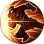
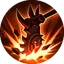
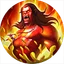

[Тир-лист](https://boostmlbb.ru/heroes/)[Предметы](https://boostmlbb.ru/items/)[Новости и гайды](https://boostmlbb.ru/news/)

# Бальмонд

C

БоецЛиния опытаЛес

Победы

45,1%

Выбор

0,3%

Баны

0,1%

[Обзор](https://boostmlbb.ru/#overview)[Сборка](https://boostmlbb.ru/#build)[Как играть](https://boostmlbb.ru/#howto)[Навыки](https://boostmlbb.ru/#skills)[Контрпики](https://boostmlbb.ru/#draft)[История](https://boostmlbb.ru/#lore)

## Обзор

### Характеристики

-   Живучесть**80**
-   Атака**30**
-   Эффекты**20**
-   Сложность**20**

-   Урон
-   Регенерация

### Победы по рангам, 30 дней

1.  **47,2%**Эпик
2.  **47,5%**Легенда
3.  **47,4%**Мифик
4.  **46,0%**Честь
5.  **45,0%**Слава

Пунктир: 50% побед

### Другие бойцы этой линии

[Фрейя](https://boostmlbb.ru/heroes/freya.html)[Аулус](https://boostmlbb.ru/heroes/aulus.html)[Пакито](https://boostmlbb.ru/heroes/paquito.html)[Сан](https://boostmlbb.ru/heroes/sun.html)[Лукас](https://boostmlbb.ru/heroes/lukas.html)[Су Ё](https://boostmlbb.ru/heroes/suyou.html)[Чичи](https://boostmlbb.ru/heroes/cici.html)[Сора](https://boostmlbb.ru/heroes/sora.html)

### Места в рейтингах

-   [Лучшие лесники MLBB**34 из 37**](https://boostmlbb.ru/heroes/best-jungle.html)
-   [Лучшие бойцы MLBB**42 из 44**](https://boostmlbb.ru/heroes/best-fighter.html)

## Сборка

Сборка 1Сборка 2Сборка 3

Победы

53,3%

Выбор

2,6%

#### Основные предметы

-   [

    

    Проклятый шлем

    ](https://boostmlbb.ru/items/cursed-helmet.html)
-   [

    

    Топор войны

    ](https://boostmlbb.ru/items/war-axe.html)
-   [

    

    Крылья королевы

    ](https://boostmlbb.ru/items/queens-wings.html)

#### Заклинание

Месть

#### Эмблема и таланты

Эмблема танка

-   

    Живучесть

-   

    Кровавое пиршество

-   

    Убийственный пир

Победы

52,1%

Выбор

1,8%

#### Основные предметы

-   [

    

    Проклятый шлем

    ](https://boostmlbb.ru/items/cursed-helmet.html)
-   [

    

    Топор войны

    ](https://boostmlbb.ru/items/war-axe.html)
-   [

    

    Крылья королевы

    ](https://boostmlbb.ru/items/queens-wings.html)

#### Заклинание

Вспышка

#### Эмблема и таланты

Эмблема танка

-   

    Живучесть

-   

    Кровавое пиршество

-   

    Убийственный пир

Победы

53,2%

Выбор

1,1%

#### Основные предметы

-   [

    

    Проклятый шлем

    ](https://boostmlbb.ru/items/cursed-helmet.html)
-   [

    

    Наплечник наказания

    ](https://boostmlbb.ru/items/chastise-pauldron.html)
-   [

    

    Оракул

    ](https://boostmlbb.ru/items/oracle.html)

#### Заклинание

Вспышка

#### Эмблема и таланты

Эмблема танка

-   

    Живучесть

-   

    Опытный охотник

-   

    Ударная волна

## Как играть за Бальмонда

### Комбо Бальмонда

#### В драке

1.  1
2.  2
3.  Ульт

Подойдите ловушкой для души, крутитесь ударом торнадо и добивайте ультом.

#### На линии

1.  1
2.  2
3.  Атака
4.  Ульт

Подойдите ловушкой для души, крутитесь ударом торнадо и добивайте ультом.

### Когда сильнее всего

Сильнее в долгой игре: после 20-й минуты выигрывает 48,2%. Не рискуйте в начале, фармите и ввязывайтесь в драки вместе с командой.

1.  **43,0**10–12
2.  **44,6**12–14
3.  **46,0**14–16
4.  **46,4**16–18
5.  **47,2**18–20
6.  **48,2**20+

Проценты побед по длине матча в минутах, все ранги. Пунктир: 50%

### Приоритет прокачки

1.  Смертельное противостояние
2.  Удар торнадо
3.  Ловушка для души

## Навыки

Пассивный**Кровожадность**1-й навык**Ловушка для души**2-й навык**Удар торнадо**Ультимейт**Смертельное противостояние**

Пассивный

### Кровожадность

Бальмонд восстанавливает 5% при убийстве миньона или монстра и 10% при убийстве героя или ассисте.

1-й навык

### Ловушка для души

Перезарядка **8 с**

Бальмонд совершает рывок в указанном направлении, нанося 150 (+60% общей физической атаки) единиц физического урона врагам на пути.

Он останавливается при попадании по вражескому герою, отбрасывая его и замедляя на 40% на 3 сек.

2-й навык

### Удар торнадо

Перезарядка **6 с**

Бальмонд получает 15% скорости передвижения и вращается с топором в течение 3 сек., нанося 30 (+1.3% Макс. ОЗ) (+25% общей физической атаки) единиц физического урона за попадание ближайшим врагам до 14 р.

Каждое попадание снижает цели на 5% (до 40%).

Ультимейт

### Смертельное противостояние

Перезарядка **34 с**

Бальмонд совершает сокрушительный удар в указанном направлении, нанося 150 (+70% общей физической атаки) (+30% от потерянных цели) в виде чистого урона. Этот навык можно прервать только подавлением.

Урон по целям, не являющимся героями, ограничен 1000 ед. чистого урона.

## Контрпики Бальмонда

### Кто контрит Бальмонда

[Сабер](https://boostmlbb.ru/heroes/saber.html)[Лукас](https://boostmlbb.ru/heroes/lukas.html)[Бартс](https://boostmlbb.ru/heroes/barats.html)[Чип](https://boostmlbb.ru/heroes/chip.html)[Мартис](https://boostmlbb.ru/heroes/martis.html)

### Кого контрит Бальмонд

[Ханаби](https://boostmlbb.ru/heroes/hanabi.html)[Ангела](https://boostmlbb.ru/heroes/angela.html)[Валир](https://boostmlbb.ru/heroes/valir.html)[Су Ё](https://boostmlbb.ru/heroes/suyou.html)[Клауд](https://boostmlbb.ru/heroes/claude.html)[Чичи](https://boostmlbb.ru/heroes/cici.html)[Чан'Э](https://boostmlbb.ru/heroes/change.html)[Кэрри](https://boostmlbb.ru/heroes/karrie.html)[Ханзо](https://boostmlbb.ru/heroes/hanzo.html)

## История

> Наступит день, когда орки сбросят оковы.

[Читать полную историю ↗](https://kazukiofficial.com/stories/balmond)Kazuki Official, английский [Характеристики на сайте игры ↗](https://www.mobilelegends.com/hero/detail?heroid=2)

**Поднимем ранг на герое «Бальмонд»**Цена считается в калькуляторе

[Рассчитать цену](https://boostmlbb.ru/order.html?type=hero)

## Частые вопросы

Кто контрит Бальмонда в MLBB?

За последние 30 дней Бальмонда чаще всего обыгрывают Сабер, Лукас, Бартс, Чип и Мартис.

Как играть за Бальмонда?

В первую очередь качайте «Удар торнадо», ульт берите, как только доступен. Сильнее в долгой игре: после 20-й минуты выигрывает 48,2%. Не рискуйте в начале, фармите и ввязывайтесь в драки вместе с командой. Комбо для драки: Подойдите ловушкой для души, крутитесь ударом торнадо и добивайте ультом.

Какой процент побед у Бальмонда сейчас?

45,10% в Мифической славе за последние 7 дней и 46,62% на всех рангах за 30 дней, данные на 25 ноября 2026 года.

Какая роль и линия у Бальмонда?

Боец, играет на линии опыта или в лесу.

Стоит ли брать Бальмонда в текущей мете?

Тир C, 124-е место из 133 героев и 42-е среди бойцов. Тир учитывает, как часто героя берут и банят и как он выигрывает в Мифической славе за 7 дней: бан в 0,1% матчей, 45,1% побед. В профессиональных матчах за месяц героя драфтуют в 0,3% катков.

Какая сборка на Бальмонда лучшая?

Самая популярная сборка в рейтинге: ключевые предметы «Проклятый шлем», «Топор войны» и «Крылья королевы», эмблема танка с талантами «Живучесть», «Кровавое пиршество» и «Убийственный пир» и заклинание «Месть». С ней выигрывают 53,32% матчей.
