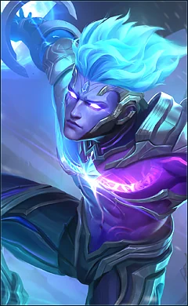

[Тир-лист](https://boostmlbb.ru/heroes/)[Новости и гайды](https://boostmlbb.ru/news/)

# Бартс

A

ТанкБоецЛиния опыта

Победы

51,6%

Выбор

0,8%

Баны

3,2%

[Обзор](https://boostmlbb.ru/#overview)[Сборка](https://boostmlbb.ru/#build)[Навыки](https://boostmlbb.ru/#skills)[Контрпики](https://boostmlbb.ru/#draft)[История](https://boostmlbb.ru/#lore)

## Обзор

### Характеристики

-   Живучесть**100**
-   Атака**30**
-   Эффекты**90**
-   Сложность**40**

-   Урон
-   Массовый контроль

### Победы по рангам, 30 дней

1.  **50,7%**Эпик
2.  **51,4%**Легенда
3.  **52,1%**Мифик
4.  **51,8%**Честь
5.  **51,6%**Слава

Пунктир: 50% побед

### Другие танки этой линии

[Маша](https://boostmlbb.ru/heroes/masha.html)[Алиса](https://boostmlbb.ru/heroes/alice.html)[Эсмеральда](https://boostmlbb.ru/heroes/esmeralda.html)[Глу](https://boostmlbb.ru/heroes/gloo.html)[Уранус](https://boostmlbb.ru/heroes/uranus.html)[Хильда](https://boostmlbb.ru/heroes/hilda.html)[Гатоткача](https://boostmlbb.ru/heroes/gatotkaca.html)[Эдит](https://boostmlbb.ru/heroes/edith.html)

### Места в рейтингах

-   [Лучшие бойцы MLBB**7 из 44**](https://boostmlbb.ru/heroes/best-fighter.html)
-   [Лучшие танки MLBB**8 из 25**](https://boostmlbb.ru/heroes/best-tank.html)

## Сборка

Сборка 1Сборка 2Сборка 3

Победы

59,5%

Выбор

5,8%

#### Основные предметы

-   

    Топор войны

-   

    Крылья королевы

-   

    Кираса грубой силы

#### Заклинание

Вспышка

#### Эмблема и таланты

Эмблема бойца

-   

    Трепет

-   

    Кровавое пиршество

-   

    Ударная волна

Победы

61,1%

Выбор

4,1%

#### Основные предметы

-   

    Топор войны

-   

    Кираса грубой силы

-   

    Крылья королевы

#### Заклинание

Вспышка

#### Эмблема и таланты

Обычная эмблема

-   

    Трепет

-   

    Кровавое пиршество

-   

    Отвага

Победы

55,5%

Выбор

2,3%

#### Основные предметы

-   

    Топор войны

-   

    Крылья королевы

-   

    Кираса грубой силы

#### Заклинание

Вспышка

#### Эмблема и таланты

Эмблема танка

-   

    Живучесть

-   

    Опытный охотник

-   

    Отвага

## Навыки

Прокачка**Приветствие Детоны**_›_**Командная работа**_›_**Ракетный "эксперт"**

Пассивный**Здоровяк**1-й навык**Командная работа**2-й навык**Ракетный "эксперт"**Ультимейт**Приветствие Детоны**

Пассивный

### Здоровяк

Детона получает заряд "Здоровяка" на 12 сек. каждый раз, когда он или Бартс наносят урон врагу своими навыками (до 10 зарядов). Каждый заряд "Здоровяка" увеличивает размер Детоны и дает 4 - 10 (зависит от уровня "Приветствия Детоны"). При максимальных зарядах Детона получает 20% дополнительной устойчивости, а его базовые атаки заменяются на "Топот", который наносит (+140% общей физической атаки) (+3.5% Макс. ОЗ) единиц физического урона врагам в круговой области, замедляет их на 40% на 0.2 сек. и обновляет длительность "Здоровяка" с каждым попаданием.

1-й навык

### Командная работа

Перезарядка **7 Mana Cost: 25 с**

Детона выплевывает масло в указанном направлении, нанося 60 (+7% Макс. ОЗ) единиц физического урона врагам в веерообразной области. Затем Бартс поджигает масло петардой, нанося 120 (+180% общей физической атаки) единиц физического урона врагам в области (только 50% урона монстрам).

Область действия "Командной работы" увеличивается с количеством зарядов "Здоровяка".

2-й навык

### Ракетный "эксперт"

Перезарядка **11 Mana Cost: 70 с**

Бартс запускает две ракеты в указанном направлении, нанося 100 (+75% общей физической атаки) единиц физического урона и замедляя врагов на 40% на 1 сек. После приземления из ракет вырывается пламя, нанося 100 (+75% общей физической атаки) единиц физического урона врагам в прямоугольной области и притягивая их к Бартсу.

Ультимейт

### Приветствие Детоны

Перезарядка **50 Mana Cost: 100 с**

После небольшой задержки Детона делает рывок в указанном направлении и наносит 120 (+70% общей физической атаки) (+1.2% Макс. ОЗ) единиц физического урона первому пораженному врагу, поглощая и подавляя его на 1.2 сек., затем выплевывая. Если тот ударяется о вражеского героя или стену, произойдет взрыв. Цель и ближайшие враги получат дополнительно 180 (+105% общей физической атаки) (+5% Макс. ОЗ) единиц физического урона и будут оглушены на 1 сек.

Во время навыка Бартс получает иммунитет к эффектам контроля. Если применение прервано или навык не попадает, восполнится 50% перезарядки навыка.

Если Детона успешно поглотит врага, он сразу получит максимальное количество зарядов "Здоровяка".

## Контрпики

### Контрпики

Побеждают этого героя

[Сильвана](https://boostmlbb.ru/heroes/silvanna.html)[Фовиус](https://boostmlbb.ru/heroes/phoveus.html)[Аргус](https://boostmlbb.ru/heroes/argus.html)[Алукард](https://boostmlbb.ru/heroes/alucard.html)[Эйдора](https://boostmlbb.ru/heroes/eudora.html)

### Слабые цели

Этот герой побеждает их

[Альфа](https://boostmlbb.ru/heroes/alpha.html)[Алиса](https://boostmlbb.ru/heroes/alice.html)[Сесилион](https://boostmlbb.ru/heroes/cecilion.html)[Бальмонд](https://boostmlbb.ru/heroes/balmond.html)[Икс.Борг](https://boostmlbb.ru/heroes/x-borg.html)[Горд](https://boostmlbb.ru/heroes/gord.html)[Лилия](https://boostmlbb.ru/heroes/lylia.html)[Ив](https://boostmlbb.ru/heroes/yve.html)

## История

> Искатель приключений верхом на ящере-драконе.

[Читать полную историю ↗](https://play.mobilelegends.com/lore/hero/Barats)Официальный сайт Mobile Legends [Характеристики на сайте игры ↗](https://www.mobilelegends.com/hero/detail?heroid=99)

**Поднимем ранг на герое «Бартс»**Цена считается в калькуляторе

[Рассчитать цену](https://boostmlbb.ru/order.html?type=hero)

## Частые вопросы

Кто контрпик для героя «Бартс» в MLBB?

За последние 30 дней чаще всего героя обыгрывают Сильвана, Фовиус, Аргус, Алукард и Эйдора.

Какой процент побед у героя «Бартс» сейчас?

51,59% в Мифической славе за последние 7 дней и 51,66% на всех рангах за 30 дней, данные на 24 ноября 2026 года.

Какая роль и линия у героя «Бартс»?

Танк и боец, играет на линии опыта.

Силён ли герой «Бартс» в текущей мете?

Тир A, 24-е место из 133 героев и 8-е среди танков. Тир учитывает, как часто героя берут и банят и как он выигрывает в Мифической славе за 7 дней: бан в 3,2% матчей, 51,6% побед. В профессиональных матчах за месяц героя драфтуют в 42,2% катков.

Какая сборка на героя «Бартс» лучшая?

Самая популярная сборка в рейтинге: ключевые предметы «Топор войны», «Крылья королевы» и «Кираса грубой силы», эмблема бойца с талантами «Трепет», «Кровавое пиршество» и «Ударная волна» и заклинание «Вспышка». С ней выигрывают 59,47% матчей.
