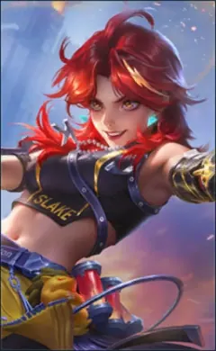

[Тир-лист](https://boostmlbb.ru/heroes/)

# Беатрис

C

СтрелокЛиния золота

Победы

50,5%

Выбор

0,8%

Баны

0,4%

[Обзор](https://boostmlbb.ru/#overview)[Сборка](https://boostmlbb.ru/#build)[Как играть](https://boostmlbb.ru/#howto)[Навыки](https://boostmlbb.ru/#skills)[Контрпики](https://boostmlbb.ru/#draft)[Скины](https://boostmlbb.ru/#skins)[История](https://boostmlbb.ru/#lore)

## Обзор

### Характеристики

-   Живучесть**30**
-   Атака**80**
-   Эффекты**10**
-   Сложность**70**

-   Добивание
-   Урон

### Другие стрелки этой линии

[Обсидия](https://boostmlbb.ru/heroes/obsidia.html)[Бруно](https://boostmlbb.ru/heroes/bruno.html)[Клинт](https://boostmlbb.ru/heroes/clint.html)[Броуди](https://boostmlbb.ru/heroes/brody.html)[Ханаби](https://boostmlbb.ru/heroes/hanabi.html)[Москов](https://boostmlbb.ru/heroes/moskov.html)[Клауд](https://boostmlbb.ru/heroes/claude.html)[Мия](https://boostmlbb.ru/heroes/miya.html)

### Места в рейтингах

-   [Лучшие стрелки MLBB**13 из 23**](https://boostmlbb.ru/heroes/best-marksman.html)

## Сборка

Сборка 1Сборка 2Сборка 3

Победы

51,5%

Выбор

6,5%

#### Основные предметы

-   [

    

    Клинок отчаяния

    ](https://boostmlbb.ru/items/blade-of-despair.html)
-   [

    

    Губительный пулемет

    ](https://boostmlbb.ru/items/malefic-gun.html)
-   [

    

    Трезубец

    ](https://boostmlbb.ru/items/sea-halberd.html)

#### Заклинание

Вспышка

#### Эмблема и таланты

Эмблема стрелка

-   

    Разрыв

-   

    Мастер оружий

-   

    Смертельное воспламенение

Победы

55,7%

Выбор

4,8%

#### Основные предметы

-   [

    

    Клинок отчаяния

    ](https://boostmlbb.ru/items/blade-of-despair.html)
-   [

    

    Губительный пулемет

    ](https://boostmlbb.ru/items/malefic-gun.html)
-   [

    

    Трезубец

    ](https://boostmlbb.ru/items/sea-halberd.html)

#### Заклинание

Вспышка

#### Эмблема и таланты

Эмблема стрелка

-   

    Проворность

-   

    Мастер оружий

-   

    Квантовый заряд

Победы

54,4%

Выбор

3,9%

#### Основные предметы

-   [

    

    Клинок отчаяния

    ](https://boostmlbb.ru/items/blade-of-despair.html)
-   [

    

    Губительный пулемет

    ](https://boostmlbb.ru/items/malefic-gun.html)
-   [

    

    Трезубец

    ](https://boostmlbb.ru/items/sea-halberd.html)

#### Заклинание

Вспышка

#### Эмблема и таланты

Эмблема стрелка

-   

    Проворность

-   

    Мастер оружий

-   

    Точно в цель

## Как играть за Беатрис

### Комбо Беатрис

#### В драке

1.  3
2.  1
3.  3
4.  Атака
5.  2
6.  Атака

Для драк берите «Беннета» основным оружием, а «Нибиру» запасным. Сначала ульт «Беннета» по команде врага, затем первым навыком смените оружие на «Нибиру» и ударьте его ультом. Добивайте атаками и вторым навыком.

#### На линии

1.  Атака
2.  2
3.  Атака
4.  1
5.  Атака

Для линии берите «Реннера» основным, «Вескера» запасным. Дальними атаками «Реннера» тревожьте врага, вторым перезаряжайтесь и стреляйте снова, а для добивания переключитесь на «Вескера».

### Когда сильнее всего

Сила ровная всю игру, от 49,3% до 52,7%. Выбирайте драки по готовым предметам, а не по минутам.

1.  **52,7**10–12
2.  **50,1**12–14
3.  **49,3**14–16
4.  **49,7**16–18
5.  **50,3**18–20
6.  **50,6**20+

Проценты побед по длине матча в минутах, все ранги. Пунктир: 50%

### Приоритет прокачки

1.  Равнодушие Реннера
2.  Мастерский стрелок
3.  Тактическая смена позиции

## Навыки

Пассивный**Гений механики**1-й навык**Мастерский стрелок**2-й навык**Тактическая смена позиции**3-й навык**Равнодушие Реннера**Ультимейт**Нужна помощь**

Пассивный

### Гений механики

Необыкновенный талант в области механики позволил Беатрис создать 4 оружия с поистине впечатляющей огневой мощью.

**Базовая атака Реннера — Дальнобой:** запускает мощный выстрел в указанном направлении, нанося (+365% общей физической атаки) - (+400% общей физической атаки) единиц физического урона первой пораженной цели (75% урона монстрам). От этого выстрела можно уклониться или его может заблокировать другая цель.

Беатрис не может наносить критический урон. Она превращает кажд. 1% шанса крита в 2 .

Она получает вампиризм от навыков, равный 100% от ее вампиризма.

1-й навык

### Мастерский стрелок

Перезарядка **12 с**

**Пассивный:** Беатрис может носить сразу 2 оружия, увеличивая свою на 5.

**Активный:** Беатрис нужно 0.5 сек. на смену основного оружия на дополнительное, после чего она получит новую базовую атаку и ультимейт.

2-й навык

### Тактическая смена позиции

Беатрис совершает кувырок вперед и полностью перезаряжает текущее оружие.

3-й навык

### Равнодушие Реннера

Беатрис без труда орудует Реннером на поле боя, целясь во врагов. Выпуская навык, она наносит 700 (+280% общей физической атаки) единиц физического урона первому пораженному врагу.

Беатрис может целиться до 8 сек. и может отменить прицеливание досрочно, чтобы сократить перезарядку на 50%.

Этот выстрел может пробивать миньонов и наносит только 75% урона юнитам не-героям.

Ультимейт

### Нужна помощь

Покинув поле боя на 3 сек., Беатрис может позвать своего дворецкого Моргана, чтобы он дал ей ящик с оружием.

Затем Беатрис должна выбрать из ящика основное и дополнительное оружие.

Выбор прерывается, если в течение этого периода она совершает какое-либо действие или попадает под контроль.

## Контрпики Беатрис

### Кто контрит Беатрис

[Эстес](https://boostmlbb.ru/heroes/estes.html)[Ханаби](https://boostmlbb.ru/heroes/hanabi.html)[Белерик](https://boostmlbb.ru/heroes/belerick.html)[Эдит](https://boostmlbb.ru/heroes/edith.html)[Минотавр](https://boostmlbb.ru/heroes/minotaur.html)

### Кого контрит Беатрис

[Селена](https://boostmlbb.ru/heroes/selena.html)[Грейнджер](https://boostmlbb.ru/heroes/granger.html)[Чу](https://boostmlbb.ru/heroes/chou.html)[Москов](https://boostmlbb.ru/heroes/moskov.html)[Иритель](https://boostmlbb.ru/heroes/irithel.html)

## Скины Беатрис

[Небесный асДелюкс · 2025](https://boostmlbb.ru/skins/beatrix/sky-force-maverick.html)[Яркая фиестаИсключительный · 2023](https://boostmlbb.ru/skins/beatrix/vibrant-fiesta.html)[Звёздный блескГрандиозный · 2022](https://boostmlbb.ru/skins/beatrix/stellar-briliance.html)[Охотница за светомДелюкс · 2022](https://boostmlbb.ru/skins/beatrix/light-chaser.html)[Косми­ческий агентИсключительный · 2022](https://boostmlbb.ru/skins/beatrix/space-agent.html)[Блиц-атакаОбычный · 2021](https://boostmlbb.ru/skins/beatrix/blitz-attack.html)[Фактор XОбычный · 2021](https://boostmlbb.ru/skins/beatrix/x-factor.html)

[Все 7 скинов Беатрис: цены и как получить](https://boostmlbb.ru/skins/beatrix.html)

## История

> Уверенная в себе изобретательница.

[Читать полную историю ↗](https://play.mobilelegends.com/lore/hero/Beatrix)Официальный сайт Mobile Legends [Характеристики на сайте игры ↗](https://www.mobilelegends.com/hero/detail?heroid=105)

**Поднимем ранг на герое «Беатрис»**Цена считается в калькуляторе

[Рассчитать цену](https://boostmlbb.ru/order.html?type=hero)

## Частые вопросы

Кто контрит Беатрис в MLBB?

За последние 30 дней Беатрис чаще всего обыгрывают Эстес, Ханаби, Белерик, Эдит и Минотавр.

Как играть за Беатрис?

В первую очередь качайте «Равнодушие Реннера», ульт берите, как только доступен. Сила ровная всю игру, от 49,3% до 52,7%. Выбирайте драки по готовым предметам, а не по минутам. Комбо для драки: Для драк берите «Беннета» основным оружием, а «Нибиру» запасным. Сначала ульт «Беннета» по команде врага, затем первым навыком смените оружие на «Нибиру» и ударьте его ультом. Добивайте атаками и вторым навыком.

Какой процент побед у Беатрис сейчас?

50,49% в Мифической славе за последние 7 дней и 50,30% на всех рангах за 30 дней, данные на 27 ноября 2026 года.

Какая роль и линия у Беатрис?

Стрелок, играет на линии золота.

Стоит ли брать Беатрис в текущей мете?

Тир C, 70-е место из 133 героев и 13-е среди стрелков. Тир учитывает, как часто героя берут и банят и как он выигрывает в Мифической славе за 7 дней: бан в 0,4% матчей, 50,5% побед. В профессиональных матчах за месяц героя драфтуют в 2,1% катков.

Какая сборка на Беатрис лучшая?

Самая популярная сборка в рейтинге: ключевые предметы «Клинок отчаяния», «Губительный пулемет» и «Трезубец», эмблема стрелка с талантами «Разрыв», «Мастер оружий» и «Смертельное воспламенение» и заклинание «Вспышка». С ней выигрывают 51,55% матчей.
