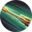

[Тир-лист](https://boostmlbb.ru/heroes/)[Новости и гайды](https://boostmlbb.ru/news/)

# Беатрис

B

СтрелокЛиния золота

Уверенная в себе изобретательница.

Победы

50,6%

все ранги 50,4%

Выбор

0,8%

все ранги 0,7%

Баны

0,4%

все ранги 0,4%

№55 в тир-листе · №10 среди стрелков · Мифическая слава, 7 дней, по 23 ноября

[Обзор](https://boostmlbb.ru/#overview)[Сборка](https://boostmlbb.ru/#build)[Навыки](https://boostmlbb.ru/#skills)[Контрпики](https://boostmlbb.ru/#draft)[История](https://boostmlbb.ru/#lore)

## Обзор

### Характеристики

-   Живучесть**30**
-   Атака**80**
-   Эффекты**10**
-   Сложность**70**

-   Добивание
-   Урон

### Победы по рангам, 30 дней

1.  **51,0%**Эпик
2.  **49,9%**Легенда
3.  **49,4%**Мифик
4.  **50,1%**Честь
5.  **50,7%**Слава

Пунктир: 50% побед

### Другие стрелки этой линии

[Обсидия](https://boostmlbb.ru/heroes/obsidia.html)[Бруно](https://boostmlbb.ru/heroes/bruno.html)[Ханаби](https://boostmlbb.ru/heroes/hanabi.html)[Москов](https://boostmlbb.ru/heroes/moskov.html)[Мия](https://boostmlbb.ru/heroes/miya.html)[Иритель](https://boostmlbb.ru/heroes/irithel.html)[Броуди](https://boostmlbb.ru/heroes/brody.html)[Клинт](https://boostmlbb.ru/heroes/clint.html)

## Сборка

Линия золота · по данным рейтинговых матчей

Сборка 151,7%Сборка 256,0%Сборка 354,5%

### Предметы

Клинок отчаяния

Губительный пулемет

Трезубец

### Эмблема

Эмблема стрелка

Разрыв

Мастер оружий

Смертельное воспламенение

### Заклинание

Вспышка

Победы

51,7%

Выбор

5,9%

### Предметы

Клинок отчаяния

Губительный пулемет

Трезубец

### Эмблема

Эмблема стрелка

Проворность

Мастер оружий

Квантовый заряд

### Заклинание

Вспышка

Победы

56,0%

Выбор

5,1%

### Предметы

Клинок отчаяния

Губительный пулемет

Трезубец

### Эмблема

Эмблема стрелка

Проворность

Мастер оружий

Точно в цель

### Заклинание

Вспышка

Победы

54,5%

Выбор

3,3%

## Навыки

Прокачка**Равнодушие Реннера**_›_**Мастерский стрелок**_›_**Тактическая смена позиции**

Пассивный1-й навык2-й навык3-й навыкУльтимейт

Пассивный

### Гений механики

Необыкновенный талант в области механики позволил Беатрис создать 4 оружия с поистине впечатляющей огневой мощью.

**Базовая атака Реннера — Дальнобой:** запускает мощный выстрел в указанном направлении, нанося (+365% общей физической атаки) - (+400% общей физической атаки) единиц физического урона первой пораженной цели (75% урона монстрам). От этого выстрела можно уклониться или его может заблокировать другая цель.

Беатрис не может наносить критический урон. Она превращает кажд. 1% шанса крита в 2 .

Она получает вампиризм от навыков, равный 100% от ее вампиризма.

1-й навык

### Мастерский стрелок

Перезарядка **12 с**

**Пассивный:** Беатрис может носить сразу 2 оружия, увеличивая свою на 5.

**Активный:** Беатрис нужно 0.5 сек. на смену основного оружия на дополнительное, после чего она получит новую базовую атаку и ультимейт.

2-й навык

### Тактическая смена позиции

Беатрис совершает кувырок вперед и полностью перезаряжает текущее оружие.

3-й навык

### Равнодушие Реннера

Беатрис без труда орудует Реннером на поле боя, целясь во врагов. Выпуская навык, она наносит 700 (+280% общей физической атаки) единиц физического урона первому пораженному врагу.

Беатрис может целиться до 8 сек. и может отменить прицеливание досрочно, чтобы сократить перезарядку на 50%.

Этот выстрел может пробивать миньонов и наносит только 75% урона юнитам не-героям.

Ультимейт

### Нужна помощь

Покинув поле боя на 3 сек., Беатрис может позвать своего дворецкого Моргана, чтобы он дал ей ящик с оружием.

Затем Беатрис должна выбрать из ящика основное и дополнительное оружие.

Выбор прерывается, если в течение этого периода она совершает какое-либо действие или попадает под контроль.

## Контрпики и союзники

### Контрпики

Побеждают этого героя

[Эстес](https://boostmlbb.ru/heroes/estes.html)[Ханаби](https://boostmlbb.ru/heroes/hanabi.html)[Белерик](https://boostmlbb.ru/heroes/belerick.html)[Эдит](https://boostmlbb.ru/heroes/edith.html)[Минотавр](https://boostmlbb.ru/heroes/minotaur.html)

### Слабые цели

Этот герой побеждает их

[Селена](https://boostmlbb.ru/heroes/selena.html)[Грейнджер](https://boostmlbb.ru/heroes/granger.html)[Чу](https://boostmlbb.ru/heroes/chou.html)[Москов](https://boostmlbb.ru/heroes/moskov.html)[Кайя](https://boostmlbb.ru/heroes/kaja.html)[Иритель](https://boostmlbb.ru/heroes/irithel.html)

### Союзники

Рост побед в паре, п. п.

[Харит**+5,6**](https://boostmlbb.ru/heroes/harith.html)[Дигги**+4,6**](https://boostmlbb.ru/heroes/diggie.html)[Баксий**+2,4**](https://boostmlbb.ru/heroes/baxia.html)[Фредрин**+2,2**](https://boostmlbb.ru/heroes/fredrinn.html)

## История

> Уверенная в себе изобретательница.

[Читать полную историю ↗](https://play.mobilelegends.com/lore/hero/Beatrix)Официальный сайт Mobile Legends

[Характеристики на сайте игры ↗](https://www.mobilelegends.com/hero/detail?heroid=105)

**Поднимем ранг на герое «Беатрис»**Цена считается в калькуляторе

[Рассчитать цену](https://boostmlbb.ru/order.html?type=hero)

## Частые вопросы

Кто контрпик для героя «Беатрис» в MLBB?

За последние 30 дней чаще всего героя обыгрывают Эстес, Ханаби, Белерик, Эдит и Минотавр.

Какой процент побед у героя «Беатрис» сейчас?

50,56% в Мифической славе за последние 7 дней и 50,35% на всех рангах за 30 дней, данные на 23 ноября 2026 года.

Какая роль и линия у героя «Беатрис»?

Стрелок, играет на линии золота.

Силён ли герой «Беатрис» в текущей мете?

Тир B, 55-е место из 133 героев и 10-е среди стрелков. Тир учитывает, как часто героя берут и банят и как он выигрывает в Мифической славе за 7 дней: бан в 0,4% матчей, 50,6% побед.

Какая сборка на героя «Беатрис» лучшая?

Самая популярная сборка в рейтинге: ключевые предметы «Клинок отчаяния», «Губительный пулемет» и «Трезубец», эмблема стрелка с талантами «Разрыв», «Мастер оружий» и «Смертельное воспламенение» и заклинание «Вспышка». С ней выигрывают 51,69% матчей.
