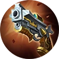
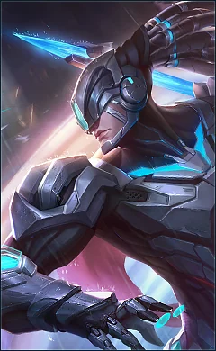

[Тир-лист](https://boostmlbb.ru/heroes/)[Новости и гайды](https://boostmlbb.ru/news/)

# Бенедетта

C

БоецУбийцаЛиния опыта

Победы

51,6%

Выбор

0,5%

Баны

0,3%

[Обзор](https://boostmlbb.ru/#overview)[Сборка](https://boostmlbb.ru/#build)[Навыки](https://boostmlbb.ru/#skills)[Контрпики](https://boostmlbb.ru/#draft)[История](https://boostmlbb.ru/#lore)

## Обзор

### Характеристики

-   Живучесть**60**
-   Атака**50**
-   Эффекты**20**
-   Сложность**80**

-   Преследование
-   Разрушительный урон

### Победы по рангам, 30 дней

1.  **54,4%**Эпик
2.  **53,2%**Легенда
3.  **52,2%**Мифик
4.  **52,3%**Честь
5.  **51,5%**Слава

Пунктир: 50% побед

### Другие бойцы этой линии

[Фрейя](https://boostmlbb.ru/heroes/freya.html)[Аулус](https://boostmlbb.ru/heroes/aulus.html)[Пакито](https://boostmlbb.ru/heroes/paquito.html)[Сан](https://boostmlbb.ru/heroes/sun.html)[Лукас](https://boostmlbb.ru/heroes/lukas.html)[Чичи](https://boostmlbb.ru/heroes/cici.html)[Сора](https://boostmlbb.ru/heroes/sora.html)[Чонг](https://boostmlbb.ru/heroes/yu-zhong.html)

## Сборка

Сборка 1Сборка 2Сборка 3

Победы

54,6%

Выбор

5,0%

#### Основные предметы

-   

    Клинок семи морей

-   

    Злобный рык

-   

    Удар охотника

#### Заклинание

Окаменение

#### Эмблема и таланты

Эмблема бойца

-   

    Разрыв

-   

    Мастер оружий

-   

    Смертельное воспламенение

Победы

57,4%

Выбор

4,2%

#### Основные предметы

-   

    Клинок семи морей

-   

    Удар охотника

-   

    Злобный рык

-   

    Клинок отчаяния

#### Заклинание

Окаменение

#### Эмблема и таланты

Эмблема бойца

-   

    Разрыв

-   

    Мастер оружий

-   

    Смертельное воспламенение

Победы

53,0%

Выбор

2,5%

#### Основные предметы

-   

    Клинок семи морей

-   

    Удар охотника

-   

    Злобный рык

#### Заклинание

Окаменение

#### Эмблема и таланты

Эмблема бойца

-   

    Разрыв

-   

    Мастер оружий

-   

    Смертельное воспламенение

## Навыки

Прокачка**Алекто: финальный удар**_›_**Призрачный удар**_›_**Око за око**

Пассивный**Уходящий день**1-й навык**Призрачный удар**2-й навык**Око за око**Ультимейт**Алекто: финальный удар**

Пассивный

### Уходящий день

Удерживайте кнопку базовой атаки, чтобы войти в состояние фехтования и накопить "Путь меча". При полном заряде отпустите кнопку, чтобы применить "Удар фехтовальщика" в направлении своего взгляда и совершить рывок вперед, нанося (+215% общей физической атаки) единиц физического урона врагам на пути (считается уроном от базовой атаки и снижается до 50% по миньонам и монстрам).

Бенедетта может использовать "Удар фехтовальщика" только тогда, когда "Путь меча" полностью заряжен и она находится в состоянии фехтования.

Бенедетта также получает "Путь меча", нанося урон базовыми атаками и навыками.

1-й навык

### Призрачный удар

Перезарядка **10 Mana Cost: 55 с**

Бенедетта оставляет тень и делает шаг назад. После небольшой задержки ее тень атакует врагов в веерообразной области, нанося 200 (+75% общей физической атаки) единиц физического урона и замедляя их на 60% на 0.5 сек.

Тем временем Бенедетта устремляется вперед, нанося 75 (+100% общей физической атаки) единиц физического урона. (Если ее тень попала по цели, урон, наносимый Бенедеттой, будет увеличен до 200%.)

2-й навык

### Око за око

Перезарядка **15 Mana Cost: 100 с**

Бенедетта защищается своим оружием, получает иммунитет к контролю и блокирует любой урон в течение 0.8 сек. После защиты она совершает удар в определенном направлении, нанося 300 (+80% общей физической атаки) единиц физического урона.

Если Бенедетта успешно отразит любой урон во время защиты, то получит полный заряд "Пути меча". Если она отразит любой эффект контроля, то последующим ударом оглушит цель на 1.5 сек.

Ультимейт

### Алекто: финальный удар

Перезарядка **45 Mana Cost: 110 с**

Бенедетта сжимает Алекто, бросается вперед (неуловима для прицела во время рывка) и после небольшой задержки совершает удар, взрывая "Путь меча" на своем пути. В течение 2.5 сек. "Путь меча" наносит до 1560 (+1105% дополнительной физической атаки) единиц физического урона врагам внутри и замедляет их на 50%.

## Контрпики

### Контрпики

Побеждают этого героя

[Икс.Борг](https://boostmlbb.ru/heroes/x-borg.html)[Альфа](https://boostmlbb.ru/heroes/alpha.html)[Сильвана](https://boostmlbb.ru/heroes/silvanna.html)[Иксия](https://boostmlbb.ru/heroes/ixia.html)[Атлас](https://boostmlbb.ru/heroes/atlas.html)

### Слабые цели

Этот герой побеждает их

[Обсидия](https://boostmlbb.ru/heroes/obsidia.html)[Селена](https://boostmlbb.ru/heroes/selena.html)[Ли Сун-Син](https://boostmlbb.ru/heroes/yi-sun-shin.html)[Иритель](https://boostmlbb.ru/heroes/irithel.html)[Фовиус](https://boostmlbb.ru/heroes/phoveus.html)[Матильда](https://boostmlbb.ru/heroes/mathilda.html)

## История

> Женщина-воин, защищающая Бесплодные земли от вторжения демонов.

[Читать полную историю ↗](https://play.mobilelegends.com/lore/hero/Benedetta)Официальный сайт Mobile Legends [Характеристики на сайте игры ↗](https://www.mobilelegends.com/hero/detail?heroid=97)

**Поднимем ранг на герое «Бенедетта»**Цена считается в калькуляторе

[Рассчитать цену](https://boostmlbb.ru/order.html?type=hero)

## Частые вопросы

Кто контрпик для героя «Бенедетта» в MLBB?

За последние 30 дней чаще всего героя обыгрывают Икс.Борг, Альфа, Сильвана, Иксия и Атлас.

Какой процент побед у героя «Бенедетта» сейчас?

51,58% в Мифической славе за последние 7 дней и 52,10% на всех рангах за 30 дней, данные на 23 ноября 2026 года.

Какая роль и линия у героя «Бенедетта»?

Боец и убийца, играет на линии опыта.

Силён ли герой «Бенедетта» в текущей мете?

Тир C, 81-е место из 133 героев и 23-е среди бойцов. Тир учитывает, как часто героя берут и банят и как он выигрывает в Мифической славе за 7 дней: бан в 0,3% матчей, 51,6% побед. В профессиональных матчах за месяц героя драфтуют в 1,4% катков.

Какая сборка на героя «Бенедетта» лучшая?

Самая популярная сборка в рейтинге: ключевые предметы «Клинок семи морей», «Злобный рык» и «Удар охотника», эмблема бойца с талантами «Разрыв», «Мастер оружий» и «Смертельное воспламенение» и заклинание «Окаменение». С ней выигрывают 54,64% матчей.
