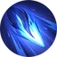

[Тир-лист](https://boostmlbb.ru/heroes/)[Новости и гайды](https://boostmlbb.ru/news/)

# Броуди

B

СтрелокЛиния золота

Победы

49,9%

Выбор

1,0%

Баны

0,9%

[Обзор](https://boostmlbb.ru/#overview)[Сборка](https://boostmlbb.ru/#build)[Навыки](https://boostmlbb.ru/#skills)[Контрпики](https://boostmlbb.ru/#draft)[История](https://boostmlbb.ru/#lore)

## Обзор

### Характеристики

-   Живучесть**40**
-   Атака**70**
-   Эффекты**50**
-   Сложность**50**

-   Разрушительный урон
-   Добивание

### Победы по рангам, 30 дней

1.  **49,8%**Эпик
2.  **49,9%**Легенда
3.  **49,8%**Мифик
4.  **50,2%**Честь
5.  **50,0%**Слава

Пунктир: 50% побед

### Другие стрелки этой линии

[Обсидия](https://boostmlbb.ru/heroes/obsidia.html)[Бруно](https://boostmlbb.ru/heroes/bruno.html)[Клинт](https://boostmlbb.ru/heroes/clint.html)[Ханаби](https://boostmlbb.ru/heroes/hanabi.html)[Москов](https://boostmlbb.ru/heroes/moskov.html)[Клауд](https://boostmlbb.ru/heroes/claude.html)[Мия](https://boostmlbb.ru/heroes/miya.html)[Мелисса](https://boostmlbb.ru/heroes/melissa.html)

## Сборка

Сборка 1Сборка 2Сборка 3

Победы

53,4%

Выбор

19,2%

#### Основные предметы

-   

    Клинок семи морей

-   

    Пронзающий небеса

-   

    Губительный пулемет

#### Заклинание

Вспышка

#### Эмблема и таланты

Эмблема убийцы

-   

    Разрыв

-   

    Стойкость

-   

    Квантовый заряд

Победы

57,3%

Выбор

7,8%

#### Основные предметы

-   

    Клинок семи морей

-   

    Пронзающий небеса

-   

    Губительный пулемет

#### Заклинание

Вспышка

#### Эмблема и таланты

Эмблема бойца

-   

    Разрыв

-   

    Стойкость

-   

    Квантовый заряд

Победы

56,3%

Выбор

2,5%

#### Основные предметы

-   

    Клинок семи морей

-   

    Пронзающий небеса

-   

    Губительный пулемет

#### Заклинание

Вспышка

#### Эмблема и таланты

Эмблема бойца

-   

    Разрыв

-   

    Мастер-убийца

-   

    Квантовый заряд

## Навыки

Прокачка**Разорванная память**_›_**Влияние Бездны**_›_**Губительный удар**

Пассивный**Разрушение Бездны**1-й навык**Влияние Бездны**2-й навык**Губительный удар**Ультимейт**Разорванная память**

Пассивный

### Разрушение Бездны

Благодаря резонансу базовых атак с силой Бездны в его теле, Броуди может двигаться, заряжая базовые атаки (которые будут прерываться при применении навыков), ценой более длительной анимации базовой атаки и меньшего бонуса к скорости атаки. Каждая базовая атака наносит (+140% общей физической атаки) (+45 × ур. героя) единиц физического урона (урон, увеличивающийся с уровнем, не может быть критическим), увеличивает скорость передвижения на 30% (что быстро спадает за 1.2 сек.) и накладывает на врага 1 заряд метки Бездны, макс. количество зарядов — 4.

Каждый заряд метки Бездны увеличивает урон Броуди против цели на 5%, а его скорость передвижения на 5%.

1-й навык

### Влияние Бездны

Перезарядка **4 Mana Cost: 50 с**

Броуди запускает ударную волну в указанном направлении, нанося 200 (+170% общей физической атаки) единиц физического урона и замедляя врагов на 30% на 1.2 сек., при этом накладывая один заряд метки Бездны.

За каждого врага, пораженного ударной волной, цель получает дополнительное замедление на 5% и один дополнительный заряд метки Бездны (максимум до 45% замедления и 4 зарядов).

2-й навык

### Губительный удар

Перезарядка **8 Mana Cost: 90 с**

Броуди делает рывок к врагу, нанося цели 200 (+70% общей физической атаки) единиц физического урона, оглушая цель на 0.8 сек. и накладывая 1 заряд метки Бездны на цель.

При попадании по цели он сможет еще раз переместиться в направлении движения, получая 45% скорости передвижения, которая быстро спадает за 1.2 сек.

Ультимейт

### Разорванная память

Перезарядка **32 Mana Cost: 120 с**

Броуди целится во всех врагов в пределах 8 ед., нанося им 216 (+165% дополнительной физической атаки) единиц физического урона.

У каждой цели с зарядами "Метки Бездны" поглощаются все заряды, нанося дополнительно 94 (+72% дополнительной физической атаки) (+4% от потерянных цели) единиц физического урона за каждый заряд.

## Контрпики

### Контрпики

Побеждают этого героя

[Карина](https://boostmlbb.ru/heroes/karina.html)[Белерик](https://boostmlbb.ru/heroes/belerick.html)[Иритель](https://boostmlbb.ru/heroes/irithel.html)[Наталья](https://boostmlbb.ru/heroes/natalia.html)[Джой](https://boostmlbb.ru/heroes/joy.html)

### Слабые цели

Этот герой побеждает их

[Маша](https://boostmlbb.ru/heroes/masha.html)

## История

> Странник из пограничья, чья правая рука пропитана тьмой, обращает свою боль в стрелы, разящие захватчиков; "Одинокая звезда", пронзающая ночи Бесплодных земель.

[Читать полную историю ↗](https://play.mobilelegends.com/lore/hero/Brody)Официальный сайт Mobile Legends [Характеристики на сайте игры ↗](https://www.mobilelegends.com/hero/detail?heroid=100)

**Поднимем ранг на герое «Броуди»**Цена считается в калькуляторе

[Рассчитать цену](https://boostmlbb.ru/order.html?type=hero)

## Частые вопросы

Кто контрпик для героя «Броуди» в MLBB?

За последние 30 дней чаще всего героя обыгрывают Карина, Белерик, Иритель, Наталья и Джой.

Какой процент побед у героя «Броуди» сейчас?

49,91% в Мифической славе за последние 7 дней и 49,99% на всех рангах за 30 дней, данные на 23 ноября 2026 года.

Какая роль и линия у героя «Броуди»?

Стрелок, играет на линии золота.

Силён ли герой «Броуди» в текущей мете?

Тир B, 42-е место из 133 героев и 6-е среди стрелков. Тир учитывает, как часто героя берут и банят и как он выигрывает в Мифической славе за 7 дней: бан в 0,9% матчей, 49,9% побед. В профессиональных матчах за месяц героя драфтуют в 15,1% катков.

Какая сборка на героя «Броуди» лучшая?

Самая популярная сборка в рейтинге: ключевые предметы «Клинок семи морей», «Пронзающий небеса» и «Губительный пулемет», эмблема убийцы с талантами «Разрыв», «Стойкость» и «Квантовый заряд» и заклинание «Вспышка». С ней выигрывают 53,41% матчей.
