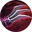
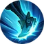

[Тир-лист](https://boostmlbb.ru/heroes/)[Новости и гайды](https://boostmlbb.ru/news/)

# Бруно

A

СтрелокЛиния золота

Капитан Рейнджеров Эрудитио, вернувшийся на "поле" благодаря передовым протезам.

Победы

54,3%

все ранги 53,8%

Выбор

1,0%

все ранги 0,6%

Баны

0,5%

все ранги 0,3%

№24 в тир-листе · №2 среди стрелков · Мифическая слава, 7 дней, по 23 ноября

[Обзор](https://boostmlbb.ru/#overview)[Сборка](https://boostmlbb.ru/#build)[Навыки](https://boostmlbb.ru/#skills)[Контрпики](https://boostmlbb.ru/#draft)[История](https://boostmlbb.ru/#lore)

## Обзор

### Характеристики

-   Живучесть**20**
-   Атака**60**
-   Эффекты**20**
-   Сложность**40**

-   Добивание
-   Разрушительный урон

### Победы по рангам, 30 дней

1.  **52,0%**Эпик
2.  **52,2%**Легенда
3.  **52,8%**Мифик
4.  **53,6%**Честь
5.  **54,3%**Слава

Пунктир: 50% побед

### Другие стрелки этой линии

[Обсидия](https://boostmlbb.ru/heroes/obsidia.html)[Ханаби](https://boostmlbb.ru/heroes/hanabi.html)[Москов](https://boostmlbb.ru/heroes/moskov.html)[Мия](https://boostmlbb.ru/heroes/miya.html)[Иритель](https://boostmlbb.ru/heroes/irithel.html)[Броуди](https://boostmlbb.ru/heroes/brody.html)[Клинт](https://boostmlbb.ru/heroes/clint.html)[Беатрис](https://boostmlbb.ru/heroes/beatrix.html)

## Сборка

Линия золота · по данным рейтинговых матчей

Сборка 159,7%Сборка 259,3%Сборка 361,7%

### Предметы

Когти Хааса

Ярость берсерка

Губительный пулемет

### Эмблема

Эмблема стрелка

Фатальность

Мастер-убийца

Квантовый заряд

### Заклинание

Эгида

Победы

59,7%

Выбор

5,4%

### Предметы

Когти Хааса

Ярость берсерка

Губительный пулемет

### Эмблема

Эмблема стрелка

Фатальность

Мастер-убийца

Квантовый заряд

### Заклинание

Вспышка

Победы

59,3%

Выбор

4,6%

### Предметы

Когти Хааса

Ярость берсерка

Губительный пулемет

### Эмблема

Эмблема бойца

Фатальность

Охотник за скидками

Квантовый заряд

### Заклинание

Вспышка

Победы

61,7%

Выбор

4,5%

## Навыки

Прокачка**Супергол**_›_**Удар в полете**_›_**Скольжение**

Пассивный1-й навык2-й навыкУльтимейт

Пассивный

### Механические ноги

Бруно получает 2.5% доп. шанса критического удара каждый раз, когда наносит урон навыками (до 8 зарядов).

У Бруно сравнительно высокая физическая атака, но он получает только 80% доп. скорости атаки из всех источников.

1-й навык

### Удар в полете

Перезарядка **10 Mana Cost: 50 с**

Со следующей базовой атакой Бруно пинает энергомяч, получая 1 скорости передвижения на 48% сек. Мяч наносит 75 (+100% общей физической атаки) единиц физического урона цели и замедляет ее на 30% на 0.5 сек.

Затем энергомяч отскакивает обратно к Бруно и остается на земле. Бруно или союзные герои могут подобрать энергомяч для еще одной атаки и сократить перезарядку "Скольжения" на 1 сек.

2-й навык

### Скольжение

Перезарядка **9 Mana Cost: 90 с**

Бруно скользит вперед, ненадолго оглушая врагов на своем пути и получая энергомяч в конце рывка.

Ультимейт

### Супергол

Перезарядка **38 Mana Cost: 140 с**

Бруно пинает энергетический шар в указанного героя, нанося 200 (+80% общей физической атаки) единиц физического урона. Шар отбрасывает его на границу дальности атаки Бруно, оглушает на 0.5 сек. и замедляет на 80% на 2 сек.

Затем энергетический шар отскакивает между вражескими юнитами (до 10 р.), отдавая приоритет вражеским героям. Каждый отскок наносит 100 (+40% общей физической атаки) единиц физического урона.

## Контрпики и союзники

### Контрпики

Побеждают этого героя

[Ванван](https://boostmlbb.ru/heroes/wanwan.html)[Линг](https://boostmlbb.ru/heroes/ling.html)[Фанни](https://boostmlbb.ru/heroes/fanny.html)[Маша](https://boostmlbb.ru/heroes/masha.html)[Марсель](https://boostmlbb.ru/heroes/marcel.html)

### Слабые цели

Этот герой побеждает их

[Лесли](https://boostmlbb.ru/heroes/lesley.html)[Эймон](https://boostmlbb.ru/heroes/aamon.html)

### Союзники

Рост побед в паре, п. п.

[Харит**+2,6**](https://boostmlbb.ru/heroes/harith.html)[Калеа**+1,8**](https://boostmlbb.ru/heroes/kalea.html)[Чжусинь**+1,7**](https://boostmlbb.ru/heroes/zhuxin.html)[Фанни**+1,7**](https://boostmlbb.ru/heroes/fanny.html)

## История

> Капитан Рейнджеров Эрудитио, вернувшийся на "поле" благодаря передовым протезам.

[Читать полную историю ↗](https://play.mobilelegends.com/lore/hero/Bruno)Официальный сайт Mobile Legends

[Характеристики на сайте игры ↗](https://www.mobilelegends.com/hero/detail?heroid=12)

**Поднимем ранг на герое «Бруно»**Цена считается в калькуляторе

[Рассчитать цену](https://boostmlbb.ru/order.html?type=hero)

## Частые вопросы

Кто контрпик для героя «Бруно» в MLBB?

За последние 30 дней чаще всего героя обыгрывают Ванван, Линг, Фанни, Маша и Марсель.

Какой процент побед у героя «Бруно» сейчас?

54,29% в Мифической славе за последние 7 дней и 53,78% на всех рангах за 30 дней, данные на 23 ноября 2026 года.

Какая роль и линия у героя «Бруно»?

Стрелок, играет на линии золота.

Силён ли герой «Бруно» в текущей мете?

Тир A, 24-е место из 133 героев и 2-е среди стрелков. Тир учитывает, как часто героя берут и банят и как он выигрывает в Мифической славе за 7 дней: бан в 0,5% матчей, 54,3% побед.

Какая сборка на героя «Бруно» лучшая?

Самая популярная сборка в рейтинге: ключевые предметы «Когти Хааса», «Ярость берсерка» и «Губительный пулемет», эмблема стрелка с талантами «Фатальность», «Мастер-убийца» и «Квантовый заряд» и заклинание «Эгида». С ней выигрывают 59,71% матчей.
