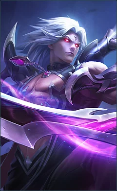

[Тир-лист](https://boostmlbb.ru/heroes/)[Предметы](https://boostmlbb.ru/items/)[Скины](https://boostmlbb.ru/skins/)[Новости и гайды](https://boostmlbb.ru/news/)

[Тир-лист](https://boostmlbb.ru/heroes/)

# Чан'Э

C

МагСредняя линия

Победы

46,0%

Выбор

0,4%

Баны

0,1%

[Обзор](https://boostmlbb.ru/#overview)[Сборка](https://boostmlbb.ru/#build)[Как играть](https://boostmlbb.ru/#howto)[Навыки](https://boostmlbb.ru/#skills)[Контрпики](https://boostmlbb.ru/#draft)[Скины](https://boostmlbb.ru/#skins)[История](https://boostmlbb.ru/#lore)

## Обзор

### Характеристики

-   Живучесть**40**
-   Атака**80**
-   Эффекты**20**
-   Сложность**40**

-   Поук
-   Разрушительный урон

### Победы по рангам, 30 дней

1.  **51,2%**Эпик
2.  **49,9%**Легенда
3.  **48,9%**Мифик
4.  **47,7%**Честь
5.  **45,9%**Слава

Пунктир: 50% побед

### Другие маги этой линии

[Кимми](https://boostmlbb.ru/heroes/kimmy.html)[Эйдора](https://boostmlbb.ru/heroes/eudora.html)[Чжусинь](https://boostmlbb.ru/heroes/zhuxin.html)[Валир](https://boostmlbb.ru/heroes/valir.html)[Цзэтянь](https://boostmlbb.ru/heroes/zetian.html)[Лилия](https://boostmlbb.ru/heroes/lylia.html)[Ксавьер](https://boostmlbb.ru/heroes/xavier.html)[Люнокс](https://boostmlbb.ru/heroes/lunox.html)

### Места в рейтингах

-   [Лучшие маги MLBB**30 из 32**](https://boostmlbb.ru/heroes/best-mage.html)
-   [Лучшие мидеры MLBB**27 из 29**](https://boostmlbb.ru/heroes/best-mid.html)

## Сборка

Сборка 1Сборка 2Сборка 3

Победы

54,3%

Выбор

5,3%

#### Основные предметы

-   [

    

    Жезл молний

    ](https://boostmlbb.ru/items/lightning-truncheon.html)
-   [

    

    Пылающий жезл

    ](https://boostmlbb.ru/items/glowing-wand.html)
-   [

    

    Божественный меч

    ](https://boostmlbb.ru/items/divine-glaive.html)

#### Заклинание

Вспышка

#### Эмблема и таланты

Эмблема мага

-   

    Трепет

-   

    Охотник за скидками

-   

    Нечестивая ярость

Победы

52,2%

Выбор

3,7%

#### Основные предметы

-   [

    

    Пронзающий небеса

    ](https://boostmlbb.ru/items/sky-piercer.html)
-   [

    

    Пылающий жезл

    ](https://boostmlbb.ru/items/glowing-wand.html)
-   [

    

    Божественный меч

    ](https://boostmlbb.ru/items/divine-glaive.html)

#### Заклинание

Вспышка

#### Эмблема и таланты

Эмблема мага

-   

    Трепет

-   

    Охотник за скидками

-   

    Нечестивая ярость

Победы

50,9%

Выбор

1,8%

#### Основные предметы

-   [

    

    Пронзающий небеса

    ](https://boostmlbb.ru/items/sky-piercer.html)
-   [

    

    Пылающий жезл

    ](https://boostmlbb.ru/items/glowing-wand.html)
-   [

    

    Божественный меч

    ](https://boostmlbb.ru/items/divine-glaive.html)

#### Заклинание

Огненный выстрел

#### Эмблема и таланты

Эмблема мага

-   

    Трепет

-   

    Охотник за скидками

-   

    Нечестивая ярость

## Как играть за Чан'Э

### Комбо Чан'Э

#### В драке

1.  2
2.  1
3.  Ульт

В драке получите щит вторым, тревожьте первым и ультуйте, если он попал. Во время ульта двигайтесь, чтобы выжить и не потерять цель.

#### На линии

1.  2
2.  Атака
3.  1
4.  Ульт

На линии получите бонус вторым, пометьте атаками, замедлите первым и добейте ультом.

### Когда сильнее всего

Сильнее в долгой игре: после 20-й минуты выигрывает 51,5%. Не рискуйте в начале, фармите и ввязывайтесь в драки вместе с командой.

1.  **45,8**10–12
2.  **46,5**12–14
3.  **47,0**14–16
4.  **49,9**16–18
5.  **51,3**18–20
6.  **51,5**20+

Проценты побед по длине матча в минутах, все ранги. Пунктир: 50%

### Приоритет прокачки

1.  Метеоритный дождь
2.  Лунная ударная волна
3.  Полумесяц

## Навыки

Пассивный**Нарушитель спокойствия**1-й навык**Лунная ударная волна**2-й навык**Полумесяц**Ультимейт**Метеоритный дождь**

Пассивный

### Нарушитель спокойствия

Каждый раз, когда Чан'Э наносит урон врагу, она оставляет на нем метку, которая уменьшает его скорость передвижения на 1% (до 20%).

1-й навык

### Лунная ударная волна

Перезарядка **7 Mana Cost: 60 с**

Чан'Э бросает энергетический шар в указанном направлении, нанося 350 (+130% общей магической силы) единиц мaгического урона врагам на пути и замедляя их на 10% на 1.5 сек.

**Полумесяц:** "Полумесяц" отправит 4 дополнительных энергетических шара вместе с Чан'Э, каждый из которых наносит 20% урона и замедляет пораженных врагов. Эффект замедления может складываться (до 20%).

2-й навык

### Полумесяц

Перезарядка **12 Mana Cost: 60 с**

Чан'Э призывает "Полумесяц", получая 300 (+150% общей магической силы) ед. постоянного щита и 10% скорости передвижения до разрушения щита. Каждый раз при использовании навыка она получает дополнительно 50% скорости передвижения, которая уменьшается в течение 2.5 сек.

**Полумесяц:** усиливает ее базовые атаки, наносящие 20 (+35% общей магической силы) единиц дополнительного магического урона 2 раза.

Каждый раз, когда Чан'Э наносит магический урон базовыми атаками или навыками, перезарядка этого навыка уменьшается на 0.2 сек.

Ультимейт

### Метеоритный дождь

Перезарядка **24 Mana Cost: 120 с**

Чан'Э получает 10% скорости передвижения на 4 сек. В течение этого времени она выпускает 30 метеоров в указанном направлении, каждый из которых наносит 60 (+21% общей магической силы) единиц магического урона первому пораженному врагу. Этот навык наносит 100% дополнительного урона миньонам и монстрам.

**Полумесяц:** выпускает метеоры вместе с Чан'Э, каждый из которых наносит 33% урона.

## Контрпики Чан'Э

### Кто контрит Чан'Э

[Дигги](https://boostmlbb.ru/heroes/diggie.html)[Бальмонд](https://boostmlbb.ru/heroes/balmond.html)[Мартис](https://boostmlbb.ru/heroes/martis.html)[Икс.Борг](https://boostmlbb.ru/heroes/x-borg.html)[Альфа](https://boostmlbb.ru/heroes/alpha.html)

### Кого контрит Чан'Э

[Клауд](https://boostmlbb.ru/heroes/claude.html)[Глу](https://boostmlbb.ru/heroes/gloo.html)[Пополь и Купа](https://boostmlbb.ru/heroes/popol-and-kupa.html)[Лолита](https://boostmlbb.ru/heroes/lolita.html)

## Скины Чан'Э

[Золотой османтусОбычный · 2026](https://boostmlbb.ru/skins/change/golden-osmanthus.html)[Труппа лунного светаИсключительный · 2025](https://boostmlbb.ru/skins/change/moonglow-troupe.html)[Техни­ческий генийГрандиозный · 2024](https://boostmlbb.ru/skins/change/tech-tensai.html)[НоволуниеДелюкс · 2023](https://boostmlbb.ru/skins/change/new-moon.html)[Лунная художницаГрандиозный · 2022](https://boostmlbb.ru/skins/change/moon-artist.html)[Колыбель из лозДелюкс · 2021](https://boostmlbb.ru/skins/change/vine-cradle.html)[Клубничное парфеИсключительный · 2020](https://boostmlbb.ru/skins/change/strawberry-parfait.html)[Лунная магияИзысканный · 2020](https://boostmlbb.ru/skins/change/lunar-magic.html)[Цветочная эльфийкаИсключительный · 2019](https://boostmlbb.ru/skins/change/floral-elfo.html)[Багровая лунаОбычный · 2019](https://boostmlbb.ru/skins/change/crimson-moon.html)[ЛунатичкаОбычный · 2018](https://boostmlbb.ru/skins/change/moonstruck.html)

[Все 11 скинов Чан'Э: цены и как получить](https://boostmlbb.ru/skins/change.html)

## История

> Озорная и милая ученица Великого дракона.

[Читать полную историю ↗](https://kazukiofficial.com/stories/chang-e)Kazuki Official, английский [Характеристики на сайте игры ↗](https://www.mobilelegends.com/hero/detail?heroid=61)

**Поднимем ранг на герое «Чан'Э»**Цена считается в калькуляторе

[Рассчитать цену](https://boostmlbb.ru/order.html?type=hero)

## Частые вопросы

Кто контрит Чан'Э в MLBB?

За последние 30 дней Чан'Э чаще всего обыгрывают Дигги, Бальмонд, Мартис, Икс.Борг и Альфа.

Как играть за Чан'Э?

В первую очередь качайте «Лунная ударная волна», ульт берите, как только доступен. Сильнее в долгой игре: после 20-й минуты выигрывает 51,5%. Не рискуйте в начале, фармите и ввязывайтесь в драки вместе с командой. Комбо для драки: В драке получите щит вторым, тревожьте первым и ультуйте, если он попал. Во время ульта двигайтесь, чтобы выжить и не потерять цель.

Какой процент побед у Чан'Э сейчас?

46,03% в Мифической славе за последние 7 дней и 48,21% на всех рангах за 30 дней, данные на 26 ноября 2026 года.

Какая роль и линия у Чан'Э?

Маг, играет на средней линии.

Стоит ли брать Чан'Э в текущей мете?

Тир C, 120-е место из 133 героев и 30-е среди магов. Тир учитывает, как часто героя берут и банят и как он выигрывает в Мифической славе за 7 дней: бан в 0,1% матчей, 46,0% побед. В профессиональных матчах за месяц героя драфтуют в 0,0% катков.

Какая сборка на Чан'Э лучшая?

Самая популярная сборка в рейтинге: ключевые предметы «Жезл молний», «Пылающий жезл» и «Божественный меч», эмблема мага с талантами «Трепет», «Охотник за скидками» и «Нечестивая ярость» и заклинание «Вспышка». С ней выигрывают 54,27% матчей.
