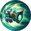

[Тир-лист](https://boostmlbb.ru/heroes/)[Предметы](https://boostmlbb.ru/items/)[Скины](https://boostmlbb.ru/skins/)[Новости и гайды](https://boostmlbb.ru/news/)

[Тир-лист](https://boostmlbb.ru/heroes/)

# Чип

D

ТанкПоддержкаРоум

Победы

48,1%

Выбор

0,1%

Баны

0,2%

[Обзор](https://boostmlbb.ru/#overview)[Сборка](https://boostmlbb.ru/#build)[Как играть](https://boostmlbb.ru/#howto)[Навыки](https://boostmlbb.ru/#skills)[Контрпики](https://boostmlbb.ru/#draft)[Скины](https://boostmlbb.ru/#skins)[История](https://boostmlbb.ru/#lore)

## Обзор

### Характеристики

-   Живучесть**80**
-   Атака**20**
-   Эффекты**60**
-   Сложность**50**

-   Поддержка
-   Массовый контроль

### Другие танки этой линии

[Кармилла](https://boostmlbb.ru/heroes/carmilla.html)[Белерик](https://boostmlbb.ru/heroes/belerick.html)[Атлас](https://boostmlbb.ru/heroes/atlas.html)[Глу](https://boostmlbb.ru/heroes/gloo.html)[Минотавр](https://boostmlbb.ru/heroes/minotaur.html)[Хуфра](https://boostmlbb.ru/heroes/khufra.html)[Тигрил](https://boostmlbb.ru/heroes/tigreal.html)[Хильда](https://boostmlbb.ru/heroes/hilda.html)

### Места в рейтингах

-   [Лучшие танки MLBB**23 из 25**](https://boostmlbb.ru/heroes/best-tank.html)
-   [Лучшие роумеры MLBB**32 из 34**](https://boostmlbb.ru/heroes/best-roam.html)

## Сборка

Сборка 1Сборка 2Сборка 3

Победы

53,0%

Выбор

8,5%

#### Основные предметы

-   [

    

    Мимолетное время

    ](https://boostmlbb.ru/items/fleeting-time.html)
-   [

    

    Наплечник наказания

    ](https://boostmlbb.ru/items/chastise-pauldron.html)
-   [

    

    Древняя кираса

    ](https://boostmlbb.ru/items/antique-cuirass.html)

#### Заклинание

Вспышка

#### Эмблема и таланты

Эмблема поддержки

-   

    Вдохновение

-   

    Стойкость

-   

    Ударная волна

Победы

53,2%

Выбор

3,1%

#### Основные предметы

-   [

    

    Мимолетное время

    ](https://boostmlbb.ru/items/fleeting-time.html)
-   [

    

    Наплечник наказания

    ](https://boostmlbb.ru/items/chastise-pauldron.html)
-   [

    

    Древняя кираса

    ](https://boostmlbb.ru/items/antique-cuirass.html)

#### Заклинание

Вспышка

#### Эмблема и таланты

Эмблема поддержки

-   

    Вдохновение

-   

    Благословение природы

-   

    Ударная волна

Победы

53,4%

Выбор

1,4%

#### Основные предметы

-   [

    

    Мимолетное время

    ](https://boostmlbb.ru/items/fleeting-time.html)
-   [

    

    Оракул

    ](https://boostmlbb.ru/items/oracle.html)
-   [

    

    Наплечник наказания

    ](https://boostmlbb.ru/items/chastise-pauldron.html)

#### Заклинание

Окаменение

#### Эмблема и таланты

Эмблема поддержки

-   

    Вдохновение

-   

    Благословение природы

-   

    Ударная волна

## Как играть за Чипа

### Комбо Чипа

#### В драке

1.  2
2.  Атака
3.  3
4.  1
5.  Атака

Заранее разгонитесь вторым, ударьте атакой и ультом откройте главный портал. Первым и ещё одной атакой оглушите, пока портал замедляет, и продолжайте, пока союзники перемещаются.

#### На линии

1.  2
2.  Атака
3.  1
4.  Атака

При ганке вторым зайдите за спину и усиленной атакой выбейте цель к своим, затем первый и атака с оглушением.

### Когда сильнее всего

Сильнее в долгой игре: после 20-й минуты выигрывает 49,5%. Не рискуйте в начале, фармите и ввязывайтесь в драки вместе с командой.

1.  **46,0**10–12
2.  **47,5**12–14
3.  **48,3**14–16
4.  **48,0**16–18
5.  **48,0**18–20
6.  **49,5**20+

Проценты побед по длине матча в минутах, все ранги. Пунктир: 50%

### Приоритет прокачки

1.  Легкий путь
2.  Интенсив
3.  Сверхурочная работа

## Навыки

Пассивный**Пора перекусить!**1-й навык**Интенсив**2-й навык**Сверхурочная работа**3-й навык**Легкий путь**Ультимейт**Зачем пешком?**

Пассивный

### Пора перекусить!

Вне боя Чип откусывает чипсы кажд. 2 сек. После 4 укусов он доедает пачку и восстанавливает ОЗ в размере 300 (+45% от его потерянных ).

Съев пачку, Чип не может есть снова в течение 5 сек. (Количество укусов сохраняется, если он вступает в бой до того, как доест пачку.)

1-й навык

### Интенсив

Перезарядка **5.5 Mana Cost: 40 с**

Чип таранит землю своим летающим транспортом, нанося магический урон, равный 100 плюс 4% от цели, и накладывает "Метку Чипа" на пораженных врагов. Чип получает 300 (+60% общей магической силы) ед. щита при попадании по вражескому герою, который увеличивается на 40% за каждого дополнительного пораженного вражеского героя. Следующая базовая атака Чипа становится дальней и поражает всех ближайших врагов с "Меткой Чипа", взрывая метку для нанесения 150 (+30% общей магической силы) единиц магического урона и оглушая каждую цель на 0.6 сек.

2-й навык

### Сверхурочная работа

Перезарядка **13 Mana Cost: 75 с**

Чип мчится вперед в течение 2 сек., получая до 65% дополнительной скорости передвижения, после чего он сохраняет максимальную скорость в течение 2 сек.

Следующая базовая атака Чипа позволит броситься к врагу, нанося 200 (+30% общей магической силы) единиц магического урона и слегка отбрасывая его.

3-й навык

### Легкий путь

Перезарядка **70 Mana Cost: 110 с**

Чип ставит главный портал на вражеского героя, нанося 200 (+60% общей магической силы) единиц магического урона и ненадолго замедляя его на 25%. Главный портал наносит в 2 раза больше урона и обездвиживает его на 1 сек. после задержки. Тем временем Чип создает соединительные порталы возле союзных героев на расстоянии 10 ед. и за союзной базой. Главный портал и соединительные порталы существуют до 15 сек.

**Соединительный портал:** герои (из обеих команд) могут телепортироваться через соединительные порталы к главному порталу, а союзные герои получают мощное увеличение скорости передвижения на 1.5 сек. и 500 ед. щита.

**Главный портал:** главный портал наследует 70% показателей Чипа. Герои могут встать на главный портал на 2 сек., чтобы вернуться в соединительный портал, из которого они пришли. Применение навыков или использование базовых атак сбросит время стояния.

Ультимейт

### Зачем пешком?

В начале боя у Чипа есть 4 установленных маячка на карте. Используйте этот навык, чтобы телепортироваться к любому маячку. (Навык нельзя использовать в бою.)

## Контрпики Чипа

### Кто контрит Чипа

[Хелкарт](https://boostmlbb.ru/heroes/helcurt.html)[Зилонг](https://boostmlbb.ru/heroes/zilong.html)[Селена](https://boostmlbb.ru/heroes/selena.html)[Валентина](https://boostmlbb.ru/heroes/valentina.html)[Флорин](https://boostmlbb.ru/heroes/floryn.html)

### Кого контрит Чип

[Вексана](https://boostmlbb.ru/heroes/vexana.html)[Кармилла](https://boostmlbb.ru/heroes/carmilla.html)[Алиса](https://boostmlbb.ru/heroes/alice.html)[Бальмонд](https://boostmlbb.ru/heroes/balmond.html)[Мартис](https://boostmlbb.ru/heroes/martis.html)[Одетта](https://boostmlbb.ru/heroes/odette.html)

## Скины Чипа

[Инженер нексусаОбычный · 2024](https://boostmlbb.ru/skins/chip/nexus-engineer.html)[Привал в пустошахОбычный · 2024](https://boostmlbb.ru/skins/chip/badlands-hiatus.html)

[Все 2 скина Чипа: цены и как получить](https://boostmlbb.ru/skins/chip.html)

## История

> Беззаботный генно-модифицированный лис, владеющий передовой технологией порталов.

[Читать полную историю ↗](https://play.mobilelegends.com/lore/hero/Chip)Официальный сайт Mobile Legends [Характеристики на сайте игры ↗](https://www.mobilelegends.com/hero/detail?heroid=124)

**Поднимем ранг на герое «Чип»**Цена считается в калькуляторе

[Рассчитать цену](https://boostmlbb.ru/order.html?type=hero)

## Частые вопросы

Кто контрит Чипа в MLBB?

За последние 30 дней Чипа чаще всего обыгрывают Хелкарт, Зилонг, Селена, Валентина и Флорин.

Как играть за Чипа?

В первую очередь качайте «Легкий путь», ульт берите, как только доступен. Сильнее в долгой игре: после 20-й минуты выигрывает 49,5%. Не рискуйте в начале, фармите и ввязывайтесь в драки вместе с командой. Комбо для драки: Заранее разгонитесь вторым, ударьте атакой и ультом откройте главный портал. Первым и ещё одной атакой оглушите, пока портал замедляет, и продолжайте, пока союзники перемещаются.

Какой процент побед у Чипа сейчас?

48,13% в Мифической славе за последние 7 дней и 47,60% на всех рангах за 30 дней, данные на 27 ноября 2026 года.

Какая роль и линия у Чипа?

Танк и поддержка, играет в роуме.

Стоит ли брать Чипа в текущей мете?

Тир D, 129-е место из 133 героев и 23-е среди танков. Тир учитывает, как часто героя берут и банят и как он выигрывает в Мифической славе за 7 дней: бан в 0,2% матчей, 48,1% побед. В профессиональных матчах за месяц героя драфтуют в 1,8% катков.

Какая сборка на Чипа лучшая?

Самая популярная сборка в рейтинге: ключевые предметы «Мимолетное время», «Наплечник наказания» и «Древняя кираса», эмблема поддержки с талантами «Вдохновение», «Стойкость» и «Ударная волна» и заклинание «Вспышка». С ней выигрывают 52,99% матчей.
