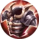
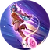
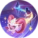

[Главная](https://boostmlbb.ru/) / [Герои](https://boostmlbb.ru/heroes/)

Тир B

# Чичи в Mobile Legends: сборка, контрпики и статистика

Боец, линия опыта. Выигрывает 49,38% матчей за последние 30 дней — 81-е место из 133 героев.

[Буст на этом герое](https://boostmlbb.ru/order.html?type=hero)[Все герои](https://boostmlbb.ru/heroes/)

Статистика герояТир B

**Чичи**Бан 1,16% · Выбор 0,68%

Контрпики

Победы за 30 дней**49,38%**

**49,38%**побед за 30 дней

**0,68%**выбирают в матчах

**1,16%**банят в матчах

**48,93%**побед в Мифической славе

## Сборка на героя «Чичи»

Самая популярная сборка для героя «Чичи» на роли линии опыта в рейтинговых матчах на всех рангах — по данным «Академии» в игре. Процент побед — в матчах именно с этой сборкой.

Ключевые предметы

Топор войныКираса грубой силыУдар охотника

Эмблема и таланты

Эмблема бойцаЛовкостьКровавое пиршествоОтвага

Боевое заклинание

Месть

Побед с этой сборкой **59,02%**Выбирают в **7,46%** матчей

### Другие популярные варианты

-   МестьЭмблема бойцаТрепет · Кровавое пиршество · Отвага**58,65%**
-   ВспышкаЭмблема бойцаТрепет · Кровавое пиршество · Отвага**56,72%**

## Навыки героя «Чичи»

Официальные описания навыков от MOONTON с перезарядкой и типом навыка.

Порядок прокачки: **Выход на поклон** → **Нападение Йо-йо** → **Жизнерадостный прыжок**

-   

    **Восторг артиста**Пассивный

    Чичи генерирует заряд "Восторга" после нанесения урона, увеличивая свою скорость передвижения на 0.75% и вампиризм от навыков на 1.25% за заряд до 10 раз, удваивая эффекты при полных зарядах.

-   

    **Нападение Йо-йо**1-й навыкПерезарядка 6.5 с

    Чичи использует Йо-йо, чтобы продолжительно атаковать ближайшего врага в пределах дальности (в приоритете герои) в течение 3.5 сек., ударяя его до 10 раз и каждым ударом нанося физический урон, равный 65 плюс 3.5 (+1.2% дополнительной физической атаки)% от цели. Во время этой атаки Чичи может двигаться и использовать другие навыки.
    Если в пределах дальности атаки нет врагов, Йо-йо атакует башни или базу.
    Этот навык наносит 20% дополнительного урона по миньонам.

-   

    **Жизнерадостный прыжок**2-й навыкПерезарядка 9.5 с

    Чичи прыгает в указанное место. Если она приземлится на любого юнита (не включая башни и базу), то сможет снова прыгнуть в направлении джойстика. Если первым прыжком она приземлится на врага, то нанесет ему 200 (+40% общей физической атаки) единиц физического урона.

-   

    **Выход на поклон**УльтимейтПерезарядка 40 с

    Чичи бросает Йо-йо в указанного вражеского героя и связывает его с другим вражеским героем поблизости, нанося 100 (+10% общей физической атаки) единиц физического урона, замедляя их на 30% и стягивая их вместе на 4 сек.
    В это время Чичи может использовать "Нападение Йо-йо", чтобы атаковать обе связанные цели одновременно. Если только одна цель находится в пределах дальности "Нападения Йо-йо", Чичи будет атаковать цель дважды, но урон от второй атаки будет уменьшен до 25%.

## Роль и линия

Место считается по проценту побед за 30 дней среди героев той же роли или линии.

-   Роль**Боец**
-   Линия**Линия опыта**
-   Среди бойцов**26-е из 44**
-   На линии опыта**25-е из 42**
-   Специализация**Урон, Регенерация**
-   Сложность**Низкая (20/100)**

## Кто контрит этого героя

Против этих героев «Чичи» проигрывает чаще всего. Под иконкой — их собственный процент побед. 3 из 5 контрпиков — танки.

[Бальмонд46,66%](https://boostmlbb.ru/heroes/balmond.html)[Тамуз48,91%](https://boostmlbb.ru/heroes/thamuz.html)[Алиса50,70%](https://boostmlbb.ru/heroes/alice.html)[Хилос48,55%](https://boostmlbb.ru/heroes/hylos.html)[Белерик51,83%](https://boostmlbb.ru/heroes/belerick.html)

## Против кого силён

Для этих героев «Чичи» — один из самых неудобных соперников.

[Рафаэль54,51%](https://boostmlbb.ru/heroes/rafaela.html)[Зилонг46,27%](https://boostmlbb.ru/heroes/zilong.html)[Эстес52,75%](https://boostmlbb.ru/heroes/estes.html)[Эймон50,24%](https://boostmlbb.ru/heroes/aamon.html)[Маша60,40%](https://boostmlbb.ru/heroes/masha.html)[Арлотт47,49%](https://boostmlbb.ru/heroes/arlott.html)[Дигги54,30%](https://boostmlbb.ru/heroes/diggie.html)

## С кем играть в команде

С этими героями в одной команде «Чичи» выигрывает чаще. Число — прибавка к проценту побед в процентных пунктах.

[Алиса+2,27 п. п.](https://boostmlbb.ru/heroes/alice.html)[Сан+2,21 п. п.](https://boostmlbb.ru/heroes/sun.html)[Бэйн+1,56 п. п.](https://boostmlbb.ru/heroes/bane.html)[Альфа+1,47 п. п.](https://boostmlbb.ru/heroes/alpha.html)

## Процент побед по рангам

Лучший результат — на ранге «Легенда» (50,10%), слабее всего — «Мифическая слава» (48,93%). Данные за последние 30 дней.

-   Эпик**50,02%**
-   Легенда**50,10%**
-   Мифический**50,01%**
-   Мифическая честь**49,34%**
-   Мифическая слава**48,93%**

## Место в мете

«Чичи» — тир B в нашем тир-листе по проценту побед, 81-е место из 133 героев. В Мифической славе результат почти такой же: 48,93%. В патче 2.2.16 герой усилен. Полный [тир-лист ноября](https://boostmlbb.ru/news/mlbb-meta-tier-list/) и [разбор патча](https://boostmlbb.ru/news/mlbb-current-patch/).

## Другие герои линии опыта

Самые сильные по проценту побед за последние 30 дней.

[Маша60,40%](https://boostmlbb.ru/heroes/masha.html)[Аргус56,78%](https://boostmlbb.ru/heroes/argus.html)[Сан53,72%](https://boostmlbb.ru/heroes/sun.html)[Аулус53,46%](https://boostmlbb.ru/heroes/aulus.html)[Глу53,45%](https://boostmlbb.ru/heroes/gloo.html)[Эдит52,67%](https://boostmlbb.ru/heroes/edith.html)

## История героя

«Веселая артистка, которая излучает радость и творит чудеса везде, где появляется.»

Полная история героя «Чичи» — на официальном сайте лора MOONTON. Карточка героя с навыками и советами разработчиков — на mobilelegends.com, реплики, облики и история изменений — в MLBB Wiki.

[Читать историю](https://play.mobilelegends.com/lore/hero/Cici)[Карточка героя](https://www.mobilelegends.com/hero/detail?heroid=123)[MLBB Wiki](https://mobile-legends.fandom.com/wiki/Cici)

## Буст на герое «Чичи»

Бустер играет только этим героем: вместе с рангом растёт и рейтинг героя.

[Рассчитать стоимость](https://boostmlbb.ru/order.html?type=hero)

Статистика — официальный рейтинг героев MOONTON (mobilelegends.com/rank) за последние 30 дней, обновление 23 ноября 2026 года, страница обновляется каждый день. Роли и линии — с официальной страницы героев. Сборки, навыки и союзники — данные «Академии» MOONTON через Rone Arena API (ridwaanhall / RoneAI).

## Частые вопросы

Кто контрпик для героя «Чичи» в MLBB?

За последние 30 дней чаще всего героя обыгрывают Бальмонд, Тамуз, Алиса, Хилос и Белерик.

Какой процент побед у героя «Чичи» сейчас?

49,38% за последние 30 дней на всех рангах и 48,93% в Мифической славе, данные на 23 ноября 2026 года.

Какая роль и линия у героя «Чичи»?

Боец, играет на линии опыта.

Силён ли герой «Чичи» в текущей мете?

Тир B: 81-е место из 133 героев по проценту побед за 30 дней и 26-е среди бойцов.

Какая сборка на героя «Чичи» лучшая?

Самая популярная сборка в рейтинге: ключевые предметы «Топор войны», «Кираса грубой силы» и «Удар охотника», эмблема бойца с талантами «Ловкость», «Кровавое пиршество» и «Отвага» и заклинание «Месть». С ней выигрывают 59,02% матчей.

Редакция MLBB Boost · Обновлено 23 ноября 2026
