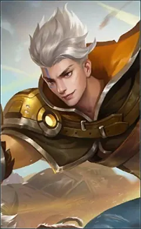

[Тир-лист](https://boostmlbb.ru/heroes/)

# Клауд

B

СтрелокЛиния золота

Победы

48,4%

Выбор

1,0%

Баны

0,1%

[Обзор](https://boostmlbb.ru/#overview)[Сборка](https://boostmlbb.ru/#build)[Как играть](https://boostmlbb.ru/#howto)[Навыки](https://boostmlbb.ru/#skills)[Контрпики](https://boostmlbb.ru/#draft)[Скины](https://boostmlbb.ru/#skins)[История](https://boostmlbb.ru/#lore)

## Обзор

### Характеристики

-   Живучесть**30**
-   Атака**60**
-   Эффекты**10**
-   Сложность**60**

-   Разрушительный урон
-   Преследование

### Другие стрелки этой линии

[Обсидия](https://boostmlbb.ru/heroes/obsidia.html)[Бруно](https://boostmlbb.ru/heroes/bruno.html)[Клинт](https://boostmlbb.ru/heroes/clint.html)[Броуди](https://boostmlbb.ru/heroes/brody.html)[Ханаби](https://boostmlbb.ru/heroes/hanabi.html)[Москов](https://boostmlbb.ru/heroes/moskov.html)[Мия](https://boostmlbb.ru/heroes/miya.html)[Мелисса](https://boostmlbb.ru/heroes/melissa.html)

### Места в рейтингах

-   [Лучшие стрелки MLBB**9 из 23**](https://boostmlbb.ru/heroes/best-marksman.html)

## Сборка

Сборка 1Сборка 2Сборка 3

Победы

53,5%

Выбор

3,9%

#### Основные предметы

-   [

    

    Коса коррозии

    ](https://boostmlbb.ru/items/corrosion-scythe.html)
-   [

    

    Меч охотника на демонов

    ](https://boostmlbb.ru/items/demon-hunter-sword.html)
-   [

    

    Золотой посох

    ](https://boostmlbb.ru/items/golden-staff.html)

#### Заклинание

Очищение

#### Эмблема и таланты

Эмблема бойца

-   

    Трепет

-   

    Кровавое пиршество

-   

    Квантовый заряд

Победы

50,3%

Выбор

3,4%

#### Основные предметы

-   [

    

    Коса коррозии

    ](https://boostmlbb.ru/items/corrosion-scythe.html)
-   [

    

    Меч охотника на демонов

    ](https://boostmlbb.ru/items/demon-hunter-sword.html)
-   [

    

    Золотой посох

    ](https://boostmlbb.ru/items/golden-staff.html)

#### Заклинание

Месть

#### Эмблема и таланты

Эмблема бойца

-   

    Трепет

-   

    Охотник за скидками

-   

    Убийственный пир

Победы

53,7%

Выбор

2,8%

#### Основные предметы

-   [

    

    Меч охотника на демонов

    ](https://boostmlbb.ru/items/demon-hunter-sword.html)
-   [

    

    Золотой посох

    ](https://boostmlbb.ru/items/golden-staff.html)
-   [

    

    Коса коррозии

    ](https://boostmlbb.ru/items/corrosion-scythe.html)

#### Заклинание

Очищение

#### Эмблема и таланты

Эмблема бойца

-   

    Трепет

-   

    Охотник за скидками

-   

    Квантовый заряд

## Как играть за Клауда

### Комбо Клауда

#### В драке

1.  1
2.  2
3.  Ульт

В драке сначала первым накопите усиление, ловите момент подойти вторым и добивайте ультом.

#### На линии

1.  1
2.  Атака
3.  2
4.  Ульт

На линии тревожьте первым, при низком здоровье врага подойдите вторым и убейте ультом.

### Когда сильнее всего

Сильнее в долгой игре: на 16–18 минутах выигрывает 50,5%. Не рискуйте в начале, фармите и ввязывайтесь в драки вместе с командой.

1.  **45,6**10–12
2.  **49,5**12–14
3.  **50,1**14–16
4.  **50,5**16–18
5.  **49,2**18–20
6.  **49,3**20+

Проценты побед по длине матча в минутах, все ранги. Пунктир: 50%

### Приоритет прокачки

1.  Превосходный дуэт
2.  Искусство воровства
3.  Боевая голограмма

## Навыки

Пассивный**Сражение бок о бок**1-й навык**Искусство воровства**2-й навык**Боевая голограмма**Ультимейт**Превосходный дуэт**

Пассивный

### Сражение бок о бок

Декстер помогает Клауду с каждой базовой атакой, нанося 25 (+25% общей физической атаки) единиц физического урона той же цели (наследуется часть эффектов атаки).

1-й навык

### Искусство воровства

Перезарядка **5 Mana Cost: 35 с**

Клауд выпускает разрушительную волну в указанном направлении, нанося 250 (+40% общей физической атаки) единиц физического урона врагам в веерообразной области и снижая их скорость передвижения на 20% и скорость атаки на 10%.

За каждого пораженного врага он получает 4% скорости передвижения и скорости атаки (удваивается за попадание во вражеских героев) на 6 сек. (до 5 зарядов).

2-й навык

### Боевая голограмма

Перезарядка **13 Mana Cost: 90 с**

Клауд создает голограмму Декстера в указанном месте, которая автоматически атакует ближайших врагов в течение 5.5 сек. Базовые атаки голограммы наносят 25 (+25% общей физической атаки) единиц физического урона и активируют эффекты атаки Клауда.

**Повторное использование:** Клауд меняется местами с голограммой.

Ультимейт

### Превосходный дуэт

Перезарядка **50 Mana Cost: 100 с**

Клауд и Декстер быстро стреляют по ближайшим врагам в течение 3 сек., каждым выстрелом нанося 40 (+40% общей физической атаки) единиц физического урона максимум двум врагам (этот урон считается уроном базовой атаки). После каждого нанесения урона по врагу с помощью ультимейта Клауд получает 20 (+3% общей физической атаки) ед. щита.

## Контрпики Клауда

### Кто контрит Клауда

[Лолита](https://boostmlbb.ru/heroes/lolita.html)[Чан'Э](https://boostmlbb.ru/heroes/change.html)[Иксия](https://boostmlbb.ru/heroes/ixia.html)[Бальмонд](https://boostmlbb.ru/heroes/balmond.html)[Джонсон](https://boostmlbb.ru/heroes/johnson.html)

### Кого контрит Клауд

[Лесли](https://boostmlbb.ru/heroes/lesley.html)[Эймон](https://boostmlbb.ru/heroes/aamon.html)[Эдит](https://boostmlbb.ru/heroes/edith.html)

## Скины Клауда

[МехадраконИзысканный · 2025](https://boostmlbb.ru/skins/claude/mecha-dragon.html)[Косми­ческое пламяГрандиозный · 2024](https://boostmlbb.ru/skins/claude/cosmic-blaze.html)[Искра претен­дентаДелюкс · 2024](https://boostmlbb.ru/skins/claude/challenger-s-spark.html)[Пылающее сердцеДелюкс · 2024](https://boostmlbb.ru/skins/claude/heart-aflame.html)[Пылающий следДелюкс · 2024](https://boostmlbb.ru/skins/claude/blazing-trace.html)[Сильнейший на ЗемлеИсключительный · 2024](https://boostmlbb.ru/skins/claude/earth-s-mightiest.html)[Рож­дественский карнавалИсключительный · 2024](https://boostmlbb.ru/skins/claude/christmas-carnival.html)[Спаса­тельницаИсключительный · 2024](https://boostmlbb.ru/skins/claude/lifeguard.html)[Золотая пуляОбычный · 2022](https://boostmlbb.ru/skins/claude/golden-bullet.html)[Плохой броГрандиозный · 2020](https://boostmlbb.ru/skins/claude/bad-bro.html)[Пират-грабительИсключительный · 2018](https://boostmlbb.ru/skins/claude/plunderous-pirate.html)

[Все 11 скинов Клауда: цены и как получить](https://boostmlbb.ru/skins/claude.html)

## История

> Превосходный вор, не оставляющий следов.

[Читать полную историю ↗](https://play.mobilelegends.com/lore/hero/Claude)Официальный сайт Mobile Legends [Характеристики на сайте игры ↗](https://www.mobilelegends.com/hero/detail?heroid=65)

**Поднимем ранг на герое «Клауд»**Цена считается в калькуляторе

[Рассчитать цену](https://boostmlbb.ru/order.html?type=hero)

## Частые вопросы

Кто контрит Клауда в MLBB?

За последние 30 дней Клауда чаще всего обыгрывают Лолита, Чан'Э, Иксия, Бальмонд и Джонсон.

Как играть за Клауда?

В первую очередь качайте «Искусство воровства», ульт берите, как только доступен. Сильнее в долгой игре: на 16–18 минутах выигрывает 50,5%. Не рискуйте в начале, фармите и ввязывайтесь в драки вместе с командой. Комбо для драки: В драке сначала первым накопите усиление, ловите момент подойти вторым и добивайте ультом.

Какой процент побед у Клауда сейчас?

48,42% в Мифической славе за последние 7 дней и 48,84% на всех рангах за 30 дней, данные на 27 ноября 2026 года.

Какая роль и линия у Клауда?

Стрелок, играет на линии золота.

Стоит ли брать Клауда в текущей мете?

Тир B, 50-е место из 133 героев и 9-е среди стрелков. Тир учитывает, как часто героя берут и банят и как он выигрывает в Мифической славе за 7 дней: бан в 0,1% матчей, 48,4% побед. В профессиональных матчах за месяц героя драфтуют в 16,4% катков.

Какая сборка на Клауда лучшая?

Самая популярная сборка в рейтинге: ключевые предметы «Коса коррозии», «Меч охотника на демонов» и «Золотой посох», эмблема бойца с талантами «Трепет», «Кровавое пиршество» и «Квантовый заряд» и заклинание «Очищение». С ней выигрывают 53,49% матчей.
