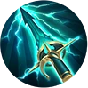
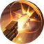

[Главная](https://boostmlbb.ru/) / [Герои](https://boostmlbb.ru/heroes/)

Тир B

# Клинт в Mobile Legends: сборка, контрпики и статистика

Стрелок, линия золота. Выигрывает 50,33% матчей за последние 30 дней — 55-е место из 133 героев.

[Буст на этом герое](https://boostmlbb.ru/order.html?type=hero)[Все герои](https://boostmlbb.ru/heroes/)

Статистика герояТир B

**Клинт**Бан 0,61% · Выбор 0,72%

Контрпики

Победы за 30 дней**50,33%**

**50,33%**побед за 30 дней

**0,72%**выбирают в матчах

**0,61%**банят в матчах

**50,58%**побед в Мифической славе

## Сборка на героя «Клинт»

Самая популярная сборка для героя «Клинт» на роли линии золота в рейтинговых матчах на всех рангах — по данным «Академии» в игре. Процент побед — в матчах именно с этой сборкой.

Ключевые предметы

Бесконечная битваПронзающий небесаГубительный пулемет

Эмблема и таланты

Эмблема бойцаТрепетМастер оружийКвантовый заряд

Боевое заклинание

Вспышка

Побед с этой сборкой **55,55%**Выбирают в **3,61%** матчей

### Другие популярные варианты

-   ВспышкаЭмблема убийцыРазрыв · Мастер оружий · Квантовый заряд**51,90%**
-   ВспышкаЭмблема убийцыРазрыв · Мастер оружий · Квантовый заряд**55,94%**

## Навыки героя «Клинт»

Официальные описания навыков от MOONTON с перезарядкой и типом навыка.

Порядок прокачки: **Обстрел гранатами** → **Быстрый выигрыш** → **Ловкий маневр**

-   

    **Двойной выстрел**Пассивный

    После каждого применения навыка следующая базовая атака Клинта в течение 4 сек. пробивает линию врагов, нанося 150 (+100% общей физической атаки) единиц физического урона. Этот урон может активировать эффекты атаки, а часть, которая зависит от , может нанести критический удар.

-   

    **Быстрый выигрыш**1-й навыкПерезарядка 8 Mana Cost: 50 с

    Клинт быстро стреляет 5 пулями в указанном направлении, каждая пуля наносит 250 (+85% общей физической атаки) единиц физического урона пораженному врагу.
    Пули равномерно распределяются по веерообразной области. Начиная со второй пули, враги получают меньше урона от каждой последующей пули.

-   

    **Ловкий маневр**2-й навыкПерезарядка 10 Mana Cost: 80 с

    Клинт выстреливает сетью в указанном направлении, слегка отпрыгивая и нанося 140 (+30% общей физической атаки) (+150% общей магической силы) единиц физического урона первому пораженному врагу, а также обездвиживая его на 1.2 сек.
    При попадании по врагу перезарядка навыка сократится на 40%.

-   

    **Обстрел гранатами**УльтимейтПерезарядка 1.5 Mana Cost: 50 с

    Клинт запускает гранату в указанном направлении, которая взрывается при попадании по первому врагу, нанося 280 (+100% общей физической атаки) единиц физического урона и замедляя его на 50% на 0.5 сек.
    Клинт получает новую гранату каждые 10 сек. (до 3).

## Роль и линия

Место считается по проценту побед за 30 дней среди героев той же роли или линии.

-   Роль**Стрелок**
-   Линия**Линия золота**
-   Среди стрелков**9-е из 23**
-   На линии золота**8-е из 21**
-   Специализация**Добивание, Разрушительный урон**
-   Сложность**Средняя (60/100)**

## Кто контрит этого героя

Против этих героев «Клинт» проигрывает чаще всего. Под иконкой — их собственный процент побед. 3 из 5 контрпиков — танки.

[Лолита53,30%](https://boostmlbb.ru/heroes/lolita.html)[Карина48,60%](https://boostmlbb.ru/heroes/karina.html)[Белерик51,83%](https://boostmlbb.ru/heroes/belerick.html)[Баксий45,97%](https://boostmlbb.ru/heroes/baxia.html)[Люнокс50,64%](https://boostmlbb.ru/heroes/lunox.html)

## Против кого силён

Для этих героев «Клинт» — один из самых неудобных соперников.

[Фанни42,64%](https://boostmlbb.ru/heroes/fanny.html)

## С кем играть в команде

С этими героями в одной команде «Клинт» выигрывает чаще. Число — прибавка к проценту побед в процентных пунктах.

[Харит+4,78 п. п.](https://boostmlbb.ru/heroes/harith.html)[Пополь и Купа+2,21 п. п.](https://boostmlbb.ru/heroes/popol-and-kupa.html)[Роджер+1,78 п. п.](https://boostmlbb.ru/heroes/roger.html)[Маша+1,21 п. п.](https://boostmlbb.ru/heroes/masha.html)

## Процент побед по рангам

Лучший результат — на ранге «Мифическая честь» (50,88%), слабее всего — «Эпик» (47,48%). Данные за последние 30 дней.

-   Эпик**47,48%**
-   Легенда**49,35%**
-   Мифический**50,05%**
-   Мифическая честь**50,88%**
-   Мифическая слава**50,58%**

## Место в мете

«Клинт» — тир B в нашем тир-листе по проценту побед, 55-е место из 133 героев. В Мифической славе результат почти такой же: 50,58%. Полный [тир-лист ноября](https://boostmlbb.ru/news/mlbb-meta-tier-list/) и [разбор патча](https://boostmlbb.ru/news/mlbb-current-patch/).

## Другие герои линии золота

Самые сильные по проценту побед за последние 30 дней.

[Бруно53,78%](https://boostmlbb.ru/heroes/bruno.html)[Обсидия53,20%](https://boostmlbb.ru/heroes/obsidia.html)[Иритель52,74%](https://boostmlbb.ru/heroes/irithel.html)[Ханаби52,66%](https://boostmlbb.ru/heroes/hanabi.html)[Пополь и Купа52,09%](https://boostmlbb.ru/heroes/popol-and-kupa.html)[Натан51,32%](https://boostmlbb.ru/heroes/natan.html)

## История героя

«Бесстрашный стрелок и шериф, твердо и непоколебимо вершащий правосудие среди песков.»

Полная история героя «Клинт» — на официальном сайте лора MOONTON. Карточка героя с навыками и советами разработчиков — на mobilelegends.com, реплики, облики и история изменений — в MLBB Wiki.

[Читать историю](https://play.mobilelegends.com/lore/hero/Clint)[Карточка героя](https://www.mobilelegends.com/hero/detail?heroid=13)[MLBB Wiki](https://mobile-legends.fandom.com/wiki/Clint)

## Буст на герое «Клинт»

Бустер играет только этим героем: вместе с рангом растёт и рейтинг героя.

[Рассчитать стоимость](https://boostmlbb.ru/order.html?type=hero)

Статистика — официальный рейтинг героев MOONTON (mobilelegends.com/rank) за последние 30 дней, обновление 23 ноября 2026 года, страница обновляется каждый день. Роли и линии — с официальной страницы героев. Сборки, навыки и союзники — данные «Академии» MOONTON через Rone Arena API (ridwaanhall / RoneAI).

## Частые вопросы

Кто контрпик для героя «Клинт» в MLBB?

За последние 30 дней чаще всего героя обыгрывают Лолита, Карина, Белерик, Баксий и Люнокс.

Какой процент побед у героя «Клинт» сейчас?

50,33% за последние 30 дней на всех рангах и 50,58% в Мифической славе, данные на 23 ноября 2026 года.

Какая роль и линия у героя «Клинт»?

Стрелок, играет на линии золота.

Силён ли герой «Клинт» в текущей мете?

Тир B: 55-е место из 133 героев по проценту побед за 30 дней и 9-е среди стрелков.

Какая сборка на героя «Клинт» лучшая?

Самая популярная сборка в рейтинге: ключевые предметы «Бесконечная битва», «Пронзающий небеса» и «Губительный пулемет», эмблема бойца с талантами «Трепет», «Мастер оружий» и «Квантовый заряд» и заклинание «Вспышка». С ней выигрывают 55,55% матчей.

Редакция MLBB Boost · Обновлено 23 ноября 2026
