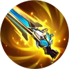

[Тир-лист](https://boostmlbb.ru/heroes/)[Новости и гайды](https://boostmlbb.ru/news/)

Тир B

# Клинт

Стрелок · Линия золота

Победы

50,33%

Выбор

0,72%

Баны

0,61%

**№ 55 из 133 по доле побед**Все ранги · 30 дней по 23 ноября 2026 года

[Сборка](https://boostmlbb.ru/#build)[Контрпики](https://boostmlbb.ru/#draft)[Навыки](https://boostmlbb.ru/#skills)[Статистика](https://boostmlbb.ru/#ranks)[История](https://boostmlbb.ru/#lore)

Добивание · Разрушительный урон · Сложность 60/100

## Сборка

Самый частый выбор в рейтинге · Линия золота

Ключевые предметы

Бесконечная битваПронзающий небесаГубительный пулемет

Эмблема и таланты

Эмблема бойцаТрепетМастер оружийКвантовый заряд

Боевое заклинание

Вспышка

Побед с этой сборкой **55,55%**Выбирают в **3,61%** матчей

Другие сборки (2)

Ключевые предметы

Удар охотникаБесконечная битваГубительный пулемет

Эмблема и таланты

Эмблема убийцыРазрывМастер оружийКвантовый заряд

Боевое заклинание

Вспышка

Побед с этой сборкой **51,90%**Выбирают в **5,29%** матчей

Ключевые предметы

Бесконечная битваПронзающий небесаГубительный пулемет

Эмблема и таланты

Эмблема убийцыРазрывМастер оружийКвантовый заряд

Боевое заклинание

Вспышка

Побед с этой сборкой **55,94%**Выбирают в **4,59%** матчей

## Контрпики и союзники

### Кто контрит

[Лолита](https://boostmlbb.ru/heroes/lolita.html)[Карина](https://boostmlbb.ru/heroes/karina.html)[Белерик](https://boostmlbb.ru/heroes/belerick.html)[Баксий](https://boostmlbb.ru/heroes/baxia.html)[Люнокс](https://boostmlbb.ru/heroes/lunox.html)

### Против кого силён

[Фанни](https://boostmlbb.ru/heroes/fanny.html)

### Союзники

Изменение винрейта в паре

[Харит+4,78 п. п.](https://boostmlbb.ru/heroes/harith.html)[Пополь и Купа+2,21 п. п.](https://boostmlbb.ru/heroes/popol-and-kupa.html)[Роджер+1,78 п. п.](https://boostmlbb.ru/heroes/roger.html)[Маша+1,21 п. п.](https://boostmlbb.ru/heroes/masha.html)

## Навыки

Приоритет прокачки · Обстрел гранатами → Быстрый выигрыш → Ловкий маневр

Пассивный**Двойной выстрел**

После каждого применения навыка следующая базовая атака Клинта в течение 4 сек. пробивает линию врагов, нанося 150 (+100% общей физической атаки) единиц физического урона. Этот урон может активировать эффекты атаки, а часть, которая зависит от , может нанести критический удар.

1-й навык**Быстрый выигрыш**

**Перезарядка 8 Mana Cost: 50 с**

Клинт быстро стреляет 5 пулями в указанном направлении, каждая пуля наносит 250 (+85% общей физической атаки) единиц физического урона пораженному врагу.
Пули равномерно распределяются по веерообразной области. Начиная со второй пули, враги получают меньше урона от каждой последующей пули.

2-й навык**Ловкий маневр**

**Перезарядка 10 Mana Cost: 80 с**

Клинт выстреливает сетью в указанном направлении, слегка отпрыгивая и нанося 140 (+30% общей физической атаки) (+150% общей магической силы) единиц физического урона первому пораженному врагу, а также обездвиживая его на 1.2 сек.
При попадании по врагу перезарядка навыка сократится на 40%.

Ультимейт**Обстрел гранатами**

**Перезарядка 1.5 Mana Cost: 50 с**

Клинт запускает гранату в указанном направлении, которая взрывается при попадании по первому врагу, нанося 280 (+100% общей физической атаки) единиц физического урона и замедляя его на 50% на 0.5 сек.
Клинт получает новую гранату каждые 10 сек. (до 3).

## Победы по рангам

-   Эпик**47,48%**
-   Легенда**49,35%**
-   Мифический**50,05%**
-   Мифическая честь**50,88%**
-   Мифическая слава**50,58%**

## История

Бесстрашный стрелок и шериф, твердо и непоколебимо вершащий правосудие среди песков.

[Читать полную историю ↗](https://play.mobilelegends.com/lore/hero/Clint)Официальный сайт Mobile Legends

[Характеристики на сайте игры](https://www.mobilelegends.com/hero/detail?heroid=13)

[Стоимость буста на герое](https://boostmlbb.ru/order.html?type=hero)

## Частые вопросы

Кто контрпик для героя «Клинт» в MLBB?

За последние 30 дней чаще всего героя обыгрывают Лолита, Карина, Белерик, Баксий и Люнокс.

Какой процент побед у героя «Клинт» сейчас?

50,33% за последние 30 дней на всех рангах и 50,58% в Мифической славе, данные на 23 ноября 2026 года.

Какая роль и линия у героя «Клинт»?

Стрелок, играет на линии золота.

Силён ли герой «Клинт» в текущей мете?

Тир B: 55-е место из 133 героев по проценту побед за 30 дней и 9-е среди стрелков.

Какая сборка на героя «Клинт» лучшая?

Самая популярная сборка в рейтинге: ключевые предметы «Бесконечная битва», «Пронзающий небеса» и «Губительный пулемет», эмблема бойца с талантами «Трепет», «Мастер оружий» и «Квантовый заряд» и заклинание «Вспышка». С ней выигрывают 55,55% матчей.
