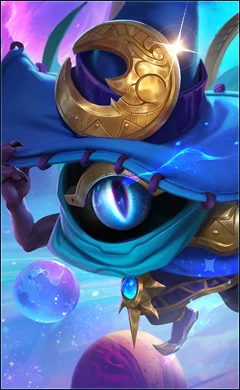

[Тир-лист](https://boostmlbb.ru/heroes/)[Новости и гайды](https://boostmlbb.ru/news/)

# Циклоп

B

МагСредняя линия

Небесный путешественник по Вселенной.

Победы

51,1%

все ранги 51,7%

Выбор

0,8%

все ранги 0,8%

Баны

0,8%

все ранги 0,8%

№46 в тир-листе · №9 среди магов · Мифическая слава, 7 дней, по 23 ноября

[Обзор](https://boostmlbb.ru/#overview)[Сборка](https://boostmlbb.ru/#build)[Навыки](https://boostmlbb.ru/#skills)[Контрпики](https://boostmlbb.ru/#draft)[История](https://boostmlbb.ru/#lore)

## Обзор

### Характеристики

-   Живучесть**30**
-   Атака**100**
-   Эффекты**70**
-   Сложность**40**

-   Урон
-   Контроль

### Победы по рангам, 30 дней

1.  **52,0%**Эпик
2.  **52,1%**Легенда
3.  **52,5%**Мифик
4.  **52,0%**Честь
5.  **50,8%**Слава

Пунктир: 50% побед

### Другие маги этой линии

[Эйдора](https://boostmlbb.ru/heroes/eudora.html)[Ксавьер](https://boostmlbb.ru/heroes/xavier.html)[Валир](https://boostmlbb.ru/heroes/valir.html)[Цзэтянь](https://boostmlbb.ru/heroes/zetian.html)[Люнокс](https://boostmlbb.ru/heroes/lunox.html)[Кагура](https://boostmlbb.ru/heroes/kagura.html)[Сесилион](https://boostmlbb.ru/heroes/cecilion.html)[Горд](https://boostmlbb.ru/heroes/gord.html)

## Сборка

Средняя линия · по данным рейтинговых матчей

Сборка 158,2%Сборка 261,8%Сборка 357,5%

### Предметы

Зачарованный талисман

Концентрированная энергия

Пылающий жезл

### Эмблема

Эмблема мага

Вдохновение

Кровавое пиршество

Нечестивая ярость

### Заклинание

Вспышка

Победы

58,2%

Выбор

5,7%

### Предметы

Зачарованный талисман

Концентрированная энергия

Крылья королевы

### Эмблема

Эмблема мага

Вдохновение

Кровавое пиршество

Нечестивая ярость

### Заклинание

Вспышка

Победы

61,8%

Выбор

4,6%

### Предметы

Зачарованный талисман

Концентрированная энергия

Крылья королевы

### Эмблема

Эмблема мага

Вдохновение

Опытный охотник

Нечестивая ярость

### Заклинание

Вспышка

Победы

57,5%

Выбор

3,8%

## Навыки

Прокачка**Звездный капкан**_›_**Атака планет**_›_**Космический удар**

Пассивный1-й навык2-й навыкУльтимейт

Пассивный

### Звездные песочные часы

Каждый раз, когда Циклоп попадает навыками по врагу, перезарядка всех его навыков сокращается на 0.5 сек.

1-й навык

### Космический удар

Перезарядка **7.5 Mana Cost: 50 с**

Циклоп выпускает два диска звездной пыли в указанном направлении, каждый из которых наносит 240 (+60% общей магической силы) единиц магического урона врагам на пути.

2-й навык

### Атака планет

Перезарядка **14 Mana Cost: 60 с**

Циклоп создает вокруг себя звездные сферы и получает 50% скорости передвижения, которая снижается за 2 сек.

Звездные сферы автоматически находят и атакуют ближайших врагов (приоритет — вражеские герои) и взрываются при столкновении, нанося 200 (+65% общей магической силы) единиц магического урона.

Урон снижается при последующих попаданиях по той же цели.

Ультимейт

### Звездный капкан

Перезарядка **26 Mana Cost: 60 с**

Циклоп создает планетарную сферу, которая преследует указанного вражеского героя или монстра, нанося 500 (+120% общей магической силы) единиц магического урона и обездвиживая его на 0.75-1.5 сек. (зависит от расстояния полета планетарной сферы).

## Контрпики и союзники

### Контрпики

Побеждают этого героя

[Наталья](https://boostmlbb.ru/heroes/natalia.html)[Марсель](https://boostmlbb.ru/heroes/marcel.html)[Ванван](https://boostmlbb.ru/heroes/wanwan.html)[Джой](https://boostmlbb.ru/heroes/joy.html)[Матильда](https://boostmlbb.ru/heroes/mathilda.html)

### Слабые цели

Этот герой побеждает их

[Минотавр](https://boostmlbb.ru/heroes/minotaur.html)[Иксия](https://boostmlbb.ru/heroes/ixia.html)[Эстес](https://boostmlbb.ru/heroes/estes.html)[Лолита](https://boostmlbb.ru/heroes/lolita.html)

### Союзники

Рост побед в паре, п. п.

[Новария**+2,6**](https://boostmlbb.ru/heroes/novaria.html)[Нана**+2,6**](https://boostmlbb.ru/heroes/nana.html)[Кагура**+2,4**](https://boostmlbb.ru/heroes/kagura.html)[Вэйл**+2,4**](https://boostmlbb.ru/heroes/vale.html)

## История

> Небесный путешественник по Вселенной.

[Читать полную историю ↗](https://kazukiofficial.com/stories/cyclops)Kazuki Official, английский

[Характеристики на сайте игры ↗](https://www.mobilelegends.com/hero/detail?heroid=33)

**Поднимем ранг на герое «Циклоп»**Цена считается в калькуляторе

[Рассчитать цену](https://boostmlbb.ru/order.html?type=hero)

## Частые вопросы

Кто контрпик для героя «Циклоп» в MLBB?

За последние 30 дней чаще всего героя обыгрывают Наталья, Марсель, Ванван, Джой и Матильда.

Какой процент побед у героя «Циклоп» сейчас?

51,14% в Мифической славе за последние 7 дней и 51,68% на всех рангах за 30 дней, данные на 23 ноября 2026 года.

Какая роль и линия у героя «Циклоп»?

Маг, играет на средней линии.

Силён ли герой «Циклоп» в текущей мете?

Тир B, 46-е место из 133 героев и 9-е среди магов. Тир учитывает, как часто героя берут и банят и как он выигрывает в Мифической славе за 7 дней: бан в 0,8% матчей, 51,1% побед.

Какая сборка на героя «Циклоп» лучшая?

Самая популярная сборка в рейтинге: ключевые предметы «Зачарованный талисман», «Концентрированная энергия» и «Пылающий жезл», эмблема мага с талантами «Вдохновение», «Кровавое пиршество» и «Нечестивая ярость» и заклинание «Вспышка». С ней выигрывают 58,16% матчей.
