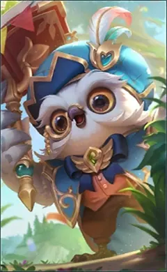

[Тир-лист](https://boostmlbb.ru/heroes/)[Предметы](https://boostmlbb.ru/items/)[Скины](https://boostmlbb.ru/skins/)[Новости и гайды](https://boostmlbb.ru/news/)

[Тир-лист](https://boostmlbb.ru/heroes/)

# Дигги

B

ПоддержкаРоум

Победы

56,1%

Выбор

0,3%

Баны

5,5%

[Обзор](https://boostmlbb.ru/#overview)[Сборка](https://boostmlbb.ru/#build)[Как играть](https://boostmlbb.ru/#howto)[Навыки](https://boostmlbb.ru/#skills)[Контрпики](https://boostmlbb.ru/#draft)[Скины](https://boostmlbb.ru/#skins)[История](https://boostmlbb.ru/#lore)

## Обзор

### Характеристики

-   Живучесть**40**
-   Атака**40**
-   Эффекты**20**
-   Сложность**30**

-   Защита
-   Поук

### Победы по рангам, 30 дней

1.  **50,9%**Эпик
2.  **51,4%**Легенда
3.  **52,9%**Мифик
4.  **53,9%**Честь
5.  **55,6%**Слава

Пунктир: 50% побед

### Другие герои поддержки этой линии

[Марсель](https://boostmlbb.ru/heroes/marcel.html)[Эстес](https://boostmlbb.ru/heroes/estes.html)[Кайя](https://boostmlbb.ru/heroes/kaja.html)[Флорин](https://boostmlbb.ru/heroes/floryn.html)[Рафаэль](https://boostmlbb.ru/heroes/rafaela.html)[Ангела](https://boostmlbb.ru/heroes/angela.html)

### Места в рейтингах

-   [Лучшие роумеры MLBB**17 из 34**](https://boostmlbb.ru/heroes/best-roam.html)

## Сборка

Сборка 1Сборка 2Сборка 3

Победы

63,2%

Выбор

20,9%

#### Основные предметы

-   [

    

    Фляга Оазиса

    ](https://boostmlbb.ru/items/flask-of-the-oasis.html)
-   [

    

    Мимолетное время

    ](https://boostmlbb.ru/items/fleeting-time.html)
-   [

    

    Защитный шлем

    ](https://boostmlbb.ru/items/guardian-helmet.html)

#### Заклинание

Восстановление

#### Эмблема и таланты

Эмблема поддержки

-   

    Вдохновение

-   

    Второе дыхание

-   

    Фокус-метка

Победы

60,2%

Выбор

14,7%

#### Основные предметы

-   [

    

    Фляга Оазиса

    ](https://boostmlbb.ru/items/flask-of-the-oasis.html)
-   [

    

    Мимолетное время

    ](https://boostmlbb.ru/items/fleeting-time.html)
-   [

    

    Господство льда

    ](https://boostmlbb.ru/items/dominance-ice.html)

#### Заклинание

Восстановление

#### Эмблема и таланты

Эмблема поддержки

-   

    Вдохновение

-   

    Второе дыхание

-   

    Фокус-метка

Победы

58,3%

Выбор

3,6%

#### Основные предметы

-   [

    

    Фляга Оазиса

    ](https://boostmlbb.ru/items/flask-of-the-oasis.html)
-   [

    

    Мимолетное время

    ](https://boostmlbb.ru/items/fleeting-time.html)
-   [

    

    Древняя кираса

    ](https://boostmlbb.ru/items/antique-cuirass.html)

#### Заклинание

Восстановление

#### Эмблема и таланты

Эмблема поддержки

-   

    Вдохновение

-   

    Второе дыхание

-   

    Фокус-метка

## Как играть за Дигги

### Комбо Дигги

#### В драке

1.  1
2.  2
3.  Ульт

В драке тревожьте врага первым навыком. Если кто-то пытается инициировать, оттащите его вторым. Если союзник попал в контроль или получает много урона, спасайте его ультом.

#### На линии

1.  2
2.  1

На линии вторым навыком удержите врага на месте и подбросьте ему сову-будильник первым.

### Когда сильнее всего

Сильнее в начале: на 10–12 минутах выигрывает 59,0%. Давите на линии, забирайте объекты и заканчивайте, пока преимущество не растаяло.

1.  **59,0**10–12
2.  **56,2**12–14
3.  **54,3**14–16
4.  **52,5**16–18
5.  **52,3**18–20
6.  **50,6**20+

Проценты побед по длине матча в минутах, все ранги. Пунктир: 50%

### Приоритет прокачки

1.  Путешествие во времени
2.  Автоматическая бомба
3.  Время назад

## Навыки

Пассивный**Снова молодой**1-й навык**Автоматическая бомба**2-й навык**Время назад**Ультимейт**Путешествие во времени**

Пассивный

### Снова молодой

После смерти Дигги обращает время вспять и возвращается в форму яйца, в которой может передвигаться и использовать новый набор навыков. В форме яйца он получает неуловимость для прицела и возрождается в текущем местоположении.

1-й навык

### Автоматическая бомба

Перезарядка **8 Mana Cost: 70 с**

Дигги бросает сову-будильник в указанное место, который остается неподвижным в течение 25 сек. или пока не среагирует на первого врага в радиусе действия, преследуя его и взрываясь при столкновении. Взрыв наносит 350 (+100% общей магической силы) единиц магического урона пораженным врагам и замедляет их на 30%.

Дигги получает 2 заряда взрывных искр каждый раз, когда вражеский герой поражается взрывом (до 60 зарядов), каждый заряд увеличивает урон навыка на 1%. Дигги теряет половину зарядов после смерти, но может получить 1 заряд взрывных искр каждый раз, когда поражает вражеского героя навыком в форме яйца.

Одновременно может существовать до 5 сов-будильников.

2-й навык

### Время назад

Перезарядка **15 Mana Cost: 90 с**

Дигги отмечает указанного вражеского героя на 4 сек. и притягивает его к предыдущему месту после окончания действия, нанося 150 (+100% общей магической силы) единиц магического урона и ненадолго замедляя его на 80%.

Если враг выйдет из круга, притягивание сработает раньше.

Ультимейт

### Путешествие во времени

Перезарядка **76 Mana Cost: 130 с**

Дигги снимает все дебаффы с ближайших союзных героев (включая себя) и дает 650 (+300% общей магической силы) ед. щита и иммунитет к контролю на 2 сек. Он также получает 50% скорости передвижения на 0.5 сек.

## Контрпики Дигги

### Кто контрит Дигги

[Алиса](https://boostmlbb.ru/heroes/alice.html)[Чжусинь](https://boostmlbb.ru/heroes/zhuxin.html)[Гвиневра](https://boostmlbb.ru/heroes/guinevere.html)[Чичи](https://boostmlbb.ru/heroes/cici.html)[Валир](https://boostmlbb.ru/heroes/valir.html)

### Кого контрит Дигги

[Лейла](https://boostmlbb.ru/heroes/layla.html)[Сан](https://boostmlbb.ru/heroes/sun.html)[Грейнджер](https://boostmlbb.ru/heroes/granger.html)[Новария](https://boostmlbb.ru/heroes/novaria.html)[Франко](https://boostmlbb.ru/heroes/franco.html)[Зилонг](https://boostmlbb.ru/heroes/zilong.html)[Эстес](https://boostmlbb.ru/heroes/estes.html)[Хелкарт](https://boostmlbb.ru/heroes/helcurt.html)[Чан'Э](https://boostmlbb.ru/heroes/change.html)[Инь](https://boostmlbb.ru/heroes/yin.html)

## Скины Дигги

[Хранитель подлескаОбычный · 2024](https://boostmlbb.ru/skins/diggie/underwood-steward.html)[СказочникДелюкс · 2022](https://boostmlbb.ru/skins/diggie/fairytaler.html)[Цирковой клоунОбычный · 2021](https://boostmlbb.ru/skins/diggie/circus-clown.html)[СозвездиеИсключительный · 2019](https://boostmlbb.ru/skins/diggie/constellation.html)[ГолубятникОбычный · 2017](https://boostmlbb.ru/skins/diggie/pigeoneer.html)

[Все 5 скинов Дигги: цены и как получить](https://boostmlbb.ru/skins/diggie.html)

## История

> Сова-ученый, способный управлять временем.

[Читать полную историю ↗](https://kazukiofficial.com/stories/diggie)Kazuki Official, английский [Характеристики на сайте игры ↗](https://www.mobilelegends.com/hero/detail?heroid=48)

**Поднимем ранг на герое «Дигги»**Цена считается в калькуляторе

[Рассчитать цену](https://boostmlbb.ru/order.html?type=hero)

## Частые вопросы

Кто контрит Дигги в MLBB?

За последние 30 дней Дигги чаще всего обыгрывают Алиса, Чжусинь, Гвиневра, Чичи и Валир.

Как играть за Дигги?

В первую очередь качайте «Автоматическая бомба», ульт берите, как только доступен. Сильнее в начале: на 10–12 минутах выигрывает 59,0%. Давите на линии, забирайте объекты и заканчивайте, пока преимущество не растаяло. Комбо для драки: В драке тревожьте врага первым навыком. Если кто-то пытается инициировать, оттащите его вторым. Если союзник попал в контроль или получает много урона, спасайте его ультом.

Какой процент побед у Дигги сейчас?

56,06% в Мифической славе за последние 7 дней и 54,42% на всех рангах за 30 дней, данные на 26 ноября 2026 года.

Какая роль и линия у Дигги?

Поддержка, играет в роуме.

Стоит ли брать Дигги в текущей мете?

Тир B, 57-е место из 133 героев и 10-е среди героев поддержки. Тир учитывает, как часто героя берут и банят и как он выигрывает в Мифической славе за 7 дней: бан в 5,5% матчей, 56,1% побед. В профессиональных матчах за месяц героя драфтуют в 0,0% катков.

Какая сборка на Дигги лучшая?

Самая популярная сборка в рейтинге: ключевые предметы «Фляга Оазиса», «Мимолетное время» и «Защитный шлем», эмблема поддержки с талантами «Вдохновение», «Второе дыхание» и «Фокус-метка» и заклинание «Восстановление». С ней выигрывают 63,24% матчей.
