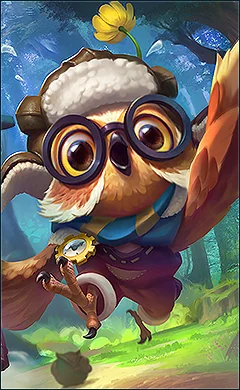

[Тир-лист](https://boostmlbb.ru/heroes/)[Новости и гайды](https://boostmlbb.ru/news/)

# Дигги

A

ПоддержкаРоум

Сова-ученый, способный управлять временем.

Победы

55,9%

все ранги 54,3%

Выбор

0,3%

все ранги 0,2%

Баны

5,3%

все ранги 3,7%

№29 в тир-листе · №10 среди героев поддержки · Мифическая слава, 7 дней, по 23 ноября

[Обзор](https://boostmlbb.ru/#overview)[Сборка](https://boostmlbb.ru/#build)[Навыки](https://boostmlbb.ru/#skills)[Контрпики](https://boostmlbb.ru/#draft)[История](https://boostmlbb.ru/#lore)

## Обзор

### Характеристики

-   Живучесть**40**
-   Атака**40**
-   Эффекты**20**
-   Сложность**30**

-   Защита
-   Поук

### Победы по рангам, 30 дней

1.  **50,7%**Эпик
2.  **51,5%**Легенда
3.  **53,1%**Мифик
4.  **53,9%**Честь
5.  **55,5%**Слава

Пунктир: 50% побед

### Другие герои поддержки этой линии

[Марсель](https://boostmlbb.ru/heroes/marcel.html)[Эстес](https://boostmlbb.ru/heroes/estes.html)[Флорин](https://boostmlbb.ru/heroes/floryn.html)[Кайя](https://boostmlbb.ru/heroes/kaja.html)[Рафаэль](https://boostmlbb.ru/heroes/rafaela.html)[Ангела](https://boostmlbb.ru/heroes/angela.html)

## Сборка

Роум · по данным рейтинговых матчей

Сборка 163,0%Сборка 260,1%Сборка 357,9%

### Предметы

Фляга Оазиса

Мимолетное время

Защитный шлем

### Эмблема

Эмблема поддержки

Вдохновение

Второе дыхание

Фокус-метка

### Заклинание

Восстановление

Победы

63,0%

Выбор

21,3%

### Предметы

Фляга Оазиса

Мимолетное время

Господство льда

### Эмблема

Эмблема поддержки

Вдохновение

Второе дыхание

Фокус-метка

### Заклинание

Восстановление

Победы

60,1%

Выбор

13,9%

### Предметы

Фляга Оазиса

Мимолетное время

Древняя кираса

### Эмблема

Эмблема поддержки

Вдохновение

Второе дыхание

Фокус-метка

### Заклинание

Восстановление

Победы

57,9%

Выбор

3,6%

## Навыки

Прокачка**Путешествие во времени**_›_**Автоматическая бомба**_›_**Время назад**

Пассивный1-й навык2-й навыкУльтимейт

Пассивный

### Снова молодой

После смерти Дигги обращает время вспять и возвращается в форму яйца, в которой может передвигаться и использовать новый набор навыков. В форме яйца он получает неуловимость для прицела и возрождается в текущем местоположении.

1-й навык

### Автоматическая бомба

Перезарядка **8 Mana Cost: 70 с**

Дигги бросает сову-будильник в указанное место, который остается неподвижным в течение 25 сек. или пока не среагирует на первого врага в радиусе действия, преследуя его и взрываясь при столкновении. Взрыв наносит 350 (+100% общей магической силы) единиц магического урона пораженным врагам и замедляет их на 30%.

Дигги получает 2 заряда взрывных искр каждый раз, когда вражеский герой поражается взрывом (до 60 зарядов), каждый заряд увеличивает урон навыка на 1%. Дигги теряет половину зарядов после смерти, но может получить 1 заряд взрывных искр каждый раз, когда поражает вражеского героя навыком в форме яйца.

Одновременно может существовать до 5 сов-будильников.

2-й навык

### Время назад

Перезарядка **15 Mana Cost: 90 с**

Дигги отмечает указанного вражеского героя на 4 сек. и притягивает его к предыдущему месту после окончания действия, нанося 150 (+100% общей магической силы) единиц магического урона и ненадолго замедляя его на 80%.

Если враг выйдет из круга, притягивание сработает раньше.

Ультимейт

### Путешествие во времени

Перезарядка **76 Mana Cost: 130 с**

Дигги снимает все дебаффы с ближайших союзных героев (включая себя) и дает 650 (+300% общей магической силы) ед. щита и иммунитет к контролю на 2 сек. Он также получает 50% скорости передвижения на 0.5 сек.

## Контрпики и союзники

### Контрпики

Побеждают этого героя

[Алиса](https://boostmlbb.ru/heroes/alice.html)[Чжусинь](https://boostmlbb.ru/heroes/zhuxin.html)[Гвиневра](https://boostmlbb.ru/heroes/guinevere.html)[Чичи](https://boostmlbb.ru/heroes/cici.html)[Валир](https://boostmlbb.ru/heroes/valir.html)

### Слабые цели

Этот герой побеждает их

[Лейла](https://boostmlbb.ru/heroes/layla.html)[Сан](https://boostmlbb.ru/heroes/sun.html)[Грейнджер](https://boostmlbb.ru/heroes/granger.html)[Новария](https://boostmlbb.ru/heroes/novaria.html)[Франко](https://boostmlbb.ru/heroes/franco.html)[Тамуз](https://boostmlbb.ru/heroes/thamuz.html)[Зилонг](https://boostmlbb.ru/heroes/zilong.html)[Эстес](https://boostmlbb.ru/heroes/estes.html)[Чан'Э](https://boostmlbb.ru/heroes/change.html)[Хелкарт](https://boostmlbb.ru/heroes/helcurt.html)

### Союзники

Рост побед в паре, п. п.

[Баксий**+11,7**](https://boostmlbb.ru/heroes/baxia.html)[Иксия**+7,4**](https://boostmlbb.ru/heroes/ixia.html)[Калеа**+6,6**](https://boostmlbb.ru/heroes/kalea.html)[Сабер**+6,1**](https://boostmlbb.ru/heroes/saber.html)

## История

> Сова-ученый, способный управлять временем.

[Читать полную историю ↗](https://kazukiofficial.com/stories/diggie)Kazuki Official, английский

[Характеристики на сайте игры ↗](https://www.mobilelegends.com/hero/detail?heroid=48)

**Поднимем ранг на герое «Дигги»**Цена считается в калькуляторе

[Рассчитать цену](https://boostmlbb.ru/order.html?type=hero)

## Частые вопросы

Кто контрпик для героя «Дигги» в MLBB?

За последние 30 дней чаще всего героя обыгрывают Алиса, Чжусинь, Гвиневра, Чичи и Валир.

Какой процент побед у героя «Дигги» сейчас?

55,94% в Мифической славе за последние 7 дней и 54,30% на всех рангах за 30 дней, данные на 23 ноября 2026 года.

Какая роль и линия у героя «Дигги»?

Поддержка, играет в роуме.

Силён ли герой «Дигги» в текущей мете?

Тир A, 29-е место из 133 героев и 10-е среди героев поддержки. Тир учитывает, как часто героя берут и банят и как он выигрывает в Мифической славе за 7 дней: бан в 5,3% матчей, 55,9% побед.

Какая сборка на героя «Дигги» лучшая?

Самая популярная сборка в рейтинге: ключевые предметы «Фляга Оазиса», «Мимолетное время» и «Защитный шлем», эмблема поддержки с талантами «Вдохновение», «Второе дыхание» и «Фокус-метка» и заклинание «Восстановление». С ней выигрывают 63,01% матчей.
