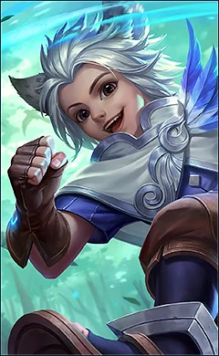

[Тир-лист](https://boostmlbb.ru/heroes/)[Предметы](https://boostmlbb.ru/items/)[Скины](https://boostmlbb.ru/skins/)[Новости и гайды](https://boostmlbb.ru/news/)

[Тир-лист](https://boostmlbb.ru/heroes/)

# Эдит

C

ТанкСтрелокЛиния опыта

Победы

52,4%

Выбор

0,3%

Баны

0,1%

[Обзор](https://boostmlbb.ru/#overview)[Сборка](https://boostmlbb.ru/#build)[Как играть](https://boostmlbb.ru/#howto)[Навыки](https://boostmlbb.ru/#skills)[Контрпики](https://boostmlbb.ru/#draft)[Скины](https://boostmlbb.ru/#skins)[История](https://boostmlbb.ru/#lore)

## Обзор

### Характеристики

-   Живучесть**70**
-   Атака**30**
-   Эффекты**100**
-   Сложность**40**

-   Контроль
-   Разрушительный урон

### Победы по рангам, 30 дней

1.  **53,5%**Эпик
2.  **53,5%**Легенда
3.  **53,5%**Мифик
4.  **52,8%**Честь
5.  **52,0%**Слава

Пунктир: 50% побед

### Другие танки этой линии

[Маша](https://boostmlbb.ru/heroes/masha.html)[Алиса](https://boostmlbb.ru/heroes/alice.html)[Эсмеральда](https://boostmlbb.ru/heroes/esmeralda.html)[Глу](https://boostmlbb.ru/heroes/gloo.html)[Бартс](https://boostmlbb.ru/heroes/barats.html)[Уранус](https://boostmlbb.ru/heroes/uranus.html)[Хильда](https://boostmlbb.ru/heroes/hilda.html)[Гатоткача](https://boostmlbb.ru/heroes/gatotkaca.html)

### Места в рейтингах

-   [Лучшие стрелки MLBB**20 из 23**](https://boostmlbb.ru/heroes/best-marksman.html)
-   [Лучшие танки MLBB**16 из 25**](https://boostmlbb.ru/heroes/best-tank.html)

## Сборка

Сборка 1Сборка 2Сборка 3

Победы

60,9%

Выбор

6,5%

#### Основные предметы

-   [

    

    Господство льда

    ](https://boostmlbb.ru/items/dominance-ice.html)
-   [

    

    Сияющая броня

    ](https://boostmlbb.ru/items/radiant-armor.html)
-   [

    

    Райское перо

    ](https://boostmlbb.ru/items/feather-of-heaven.html)

#### Заклинание

Вдохновение

#### Эмблема и таланты

Эмблема танка

-   

    Проворность

-   

    Кровавое пиршество

-   

    Убийственный пир

Победы

61,3%

Выбор

3,5%

#### Основные предметы

-   [

    

    Господство льда

    ](https://boostmlbb.ru/items/dominance-ice.html)
-   [

    

    Райское перо

    ](https://boostmlbb.ru/items/feather-of-heaven.html)
-   [

    

    Сияющая броня

    ](https://boostmlbb.ru/items/radiant-armor.html)

#### Заклинание

Вдохновение

#### Эмблема и таланты

Эмблема танка

-   

    Проворность

-   

    Кровавое пиршество

-   

    Убийственный пир

Победы

60,6%

Выбор

1,9%

#### Основные предметы

-   [

    

    Господство льда

    ](https://boostmlbb.ru/items/dominance-ice.html)
-   [

    

    Сияющая броня

    ](https://boostmlbb.ru/items/radiant-armor.html)
-   [

    

    Райское перо

    ](https://boostmlbb.ru/items/feather-of-heaven.html)

#### Заклинание

Вдохновение

#### Эмблема и таланты

Эмблема танка

-   

    Проворность

-   

    Кровавое пиршество

-   

    Боевой клич

## Как играть за Эдит

### Комбо Эдит

#### В драке

1.  2
2.  1
3.  Ульт
4.  2
5.  1
6.  Атака

В драке вторым навыком перебросьте врага за спину, подбросьте первым и сразу ультуйте. Вторым в человеческой форме обездвижьте цель, добавьте первый и добейте усиленными атаками.

#### На линии

1.  2
2.  1
3.  Атака

На линии перебросьте врага вторым навыком, подбросьте первым и добейте усиленными атаками пассивки.

### Когда сильнее всего

Сильнее в начале: на 10–12 минутах выигрывает 57,0%. Давите на линии, забирайте объекты и заканчивайте, пока преимущество не растаяло.

1.  **57,0**10–12
2.  **55,9**12–14
3.  **54,9**14–16
4.  **52,9**16–18
5.  **52,4**18–20
6.  **51,0**20+

Проценты побед по длине матча в минутах, все ранги. Пунктир: 50%

### Приоритет прокачки

1.  Первобытный гнев
2.  Сотрясение земли
3.  Вперед

## Навыки

Пассивный**Перегрузка**1-й навык**Сотрясение земли**2-й навык**Вперед**Ультимейт**Первобытный гнев**

Пассивный

### Перегрузка

После использования каждого навыка Эдит и Филакс входят в состояние перегрузки на 3 сек., во время которых все базовые атаки вызывают цепную молнию. Она наносит (+20% общей магической силы) (+3 (+0.2 × ур. героя)% от цели) единиц дополнительного магического урона, поражая до 4 врагов.

Урон цепной молнии по миньонам увеличен до 150%.

1-й навык

### Сотрясение земли

Перезарядка **8.5 с**

После 0.75 сек. подготовки Эдит управляет Филакс и совершает сокрушительный удар в указанном направлении, нанося 225 (+10% Макс. ОЗ) единиц физического урона пораженным врагам (наносит 120% урона миньонам) и подбрасывая их на 0.8 сек.

Этот навык можно прервать только подавлением.

2-й навык

### Вперед

Перезарядка **10 с**

Эдит управляет Филакс и совершает рывок в указанном направлении, нанося 90 (+3% Макс. ОЗ) единиц физического урона врагам на пути.

Если Филакс попадает во вражеского героя во время рывка, то немедленно остановится и перебросит его через плечо, нанося 108 (+5% Макс. ОЗ) единиц физического урона.

Ультимейт

### Первобытный гнев

Перезарядка **40 с**

**Пассивный:** находясь в Филакс, Эдит накапливает ярость, нанося врагам урон от навыка и получая урон (рассчитывается до снижения урона).

**Активный:** Эдит выходит из Филакс, отталкивая ближайших врагов и взлетая на время до 8 сек. (получая 30 скорости передвижения). В это время она получает новые навыки и может совершать дальние базовые атаки, каждая из которых наносит 35 (+75% общей физической атаки) (+25% общей магической силы) единиц магического урона. Она также получает 350 (+5% Макс. ОЗ) - 350 (+20% Макс. ОЗ) дополнительного щита, 50% - 150% дополнительной скорости атаки и 5% - 20% гибридного вампиризма в зависимости от накопленной ярости, а также преобразует каждое очко дополнительной и дополнительной в 3.5 .

## Контрпики Эдит

### Кто контрит Эдит

[Алиса](https://boostmlbb.ru/heroes/alice.html)[Харит](https://boostmlbb.ru/heroes/harith.html)[Сильвана](https://boostmlbb.ru/heroes/silvanna.html)[Фарамис](https://boostmlbb.ru/heroes/faramis.html)[Клауд](https://boostmlbb.ru/heroes/claude.html)

### Кого контрит Эдит

[Лейла](https://boostmlbb.ru/heroes/layla.html)[Беатрис](https://boostmlbb.ru/heroes/beatrix.html)[Лолита](https://boostmlbb.ru/heroes/lolita.html)

## Скины Эдит

[Призмати­ческая часоваяИсключительный · 2025](https://boostmlbb.ru/skins/edith/prismatic-sentinel.html)[Красный бастионИзысканный · 2024](https://boostmlbb.ru/skins/edith/red-bastion.html)[Эдит «За облаками»Изысканный · 2024](https://boostmlbb.ru/skins/edith/beyond-the-clouds-edith.html)[Древняя стражницаИсключительный · 2023](https://boostmlbb.ru/skins/edith/ancient-warden.html)[Небесная защитницаОбычный · 2021](https://boostmlbb.ru/skins/edith/celestial-safeguard.html)

[Все 5 скинов Эдит: цены и как получить](https://boostmlbb.ru/skins/edith.html)

## История

> Забытый страж с запечатанными воспоминаниями.

[Читать полную историю ↗](https://play.mobilelegends.com/lore/hero/Edith)Официальный сайт Mobile Legends [Характеристики на сайте игры ↗](https://www.mobilelegends.com/hero/detail?heroid=111)

**Поднимем ранг на герое «Эдит»**Цена считается в калькуляторе

[Рассчитать цену](https://boostmlbb.ru/order.html?type=hero)

## Частые вопросы

Кто контрит Эдит в MLBB?

За последние 30 дней Эдит чаще всего обыгрывают Алиса, Харит, Сильвана, Фарамис и Клауд.

Как играть за Эдит?

В первую очередь качайте «Сотрясение земли», ульт берите, как только доступен. Сильнее в начале: на 10–12 минутах выигрывает 57,0%. Давите на линии, забирайте объекты и заканчивайте, пока преимущество не растаяло. Комбо для драки: В драке вторым навыком перебросьте врага за спину, подбросьте первым и сразу ультуйте. Вторым в человеческой форме обездвижьте цель, добавьте первый и добейте усиленными атаками.

Какой процент побед у Эдит сейчас?

52,38% в Мифической славе за последние 7 дней и 52,73% на всех рангах за 30 дней, данные на 25 ноября 2026 года.

Какая роль и линия у Эдит?

Танк и стрелок, играет на линии опыта.

Стоит ли брать Эдит в текущей мете?

Тир C, 99-е место из 133 героев и 16-е среди танков. Тир учитывает, как часто героя берут и банят и как он выигрывает в Мифической славе за 7 дней: бан в 0,1% матчей, 52,4% побед. В профессиональных матчах за месяц героя драфтуют в 0,0% катков.

Какая сборка на Эдит лучшая?

Самая популярная сборка в рейтинге: ключевые предметы «Господство льда», «Сияющая броня» и «Райское перо», эмблема танка с талантами «Проворность», «Кровавое пиршество» и «Убийственный пир» и заклинание «Вдохновение». С ней выигрывают 60,88% матчей.
