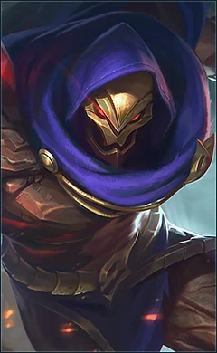

[Тир-лист](https://boostmlbb.ru/heroes/)[Предметы](https://boostmlbb.ru/items/)[Скины](https://boostmlbb.ru/skins/)[Новости и гайды](https://boostmlbb.ru/news/)

[Тир-лист](https://boostmlbb.ru/heroes/)

# Эсмеральда

A

ТанкМагЛиния опыта

Победы

46,5%

Выбор

0,9%

Баны

1,3%

[Обзор](https://boostmlbb.ru/#overview)[Сборка](https://boostmlbb.ru/#build)[Как играть](https://boostmlbb.ru/#howto)[Навыки](https://boostmlbb.ru/#skills)[Контрпики](https://boostmlbb.ru/#draft)[Скины](https://boostmlbb.ru/#skins)[История](https://boostmlbb.ru/#lore)

## Обзор

### Характеристики

-   Живучесть**90**
-   Атака**30**
-   Эффекты**60**
-   Сложность**70**

-   Регенерация
-   Смешанный урон

### Победы по рангам, 30 дней

1.  **48,3%**Эпик
2.  **48,2%**Легенда
3.  **47,9%**Мифик
4.  **47,1%**Честь
5.  **46,3%**Слава

Пунктир: 50% побед

### Другие танки этой линии

[Маша](https://boostmlbb.ru/heroes/masha.html)[Алиса](https://boostmlbb.ru/heroes/alice.html)[Глу](https://boostmlbb.ru/heroes/gloo.html)[Бартс](https://boostmlbb.ru/heroes/barats.html)[Уранус](https://boostmlbb.ru/heroes/uranus.html)[Хильда](https://boostmlbb.ru/heroes/hilda.html)[Гатоткача](https://boostmlbb.ru/heroes/gatotkaca.html)[Эдит](https://boostmlbb.ru/heroes/edith.html)

### Места в рейтингах

-   [Лучшие маги MLBB**2 из 32**](https://boostmlbb.ru/heroes/best-mage.html)
-   [Лучшие танки MLBB**6 из 25**](https://boostmlbb.ru/heroes/best-tank.html)

## Сборка

Сборка 1Сборка 2Сборка 3

Победы

55,5%

Выбор

8,5%

#### Основные предметы

-   [

    

    Зачарованный талисман

    ](https://boostmlbb.ru/items/enchanted-talisman.html)
-   [

    

    Оракул

    ](https://boostmlbb.ru/items/oracle.html)
-   [

    

    Господство льда

    ](https://boostmlbb.ru/items/dominance-ice.html)

#### Заклинание

Месть

#### Эмблема и таланты

Эмблема поддержки

-   

    Вдохновение

-   

    Кровавое пиршество

-   

    Нечестивая ярость

Победы

57,0%

Выбор

5,5%

#### Основные предметы

-   [

    

    Зачарованный талисман

    ](https://boostmlbb.ru/items/enchanted-talisman.html)
-   [

    

    Оракул

    ](https://boostmlbb.ru/items/oracle.html)
-   [

    

    Господство льда

    ](https://boostmlbb.ru/items/dominance-ice.html)

#### Заклинание

Спринт

#### Эмблема и таланты

Эмблема поддержки

-   

    Вдохновение

-   

    Кровавое пиршество

-   

    Нечестивая ярость

Победы

58,6%

Выбор

4,4%

#### Основные предметы

-   [

    

    Зачарованный талисман

    ](https://boostmlbb.ru/items/enchanted-talisman.html)
-   [

    

    Оракул

    ](https://boostmlbb.ru/items/oracle.html)
-   [

    

    Господство льда

    ](https://boostmlbb.ru/items/dominance-ice.html)

#### Заклинание

Очищение

#### Эмблема и таланты

Эмблема поддержки

-   

    Вдохновение

-   

    Кровавое пиршество

-   

    Нечестивая ярость

## Как играть за Эсмеральду

### Комбо Эсмеральды

#### В драке

1.  Ульт
2.  1
3.  2
4.  Атака

В драке врывайтесь ультом, первым наберите скорость и украдите щиты, добейте вторым и атаками.

#### На линии

1.  1
2.  2
3.  Атака
4.  1
5.  2
6.  Атака

На линии первым подойдите, вторым и атаками ударьте. Второй сокращает перезарядку первого, поэтому снова берите скорость и щит и повторяйте.

### Когда сильнее всего

Сильнее в начале: на 10–12 минутах выигрывает 49,8%. Давите на линии, забирайте объекты и заканчивайте, пока преимущество не растаяло.

1.  **49,8**10–12
2.  **48,4**12–14
3.  **47,7**14–16
4.  **46,9**16–18
5.  **46,4**18–20
6.  **47,0**20+

Проценты побед по длине матча в минутах, все ранги. Пунктир: 50%

### Приоритет прокачки

1.  Падающая звезда
2.  Танец звездной пыли
3.  Щит ледяной луны

## Навыки

Пассивный**Лунная шкатулка**1-й навык**Щит ледяной луны**2-й навык**Танец звездной пыли**Ультимейт**Падающая звезда**

Пассивный

### Лунная шкатулка

Эсмеральда управляет звездной пылью и ледяной луной: звездная пыль наносит физический урон, а ледяная луна наносит магический урон и дает цели щит, равный 135% от нанесенного ледяной луной урона. Каждая базовая атака наносит (+100% общей физической атаки) единиц физического урона и 100 (+75% общей магической силы) единиц магического урона.

Урон, наносимый Эсмеральдой, игнорирует все эффекты щита и постепенно превращает ее щит в ОЗ.

1-й навык

### Щит ледяной луны

Перезарядка **8 Mana Cost: 40 с**

Эсмеральда получает 500 (+150% общей магической силы) ед. щита и 40% скорости передвижения, которая быстро спадает в течение 4 сек. Тем временем она постепенно превращает щиты ближайших врагов в свой собственный, вплоть до 50% от ее .

2-й навык

### Танец звездной пыли

Перезарядка **4.5 Mana Cost: 35 с**

Эсмеральда взмахивает Звездной пылью и Ледяной луной, нанося 240 (+60% общей физической атаки) единиц физического урона и 300 (+120% общей магической силы) единиц магического урона ближайшим врагам. Каждый раз при нанесении урона герою время перезарядки Щита ледяной луны сокращается на 1.5 сек. (нанесение урона юнитам не-героям гарантирует сокращение перезарядки на 0.5 сек.), а скорость передвижения противника уменьшается на 20% на 1.5 сек.

Ультимейт

### Падающая звезда

Перезарядка **30 Mana Cost: 100 с**

Эсмеральда объединяет силы космоса в два оружия — Звездную пыль и Ледяную луну. Чем дольше подготовка этого навыка, тем больше дальность применения.

**Повторное использование:** Эсмеральда бросает Звездную пыль в указанное место, нанося 350 (+90% общей физической атаки) единиц физического урона, а затем перемещается в это место и использует Ледяную луну, нанося 350 (+140% общей магической силы) единиц магического урона и обездвиживая врагов в области на 1 сек.

## Контрпики Эсмеральды

### Кто контрит Эсмеральду

[Лолита](https://boostmlbb.ru/heroes/lolita.html)[Матильда](https://boostmlbb.ru/heroes/mathilda.html)[Марсель](https://boostmlbb.ru/heroes/marcel.html)[Кусака](https://boostmlbb.ru/heroes/jawhead.html)[Алдос](https://boostmlbb.ru/heroes/aldous.html)

### Кого контрит Эсмеральда

[Дариус](https://boostmlbb.ru/heroes/dyrroth.html)[Гвиневра](https://boostmlbb.ru/heroes/guinevere.html)[Джулиан](https://boostmlbb.ru/heroes/julian.html)[Кэрри](https://boostmlbb.ru/heroes/karrie.html)[Люнокс](https://boostmlbb.ru/heroes/lunox.html)[Натан](https://boostmlbb.ru/heroes/natan.html)

## Скины Эсмеральды

[Астральная музаИсключительный · 2025](https://boostmlbb.ru/skins/esmeralda/astral-muse.html)[Прорица­тельницаГрандиозный · 2023](https://boostmlbb.ru/skins/esmeralda/the-foreseer.html)[Посланница светаИзысканный · 2022](https://boostmlbb.ru/skins/esmeralda/light-envoy.html)[Пылающая теньДелюкс · 2020](https://boostmlbb.ru/skins/esmeralda/blazing-shadow.html)[КлеопатраИсключительный · 2020](https://boostmlbb.ru/skins/esmeralda/cleopatra.html)[Леди-воровкаИсключительный · 2020](https://boostmlbb.ru/skins/esmeralda/lady-thief.html)[Ядовитая лозаОбычный · 2019](https://boostmlbb.ru/skins/esmeralda/poison-vine.html)[Багряные сумеркиОбычный · 2019](https://boostmlbb.ru/skins/esmeralda/ruddy-dusk.html)

[Все 8 скинов Эсмеральды: цены и как получить](https://boostmlbb.ru/skins/esmeralda.html)

## История

> Загадочный астролог.

[Читать полную историю ↗](https://kazukiofficial.com/stories/esmeralda)Kazuki Official, английский [Характеристики на сайте игры ↗](https://www.mobilelegends.com/hero/detail?heroid=81)

**Поднимем ранг на герое «Эсмеральда»**Цена считается в калькуляторе

[Рассчитать цену](https://boostmlbb.ru/order.html?type=hero)

## Частые вопросы

Кто контрит Эсмеральду в MLBB?

За последние 30 дней Эсмеральду чаще всего обыгрывают Лолита, Матильда, Марсель, Кусака и Алдос.

Как играть за Эсмеральду?

В первую очередь качайте «Танец звездной пыли», ульт берите, как только доступен. Сильнее в начале: на 10–12 минутах выигрывает 49,8%. Давите на линии, забирайте объекты и заканчивайте, пока преимущество не растаяло. Комбо для драки: В драке врывайтесь ультом, первым наберите скорость и украдите щиты, добейте вторым и атаками.

Какой процент побед у Эсмеральды сейчас?

46,49% в Мифической славе за последние 7 дней и 47,03% на всех рангах за 30 дней, данные на 25 ноября 2026 года.

Какая роль и линия у Эсмеральды?

Танк и маг, играет на линии опыта.

Стоит ли брать Эсмеральду в текущей мете?

Тир A, 14-е место из 133 героев и 6-е среди танков. Тир учитывает, как часто героя берут и банят и как он выигрывает в Мифической славе за 7 дней: бан в 1,3% матчей, 46,5% побед. В профессиональных матчах за месяц героя драфтуют в 76,4% катков.

Какая сборка на Эсмеральду лучшая?

Самая популярная сборка в рейтинге: ключевые предметы «Зачарованный талисман», «Оракул» и «Господство льда», эмблема поддержки с талантами «Вдохновение», «Кровавое пиршество» и «Нечестивая ярость» и заклинание «Месть». С ней выигрывают 55,48% матчей.
