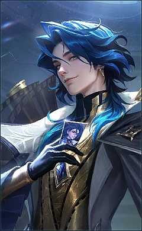

[Тир-лист](https://boostmlbb.ru/heroes/)[Предметы](https://boostmlbb.ru/items/)[Скины](https://boostmlbb.ru/skins/)[Новости и гайды](https://boostmlbb.ru/news/)

[Тир-лист](https://boostmlbb.ru/heroes/)

# Эстес

A

ПоддержкаРоум

Победы

52,6%

Выбор

0,6%

Баны

32,7%

[Обзор](https://boostmlbb.ru/#overview)[Сборка](https://boostmlbb.ru/#build)[Как играть](https://boostmlbb.ru/#howto)[Навыки](https://boostmlbb.ru/#skills)[Контрпики](https://boostmlbb.ru/#draft)[Скины](https://boostmlbb.ru/#skins)[История](https://boostmlbb.ru/#lore)

## Обзор

### Характеристики

-   Живучесть**70**
-   Атака**10**
-   Эффекты**20**
-   Сложность**30**

-   Регенерация
-   Защита

### Победы по рангам, 30 дней

1.  **54,0%**Эпик
2.  **53,4%**Легенда
3.  **53,1%**Мифик
4.  **52,3%**Честь
5.  **52,5%**Слава

Пунктир: 50% побед

### Другие герои поддержки этой линии

[Марсель](https://boostmlbb.ru/heroes/marcel.html)[Кайя](https://boostmlbb.ru/heroes/kaja.html)[Флорин](https://boostmlbb.ru/heroes/floryn.html)[Рафаэль](https://boostmlbb.ru/heroes/rafaela.html)[Ангела](https://boostmlbb.ru/heroes/angela.html)[Дигги](https://boostmlbb.ru/heroes/diggie.html)

### Места в рейтингах

-   [Лучшие роумеры MLBB**7 из 34**](https://boostmlbb.ru/heroes/best-roam.html)

## Сборка

Сборка 1Сборка 2Сборка 3

Победы

58,9%

Выбор

5,3%

#### Основные предметы

-   [

    

    Фляга Оазиса

    ](https://boostmlbb.ru/items/flask-of-the-oasis.html)
-   [

    

    Зачарованный талисман

    ](https://boostmlbb.ru/items/enchanted-talisman.html)
-   [

    

    Мимолетное время

    ](https://boostmlbb.ru/items/fleeting-time.html)

#### Заклинание

Восстановление

#### Эмблема и таланты

Эмблема поддержки

-   

    Вдохновение

-   

    Стойкость

-   

    Фокус-метка

Победы

59,0%

Выбор

4,4%

#### Основные предметы

-   [

    

    Фляга Оазиса

    ](https://boostmlbb.ru/items/flask-of-the-oasis.html)
-   [

    

    Зачарованный талисман

    ](https://boostmlbb.ru/items/enchanted-talisman.html)
-   [

    

    Мимолетное время

    ](https://boostmlbb.ru/items/fleeting-time.html)

#### Заклинание

Очищение

#### Эмблема и таланты

Эмблема поддержки

-   

    Вдохновение

-   

    Стойкость

-   

    Фокус-метка

Победы

59,0%

Выбор

3,7%

#### Основные предметы

-   [

    

    Фляга Оазиса

    ](https://boostmlbb.ru/items/flask-of-the-oasis.html)
-   [

    

    Зачарованный талисман

    ](https://boostmlbb.ru/items/enchanted-talisman.html)
-   [

    

    Мимолетное время

    ](https://boostmlbb.ru/items/fleeting-time.html)

#### Заклинание

Очищение

#### Эмблема и таланты

Эмблема поддержки

-   

    Вдохновение

-   

    Второе дыхание

-   

    Фокус-метка

## Как играть за Эстеса

### Комбо Эстеса

#### В драке

1.  2
2.  Ульт
3.  1

Замедлите вражескую команду вторым навыком и лечите своих ультом и первым навыком.

#### На линии

1.  2
2.  1

Вторым навыком замедляйте и тревожьте врагов, первым лечите союзников.

### Когда сильнее всего

Сильнее в начале: на 10–12 минутах выигрывает 58,9%. Давите на линии, забирайте объекты и заканчивайте, пока преимущество не растаяло.

1.  **58,9**10–12
2.  **54,7**12–14
3.  **51,2**14–16
4.  **48,7**16–18
5.  **48,0**18–20
6.  **46,2**20+

Проценты побед по длине матча в минутах, все ранги. Пунктир: 50%

### Приоритет прокачки

1.  Благословение лунной богини
2.  Поток лунного света
3.  Владения Лунной богини

## Навыки

Пассивный**Писание лунного эльфа**1-й навык**Поток лунного света**2-й навык**Владения Лунной богини**Ультимейт**Благословение лунной богини**

Пассивный

### Писание лунного эльфа

"Писание лунного эльфа" медленно наполняет энергией Эстеса. При достижении 100 зарядов оно усиливает его следующую базовую атаку, нанося цели 250 (+100% общей физической атаки) (+150% общей магической силы) единиц магического урона. Усиленная атака также отрикошетит в ближайших врагов, нанося им 125 (+50% общей физической атаки) (+75% общей магической силы) единиц магического урона и замедляя их на 60% на 1.5 сек.

1-й навык

### Поток лунного света

Перезарядка **11 Mana Cost: 60 с**

Эстес немедленно восстанавливает 200 (+110% общей магической силы) ОЗ указанному союзному герою и связывает себя с ним на 5 сек.

Пока они связаны, оба героя получают 15 (+10% общей магической силы) ед. , а цель медленно восстанавливает 360 (+90% общей магической силы) ОЗ. Связь с союзным героем увеличивает скорость передвижения Эстеса на 15%, а также скорость восполнения энергии "Писания лунного эльфа".

При нахождении слишком далеко от цели связь прерывается.

2-й навык

### Владения Лунной богини

Перезарядка **12 Mana Cost: 80 с**

Эстес обрушивает поток лунного света на указанную область, нанося 350 (+70% общей магической силы) единиц магического урона находящимся в ней вражеским бойцам.

Затем область превращается во "Владения Лунной богини", раскрывая находящихся в ней врагов. Враги, коснувшиеся границы владений, замедляются на 90% на 1.5 сек. Эффект замедления постепенно ослабевает.

Ультимейт

### Благословение лунной богини

Перезарядка **55 Mana Cost: 140 с**

Эстес применяет усиленный "Поток лунного света" на себя и всех ближайших союзных героев, обновляя "Поток лунного света" на них и усиливая его на 8 сек.

**Усиленный Поток лунного света:** удваивает мгновенное обычное лечение и увеличение , а также со временем восстанавливает цели 1020 (+225% общей магической силы) ОЗ.

## Контрпики Эстеса

### Кто контрит Эстеса

[Фарамис](https://boostmlbb.ru/heroes/faramis.html)[Циклоп](https://boostmlbb.ru/heroes/cyclops.html)[Алиса](https://boostmlbb.ru/heroes/alice.html)[Чичи](https://boostmlbb.ru/heroes/cici.html)[Дигги](https://boostmlbb.ru/heroes/diggie.html)

### Кого контрит Эстес

[Тигрил](https://boostmlbb.ru/heroes/tigreal.html)[Нолан](https://boostmlbb.ru/heroes/nolan.html)[Франко](https://boostmlbb.ru/heroes/franco.html)[Атлас](https://boostmlbb.ru/heroes/atlas.html)[Иксия](https://boostmlbb.ru/heroes/ixia.html)[Сора](https://boostmlbb.ru/heroes/sora.html)[Беатрис](https://boostmlbb.ru/heroes/beatrix.html)[Аврора](https://boostmlbb.ru/heroes/aurora.html)[Инь](https://boostmlbb.ru/heroes/yin.html)[Вэйл](https://boostmlbb.ru/heroes/vale.html)

## Скины Эстеса

[Тайный магистратИсключительный · 2025](https://boostmlbb.ru/skins/estes/arcane-magistrate.html)[Эстес SPARKLEДелюкс · 2024](https://boostmlbb.ru/skins/estes/sparkle-estes.html)[Blacklist Interna­tionalДелюкс · 2024](https://boostmlbb.ru/skins/estes/blacklist-international.html)[Епископ-воронИсключительный · 2020](https://boostmlbb.ru/skins/estes/crow-bishop.html)[Белый журавльОбычный · 2018](https://boostmlbb.ru/skins/estes/white-crane.html)[Повелитель галактикиИзысканный](https://boostmlbb.ru/skins/estes/galaxy-dominator.html)[Ротанговый драконДелюкс · 2017](https://boostmlbb.ru/skins/estes/rattan-dragon.html)[Святой жрецОбычный · 2017](https://boostmlbb.ru/skins/estes/holy-priest.html)

[Все 8 скинов Эстеса: цены и как получить](https://boostmlbb.ru/skins/estes.html)

## История

> Король эльфов, правящий лунными эльфами.

[Читать полную историю ↗](https://kazukiofficial.com/stories/estes)Kazuki Official, английский [Характеристики на сайте игры ↗](https://www.mobilelegends.com/hero/detail?heroid=34)

**Поднимем ранг на герое «Эстес»**Цена считается в калькуляторе

[Рассчитать цену](https://boostmlbb.ru/order.html?type=hero)

## Частые вопросы

Кто контрит Эстеса в MLBB?

За последние 30 дней Эстеса чаще всего обыгрывают Фарамис, Циклоп, Алиса, Чичи и Дигги.

Как играть за Эстеса?

В первую очередь качайте «Поток лунного света», ульт берите, как только доступен. Сильнее в начале: на 10–12 минутах выигрывает 58,9%. Давите на линии, забирайте объекты и заканчивайте, пока преимущество не растаяло. Комбо для драки: Замедлите вражескую команду вторым навыком и лечите своих ультом и первым навыком.

Какой процент побед у Эстеса сейчас?

52,62% в Мифической славе за последние 7 дней и 52,76% на всех рангах за 30 дней, данные на 26 ноября 2026 года.

Какая роль и линия у Эстеса?

Поддержка, играет в роуме.

Стоит ли брать Эстеса в текущей мете?

Тир A, 22-е место из 133 героев и 4-е среди героев поддержки. Тир учитывает, как часто героя берут и банят и как он выигрывает в Мифической славе за 7 дней: бан в 32,7% матчей, 52,6% побед. В профессиональных матчах за месяц героя драфтуют в 14,9% катков.

Какая сборка на Эстеса лучшая?

Самая популярная сборка в рейтинге: ключевые предметы «Фляга Оазиса», «Зачарованный талисман» и «Мимолетное время», эмблема поддержки с талантами «Вдохновение», «Стойкость» и «Фокус-метка» и заклинание «Восстановление». С ней выигрывают 58,94% матчей.
