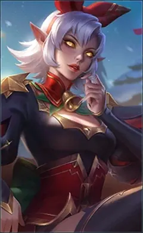

[Тир-лист](https://boostmlbb.ru/heroes/)[Предметы](https://boostmlbb.ru/items/)[Скины](https://boostmlbb.ru/skins/)[Новости и гайды](https://boostmlbb.ru/news/)

# Эйдора

A

МагСредняя линия

Победы

50,2%

Выбор

1,6%

Баны

33,4%

[Обзор](https://boostmlbb.ru/#overview)[Сборка](https://boostmlbb.ru/#build)[Как играть](https://boostmlbb.ru/#howto)[Навыки](https://boostmlbb.ru/#skills)[Контрпики](https://boostmlbb.ru/#draft)[Скины](https://boostmlbb.ru/#skins)[История](https://boostmlbb.ru/#lore)

## Обзор

### Характеристики

-   Живучесть**10**
-   Атака**80**
-   Эффекты**80**
-   Сложность**20**

-   Контроль
-   Разрушительный урон

### Победы по рангам, 30 дней

1.  **49,5%**Эпик
2.  **50,1%**Легенда
3.  **50,5%**Мифик
4.  **50,2%**Честь
5.  **50,5%**Слава

Пунктир: 50% побед

### Другие маги этой линии

[Кимми](https://boostmlbb.ru/heroes/kimmy.html)[Чжусинь](https://boostmlbb.ru/heroes/zhuxin.html)[Валир](https://boostmlbb.ru/heroes/valir.html)[Цзэтянь](https://boostmlbb.ru/heroes/zetian.html)[Лилия](https://boostmlbb.ru/heroes/lylia.html)[Ксавьер](https://boostmlbb.ru/heroes/xavier.html)[Люнокс](https://boostmlbb.ru/heroes/lunox.html)[Валентина](https://boostmlbb.ru/heroes/valentina.html)

### Места в рейтингах

-   [Лучшие маги MLBB**4 из 32**](https://boostmlbb.ru/heroes/best-mage.html)
-   [Лучшие мидеры MLBB**2 из 29**](https://boostmlbb.ru/heroes/best-mid.html)

## Сборка

Сборка 1Сборка 2Сборка 3

Победы

54,2%

Выбор

5,0%

#### Основные предметы

-   [

    

    Пронзающий небеса

    ](https://boostmlbb.ru/items/sky-piercer.html)
-   [

    

    Палочка гения

    ](https://boostmlbb.ru/items/genius-wand.html)
-   [

    

    Кровавые крылья

    ](https://boostmlbb.ru/items/blood-wings.html)

#### Заклинание

Вспышка

#### Эмблема и таланты

Эмблема убийцы

-   

    Разрыв

-   

    Благословение природы

-   

    Смертельное воспламенение

Победы

56,2%

Выбор

4,5%

#### Основные предметы

-   [

    

    Палочка гения

    ](https://boostmlbb.ru/items/genius-wand.html)
-   [

    

    Пронзающий небеса

    ](https://boostmlbb.ru/items/sky-piercer.html)
-   [

    

    Жезл молний

    ](https://boostmlbb.ru/items/lightning-truncheon.html)

#### Заклинание

Вспышка

#### Эмблема и таланты

Эмблема убийцы

-   

    Разрыв

-   

    Благословение природы

-   

    Смертельное воспламенение

Победы

55,6%

Выбор

3,9%

#### Основные предметы

-   [

    

    Палочка гения

    ](https://boostmlbb.ru/items/genius-wand.html)
-   [

    

    Пылающий жезл

    ](https://boostmlbb.ru/items/glowing-wand.html)
-   [

    

    Жезл молний

    ](https://boostmlbb.ru/items/lightning-truncheon.html)

#### Заклинание

Вспышка

#### Эмблема и таланты

Эмблема убийцы

-   

    Разрыв

-   

    Благословение природы

-   

    Смертельное воспламенение

## Как играть за Эйдору

### Комбо Эйдоры

#### В драке

1.  1
2.  2
3.  Ульт
4.  1

В драке первым навыком наложите сверхпроводник, вторым по нужной цели оглушите по площади и ультом дайте огромный взрывной урон. Первым добейте.

#### На линии

1.  2
2.  Ульт
3.  1

На линии оглушите вторым навыком и наложите сверхпроводник, поставьте центр ульта на врага и добейте первым.

### Когда сильнее всего

Сильнее в начале: на 10–12 минутах выигрывает 50,7%. Давите на линии, забирайте объекты и заканчивайте, пока преимущество не растаяло.

1.  **50,7**10–12
2.  **50,7**12–14
3.  **50,6**14–16
4.  **49,9**16–18
5.  **49,2**18–20
6.  **49,4**20+

Проценты побед по длине матча в минутах, все ранги. Пунктир: 50%

### Приоритет прокачки

1.  Гнев молнии
2.  Разветвленная молния
3.  Шар молнии

## Навыки

Пассивный**Сверхпроводимость**1-й навык**Разветвленная молния**2-й навык**Шар молнии**Ультимейт**Гнев молнии**

Пассивный

### Сверхпроводимость

Навыки Эйдоры при попадании по целям, не являющимся миньонами, накладывают эффект "Сверхпроводимость" на 5 сек. и могут вызывать дополнительные эффекты на врагах, находящихся под действием "Сверхпроводимости".

1-й навык

### Разветвленная молния

Перезарядка **5 Mana Cost: 40 с**

Эйдора запускает разветвленную молнию в веерообразной области, нанося врагам в ней 275 (+100% общей магической силы) единиц магического урона (увеличивается до 200% против миньонов).

При попадании по целям под действием "Сверхпроводимости" Эйдора формирует с ними цепь из молнии, получая 40% скорости передвижения во время действия цепи до 1 сек.

Цепь из молнии наносит 10 (+4% общей магической силы) единиц магического урона в течение своего действия и дополнительно 275 (+100% общей магической силы) единиц магического урона по окончании. Если этот удар попадает в цель, перезарядка этого навыка сокращается на 50%.

2-й навык

### Шар молнии

Перезарядка **11 Mana Cost: 80 с**

Эйдора запускает в указанного врага сферу молнии, снижая его на 10 на 1.8 сек., нанося 300 (+50% общей магической силы) единиц магического урона и оглушая цель на 1 сек.

Если цель находится под действием "Сверхпроводимости", сфера молнии снижает ближайших врагов, наносит массовый урон вокруг цели и оглушает всех ближайших врагов.

Ультимейт

### Гнев молнии

Перезарядка **32 Mana Cost: 130 с**

Эйдора обрушивает молнию в указанную область, нанося 540 (+145% общей магической силы) единиц магического урона целям в центре. Затем второй удар наносит 270 (+90% общей магической силы) единиц магического урона врагам во внешней области.

Когда "Гнев молнии" поражает цель под действием "Сверхпроводимости", после небольшой задержки в месте нахождения цели активируется "Взрыв молнии", нанося ей 300 (+100% общей магической силы) единиц магического урона.

## Контрпики Эйдоры

### Кто контрит Эйдору

[Флорин](https://boostmlbb.ru/heroes/floryn.html)[Хелкарт](https://boostmlbb.ru/heroes/helcurt.html)[Иритель](https://boostmlbb.ru/heroes/irithel.html)[Наталья](https://boostmlbb.ru/heroes/natalia.html)[Зилонг](https://boostmlbb.ru/heroes/zilong.html)

### Кого контрит Эйдора

[Бартс](https://boostmlbb.ru/heroes/barats.html)[Аврора](https://boostmlbb.ru/heroes/aurora.html)[Маша](https://boostmlbb.ru/heroes/masha.html)

## Скины Эйдоры

[Чары полуночиДелюкс · 2026](https://boostmlbb.ru/skins/eudora/midnight-s-allure.html)[Эйдора Atomic PopДелюкс · 2023](https://boostmlbb.ru/skins/eudora/atomic-pop-eudora.html)[Косми­ческое путе­шествиеИсключительный · 2022](https://boostmlbb.ru/skins/eudora/cosmic-voyage.html)[Графиня СкарлетОбычный · 2020](https://boostmlbb.ru/skins/eudora/countess-scarlet.html)[Богиня селфи VivoИсключительный · 2017](https://boostmlbb.ru/skins/eudora/vivo-selfie-goddess.html)[Изумрудная чародейкаИзысканный · 2017](https://boostmlbb.ru/skins/eudora/emerald-enchantress.html)[Рож­дественский карнавалИсключительный · 2016](https://boostmlbb.ru/skins/eudora/christmas-carnival.html)[Огненно-алые губыОбычный · 2016](https://boostmlbb.ru/skins/eudora/flame-red-lips.html)

[Все 8 скинов Эйдоры: цены и как получить](https://boostmlbb.ru/skins/eudora.html)

## История

> Эльфийская волшебница, чьи пальцы повелевают молниями, разрушает оковы предрассудков и озаряет путь к будущему.

[Читать полную историю ↗](https://play.mobilelegends.com/lore/hero/Eudora)Официальный сайт Mobile Legends [Характеристики на сайте игры ↗](https://www.mobilelegends.com/hero/detail?heroid=15)

**Поднимем ранг на герое «Эйдора»**Цена считается в калькуляторе

[Рассчитать цену](https://boostmlbb.ru/order.html?type=hero)

## Частые вопросы

Кто контрит Эйдору в MLBB?

За последние 30 дней Эйдору чаще всего обыгрывают Флорин, Хелкарт, Иритель, Наталья и Зилонг.

Как играть за Эйдору?

В первую очередь качайте «Разветвленная молния», ульт берите, как только доступен. Сильнее в начале: на 10–12 минутах выигрывает 50,7%. Давите на линии, забирайте объекты и заканчивайте, пока преимущество не растаяло. Комбо для драки: В драке первым навыком наложите сверхпроводник, вторым по нужной цели оглушите по площади и ультом дайте огромный взрывной урон. Первым добейте.

Какой процент побед у Эйдоры сейчас?

50,20% в Мифической славе за последние 7 дней и 50,29% на всех рангах за 30 дней, данные на 25 ноября 2026 года.

Какая роль и линия у Эйдоры?

Маг, играет на средней линии.

Стоит ли брать Эйдору в текущей мете?

Тир A, 16-е место из 133 героев и 4-е среди магов. Тир учитывает, как часто героя берут и банят и как он выигрывает в Мифической славе за 7 дней: бан в 33,4% матчей, 50,2% побед. В профессиональных матчах за месяц героя драфтуют в 24,7% катков.

Какая сборка на Эйдору лучшая?

Самая популярная сборка в рейтинге: ключевые предметы «Пронзающий небеса», «Палочка гения» и «Кровавые крылья», эмблема убийцы с талантами «Разрыв», «Благословение природы» и «Смертельное воспламенение» и заклинание «Вспышка». С ней выигрывают 54,19% матчей.
