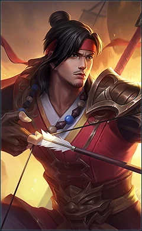

[Тир-лист](https://boostmlbb.ru/heroes/)[Новости и гайды](https://boostmlbb.ru/news/)

# Фанни

B

УбийцаЛес

Победы

43,0%

Выбор

0,7%

Баны

1,6%

[Обзор](https://boostmlbb.ru/#overview)[Сборка](https://boostmlbb.ru/#build)[Навыки](https://boostmlbb.ru/#skills)[Контрпики](https://boostmlbb.ru/#draft)[История](https://boostmlbb.ru/#lore)

## Обзор

### Характеристики

-   Живучесть**60**
-   Атака**70**
-   Эффекты**10**
-   Сложность**100**

-   Преследование
-   Добивание

### Победы по рангам, 30 дней

1.  **44,7%**Эпик
2.  **43,0%**Легенда
3.  **41,7%**Мифик
4.  **42,4%**Честь
5.  **42,9%**Слава

Пунктир: 50% побед

### Другие убийцы этой линии

[Нолан](https://boostmlbb.ru/heroes/nolan.html)[Хирара](https://boostmlbb.ru/heroes/hirara.html)[Сабер](https://boostmlbb.ru/heroes/saber.html)[Харли](https://boostmlbb.ru/heroes/harley.html)[Линг](https://boostmlbb.ru/heroes/ling.html)[Ли Сун-Син](https://boostmlbb.ru/heroes/yi-sun-shin.html)[Карина](https://boostmlbb.ru/heroes/karina.html)[Госсен](https://boostmlbb.ru/heroes/gusion.html)

## Сборка

Сборка 1Сборка 2Сборка 3

Победы

47,8%

Выбор

2,0%

#### Основные предметы

-   

    Клинок семи морей

-   

    Злобный рык

-   

    Золотой метеор

#### Заклинание

Возмездие

#### Эмблема и таланты

Эмблема убийцы

-   

    Разрыв

-   

    Кровавое пиршество

-   

    Смертельное воспламенение

Победы

45,1%

Выбор

1,9%

#### Основные предметы

-   

    Клинок семи морей

-   

    Злобный рык

-   

    Золотой метеор

#### Заклинание

Возмездие

#### Эмблема и таланты

Эмблема убийцы

-   

    Разрыв

-   

    Кровавое пиршество

-   

    Нечестивая ярость

Победы

51,3%

Выбор

1,7%

#### Основные предметы

-   

    Клинок семи морей

-   

    Пронзающий небеса

-   

    Злобный рык

#### Заклинание

Возмездие

#### Эмблема и таланты

Эмблема убийцы

-   

    Разрыв

-   

    Кровавое пиршество

-   

    Смертельное воспламенение

## Навыки

Прокачка**Головорез**_›_**Стальной трос**_›_**Удар торнадо**

Пассивный**Превосходство в воздухе**1-й навык**Удар торнадо**2-й навык**Стальной трос**Ультимейт**Головорез**

Пассивный

### Превосходство в воздухе

Во время полета Фанни наносит 10%-20% дополнительного урона пораженным врагам (зависит от скорости полета) и при каждом попадании накладывает 1 заряд метки жертвы (до 2 зарядов).

Ее последующие попадания навыками по отмеченным вражеским героям восстанавливают 8 энергии за заряд. Восстановление энергии уменьшается, если за короткое время поражено несколько вражеских героев.

1-й навык

### Удар торнадо

Перезарядка **3.5 Energy Cost: 12 с**

Фанни взмахивает клинками, нанося 275 (+85% общей физической атаки) единиц физического урона ближайшим врагам.

2-й навык

### Стальной трос

Перезарядка **0 Energy Cost: 19 с**

Фанни выпускает трос в указанном направлении и притягивается к первому препятствию на его пути. При наличии достаточного количества энергии она может повторно применить этот навык в течение 2 сек. Каждое последующее применение за это время расходует на 2 меньше энергии.

Во время полета Фанни автоматически применяет "Удар торнадо" при столкновении с врагом, если у нее достаточно энергии.

Ультимейт

### Головорез

Перезарядка **35 Energy Cost: 12 с**

Фанни прыгает с клинками на указанного вражеского героя или монстра, нанося 400 (+200% дополнительной физической атаки) единиц физического урона. Каждый заряд метки жертвы на цели увеличивает этот урон на 30%.

## Контрпики

### Контрпики

Побеждают этого героя

[Грейнджер](https://boostmlbb.ru/heroes/granger.html)[Глу](https://boostmlbb.ru/heroes/gloo.html)[Ив](https://boostmlbb.ru/heroes/yve.html)[Атлас](https://boostmlbb.ru/heroes/atlas.html)[Клинт](https://boostmlbb.ru/heroes/clint.html)

### Слабые цели

Этот герой побеждает их

[Баданг](https://boostmlbb.ru/heroes/badang.html)[Чу](https://boostmlbb.ru/heroes/chou.html)[Франко](https://boostmlbb.ru/heroes/franco.html)[Москов](https://boostmlbb.ru/heroes/moskov.html)[Лукас](https://boostmlbb.ru/heroes/lukas.html)[Зилонг](https://boostmlbb.ru/heroes/zilong.html)[Калеа](https://boostmlbb.ru/heroes/kalea.html)[Бруно](https://boostmlbb.ru/heroes/bruno.html)

## История

> Танцующая с клинками на поле боя.

[Читать полную историю ↗](https://play.mobilelegends.com/lore/hero/Fanny)Официальный сайт Mobile Legends [Характеристики на сайте игры ↗](https://www.mobilelegends.com/hero/detail?heroid=17)

**Поднимем ранг на герое «Фанни»**Цена считается в калькуляторе

[Рассчитать цену](https://boostmlbb.ru/order.html?type=hero)

## Частые вопросы

Кто контрпик для героя «Фанни» в MLBB?

За последние 30 дней чаще всего героя обыгрывают Грейнджер, Глу, Ив, Атлас и Клинт.

Какой процент побед у героя «Фанни» сейчас?

42,96% в Мифической славе за последние 7 дней и 42,67% на всех рангах за 30 дней, данные на 24 ноября 2026 года.

Какая роль и линия у героя «Фанни»?

Убийца, играет в лесу.

Силён ли герой «Фанни» в текущей мете?

Тир B, 45-е место из 133 героев и 10-е среди убийц. Тир учитывает, как часто героя берут и банят и как он выигрывает в Мифической славе за 7 дней: бан в 1,6% матчей, 43,0% побед. В профессиональных матчах за месяц героя драфтуют в 32,2% катков.

Какая сборка на героя «Фанни» лучшая?

Самая популярная сборка в рейтинге: ключевые предметы «Клинок семи морей», «Злобный рык» и «Золотой метеор», эмблема убийцы с талантами «Разрыв», «Кровавое пиршество» и «Смертельное воспламенение» и заклинание «Возмездие». С ней выигрывают 47,81% матчей.
