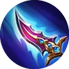
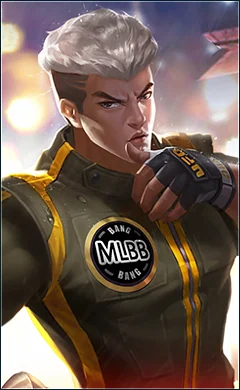

[Тир-лист](https://boostmlbb.ru/heroes/)[Предметы](https://boostmlbb.ru/items/)[Скины](https://boostmlbb.ru/skins/)[Новости и гайды](https://boostmlbb.ru/news/)

[Тир-лист](https://boostmlbb.ru/heroes/)

# Фанни

B

УбийцаЛес

Победы

43,0%

Выбор

0,8%

Баны

1,6%

[Обзор](https://boostmlbb.ru/#overview)[Сборка](https://boostmlbb.ru/#build)[Как играть](https://boostmlbb.ru/#howto)[Навыки](https://boostmlbb.ru/#skills)[Контрпики](https://boostmlbb.ru/#draft)[Скины](https://boostmlbb.ru/#skins)[История](https://boostmlbb.ru/#lore)

## Обзор

### Характеристики

-   Живучесть**60**
-   Атака**70**
-   Эффекты**10**
-   Сложность**100**

-   Преследование
-   Добивание

### Другие убийцы этой линии

[Нолан](https://boostmlbb.ru/heroes/nolan.html)[Хирара](https://boostmlbb.ru/heroes/hirara.html)[Сабер](https://boostmlbb.ru/heroes/saber.html)[Харли](https://boostmlbb.ru/heroes/harley.html)[Линг](https://boostmlbb.ru/heroes/ling.html)[Карина](https://boostmlbb.ru/heroes/karina.html)[Ли Сун-Син](https://boostmlbb.ru/heroes/yi-sun-shin.html)[Госсен](https://boostmlbb.ru/heroes/gusion.html)

### Места в рейтингах

-   [Лучшие лесники MLBB**12 из 37**](https://boostmlbb.ru/heroes/best-jungle.html)
-   [Лучшие убийцы MLBB**10 из 29**](https://boostmlbb.ru/heroes/best-assassin.html)

## Сборка

Сборка 1Сборка 2Сборка 3

Победы

47,9%

Выбор

2,2%

#### Основные предметы

-   [

    

    Клинок семи морей

    ](https://boostmlbb.ru/items/blade-of-the-heptaseas.html)
-   [

    

    Злобный рык

    ](https://boostmlbb.ru/items/malefic-roar.html)
-   [

    

    Золотой метеор

    ](https://boostmlbb.ru/items/rose-gold-meteor.html)

#### Заклинание

Возмездие

#### Эмблема и таланты

Эмблема убийцы

-   

    Разрыв

-   

    Кровавое пиршество

-   

    Смертельное воспламенение

Победы

44,8%

Выбор

2,0%

#### Основные предметы

-   [

    

    Клинок семи морей

    ](https://boostmlbb.ru/items/blade-of-the-heptaseas.html)
-   [

    

    Злобный рык

    ](https://boostmlbb.ru/items/malefic-roar.html)
-   [

    

    Золотой метеор

    ](https://boostmlbb.ru/items/rose-gold-meteor.html)

#### Заклинание

Возмездие

#### Эмблема и таланты

Эмблема убийцы

-   

    Проворность

-   

    Кровавое пиршество

-   

    Смертельное воспламенение

Победы

45,4%

Выбор

1,8%

#### Основные предметы

-   [

    

    Клинок семи морей

    ](https://boostmlbb.ru/items/blade-of-the-heptaseas.html)
-   [

    

    Злобный рык

    ](https://boostmlbb.ru/items/malefic-roar.html)
-   [

    

    Золотой метеор

    ](https://boostmlbb.ru/items/rose-gold-meteor.html)

#### Заклинание

Возмездие

#### Эмблема и таланты

Эмблема убийцы

-   

    Разрыв

-   

    Кровавое пиршество

-   

    Нечестивая ярость

## Как играть за Фанни

### Комбо Фанни

#### В драке

1.  2
2.  Ульт

В драке летайте вторым и включайте первый в гуще врагов. Слабых добивайте ультом.

#### На линии

1.  2
2.  1
3.  2
4.  Ульт

На линии цепляйтесь вторым за стены и включайте первый рядом с врагом. Пролёты вторым сквозь врага включают первый сами, добивайте ультом.

### Когда сильнее всего

Сильнее в долгой игре: после 20-й минуты выигрывает 47,3%. Не рискуйте в начале, фармите и ввязывайтесь в драки вместе с командой.

1.  **34,5**10–12
2.  **40,4**12–14
3.  **42,6**14–16
4.  **45,9**16–18
5.  **46,4**18–20
6.  **47,3**20+

Проценты побед по длине матча в минутах, все ранги. Пунктир: 50%

### Приоритет прокачки

1.  Головорез
2.  Стальной трос
3.  Удар торнадо

## Навыки

Пассивный**Превосходство в воздухе**1-й навык**Удар торнадо**2-й навык**Стальной трос**Ультимейт**Головорез**

Пассивный

### Превосходство в воздухе

Во время полета Фанни наносит 10%-20% дополнительного урона пораженным врагам (зависит от скорости полета) и при каждом попадании накладывает 1 заряд метки жертвы (до 2 зарядов).

Ее последующие попадания навыками по отмеченным вражеским героям восстанавливают 8 энергии за заряд. Восстановление энергии уменьшается, если за короткое время поражено несколько вражеских героев.

1-й навык

### Удар торнадо

Перезарядка **3.5 Energy Cost: 12 с**

Фанни взмахивает клинками, нанося 275 (+85% общей физической атаки) единиц физического урона ближайшим врагам.

2-й навык

### Стальной трос

Перезарядка **0 Energy Cost: 19 с**

Фанни выпускает трос в указанном направлении и притягивается к первому препятствию на его пути. При наличии достаточного количества энергии она может повторно применить этот навык в течение 2 сек. Каждое последующее применение за это время расходует на 2 меньше энергии.

Во время полета Фанни автоматически применяет "Удар торнадо" при столкновении с врагом, если у нее достаточно энергии.

Ультимейт

### Головорез

Перезарядка **35 Energy Cost: 12 с**

Фанни прыгает с клинками на указанного вражеского героя или монстра, нанося 400 (+200% дополнительной физической атаки) единиц физического урона. Каждый заряд метки жертвы на цели увеличивает этот урон на 30%.

## Контрпики Фанни

### Кто контрит Фанни

[Грейнджер](https://boostmlbb.ru/heroes/granger.html)[Глу](https://boostmlbb.ru/heroes/gloo.html)[Ив](https://boostmlbb.ru/heroes/yve.html)[Атлас](https://boostmlbb.ru/heroes/atlas.html)[Клинт](https://boostmlbb.ru/heroes/clint.html)

### Кого контрит Фанни

[Баданг](https://boostmlbb.ru/heroes/badang.html)[Чу](https://boostmlbb.ru/heroes/chou.html)[Франко](https://boostmlbb.ru/heroes/franco.html)[Москов](https://boostmlbb.ru/heroes/moskov.html)[Лукас](https://boostmlbb.ru/heroes/lukas.html)[Калеа](https://boostmlbb.ru/heroes/kalea.html)[Зилонг](https://boostmlbb.ru/heroes/zilong.html)[Бруно](https://boostmlbb.ru/heroes/bruno.html)

## Скины Фанни

[Фанни P.ACEДелюкс · 2025](https://boostmlbb.ru/skins/fanny/p-ace-fanny.html)[МикасаГрандиозный · 2023](https://boostmlbb.ru/skins/fanny/mikasa.html)[Парящее сердцеДелюкс · 2022](https://boostmlbb.ru/skins/fanny/heart-afloat.html)[Клинок надеждыГрандиозный · 2022](https://boostmlbb.ru/skins/fanny/blade-of-kibou.html)[Имперская вои­тельницаОбычный · 2021](https://boostmlbb.ru/skins/fanny/imperial-warrior.html)[Рож­дественский карнавалИсключительный · 2020](https://boostmlbb.ru/skins/fanny/christmas-carnival.html)[Рождённая светом: РейнджерДелюкс · 2019](https://boostmlbb.ru/skins/fanny/lightborn-ranger.html)[Спаса­тельницаИсключительный · 2019](https://boostmlbb.ru/skins/fanny/lifeguard.html)[Коро­левская кавалерияИсключительный · 2018](https://boostmlbb.ru/skins/fanny/royal-cavalry.html)[ЖаворонокИзысканный · 2018](https://boostmlbb.ru/skins/fanny/skylark.html)[Принцесса-панкОбычный · 2017](https://boostmlbb.ru/skins/fanny/punk-princess.html)[СтуденткаОбычный · 2016](https://boostmlbb.ru/skins/fanny/campus-youth.html)

[Все 13 скинов Фанни: цены и как получить](https://boostmlbb.ru/skins/fanny.html)

## История

> Танцующая с клинками на поле боя.

[Читать полную историю ↗](https://play.mobilelegends.com/lore/hero/Fanny)Официальный сайт Mobile Legends [Характеристики на сайте игры ↗](https://www.mobilelegends.com/hero/detail?heroid=17)

**Поднимем ранг на герое «Фанни»**Цена считается в калькуляторе

[Рассчитать цену](https://boostmlbb.ru/order.html?type=hero)

## Частые вопросы

Кто контрит Фанни в MLBB?

За последние 30 дней Фанни чаще всего обыгрывают Грейнджер, Глу, Ив, Атлас и Клинт.

Как играть за Фанни?

В первую очередь качайте «Стальной трос», ульт берите, как только доступен. Сильнее в долгой игре: после 20-й минуты выигрывает 47,3%. Не рискуйте в начале, фармите и ввязывайтесь в драки вместе с командой. Комбо для драки: В драке летайте вторым и включайте первый в гуще врагов. Слабых добивайте ультом.

Какой процент побед у Фанни сейчас?

42,97% в Мифической славе за последние 7 дней и 42,76% на всех рангах за 30 дней, данные на 27 ноября 2026 года.

Какая роль и линия у Фанни?

Убийца, играет в лесу.

Стоит ли брать Фанни в текущей мете?

Тир B, 46-е место из 133 героев и 10-е среди убийц. Тир учитывает, как часто героя берут и банят и как он выигрывает в Мифической славе за 7 дней: бан в 1,6% матчей, 43,0% побед. В профессиональных матчах за месяц героя драфтуют в 32,2% катков.

Какая сборка на Фанни лучшая?

Самая популярная сборка в рейтинге: ключевые предметы «Клинок семи морей», «Злобный рык» и «Золотой метеор», эмблема убийцы с талантами «Разрыв», «Кровавое пиршество» и «Смертельное воспламенение» и заклинание «Возмездие». С ней выигрывают 47,94% матчей.
