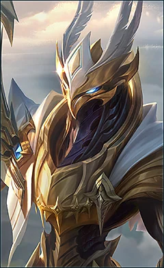

[Тир-лист](https://boostmlbb.ru/heroes/)[Новости и гайды](https://boostmlbb.ru/news/)

# Флорин

B

ПоддержкаРоум

Победы

53,9%

Выбор

1,3%

Баны

13,7%

[Обзор](https://boostmlbb.ru/#overview)[Сборка](https://boostmlbb.ru/#build)[Навыки](https://boostmlbb.ru/#skills)[Контрпики](https://boostmlbb.ru/#draft)[История](https://boostmlbb.ru/#lore)

## Обзор

### Характеристики

-   Живучесть**60**
-   Атака**10**
-   Эффекты**70**
-   Сложность**30**

-   Поук
-   Защита

### Победы по рангам, 30 дней

1.  **55,6%**Эпик
2.  **54,5%**Легенда
3.  **54,0%**Мифик
4.  **54,2%**Честь
5.  **53,8%**Слава

Пунктир: 50% побед

### Другие герои поддержки этой линии

[Марсель](https://boostmlbb.ru/heroes/marcel.html)[Эстес](https://boostmlbb.ru/heroes/estes.html)[Кайя](https://boostmlbb.ru/heroes/kaja.html)[Рафаэль](https://boostmlbb.ru/heroes/rafaela.html)[Ангела](https://boostmlbb.ru/heroes/angela.html)[Дигги](https://boostmlbb.ru/heroes/diggie.html)

## Сборка

Сборка 1Сборка 2Сборка 3

Победы

54,0%

Выбор

22,6%

#### Основные предметы

-   

    Lantern of Hope

-   

    Фляга Оазиса

-   

    Мимолетное время

#### Заклинание

Вспышка

#### Эмблема и таланты

Эмблема поддержки

-   

    Вдохновение

-   

    Благословение природы

-   

    Фокус-метка

Победы

55,1%

Выбор

9,0%

#### Основные предметы

-   

    Lantern of Hope

-   

    Фляга Оазиса

-   

    Мимолетное время

#### Заклинание

Вспышка

#### Эмблема и таланты

Эмблема поддержки

-   

    Вдохновение

-   

    Второе дыхание

-   

    Фокус-метка

Победы

55,5%

Выбор

8,7%

#### Основные предметы

-   

    Lantern of Hope

-   

    Фляга Оазиса

-   

    Мимолетное время

#### Заклинание

Восстановление

#### Эмблема и таланты

Эмблема поддержки

-   

    Вдохновение

-   

    Благословение природы

-   

    Фокус-метка

## Навыки

Прокачка**Цветение**_›_**Посев**_›_**Росток**

Пассивный**Дью**1-й навык**Посев**2-й навык**Росток**Ультимейт**Цветение**

Пассивный

### Дью

Фонарь Дью будет постоянно понемногу увеличивать показатели Флорин.

После выхода из боя на 5 сек., Флорин может поделиться Цветком надежды с одним из союзных героев (перезарядка: 30 сек.), что будет давать ему 100 (+70% общей магической силы) ед. щита каждый раз, когда его лечит Флорин.

Флорин никогда не продаст Фонарь.

1-й навык

### Посев

Перезарядка **9 Mana Cost: 75 с**

Флорин бросает семя энергии в указанного врага, нанося 180 (+100% общей магической силы) единиц магического урона. Затем появляются целебные фрукты, которые будут отскакивать к ближайшим союзным героям, восстанавливая их ОЗ на 175 (+90% общей магической силы).

2-й навык

### Росток

Перезарядка **13 Mana Cost: 90 с**

Флорин бросает вперед сгусток энергии, который взрывается при попадании во врага, нанося 175 (+90% общей магической силы) единиц магического урона ближайшим врагам и оглушая их на 0.5 сек. (и ненадолго раскрывая их позиции).

Ультимейт

### Цветение

Перезарядка **70 Mana Cost: 150 с**

Флорин входит в резонанс с силой Дью, восстанавливая 250 (+100% общей магической силы) ОЗ всем союзным героям 2 р., независимо от их местоположения. Этот эффект также усиливает их щит и эффекты регенерации ОЗ на 12% на 2 сек.

## Контрпики

### Контрпики

Побеждают этого героя

[Марсель](https://boostmlbb.ru/heroes/marcel.html)[Алиса](https://boostmlbb.ru/heroes/alice.html)[Икс.Борг](https://boostmlbb.ru/heroes/x-borg.html)[Линг](https://boostmlbb.ru/heroes/ling.html)[Фарамис](https://boostmlbb.ru/heroes/faramis.html)

### Слабые цели

Этот герой побеждает их

[Эйдора](https://boostmlbb.ru/heroes/eudora.html)[Сильвана](https://boostmlbb.ru/heroes/silvanna.html)[Франко](https://boostmlbb.ru/heroes/franco.html)[Иксия](https://boostmlbb.ru/heroes/ixia.html)[Инь](https://boostmlbb.ru/heroes/yin.html)

## История

> Добрая девушка, которая полна решимости озеленить весь мир.

[Читать полную историю ↗](https://play.mobilelegends.com/lore/hero/Floryn)Официальный сайт Mobile Legends [Характеристики на сайте игры ↗](https://www.mobilelegends.com/hero/detail?heroid=112)

**Поднимем ранг на герое «Флорин»**Цена считается в калькуляторе

[Рассчитать цену](https://boostmlbb.ru/order.html?type=hero)

## Частые вопросы

Кто контрпик для героя «Флорин» в MLBB?

За последние 30 дней чаще всего героя обыгрывают Марсель, Алиса, Икс.Борг, Линг и Фарамис.

Какой процент побед у героя «Флорин» сейчас?

53,91% в Мифической славе за последние 7 дней и 54,05% на всех рангах за 30 дней, данные на 24 ноября 2026 года.

Какая роль и линия у героя «Флорин»?

Поддержка, играет в роуме.

Силён ли герой «Флорин» в текущей мете?

Тир B, 31-е место из 133 героев и 7-е среди героев поддержки. Тир учитывает, как часто героя берут и банят и как он выигрывает в Мифической славе за 7 дней: бан в 13,7% матчей, 53,9% побед. В профессиональных матчах за месяц героя драфтуют в 0,0% катков.

Какая сборка на героя «Флорин» лучшая?

Самая популярная сборка в рейтинге: ключевые предметы «Lantern of Hope», «Фляга Оазиса» и «Мимолетное время», эмблема поддержки с талантами «Вдохновение», «Благословение природы» и «Фокус-метка» и заклинание «Вспышка». С ней выигрывают 53,96% матчей.
