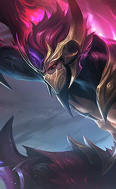
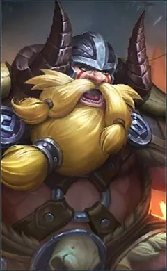

[Тир-лист](https://boostmlbb.ru/heroes/)[Предметы](https://boostmlbb.ru/items/)[Скины](https://boostmlbb.ru/skins/)[Новости и гайды](https://boostmlbb.ru/news/)

[Тир-лист](https://boostmlbb.ru/heroes/)

# Франко

C

ТанкРоум

Победы

40,5%

Выбор

0,7%

Баны

1,8%

[Обзор](https://boostmlbb.ru/#overview)[Сборка](https://boostmlbb.ru/#build)[Как играть](https://boostmlbb.ru/#howto)[Навыки](https://boostmlbb.ru/#skills)[Контрпики](https://boostmlbb.ru/#draft)[Скины](https://boostmlbb.ru/#skins)[История](https://boostmlbb.ru/#lore)

## Обзор

### Характеристики

-   Живучесть**80**
-   Атака**10**
-   Эффекты**100**
-   Сложность**20**

-   Инициатор
-   Контроль

### Другие танки этой линии

[Кармилла](https://boostmlbb.ru/heroes/carmilla.html)[Белерик](https://boostmlbb.ru/heroes/belerick.html)[Атлас](https://boostmlbb.ru/heroes/atlas.html)[Глу](https://boostmlbb.ru/heroes/gloo.html)[Минотавр](https://boostmlbb.ru/heroes/minotaur.html)[Хуфра](https://boostmlbb.ru/heroes/khufra.html)[Тигрил](https://boostmlbb.ru/heroes/tigreal.html)[Хильда](https://boostmlbb.ru/heroes/hilda.html)

### Места в рейтингах

-   [Лучшие танки MLBB**24 из 25**](https://boostmlbb.ru/heroes/best-tank.html)
-   [Лучшие роумеры MLBB**33 из 34**](https://boostmlbb.ru/heroes/best-roam.html)

## Сборка

Сборка 1Сборка 2Сборка 3

Победы

44,3%

Выбор

3,8%

#### Основные предметы

-   [

    

    Зимняя корона

    ](https://boostmlbb.ru/items/winter-crown.html)
-   [

    

    Мимолетное время

    ](https://boostmlbb.ru/items/fleeting-time.html)
-   [

    

    Древняя кираса

    ](https://boostmlbb.ru/items/antique-cuirass.html)

#### Заклинание

Вспышка

#### Эмблема и таланты

Эмблема поддержки

-   

    Вдохновение

-   

    Второе дыхание

-   

    Ударная волна

Победы

44,5%

Выбор

3,6%

#### Основные предметы

-   [

    

    Зимняя корона

    ](https://boostmlbb.ru/items/winter-crown.html)
-   [

    

    Мимолетное время

    ](https://boostmlbb.ru/items/fleeting-time.html)
-   [

    

    Древняя кираса

    ](https://boostmlbb.ru/items/antique-cuirass.html)

#### Заклинание

Вспышка

#### Эмблема и таланты

Эмблема поддержки

-   

    Ловкость

-   

    Второе дыхание

-   

    Фокус-метка

Победы

46,3%

Выбор

1,5%

#### Основные предметы

-   [

    

    Господство льда

    ](https://boostmlbb.ru/items/dominance-ice.html)
-   [

    

    Мимолетное время

    ](https://boostmlbb.ru/items/fleeting-time.html)
-   [

    

    Щит валькирии

    ](https://boostmlbb.ru/items/athenas-shield.html)

#### Заклинание

Вспышка

#### Эмблема и таланты

Эмблема танка

-   

    Ловкость

-   

    Благословение природы

-   

    Фокус-метка

## Как играть за Франко

### Комбо Франко

#### В драке

1.  Ульт
2.  1
3.  2
4.  Атака

Вспышкой подойдите к ключевой цели и ультуйте. Первым продлите контроль, вторым ударьте и замедлите.

#### На линии

1.  1
2.  2
3.  Ульт

Крюком первого притяните врага в плохую позицию, замедлите вторым и добейте подавлением ульта.

### Когда сильнее всего

Сильнее в долгой игре: после 20-й минуты выигрывает 45,6%. Не рискуйте в начале, фармите и ввязывайтесь в драки вместе с командой.

1.  **38,0**10–12
2.  **40,5**12–14
3.  **41,0**14–16
4.  **42,7**16–18
5.  **43,8**18–20
6.  **45,6**20+

Проценты побед по длине матча в минутах, все ранги. Пунктир: 50%

### Приоритет прокачки

1.  Кровавая охота
2.  Железный крюк
3.  Яростный удар

## Навыки

Пассивный**Сила пустоши**1-й навык**Железный крюк**2-й навык**Яростный удар**Ультимейт**Кровавая охота**

Пассивный

### Сила пустоши

Если Франко не получает урона в течение 5 сек., он получает 10% скорости передвижения, восстанавливает 1% в секунду и начинает накапливать "Силу пустоши" (до 10 зарядов).

Следующий навык Франко расходует все заряды "Силы пустоши", увеличивая его урон вплоть до 150%.

1-й навык

### Железный крюк

Перезарядка **15 Mana Cost: 135 с**

Франко бросает "Железный крюк" в указанном направлении, нанося 400 (+100% общей физической атаки) единиц физического урона первому пораженному врагу и притягивая его к себе.

2-й навык

### Яростный удар

Перезарядка **7 Mana Cost: 40 с**

Франко буйствует, нанося 300 (+4% от его ) единиц физического урона ближайшим врагам, замедляя их на 70% на 1.5 сек.

Ультимейт

### Кровавая охота

Перезарядка **62 Mana Cost: 110 с**

Франко подавляет указанного вражеского героя в течение 1.8 сек. и бьет его 6 раз, каждым ударом нанося 50 (+70% общей физической атаки) единиц физического урона.

## Контрпики Франко

### Кто контрит Франко

[Дигги](https://boostmlbb.ru/heroes/diggie.html)[Ангела](https://boostmlbb.ru/heroes/angela.html)[Фанни](https://boostmlbb.ru/heroes/fanny.html)[Флорин](https://boostmlbb.ru/heroes/floryn.html)[Эстес](https://boostmlbb.ru/heroes/estes.html)

### Кого контрит Франко

[Тигрил](https://boostmlbb.ru/heroes/tigreal.html)[Джонсон](https://boostmlbb.ru/heroes/johnson.html)[Ханзо](https://boostmlbb.ru/heroes/hanzo.html)

## Скины Франко

[Капитан потерянныхИсключительный · 2026](https://boostmlbb.ru/skins/franco/captain-of-the-lost.html)[Квантовый авангардИсключительный · 2024](https://boostmlbb.ru/skins/franco/quantum-vanguard.html)[Король адаВысший · 2023](https://boostmlbb.ru/skins/franco/king-of-hell.html)[КостоломОбычный · 2021](https://boostmlbb.ru/skins/franco/bone-crusher.html)[Пылающий топорДелюкс · 2020](https://boostmlbb.ru/skins/franco/blazing-axe.html)[Владыка ВальгаллыИзысканный · 2020](https://boostmlbb.ru/skins/franco/valhalla-ruler.html)[Кошмар пшеничного поляИсключительный · 2019](https://boostmlbb.ru/skins/franco/wheatfield-nightmare.html)[ЛокомотивОбычный · 2018](https://boostmlbb.ru/skins/franco/locomotive.html)[Апока­липсисИсключительный · 2017](https://boostmlbb.ru/skins/franco/apocalypse.html)[Шеф-поварИсключительный · 2016](https://boostmlbb.ru/skins/franco/masterchef.html)

[Все 10 скинов Франко: цены и как получить](https://boostmlbb.ru/skins/franco.html)

## История

> Отважный северный воин, заклятый враг Бэйна.

[Читать полную историю ↗](https://play.mobilelegends.com/lore/hero/Franco)Официальный сайт Mobile Legends [Характеристики на сайте игры ↗](https://www.mobilelegends.com/hero/detail?heroid=10)

**Поднимем ранг на герое «Франко»**Цена считается в калькуляторе

[Рассчитать цену](https://boostmlbb.ru/order.html?type=hero)

## Частые вопросы

Кто контрит Франко в MLBB?

За последние 30 дней Франко чаще всего обыгрывают Дигги, Ангела, Фанни, Флорин и Эстес.

Как играть за Франко?

В первую очередь качайте «Железный крюк», ульт берите, как только доступен. Сильнее в долгой игре: после 20-й минуты выигрывает 45,6%. Не рискуйте в начале, фармите и ввязывайтесь в драки вместе с командой. Комбо для драки: Вспышкой подойдите к ключевой цели и ультуйте. Первым продлите контроль, вторым ударьте и замедлите.

Какой процент побед у Франко сейчас?

40,49% в Мифической славе за последние 7 дней и 41,59% на всех рангах за 30 дней, данные на 27 ноября 2026 года.

Какая роль и линия у Франко?

Танк, играет в роуме.

Стоит ли брать Франко в текущей мете?

Тир C, 130-е место из 133 героев и 24-е среди танков. Тир учитывает, как часто героя берут и банят и как он выигрывает в Мифической славе за 7 дней: бан в 1,8% матчей, 40,5% побед. В профессиональных матчах за месяц героя драфтуют в 0,0% катков.

Какая сборка на Франко лучшая?

Самая популярная сборка в рейтинге: ключевые предметы «Зимняя корона», «Мимолетное время» и «Древняя кираса», эмблема поддержки с талантами «Вдохновение», «Второе дыхание» и «Ударная волна» и заклинание «Вспышка». С ней выигрывают 44,25% матчей.
