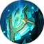
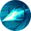
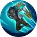

[Тир-лист](https://boostmlbb.ru/heroes/)[Предметы](https://boostmlbb.ru/items/)[Новости и гайды](https://boostmlbb.ru/news/)

# Фредрин

C

ТанкБоецЛес

Победы

52,4%

Выбор

0,5%

Баны

1,1%

[Обзор](https://boostmlbb.ru/#overview)[Сборка](https://boostmlbb.ru/#build)[Навыки](https://boostmlbb.ru/#skills)[Контрпики](https://boostmlbb.ru/#draft)[История](https://boostmlbb.ru/#lore)

## Обзор

### Характеристики

-   Живучесть**80**
-   Атака**50**
-   Эффекты**60**
-   Сложность**60**

-   Урон
-   Преследование

### Победы по рангам, 30 дней

1.  **49,9%**Эпик
2.  **49,5%**Легенда
3.  **50,0%**Мифик
4.  **50,6%**Честь
5.  **52,2%**Слава

Пунктир: 50% побед

### Другие танки этой линии

[Алиса](https://boostmlbb.ru/heroes/alice.html)[Баксий](https://boostmlbb.ru/heroes/baxia.html)

### Места в рейтингах

-   [Лучшие лесники MLBB**18 из 37**](https://boostmlbb.ru/heroes/best-jungle.html)
-   [Лучшие бойцы MLBB**21 из 44**](https://boostmlbb.ru/heroes/best-fighter.html)
-   [Лучшие танки MLBB**13 из 25**](https://boostmlbb.ru/heroes/best-tank.html)

## Сборка

Сборка 1Сборка 2Сборка 3

Победы

62,1%

Выбор

5,3%

#### Основные предметы

-   [

    

    Кираса грубой силы

    ](https://boostmlbb.ru/items/brute-force-breastplate.html)
-   [

    

    Оракул

    ](https://boostmlbb.ru/items/oracle.html)
-   [

    

    Крылья королевы

    ](https://boostmlbb.ru/items/queens-wings.html)

#### Заклинание

Возмездие

#### Эмблема и таланты

Эмблема поддержки

-   

    Трепет

-   

    Опытный охотник

-   

    Нечестивая ярость

Победы

61,4%

Выбор

4,7%

#### Основные предметы

-   [

    

    Кираса грубой силы

    ](https://boostmlbb.ru/items/brute-force-breastplate.html)
-   [

    

    Оракул

    ](https://boostmlbb.ru/items/oracle.html)
-   [

    

    Крылья королевы

    ](https://boostmlbb.ru/items/queens-wings.html)

#### Заклинание

Возмездие

#### Эмблема и таланты

Эмблема поддержки

-   

    Живучесть

-   

    Опытный охотник

-   

    Нечестивая ярость

Победы

60,5%

Выбор

3,8%

#### Основные предметы

-   [

    

    Кираса грубой силы

    ](https://boostmlbb.ru/items/brute-force-breastplate.html)
-   [

    

    Оракул

    ](https://boostmlbb.ru/items/oracle.html)
-   [

    

    Наплечник наказания

    ](https://boostmlbb.ru/items/chastise-pauldron.html)

#### Заклинание

Возмездие

#### Эмблема и таланты

Эмблема поддержки

-   

    Живучесть

-   

    Опытный охотник

-   

    Нечестивая ярость

## Навыки

Прокачка**Ярость оценщика**_›_**Пронзающий удар**_›_**Храброе нападение**

Пассивный**Кристаллическая броня**1-й навык**Пронзающий удар**2-й навык**Храброе нападение**3-й навык**Выброс энергии**Ультимейт**Ярость оценщика**

Пассивный

### Кристаллическая броня

Каждый раз, когда Фредрин поражает навыком врага, не являющегося миньоном, он получает комбо-очки (1), которые существуют 5 сек. (макс. комбо-очков: 4). Его ультимейты стоят разное количество комбо-очков.

Фредрин сохраняет 100% полученного урона в виде энергии кристалла, которая распадается через 5 сек. со скоростью 10% от в секунду.

Фредрин может преобразовать накопленную энергию кристалла в ОЗ на 20% от нанесенного им урона (10% от урона по миньонам). Получение комбо-очка сбрасывает таймер распада.

1-й навык

### Пронзающий удар

Перезарядка **7.5 с**

Фредрин делает выпад мечом в указанном направлении, нанося 125 (+7% Макс. ОЗ) (+120% дополнительной физической атаки) единиц физического урона пораженным врагам и замедляя их на 30% на 2 сек. Его следующая базовая атака получит увеличенную дальность и нанесет 85 (+100% общей физической атаки) единиц физического урона.

Этот навык наносит 170% урона врагам не-героям.

2-й навык

### Храброе нападение

Перезарядка **7.5 с**

Фредрин совершает рывок в указанном направлении, нанося 140 (+80% дополнительной физической атаки) единиц физического урона первому пораженному врагу, не являющемуся миньоном. Его следующая базовая атака подбрасывает цель на 0.3 сек.

3-й навык

### Выброс энергии

Фредрин наносит 210 (+100% дополнительной физической атаки) единиц физического урона ближайшим врагам и провоцирует их на 1 сек. Попадание по врагу, не являющемуся миньоном, дает Фредрину 25 на 3 сек. и сокращает перезарядку "Пронзающего удара" и "Храброго нападения" на 75%.

**Затраты комбо-очков на этот навык:** 1.

Ультимейт

### Ярость оценщика

Фредрин бьет мечом в указанном направлении (этот навык можно прервать только подавлением), после небольшой задержки нанося 600 плюс 21% своей энергии кристалла в качестве физического урона врагам в веерообразной области. Враги в центре области получают 175% урона. Этот навык удваивает процент преобразования накопленной энергии кристалла в ОЗ, основанный на нанесенном вражеским героям уроне.

**Затраты комбо-очков на этот навык:** 3.

## Контрпики

### Контрпики

Побеждают этого героя

[Глу](https://boostmlbb.ru/heroes/gloo.html)[Алукард](https://boostmlbb.ru/heroes/alucard.html)[Люнокс](https://boostmlbb.ru/heroes/lunox.html)[Джой](https://boostmlbb.ru/heroes/joy.html)[Халид](https://boostmlbb.ru/heroes/khaleed.html)

### Слабые цели

Этот герой побеждает их

[Альфа](https://boostmlbb.ru/heroes/alpha.html)[Валир](https://boostmlbb.ru/heroes/valir.html)[Сесилион](https://boostmlbb.ru/heroes/cecilion.html)[Аврора](https://boostmlbb.ru/heroes/aurora.html)[Горд](https://boostmlbb.ru/heroes/gord.html)[Ло Йи](https://boostmlbb.ru/heroes/luo-yi.html)

## История

> Талантливый оценщик редкостей из Лос Пекадос, который копит средства и ищет потерянного друга.

[Читать полную историю ↗](https://play.mobilelegends.com/lore/hero/Fredrinn)Официальный сайт Mobile Legends [Характеристики на сайте игры ↗](https://www.mobilelegends.com/hero/detail?heroid=117)

**Поднимем ранг на герое «Фредрин»**Цена считается в калькуляторе

[Рассчитать цену](https://boostmlbb.ru/order.html?type=hero)

## Частые вопросы

Кто контрпик для героя «Фредрин» в MLBB?

За последние 30 дней чаще всего героя обыгрывают Глу, Алукард, Люнокс, Джой и Халид.

Какой процент побед у героя «Фредрин» сейчас?

52,44% в Мифической славе за последние 7 дней и 51,28% на всех рангах за 30 дней, данные на 25 ноября 2026 года.

Какая роль и линия у героя «Фредрин»?

Танк и боец, играет в лесу.

Силён ли герой «Фредрин» в текущей мете?

Тир C, 73-е место из 133 героев и 13-е среди танков. Тир учитывает, как часто героя берут и банят и как он выигрывает в Мифической славе за 7 дней: бан в 1,1% матчей, 52,4% побед. В профессиональных матчах за месяц героя драфтуют в 0,0% катков.

Какая сборка на героя «Фредрин» лучшая?

Самая популярная сборка в рейтинге: ключевые предметы «Кираса грубой силы», «Оракул» и «Крылья королевы», эмблема поддержки с талантами «Трепет», «Опытный охотник» и «Нечестивая ярость» и заклинание «Возмездие». С ней выигрывают 62,06% матчей.
