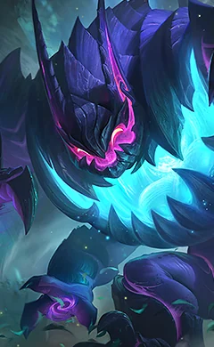

[Тир-лист](https://boostmlbb.ru/heroes/)[Предметы](https://boostmlbb.ru/items/)[Скины](https://boostmlbb.ru/skins/)[Новости и гайды](https://boostmlbb.ru/news/)

[Тир-лист](https://boostmlbb.ru/heroes/)

# Гатоткача

C

ТанкБоецЛиния опытаРоум

Победы

44,2%

Выбор

0,3%

Баны

0,1%

[Обзор](https://boostmlbb.ru/#overview)[Сборка](https://boostmlbb.ru/#build)[Как играть](https://boostmlbb.ru/#howto)[Навыки](https://boostmlbb.ru/#skills)[Контрпики](https://boostmlbb.ru/#draft)[Скины](https://boostmlbb.ru/#skins)[История](https://boostmlbb.ru/#lore)

## Обзор

### Характеристики

-   Живучесть**90**
-   Атака**30**
-   Эффекты**90**
-   Сложность**40**

-   Массовый контроль
-   Разрушительный урон

### Другие танки этой линии

[Маша](https://boostmlbb.ru/heroes/masha.html)[Кармилла](https://boostmlbb.ru/heroes/carmilla.html)[Белерик](https://boostmlbb.ru/heroes/belerick.html)[Атлас](https://boostmlbb.ru/heroes/atlas.html)[Алиса](https://boostmlbb.ru/heroes/alice.html)[Эсмеральда](https://boostmlbb.ru/heroes/esmeralda.html)[Глу](https://boostmlbb.ru/heroes/gloo.html)[Бартс](https://boostmlbb.ru/heroes/barats.html)

### Места в рейтингах

-   [Лучшие бойцы MLBB**27 из 44**](https://boostmlbb.ru/heroes/best-fighter.html)
-   [Лучшие танки MLBB**15 из 25**](https://boostmlbb.ru/heroes/best-tank.html)
-   [Лучшие роумеры MLBB**20 из 34**](https://boostmlbb.ru/heroes/best-roam.html)

## Сборка

Сборка 1Сборка 2Сборка 3

Победы

55,0%

Выбор

3,1%

#### Основные предметы

-   [

    

    Концентрированная энергия

    ](https://boostmlbb.ru/items/concentrated-energy.html)
-   [

    

    Крылья королевы

    ](https://boostmlbb.ru/items/queens-wings.html)
-   [

    

    Пронзающий небеса

    ](https://boostmlbb.ru/items/sky-piercer.html)

#### Заклинание

Месть

#### Эмблема и таланты

Эмблема мага

-   

    Трепет

-   

    Охотник за скидками

-   

    Нечестивая ярость

Победы

57,3%

Выбор

1,9%

#### Основные предметы

-   [

    

    Штормовой пояс

    ](https://boostmlbb.ru/items/thunder-belt.html)
-   [

    

    Господство льда

    ](https://boostmlbb.ru/items/dominance-ice.html)
-   [

    

    Крылья королевы

    ](https://boostmlbb.ru/items/queens-wings.html)

#### Заклинание

Восстановление

#### Эмблема и таланты

Эмблема танка

-   

    Живучесть

-   

    Стойкость

-   

    Ударная волна

Победы

50,8%

Выбор

1,8%

#### Основные предметы

-   [

    

    Господство льда

    ](https://boostmlbb.ru/items/dominance-ice.html)
-   [

    

    Древняя кираса

    ](https://boostmlbb.ru/items/antique-cuirass.html)
-   [

    

    Сияющая броня

    ](https://boostmlbb.ru/items/radiant-armor.html)

#### Заклинание

Восстановление

#### Эмблема и таланты

Эмблема танка

-   

    Живучесть

-   

    Стойкость

-   

    Ударная волна

## Как играть за Гатоткачу

### Комбо Гатоткачи

#### В драке

1.  Ульт
2.  2
3.  1
4.  Атака

В драке ультом прыгните в команду врага, вторым спровоцируйте, первым замедлите и добивайте атаками.

#### На линии

1.  2
2.  1
3.  Атака

На линии заряжайте второй навык, чтобы увеличить дальность, и дайте контроль, затем первый и атаки.

### Когда сильнее всего

Сильнее в долгой игре: после 20-й минуты выигрывает 48,0%. Не рискуйте в начале, фармите и ввязывайтесь в драки вместе с командой.

1.  **41,5**10–12
2.  **45,0**12–14
3.  **47,2**14–16
4.  **47,8**16–18
5.  **47,9**18–20
6.  **48,0**20+

Проценты побед по длине матча в минутах, все ранги. Пунктир: 50%

### Приоритет прокачки

1.  Аватар стража
2.  Железный кулак
3.  Нерушимый

## Навыки

Пассивный**Стальные кости**1-й навык**Железный кулак**2-й навык**Нерушимый**Ультимейт**Аватар стража**

Пассивный

### Стальные кости

Гатоткача получает , равную 2% от его потерянных ОЗ (вплоть до 200). Он получает 5 ярости (вплоть до 100) за кажд. 300 ед. получаемого урона (рассчитывается до снижения).

По достижении 25 ярости следующая базовая атака Гатоткачи усиливается: она потребляет всю ярость, чтобы нанести (+100% общей физической атаки) (+200% общей магической силы) (+8.2-11 \* потребленная ярость) единиц магического урона (зависит от уровня героя) и восстановить (8 \* потребленная ярость) ОЗ.

1-й навык

### Железный кулак

Перезарядка **8 с**

Гатоткача бьет по земле, создавая разлом в указанном направлении и нанося 200 (+150% общей магической силы) единиц магического урона пораженным врагам. Враги в зоне разлома будут получать 100 (+20% общей магической силы) единиц магического урона в секунду и замедляться на 30%.

2-й навык

### Нерушимый

Перезарядка **12 с**

Гатоткача начинает подготовку, затем издает боевой клич и бросается в указанном направлении, провоцируя врагов на пути атаковать его и нанося 200 (+100% общей магической силы) единиц магического урона в течение 0.9 - 1.5 сек. Длительность провокации и дистанция рывка зависят от длительности подготовки. Отмена навыка сокращает оставшуюся перезарядку на 50%.

Ультимейт

### Аватар стража

Гатоткача прыгает в указанную область, нанося 500 (+300% общей магической силы) единиц магического урона ближайшим врагам и подбрасывая их на 1 сек. Враги, находящиеся около центра области, будут подброшены на более длительное время. Враги по краям области притянутся в ее центр.

Камера будет следовать за индикатором навыка, но не будет обеспечивать дополнительный обзор.

## Контрпики Гатоткачи

### Кто контрит Гатоткачу

[Одетта](https://boostmlbb.ru/heroes/odette.html)[Сабер](https://boostmlbb.ru/heroes/saber.html)[Мия](https://boostmlbb.ru/heroes/miya.html)[Зилонг](https://boostmlbb.ru/heroes/zilong.html)[Аргус](https://boostmlbb.ru/heroes/argus.html)

### Кого контрит Гатоткача

[Лесли](https://boostmlbb.ru/heroes/lesley.html)[Уранус](https://boostmlbb.ru/heroes/uranus.html)

## Скины Гатоткачи

[Щелкунчик-монархИсключительный · 2024](https://boostmlbb.ru/skins/gatotkaca/nutcracker-monarch.html)[Хранитель приливовДелюкс · 2024](https://boostmlbb.ru/skins/gatotkaca/tide-preserver.html)[ИскраОбычный · 2019](https://boostmlbb.ru/skins/gatotkaca/spark.html)[ЧасовойИзысканный · 2018](https://boostmlbb.ru/skins/gatotkaca/sentinel.html)[Король архатовОбычный · 2018](https://boostmlbb.ru/skins/gatotkaca/arhat-king.html)[Могучий стражОбычный · 2017](https://boostmlbb.ru/skins/gatotkaca/mighty-guardian.html)[Солнечная искра](https://boostmlbb.ru/skins/gatotkaca/solar-spark.html)

[Все 7 скинов Гатоткачи: цены и как получить](https://boostmlbb.ru/skins/gatotkaca.html)

## История

> Воин из Вселенной Аркадем.

[Читать полную историю ↗](https://kazukiofficial.com/stories/gatotkaca)Kazuki Official, английский [Характеристики на сайте игры ↗](https://www.mobilelegends.com/hero/detail?heroid=41)

**Поднимем ранг на герое «Гатоткача»**Цена считается в калькуляторе

[Рассчитать цену](https://boostmlbb.ru/order.html?type=hero)

## Частые вопросы

Кто контрит Гатоткачу в MLBB?

За последние 30 дней Гатоткачу чаще всего обыгрывают Одетта, Сабер, Мия, Зилонг и Аргус.

Как играть за Гатоткачу?

В первую очередь качайте «Железный кулак», ульт берите, как только доступен. Сильнее в долгой игре: после 20-й минуты выигрывает 48,0%. Не рискуйте в начале, фармите и ввязывайтесь в драки вместе с командой. Комбо для драки: В драке ультом прыгните в команду врага, вторым спровоцируйте, первым замедлите и добивайте атаками.

Какой процент побед у Гатоткачи сейчас?

44,24% в Мифической славе за последние 7 дней и 45,39% на всех рангах за 30 дней, данные на 27 ноября 2026 года.

Какая роль и линия у Гатоткачи?

Танк и боец, играет на линии опыта или в роуме.

Стоит ли брать Гатоткачу в текущей мете?

Тир C, 89-е место из 133 героев и 15-е среди танков. Тир учитывает, как часто героя берут и банят и как он выигрывает в Мифической славе за 7 дней: бан в 0,1% матчей, 44,2% побед. В профессиональных матчах за месяц героя драфтуют в 16,3% катков.

Какая сборка на Гатоткачу лучшая?

Самая популярная сборка в рейтинге: ключевые предметы «Концентрированная энергия», «Крылья королевы» и «Пронзающий небеса», эмблема мага с талантами «Трепет», «Охотник за скидками» и «Нечестивая ярость» и заклинание «Месть». С ней выигрывают 55,05% матчей.
