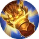

[Главная](https://boostmlbb.ru/) / [Герои](https://boostmlbb.ru/heroes/)

Тир D

# Гатоткача в Mobile Legends: сборка, контрпики и статистика

Танк и боец, линия опыта или роум. Выигрывает 45,35% матчей за последние 30 дней — 125-е место из 133 героев.

[Буст на этом герое](https://boostmlbb.ru/order.html?type=hero)[Все герои](https://boostmlbb.ru/heroes/)

Статистика герояТир D

**Гатоткача**Бан 0,30% · Выбор 0,56%

Контрпики

Победы за 30 дней**45,35%**

**45,35%**побед за 30 дней

**0,56%**выбирают в матчах

**0,30%**банят в матчах

**43,99%**побед в Мифической славе

## Сборка на героя «Гатоткача»

Самая популярная сборка для героя «Гатоткача» на роли линии опыта в рейтинговых матчах на всех рангах — по данным «Академии» в игре. Процент побед — в матчах именно с этой сборкой.

Ключевые предметы

Штормовой поясГосподство льдаКрылья королевы

Эмблема и таланты

Эмблема танкаЖивучестьСтойкостьУдарная волна

Боевое заклинание

Восстановление

Побед с этой сборкой **57,09%**Выбирают в **2,36%** матчей

### Другие популярные варианты

-   МестьЭмблема магаТрепет · Охотник за скидками · Нечестивая ярость**55,08%**
-   ВосстановлениеЭмблема танкаЖивучесть · Стойкость · Ударная волна**51,12%**

## Навыки героя «Гатоткача»

Официальные описания навыков от MOONTON с перезарядкой и типом навыка.

Порядок прокачки: **Аватар стража** → **Железный кулак** → **Нерушимый**

-   

    **Стальные кости**Пассивный

    Гатоткача получает , равную 2% от его потерянных ОЗ (вплоть до 200). Он получает 5 ярости (вплоть до 100) за кажд. 300 ед. получаемого урона (рассчитывается до снижения).
    По достижении 25 ярости следующая базовая атака Гатоткачи усиливается: она потребляет всю ярость, чтобы нанести (+100% общей физической атаки) (+200% общей магической силы) (+8.2-11 \* потребленная ярость) единиц магического урона (зависит от уровня героя) и восстановить (8 \* потребленная ярость) ОЗ.

-   

    **Железный кулак**1-й навыкПерезарядка 8 с

    Гатоткача бьет по земле, создавая разлом в указанном направлении и нанося 200 (+150% общей магической силы) единиц магического урона пораженным врагам. Враги в зоне разлома будут получать 100 (+20% общей магической силы) единиц магического урона в секунду и замедляться на 30%.

-   

    **Нерушимый**2-й навыкПерезарядка 12 с

    Гатоткача начинает подготовку, затем издает боевой клич и бросается в указанном направлении, провоцируя врагов на пути атаковать его и нанося 200 (+100% общей магической силы) единиц магического урона в течение 0.9 - 1.5 сек. Длительность провокации и дистанция рывка зависят от длительности подготовки. Отмена навыка сокращает оставшуюся перезарядку на 50%.

-   

    **Аватар стража**Ультимейт

    Гатоткача прыгает в указанную область, нанося 500 (+300% общей магической силы) единиц магического урона ближайшим врагам и подбрасывая их на 1 сек. Враги, находящиеся около центра области, будут подброшены на более длительное время. Враги по краям области притянутся в ее центр.
    Камера будет следовать за индикатором навыка, но не будет обеспечивать дополнительный обзор.

## Роль и линия

Место считается по проценту побед за 30 дней среди героев той же роли или линии.

-   Роль**Танк и боец**
-   Линия**Линия опыта или роум**
-   Среди танков**23-е из 25**
-   Среди бойцов**43-е из 44**
-   На линии опыта**41-е из 42**
-   В роуме**30-е из 34**
-   Специализация**Массовый контроль, Разрушительный урон**
-   Сложность**Низкая (40/100)**

## Кто контрит этого героя

Против этих героев «Гатоткача» проигрывает чаще всего. Под иконкой — их собственный процент побед. 2 из 5 контрпиков — убийцы.

[Одетта49,69%](https://boostmlbb.ru/heroes/odette.html)[Сабер51,21%](https://boostmlbb.ru/heroes/saber.html)[Мия49,71%](https://boostmlbb.ru/heroes/miya.html)[Зилонг46,27%](https://boostmlbb.ru/heroes/zilong.html)[Аргус56,78%](https://boostmlbb.ru/heroes/argus.html)

## Против кого силён

Для этих героев «Гатоткача» — один из самых неудобных соперников.

[Лесли48,31%](https://boostmlbb.ru/heroes/lesley.html)[Уранус49,34%](https://boostmlbb.ru/heroes/uranus.html)

## С кем играть в команде

С этими героями в одной команде «Гатоткача» выигрывает чаще. Число — прибавка к проценту побед в процентных пунктах.

[Ангела+3,67 п. п.](https://boostmlbb.ru/heroes/angela.html)[Флорин+2,45 п. п.](https://boostmlbb.ru/heroes/floryn.html)[Эстес+2,08 п. п.](https://boostmlbb.ru/heroes/estes.html)[Наталья+1,87 п. п.](https://boostmlbb.ru/heroes/natalia.html)

## Процент побед по рангам

Лучший результат — на ранге «Эпик» (48,76%), слабее всего — «Мифическая слава» (43,99%). Данные за последние 30 дней.

-   Эпик**48,76%**
-   Легенда**45,88%**
-   Мифический**44,90%**
-   Мифическая честь**44,01%**
-   Мифическая слава**43,99%**

## Место в мете

«Гатоткача» — тир D в нашем тир-листе по проценту побед, 125-е место из 133 героев. В Мифической славе процент побед ниже: 43,99% против 45,35% на всех рангах, разница 1,36 п. п. Полный [тир-лист ноября](https://boostmlbb.ru/news/mlbb-meta-tier-list/) и [разбор патча](https://boostmlbb.ru/news/mlbb-current-patch/).

## Другие герои линии опыта

Самые сильные по проценту побед за последние 30 дней.

[Маша60,40%](https://boostmlbb.ru/heroes/masha.html)[Аргус56,78%](https://boostmlbb.ru/heroes/argus.html)[Сан53,72%](https://boostmlbb.ru/heroes/sun.html)[Аулус53,46%](https://boostmlbb.ru/heroes/aulus.html)[Глу53,45%](https://boostmlbb.ru/heroes/gloo.html)[Эдит52,67%](https://boostmlbb.ru/heroes/edith.html)

## История героя

«Воин из Вселенной Аркадем.»

Полная история героя «Гатоткача» — на официальном сайте лора MOONTON. Карточка героя с навыками и советами разработчиков — на mobilelegends.com, реплики, облики и история изменений — в MLBB Wiki.

[Читать историю](https://www.mobilelegends.com/hero/detail?heroid=41)[Карточка героя](https://www.mobilelegends.com/hero/detail?heroid=41)[MLBB Wiki](https://mobile-legends.fandom.com/wiki/Gatotkaca)

## Буст на герое «Гатоткача»

Бустер играет только этим героем: вместе с рангом растёт и рейтинг героя.

[Рассчитать стоимость](https://boostmlbb.ru/order.html?type=hero)

Статистика — официальный рейтинг героев MOONTON (mobilelegends.com/rank) за последние 30 дней, обновление 23 ноября 2026 года, страница обновляется каждый день. Роли и линии — с официальной страницы героев. Сборки, навыки и союзники — данные «Академии» MOONTON через Rone Arena API (ridwaanhall / RoneAI).

## Частые вопросы

Кто контрпик для героя «Гатоткача» в MLBB?

За последние 30 дней чаще всего героя обыгрывают Одетта, Сабер, Мия, Зилонг и Аргус.

Какой процент побед у героя «Гатоткача» сейчас?

45,35% за последние 30 дней на всех рангах и 43,99% в Мифической славе, данные на 23 ноября 2026 года.

Какая роль и линия у героя «Гатоткача»?

Танк и боец, играет на линии опыта или в роуме.

Силён ли герой «Гатоткача» в текущей мете?

Тир D: 125-е место из 133 героев по проценту побед за 30 дней и 23-е среди танков.

Какая сборка на героя «Гатоткача» лучшая?

Самая популярная сборка в рейтинге: ключевые предметы «Штормовой пояс», «Господство льда» и «Крылья королевы», эмблема танка с талантами «Живучесть», «Стойкость» и «Ударная волна» и заклинание «Восстановление». С ней выигрывают 57,09% матчей.

Редакция MLBB Boost · Обновлено 23 ноября 2026
