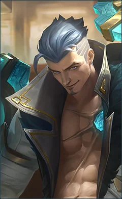

[Тир-лист](https://boostmlbb.ru/heroes/)[Предметы](https://boostmlbb.ru/items/)[Новости и гайды](https://boostmlbb.ru/news/)

# Горд

C

МагСредняя линия

Победы

51,9%

Выбор

0,5%

Баны

0,1%

[Обзор](https://boostmlbb.ru/#overview)[Сборка](https://boostmlbb.ru/#build)[Навыки](https://boostmlbb.ru/#skills)[Контрпики](https://boostmlbb.ru/#draft)[История](https://boostmlbb.ru/#lore)

## Обзор

### Характеристики

-   Живучесть**10**
-   Атака**70**
-   Эффекты**80**
-   Сложность**30**

-   Поук
-   Разрушительный урон

### Победы по рангам, 30 дней

1.  **52,4%**Эпик
2.  **52,6%**Легенда
3.  **53,0%**Мифик
4.  **52,7%**Честь
5.  **52,2%**Слава

Пунктир: 50% побед

### Другие маги этой линии

[Кимми](https://boostmlbb.ru/heroes/kimmy.html)[Эйдора](https://boostmlbb.ru/heroes/eudora.html)[Чжусинь](https://boostmlbb.ru/heroes/zhuxin.html)[Валир](https://boostmlbb.ru/heroes/valir.html)[Цзэтянь](https://boostmlbb.ru/heroes/zetian.html)[Лилия](https://boostmlbb.ru/heroes/lylia.html)[Ксавьер](https://boostmlbb.ru/heroes/xavier.html)[Люнокс](https://boostmlbb.ru/heroes/lunox.html)

### Места в рейтингах

-   [Лучшие маги MLBB**22 из 32**](https://boostmlbb.ru/heroes/best-mage.html)
-   [Лучшие мидеры MLBB**20 из 29**](https://boostmlbb.ru/heroes/best-mid.html)

## Сборка

Сборка 1Сборка 2Сборка 3

Победы

56,1%

Выбор

6,1%

#### Основные предметы

-   [

    

    Пылающий жезл

    ](https://boostmlbb.ru/items/glowing-wand.html)
-   [

    

    Пронзающий небеса

    ](https://boostmlbb.ru/items/sky-piercer.html)
-   [

    

    Фонарь желаний

    ](https://boostmlbb.ru/items/wishing-lantern.html)

#### Заклинание

Вспышка

#### Эмблема и таланты

Эмблема мага

-   

    Вдохновение

-   

    Благословение природы

-   

    Нечестивая ярость

Победы

58,0%

Выбор

4,0%

#### Основные предметы

-   [

    

    Пылающий жезл

    ](https://boostmlbb.ru/items/glowing-wand.html)
-   [

    

    Пронзающий небеса

    ](https://boostmlbb.ru/items/sky-piercer.html)
-   [

    

    Жезл снежной королевы

    ](https://boostmlbb.ru/items/ice-queen-wand.html)

#### Заклинание

Вспышка

#### Эмблема и таланты

Обычная эмблема

-   

    Ловкость

-   

    Благословение природы

-   

    Нечестивая ярость

Победы

56,7%

Выбор

3,4%

#### Основные предметы

-   [

    

    Пронзающий небеса

    ](https://boostmlbb.ru/items/sky-piercer.html)
-   [

    

    Пылающий жезл

    ](https://boostmlbb.ru/items/glowing-wand.html)
-   [

    

    Жезл снежной королевы

    ](https://boostmlbb.ru/items/ice-queen-wand.html)

#### Заклинание

Вспышка

#### Эмблема и таланты

Обычная эмблема

-   

    Ловкость

-   

    Благословение природы

-   

    Фокус-метка

## Навыки

Прокачка**Мистический поток**_›_**Мистический запрет**_›_**Мистический снаряд**

Пассивный**Мистическая милость**1-й навык**Мистический снаряд**2-й навык**Мистический запрет**Ультимейт**Мистический поток**

Пассивный

### Мистическая милость

Когда Горд попадает навыками по одной и той же цели 4 р. подряд, его следующий навык наносит 120 (+8 × ур. героя) (+40% общей магической силы) дополнительного чистого урона и замедляет цель на 20% на 1 сек. (эффект замедления складывается до 2 раз).

1-й навык

### Мистический снаряд

Перезарядка **8 Mana Cost: 80 с**

Горд бросает мистический шар, который скачет в указанном направлении и взрывается при попадании в первого врага, нанося 225 (+65% общей магической силы) единиц магического урона врагам в области, а также оглушая их и раскрывая их местоположение на 1 сек.

2-й навык

### Мистический запрет

Перезарядка **8 Mana Cost: 60 с**

Горд создает в указанной области энергетическое поле, нанося врагам в нем 30 (+10% общей магической силы) единиц магического урона каждые 0.25 сек. (до 16 раз).

Ультимейт

### Мистический поток

Перезарядка **44 Mana Cost: 150 с**

Горд выпускает поток энергии в указанном направлении, нанося 90 (+32% общей магической силы) единиц магического урона пораженным врагам каждые 0.2 сек. (до 16 раз).

Направление потока можно менять с помощью джойстика.

## Контрпики

### Контрпики

Побеждают этого героя

[Бартс](https://boostmlbb.ru/heroes/barats.html)[Лолита](https://boostmlbb.ru/heroes/lolita.html)[Фредрин](https://boostmlbb.ru/heroes/fredrinn.html)[Фовиус](https://boostmlbb.ru/heroes/phoveus.html)[Алиса](https://boostmlbb.ru/heroes/alice.html)

### Слабые цели

Этот герой побеждает их

[Харли](https://boostmlbb.ru/heroes/harley.html)[Хелкарт](https://boostmlbb.ru/heroes/helcurt.html)

## История

> Декан школы Икарус в Магической академии.

[Читать полную историю ↗](https://kazukiofficial.com/stories/gord)Kazuki Official, английский [Характеристики на сайте игры ↗](https://www.mobilelegends.com/hero/detail?heroid=23)

**Поднимем ранг на герое «Горд»**Цена считается в калькуляторе

[Рассчитать цену](https://boostmlbb.ru/order.html?type=hero)

## Частые вопросы

Кто контрпик для героя «Горд» в MLBB?

За последние 30 дней чаще всего героя обыгрывают Бартс, Лолита, Фредрин, Фовиус и Алиса.

Какой процент побед у героя «Горд» сейчас?

51,93% в Мифической славе за последние 7 дней и 52,57% на всех рангах за 30 дней, данные на 25 ноября 2026 года.

Какая роль и линия у героя «Горд»?

Маг, играет на средней линии.

Силён ли герой «Горд» в текущей мете?

Тир C, 88-е место из 133 героев и 22-е среди магов. Тир учитывает, как часто героя берут и банят и как он выигрывает в Мифической славе за 7 дней: бан в 0,1% матчей, 51,9% побед. В профессиональных матчах за месяц героя драфтуют в 0,0% катков.

Какая сборка на героя «Горд» лучшая?

Самая популярная сборка в рейтинге: ключевые предметы «Пылающий жезл», «Пронзающий небеса» и «Фонарь желаний», эмблема мага с талантами «Вдохновение», «Благословение природы» и «Нечестивая ярость» и заклинание «Вспышка». С ней выигрывают 56,07% матчей.
