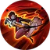

[Тир-лист](https://boostmlbb.ru/heroes/)[Новости и гайды](https://boostmlbb.ru/news/)

# Грейнджер

D

СтрелокЛиния золота

Загадочный охотник на демонов, сражающийся вне условностей Церкви Света. В его футляре для скрипки скрыты два оружия, способные поглощать души.

Победы

44,0%

все ранги 43,0%

Выбор

1,4%

все ранги 1,3%

Баны

0,9%

все ранги 1,6%

№119 в тир-листе · №22 среди стрелков · Мифическая слава, 7 дней, по 23 ноября

[Обзор](https://boostmlbb.ru/#overview)[Сборка](https://boostmlbb.ru/#build)[Навыки](https://boostmlbb.ru/#skills)[Контрпики](https://boostmlbb.ru/#draft)[История](https://boostmlbb.ru/#lore)

## Обзор

### Характеристики

-   Живучесть**30**
-   Атака**70**
-   Эффекты**10**
-   Сложность**30**

-   Разрушительный урон
-   Добивание

### Победы по рангам, 30 дней

1.  **43,2%**Эпик
2.  **41,8%**Легенда
3.  **41,4%**Мифик
4.  **42,0%**Честь
5.  **44,7%**Слава

Пунктир: 50% побед

### Другие стрелки этой линии

[Обсидия](https://boostmlbb.ru/heroes/obsidia.html)[Бруно](https://boostmlbb.ru/heroes/bruno.html)[Ханаби](https://boostmlbb.ru/heroes/hanabi.html)[Москов](https://boostmlbb.ru/heroes/moskov.html)[Мия](https://boostmlbb.ru/heroes/miya.html)[Иритель](https://boostmlbb.ru/heroes/irithel.html)[Броуди](https://boostmlbb.ru/heroes/brody.html)[Клинт](https://boostmlbb.ru/heroes/clint.html)

## Сборка

Линия золота · по данным рейтинговых матчей

Сборка 146,3%Сборка 246,1%Сборка 339,7%

### Предметы

Удар охотника

Пронзающий небеса

Злобный рык

### Эмблема

Эмблема убийцы

Трепет

Кровавое пиршество

Нечестивая ярость

### Заклинание

Вспышка

Победы

46,3%

Выбор

30,2%

### Предметы

Удар охотника

Пронзающий небеса

Злобный рык

### Эмблема

Эмблема убийцы

Разрыв

Кровавое пиршество

Нечестивая ярость

### Заклинание

Вспышка

Победы

46,1%

Выбор

10,9%

### Предметы

Удар охотника

Пронзающий небеса

Трезубец

### Эмблема

Эмблема убийцы

Трепет

Кровавое пиршество

Нечестивая ярость

### Заклинание

Вспышка

Победы

39,7%

Выбор

3,4%

## Навыки

Прокачка**Смертельная соната**_›_**Рапсодия**_›_**Рондо**

Пассивный1-й навык2-й навыкУльтимейт

Пассивный

### Каприччио

Уникальные пистолет и пушка для охоты на демонов наделены демонической энергией. Оба оружия начинают с 800 макс. энергии. Пистолет восстанавливает 8% энергии в сек., а пушка восстанавливает 2% энергии в сек. Убийство миньона / монстра навсегда увеличивает их макс. энергию на 6 / 6 и мгновенно восстанавливает энергию на 5% / 5%. Каждое убийство или ассист, полученный за вражеского героя, навсегда увеличивает макс. энергию обоих оружий на 12 и мгновенно восстанавливает 10% энергии.

Кажд. 1% сокращения перезарядки преобраз. в 2 . На затраты демонической энергии не влияет сокращение затрат энергии.

1-й навык

### Рапсодия

Перезарядка **0.3 с**

Грейнджер быстро стреляет из своего пистолета 6 р., каждым выстрелом нанося 60 (+45% общей физической атаки) единиц физического урона и расходуя 70 единиц энергии пистолета. Последний выстрел гарантированно наносит критический урон. Во время выстрелов скорость передвижения Грейнджера увеличивается на 10%.

Грейнджер перестает стрелять при отсутствии энергии или при повторном применении навыка. "Рапсодия" не имеет перезарядки и применяется только когда у пистолета более 420 энергии.

2-й навык

### Рондо

Перезарядка **12 с**

Грейнджер использует ловкость охотника на демонов, чтобы броситься в указанном направлении, мгновенно восстанавливая 15% энергии для своего пистолета.

"Рондо" можно использовать во время применения "Рапсодии". Каждый раз, когда "Рапсодия" поражает врага, перезарядка "Рондо" сокращается на 0.5 сек.

Ультимейт

### Смертельная соната

Перезарядка **0.6 Energy Cost: 250 с**

Грейнджер стреляет из пушки в указанном направлении, нанося 150 (+110% общей физической атаки) единиц физического урона первому пораженному вражескому герою и другим целям в области поражения. Пораженные цели ненадолго замедляются. После каждого выстрела Грейнджер может перекатиться в направлении джойстика.

"Смертельную сонату" можно применять во время "Рапсодии". "Смертельная соната" имеет короткую перезарядку и расходует 250 энергии пушки Грейнджера на выстрел.

## Контрпики и союзники

### Контрпики

Побеждают этого героя

[Карина](https://boostmlbb.ru/heroes/karina.html)[Беатрис](https://boostmlbb.ru/heroes/beatrix.html)[Иксия](https://boostmlbb.ru/heroes/ixia.html)[Дигги](https://boostmlbb.ru/heroes/diggie.html)[Ив](https://boostmlbb.ru/heroes/yve.html)

### Слабые цели

Этот герой побеждает их

[Фанни](https://boostmlbb.ru/heroes/fanny.html)[Хильда](https://boostmlbb.ru/heroes/hilda.html)[Кусака](https://boostmlbb.ru/heroes/jawhead.html)[Акай](https://boostmlbb.ru/heroes/akai.html)[Уранус](https://boostmlbb.ru/heroes/uranus.html)

### Союзники

Рост побед в паре, п. п.

[Баксий**+8,5**](https://boostmlbb.ru/heroes/baxia.html)[Флорин**+5,6**](https://boostmlbb.ru/heroes/floryn.html)[Харит**+3,9**](https://boostmlbb.ru/heroes/harith.html)[Фредрин**+3,4**](https://boostmlbb.ru/heroes/fredrinn.html)

## История

> Загадочный охотник на демонов, сражающийся вне условностей Церкви Света. В его футляре для скрипки скрыты два оружия, способные поглощать души.

[Читать полную историю ↗](https://kazukiofficial.com/stories/granger)Kazuki Official, английский

[Характеристики на сайте игры ↗](https://www.mobilelegends.com/hero/detail?heroid=79)

**Поднимем ранг на герое «Грейнджер»**Цена считается в калькуляторе

[Рассчитать цену](https://boostmlbb.ru/order.html?type=hero)

## Частые вопросы

Кто контрпик для героя «Грейнджер» в MLBB?

За последние 30 дней чаще всего героя обыгрывают Карина, Беатрис, Иксия, Дигги и Ив.

Какой процент побед у героя «Грейнджер» сейчас?

44,02% в Мифической славе за последние 7 дней и 42,99% на всех рангах за 30 дней, данные на 23 ноября 2026 года.

Какая роль и линия у героя «Грейнджер»?

Стрелок, играет на линии золота.

Силён ли герой «Грейнджер» в текущей мете?

Тир D, 119-е место из 133 героев и 22-е среди стрелков. Тир учитывает, как часто героя берут и банят и как он выигрывает в Мифической славе за 7 дней: бан в 0,9% матчей, 44,0% побед.

Какая сборка на героя «Грейнджер» лучшая?

Самая популярная сборка в рейтинге: ключевые предметы «Удар охотника», «Пронзающий небеса» и «Злобный рык», эмблема убийцы с талантами «Трепет», «Кровавое пиршество» и «Нечестивая ярость» и заклинание «Вспышка». С ней выигрывают 46,34% матчей.
