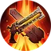

[Главная](https://boostmlbb.ru/) / [Герои](https://boostmlbb.ru/heroes/)

Тир D

# Грейнджер

Стрелок · Линия золота

**№ 131 из 133 по доле побед**Все ранги · 30 дней по 23 ноября 2026 года

Победы

42,99%

Выбор

1,33%

Баны

1,64%

Разрушительный урон · Добивание · Сложность 30/100

[Сборка](https://boostmlbb.ru/#build)[Контрпики и союзники](https://boostmlbb.ru/#draft)[Навыки](https://boostmlbb.ru/#skills)[Победы по рангам](https://boostmlbb.ru/#ranks)[История](https://boostmlbb.ru/#lore)

## Сборка

Самый частый выбор в рейтинге · Линия золота

Ключевые предметы

Удар охотникаПронзающий небесаЗлобный рык

Эмблема и таланты

Эмблема убийцыРазрывКровавое пиршествоНечестивая ярость

Боевое заклинание

Вспышка

Побед с этой сборкой **46,08%**Выбирают в **10,90%** матчей

Другие сборки (2)

Ключевые предметы

Удар охотникаПронзающий небесаЗлобный рык

Эмблема и таланты

Эмблема убийцыТрепетКровавое пиршествоНечестивая ярость

Боевое заклинание

Вспышка

Побед с этой сборкой **46,34%**Выбирают в **30,16%** матчей

Ключевые предметы

Удар охотникаПронзающий небесаТрезубец

Эмблема и таланты

Эмблема убийцыТрепетКровавое пиршествоНечестивая ярость

Боевое заклинание

Вспышка

Побед с этой сборкой **39,73%**Выбирают в **3,42%** матчей

## Контрпики и союзники

### Кто контрит

[Карина](https://boostmlbb.ru/heroes/karina.html)[Беатрис](https://boostmlbb.ru/heroes/beatrix.html)[Иксия](https://boostmlbb.ru/heroes/ixia.html)[Дигги](https://boostmlbb.ru/heroes/diggie.html)[Ив](https://boostmlbb.ru/heroes/yve.html)

### Против кого силён

[Фанни](https://boostmlbb.ru/heroes/fanny.html)[Хильда](https://boostmlbb.ru/heroes/hilda.html)[Кусака](https://boostmlbb.ru/heroes/jawhead.html)[Акай](https://boostmlbb.ru/heroes/akai.html)[Уранус](https://boostmlbb.ru/heroes/uranus.html)

### Союзники

Прибавка к доле побед в одной команде

[Баксий+8,54 п. п.](https://boostmlbb.ru/heroes/baxia.html)[Флорин+5,64 п. п.](https://boostmlbb.ru/heroes/floryn.html)[Харит+3,85 п. п.](https://boostmlbb.ru/heroes/harith.html)[Фредрин+3,39 п. п.](https://boostmlbb.ru/heroes/fredrinn.html)

## Навыки

Приоритет прокачки · Смертельная соната → Рапсодия → Рондо

Пассивный**Каприччио**

Уникальные пистолет и пушка для охоты на демонов наделены демонической энергией. Оба оружия начинают с 800 макс. энергии. Пистолет восстанавливает 8% энергии в сек., а пушка восстанавливает 2% энергии в сек. Убийство миньона / монстра навсегда увеличивает их макс. энергию на 6 / 6 и мгновенно восстанавливает энергию на 5% / 5%. Каждое убийство или ассист, полученный за вражеского героя, навсегда увеличивает макс. энергию обоих оружий на 12 и мгновенно восстанавливает 10% энергии.
Кажд. 1% сокращения перезарядки преобраз. в 2 . На затраты демонической энергии не влияет сокращение затрат энергии.

1-й навык**Рапсодия**

**Перезарядка 0.3 с**

Грейнджер быстро стреляет из своего пистолета 6 р., каждым выстрелом нанося 60 (+45% общей физической атаки) единиц физического урона и расходуя 70 единиц энергии пистолета. Последний выстрел гарантированно наносит критический урон. Во время выстрелов скорость передвижения Грейнджера увеличивается на 10%.
Грейнджер перестает стрелять при отсутствии энергии или при повторном применении навыка. "Рапсодия" не имеет перезарядки и применяется только когда у пистолета более 420 энергии.

2-й навык**Рондо**

**Перезарядка 12 с**

Грейнджер использует ловкость охотника на демонов, чтобы броситься в указанном направлении, мгновенно восстанавливая 15% энергии для своего пистолета.
"Рондо" можно использовать во время применения "Рапсодии". Каждый раз, когда "Рапсодия" поражает врага, перезарядка "Рондо" сокращается на 0.5 сек.

Ультимейт**Смертельная соната**

**Перезарядка 0.6 Energy Cost: 250 с**

Грейнджер стреляет из пушки в указанном направлении, нанося 150 (+110% общей физической атаки) единиц физического урона первому пораженному вражескому герою и другим целям в области поражения. Пораженные цели ненадолго замедляются. После каждого выстрела Грейнджер может перекатиться в направлении джойстика.
"Смертельную сонату" можно применять во время "Рапсодии". "Смертельная соната" имеет короткую перезарядку и расходует 250 энергии пушки Грейнджера на выстрел.

## Победы по рангам

-   Эпик**43,18%**
-   Легенда**41,75%**
-   Мифический**41,43%**
-   Мифическая честь**42,03%**
-   Мифическая слава**44,69%**

## История

Загадочный охотник на демонов, сражающийся вне условностей Церкви Света. В его футляре для скрипки скрыты два оружия, способные поглощать души.

[Карточка героя](https://www.mobilelegends.com/hero/detail?heroid=79)[MLBB Wiki](https://mobile-legends.fandom.com/wiki/Granger)

[Стоимость буста на герое](https://boostmlbb.ru/order.html?type=hero)

## Частые вопросы

Кто контрпик для героя «Грейнджер» в MLBB?

За последние 30 дней чаще всего героя обыгрывают Карина, Беатрис, Иксия, Дигги и Ив.

Какой процент побед у героя «Грейнджер» сейчас?

42,99% за последние 30 дней на всех рангах и 44,69% в Мифической славе, данные на 23 ноября 2026 года.

Какая роль и линия у героя «Грейнджер»?

Стрелок, играет на линии золота.

Силён ли герой «Грейнджер» в текущей мете?

Тир D: 131-е место из 133 героев по проценту побед за 30 дней и 23-е среди стрелков.

Какая сборка на героя «Грейнджер» лучшая?

Самая популярная сборка в рейтинге: ключевые предметы «Удар охотника», «Пронзающий небеса» и «Злобный рык», эмблема убийцы с талантами «Разрыв», «Кровавое пиршество» и «Нечестивая ярость» и заклинание «Вспышка». С ней выигрывают 46,08% матчей.
