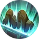

[Главная](https://boostmlbb.ru/) / [Герои](https://boostmlbb.ru/heroes/)

Тир D

# Грок

Танк и боец · Роум

**№ 122 из 133 по доле побед**Все ранги · 30 дней по 23 ноября 2026 года

Победы

46,61%

Выбор

0,34%

Баны

0,72%

Массовый контроль · Инициатор · Сложность 50/100

[Сборка](https://boostmlbb.ru/#build)[Контрпики и союзники](https://boostmlbb.ru/#draft)[Навыки](https://boostmlbb.ru/#skills)[Победы по рангам](https://boostmlbb.ru/#ranks)[История](https://boostmlbb.ru/#lore)

## Сборка

Самый частый выбор в рейтинге · Роум

Ключевые предметы

Штормовой поясСияющая броняНаплечник наказания

Эмблема и таланты

Эмблема танкаЛовкостьБлагословение природыУдарная волна

Боевое заклинание

Вспышка

Побед с этой сборкой **51,05%**Выбирают в **6,50%** матчей

Другие сборки (2)

Ключевые предметы

Штормовой поясГосподство льдаДревняя кираса

Эмблема и таланты

Эмблема танкаЛовкостьБлагословение природыУдарная волна

Боевое заклинание

Вспышка

Побед с этой сборкой **54,36%**Выбирают в **2,61%** матчей

Ключевые предметы

Штормовой поясГосподство льдаШипованная броня

Эмблема и таланты

Эмблема танкаЛовкостьБлагословение природыУдарная волна

Боевое заклинание

Вспышка

Побед с этой сборкой **54,34%**Выбирают в **4,36%** матчей

## Контрпики и союзники

### Кто контрит

[Лолита](https://boostmlbb.ru/heroes/lolita.html)[Джонсон](https://boostmlbb.ru/heroes/johnson.html)[Инь](https://boostmlbb.ru/heroes/yin.html)[Дигги](https://boostmlbb.ru/heroes/diggie.html)[Лейла](https://boostmlbb.ru/heroes/layla.html)

### Против кого силён

[Кайя](https://boostmlbb.ru/heroes/kaja.html)

### Союзники

Прибавка к доле побед в одной команде

[Сабер+2,14 п. п.](https://boostmlbb.ru/heroes/saber.html)[Наталья+1,92 п. п.](https://boostmlbb.ru/heroes/natalia.html)[Сильвана+1,66 п. п.](https://boostmlbb.ru/heroes/silvanna.html)[Зилонг+1,66 п. п.](https://boostmlbb.ru/heroes/zilong.html)

## Навыки

Приоритет прокачки · Тектонический рывок → Могучий взмах → Земляной вал

Пассивный**Каменный бастион**

Грок получает щит, равный 14% от , и усиливает следующую базовую атаку, которая наносит физический урон, равный 4 (+2% общей физической защиты)% от цели (не более 300 (+20\*Hero Level) против юнитов не-героев). Перезарядка: 18 сек. - 12 сек. (снижается с уровнем). Эта перезарядка сокращается на 200% рядом с препятствиями.
Навыки Грока не могут быть прерваны, и он получает 30 (+6\*Hero Level)% дополнительного , пока активен щит.

1-й навык**Могучий взмах**

**Перезарядка 8 с**

Грок совершает мощный удар вперед, нанося 240 (+100% дополнительной физической атаки) единиц физического урона. Враги, за которыми находятся препятствия, отбрасываются к ним, подбрасываются и получают дополнительный физический урон, равный 4 (+2% общей физической защиты)% от (не более 300 (+20\*Hero Level) против юнитов не-героев). Если за врагами нет препятствий, они только немного отбрасываются.

2-й навык**Земляной вал**

**Перезарядка 14 с**

После небольшой задержки Грок создает каменную стену в указанной области, нанося 100 (+60% дополнительной физической атаки) единиц физического урона и притягивая врагов к себе.
Повторное применение: стена разрушается досрочно.

Ультимейт**Тектонический рывок**

**Перезарядка 55 с**

Грок совершает рывок вперед и получает иммунитет к контролю, нанося 100 (+50% общей физической атаки) единиц физического урона врагам на пути. При столкновении с элементами рельефа он останавливается и вызывает мощный взрыв, который подбрасывает ближайших врагов на 1 сек. и наносит 650 (+300% общей физической атаки) единиц физического урона. Если этот навык не попадает по элементам рельефа, возвращается 50% перезарядки.

## Победы по рангам

-   Эпик**49,77%**
-   Легенда**47,88%**
-   Мифический**46,94%**
-   Мифическая честь**46,26%**
-   Мифическая слава**45,35%**

## История

Каменное создание, пробужденное ото сна.

[Карточка героя](https://www.mobilelegends.com/hero/detail?heroid=44)[MLBB Wiki](https://mobile-legends.fandom.com/wiki/Grock)

[Стоимость буста на герое](https://boostmlbb.ru/order.html?type=hero)

## Частые вопросы

Кто контрпик для героя «Грок» в MLBB?

За последние 30 дней чаще всего героя обыгрывают Лолита, Джонсон, Инь, Дигги и Лейла.

Какой процент побед у героя «Грок» сейчас?

46,61% за последние 30 дней на всех рангах и 45,35% в Мифической славе, данные на 23 ноября 2026 года.

Какая роль и линия у героя «Грок»?

Танк и боец, играет в роуме.

Силён ли герой «Грок» в текущей мете?

Тир D: 122-е место из 133 героев по проценту побед за 30 дней и 21-е среди танков.

Какая сборка на героя «Грок» лучшая?

Самая популярная сборка в рейтинге: ключевые предметы «Штормовой пояс», «Сияющая броня» и «Наплечник наказания», эмблема танка с талантами «Ловкость», «Благословение природы» и «Ударная волна» и заклинание «Вспышка». С ней выигрывают 51,05% матчей.
