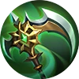
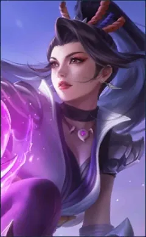

[Тир-лист](https://boostmlbb.ru/heroes/)[Предметы](https://boostmlbb.ru/items/)[Скины](https://boostmlbb.ru/skins/)[Новости и гайды](https://boostmlbb.ru/news/)

[Тир-лист](https://boostmlbb.ru/heroes/)

# Ханаби

B

СтрелокЛиния золота

Победы

51,4%

Выбор

1,6%

Баны

1,6%

[Обзор](https://boostmlbb.ru/#overview)[Сборка](https://boostmlbb.ru/#build)[Как играть](https://boostmlbb.ru/#howto)[Навыки](https://boostmlbb.ru/#skills)[Контрпики](https://boostmlbb.ru/#draft)[Скины](https://boostmlbb.ru/#skins)[История](https://boostmlbb.ru/#lore)

## Обзор

### Характеристики

-   Живучесть**20**
-   Атака**70**
-   Эффекты**80**
-   Сложность**10**

-   Добивание
-   Урон

### Победы по рангам, 30 дней

1.  **54,4%**Эпик
2.  **53,9%**Легенда
3.  **53,3%**Мифик
4.  **52,0%**Честь
5.  **51,0%**Слава

Пунктир: 50% побед

### Другие стрелки этой линии

[Обсидия](https://boostmlbb.ru/heroes/obsidia.html)[Бруно](https://boostmlbb.ru/heroes/bruno.html)[Клинт](https://boostmlbb.ru/heroes/clint.html)[Броуди](https://boostmlbb.ru/heroes/brody.html)[Москов](https://boostmlbb.ru/heroes/moskov.html)[Клауд](https://boostmlbb.ru/heroes/claude.html)[Мия](https://boostmlbb.ru/heroes/miya.html)[Мелисса](https://boostmlbb.ru/heroes/melissa.html)

### Места в рейтингах

-   [Лучшие стрелки MLBB**7 из 23**](https://boostmlbb.ru/heroes/best-marksman.html)

## Сборка

Сборка 1Сборка 2Сборка 3

Победы

59,4%

Выбор

14,3%

#### Основные предметы

-   [

    

    Коса коррозии

    ](https://boostmlbb.ru/items/corrosion-scythe.html)
-   [

    

    Золотой посох

    ](https://boostmlbb.ru/items/golden-staff.html)
-   [

    

    Меч охотника на демонов

    ](https://boostmlbb.ru/items/demon-hunter-sword.html)

#### Заклинание

Эгида

#### Эмблема и таланты

Эмблема бойца

-   

    Проворность

-   

    Охотник за скидками

-   

    Точно в цель

Победы

58,9%

Выбор

10,3%

#### Основные предметы

-   [

    

    Коса коррозии

    ](https://boostmlbb.ru/items/corrosion-scythe.html)
-   [

    

    Меч охотника на демонов

    ](https://boostmlbb.ru/items/demon-hunter-sword.html)
-   [

    

    Золотой посох

    ](https://boostmlbb.ru/items/golden-staff.html)

#### Заклинание

Эгида

#### Эмблема и таланты

Эмблема стрелка

-   

    Проворность

-   

    Охотник за скидками

-   

    Точно в цель

Победы

59,3%

Выбор

7,6%

#### Основные предметы

-   [

    

    Коса коррозии

    ](https://boostmlbb.ru/items/corrosion-scythe.html)
-   [

    

    Меч охотника на демонов

    ](https://boostmlbb.ru/items/demon-hunter-sword.html)
-   [

    

    Золотой посох

    ](https://boostmlbb.ru/items/golden-staff.html)

#### Заклинание

Эгида

#### Эмблема и таланты

Эмблема бойца

-   

    Проворность

-   

    Охотник за скидками

-   

    Точно в цель

## Как играть за Ханаби

### Комбо Ханаби

#### В драке

1.  2
2.  Ульт
3.  Атака
4.  1
5.  Атака

В драке начните со второго навыка, чтобы замедлить, затем обездвижьте ультом и стреляйте. Первый навык используйте для урона и живучести, отскоки атак доберут остальных.

#### На линии

1.  2
2.  Атака
3.  1
4.  Атака

На линии тревожьте врага вторым навыком и ставьте метку, подтачивайте отскоками атак, затем включайте первый и идите в размен.

### Когда сильнее всего

Сильнее в начале: на 10–12 минутах выигрывает 58,3%. Давите на линии, забирайте объекты и заканчивайте, пока преимущество не растаяло.

1.  **58,3**10–12
2.  **55,1**12–14
3.  **54,0**14–16
4.  **52,2**16–18
5.  **50,6**18–20
6.  **48,0**20+

Проценты побед по длине матча в минутах, все ранги. Пунктир: 50%

### Приоритет прокачки

1.  Запретный дзюцу: Хиганбана
2.  Ниндзюцу: свиток души
3.  Ниндзюцу: баланс

## Навыки

Пассивный**Ниндзюцу: листья-лезвия**1-й навык**Ниндзюцу: баланс**2-й навык**Ниндзюцу: свиток души**Ультимейт**Запретный дзюцу: Хиганбана**

Пассивный

### Ниндзюцу: листья-лезвия

Базовые атаки и навыки Ханаби выпускают лепестки-лезвия при попадании в цель, нанося 30% урона и отскакивая до 4 р. в ближайших врагов. Лепестки-лезвия, выпущенные базовыми атаками, наследуют эффекты атаки.

Если отскоки от одной и той же базовой атаки или навыка попадают в одну и ту же цель несколько раз, последующие отскоки наносят на 30% меньше урона.

1-й навык

### Ниндзюцу: баланс

Перезарядка **15 Mana Cost: 75 с**

**Пассивный:** когда Ханаби имеет щит от любого источника, она получает иммунитет к эффектам контроля.

**Активный:** Ханаби получает 300 (+40% общей физической атаки) ед. щита на 5 сек. Когда щит активен, она получает 20% скорости передвижения и 25% скорости атаки, а 20% нанесенного ею урона по вражеским героям добавляется к этому щиту (урон по не-героям добавляет к щиту только 10% своей величины). Этот щит не может превышать 50% от ее .

2-й навык

### Ниндзюцу: свиток души

Перезарядка **8 Mana Cost: 50 с**

Ханаби бросает энергетический кунай в указанном направлении, нанося 350 (+80% общей физической атаки) единиц физического урона врагам на пути и снижая их скорость передвижения на 60% на 1 сек. Пораженные вражеские юниты также получают метку, позволяя следующему урону отскоком от базовой атаки Ханаби по ним нанести 30 (+100% общей физической атаки) единиц физического урона без уменьшения урона.

Ультимейт

### Запретный дзюцу: Хиганбана

Перезарядка **40 Mana Cost: 120 с**

Ханаби бросает Хиганбану в указанном направлении, нанося 300 (+50% общей физической атаки) единиц физического урона первому пораженному вражескому герою и обездвиживая его на 0.8 сек. Через 1 сек. Хиганбана расцветает в месте первого удара, нанося 300 (+50% общей физической атаки) единиц физического урона ближайшим врагам. Последующие попадания по той же цели наносят 30% урона.

## Контрпики Ханаби

### Кто контрит Ханаби

[Сабер](https://boostmlbb.ru/heroes/saber.html)[Пополь и Купа](https://boostmlbb.ru/heroes/popol-and-kupa.html)[Москов](https://boostmlbb.ru/heroes/moskov.html)[Бальмонд](https://boostmlbb.ru/heroes/balmond.html)[Акай](https://boostmlbb.ru/heroes/akai.html)

### Кого контрит Ханаби

[Новария](https://boostmlbb.ru/heroes/novaria.html)[Кагура](https://boostmlbb.ru/heroes/kagura.html)[Беатрис](https://boostmlbb.ru/heroes/beatrix.html)[Лилия](https://boostmlbb.ru/heroes/lylia.html)[Лапу-Лапу](https://boostmlbb.ru/heroes/lapu-lapu.html)[Ванван](https://boostmlbb.ru/heroes/wanwan.html)[Халид](https://boostmlbb.ru/heroes/khaleed.html)

## Скины Ханаби

[Двойной полумесяцИсключительный · 2026](https://boostmlbb.ru/skins/hanabi/twin-crescent.html)[Икона неонового городаИсключительный · 2026](https://boostmlbb.ru/skins/hanabi/neonscape-icon.html)[Шикарный гламурИсключительный · 2025](https://boostmlbb.ru/skins/hanabi/chic-glamour.html)[Сосуд яростиГрандиозный · 2023](https://boostmlbb.ru/skins/hanabi/vessel-of-rage.html)[Лунная ниндзяГрандиозный · 2023](https://boostmlbb.ru/skins/hanabi/moonlit-ninja.html)[Полевой опера­тивникИсключительный · 2022](https://boostmlbb.ru/skins/hanabi/field-op.html)[Феникс речных земельИзысканный · 2022](https://boostmlbb.ru/skins/hanabi/riverland-phoenix.html)[РакшасаИзысканный · 2020](https://boostmlbb.ru/skins/hanabi/rakshesha.html)[Нефила V.E.N.O.M.Делюкс · 2019](https://boostmlbb.ru/skins/hanabi/v-e-n-o-m-nephila.html)[Огненный мотылёкИсключительный · 2019](https://boostmlbb.ru/skins/hanabi/fiery-moth.html)[ГадюкаОбычный · 2018](https://boostmlbb.ru/skins/hanabi/viper.html)[Блиста­тельный ирисОбычный · 2018](https://boostmlbb.ru/skins/hanabi/resplendent-iris.html)

[Все 12 скинов Ханаби: цены и как получить](https://boostmlbb.ru/skins/hanabi.html)

## История

> Лидер Алой фракции в Алой тени, что в Речной долине Кадиа.

[Читать полную историю ↗](https://play.mobilelegends.com/lore/hero/Hanabi)Официальный сайт Mobile Legends [Характеристики на сайте игры ↗](https://www.mobilelegends.com/hero/detail?heroid=60)

**Поднимем ранг на герое «Ханаби»**Цена считается в калькуляторе

[Рассчитать цену](https://boostmlbb.ru/order.html?type=hero)

## Частые вопросы

Кто контрит Ханаби в MLBB?

За последние 30 дней Ханаби чаще всего обыгрывают Сабер, Пополь и Купа, Москов, Бальмонд и Акай.

Как играть за Ханаби?

В первую очередь качайте «Ниндзюцу: свиток души», ульт берите, как только доступен. Сильнее в начале: на 10–12 минутах выигрывает 58,3%. Давите на линии, забирайте объекты и заканчивайте, пока преимущество не растаяло. Комбо для драки: В драке начните со второго навыка, чтобы замедлить, затем обездвижьте ультом и стреляйте. Первый навык используйте для урона и живучести, отскоки атак доберут остальных.

Какой процент побед у Ханаби сейчас?

51,44% в Мифической славе за последние 7 дней и 52,72% на всех рангах за 30 дней, данные на 26 ноября 2026 года.

Какая роль и линия у Ханаби?

Стрелок, играет на линии золота.

Стоит ли брать Ханаби в текущей мете?

Тир B, 45-е место из 133 героев и 7-е среди стрелков. Тир учитывает, как часто героя берут и банят и как он выигрывает в Мифической славе за 7 дней: бан в 1,6% матчей, 51,4% побед. В профессиональных матчах за месяц героя драфтуют в 0,7% катков.

Какая сборка на Ханаби лучшая?

Самая популярная сборка в рейтинге: ключевые предметы «Коса коррозии», «Золотой посох» и «Меч охотника на демонов», эмблема бойца с талантами «Проворность», «Охотник за скидками» и «Точно в цель» и заклинание «Эгида». С ней выигрывают 59,44% матчей.
