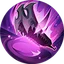
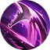

[Главная](https://boostmlbb.ru/) / [Герои](https://boostmlbb.ru/heroes/)

Тир B

# Ханзо в Mobile Legends: сборка, контрпики и статистика

Убийца, лес. Выигрывает 49,90% матчей за последние 30 дней — 70-е место из 133 героев.

[Буст на этом герое](https://boostmlbb.ru/order.html?type=hero)[Все герои](https://boostmlbb.ru/heroes/)

Статистика герояТир B

**Ханзо**Бан 5,82% · Выбор 0,36%

Контрпики

Победы за 30 дней**49,90%**

**49,90%**побед за 30 дней

**0,36%**выбирают в матчах

**5,82%**банят в матчах

**48,83%**побед в Мифической славе

## Сборка на героя «Ханзо»

Самая популярная сборка для героя «Ханзо» на роли леса в рейтинговых матчах на всех рангах — по данным «Академии» в игре. Процент побед — в матчах именно с этой сборкой.

Ключевые предметы

Пронзающий небесаЗолотой посохКоса коррозии

Эмблема и таланты

Эмблема поддержкиПроворностьБлагословение природыБоевой клич

Боевое заклинание

Возмездие

Побед с этой сборкой **55,42%**Выбирают в **2,65%** матчей

### Другие популярные варианты

-   ВозмездиеЭмблема поддержкиВдохновение · Благословение природы · Ударная волна**53,88%**
-   ВозмездиеЭмблема поддержкиВдохновение · Благословение природы · Ударная волна**52,79%**

## Навыки героя «Ханзо»

Официальные описания навыков от MOONTON с перезарядкой и типом навыка.

Порядок прокачки: **Киндзюцу: высший ниндзя** → **Ниндзюцу: пир демона** → **Ниндзюцу: темный туман**

-   

    **Амэ-но Хабакири**Пассивный

    Урон, нанесенный базовыми атаками и навыками Ханзо, накладывает на цель заряд "Темного ниндзюцу", до 5 зарядов. "Ниндзюцу: пир демона" можно применять только к целям с полными зарядами "Темного ниндзюцу".

-   

    **Ниндзюцу: пир демона**1-й навык

    Навык можно использовать только на целях с макс. количеством зарядов "Темного ниндзюцу". При использовании на монстре Ханзо мгновенно поглощает его и переваривает в течение некоторого времени, восстанавливая 20% ОЗ.
    При использовании на Черепахе, Лорде или вражеских героях наносит 600 (+120% дополнительной физической атаки) единиц физического урона, восстанавливает 150 (+80% общей физической атаки) ОЗ и сокращает перезарядку этого навыка на 60%.

-   

    **Ниндзюцу: темный туман**2-й навыкПерезарядка 10 с

    Ханзо бросается в указанном направлении, оставляя впереди темный туман, который наносит 90 (+45% дополнительной физической атаки) единиц физического урона врагам в области кажд. 0.5 сек., до 5 раз (этот урон считается уроном базовой атаки, но не может быть критическим).
    Темный туман замедляет врагов в области на 40% и дает Ханзо 20% скорости передвижения.

-   

    **Киндзюцу: высший ниндзя**УльтимейтПерезарядка 36 с

    Ханзо бросается в бой как Ханекаге, расходуя 170 ед. энергии в секунду. Он получает 20 ед. энергии, когда рядом умирает юнит, не являющийся героем, и 200 ед. энергии, когда рядом умирает герой. Он получает 15 ед. энергии при атаке героя и 45 ед. энергии при атаке Черепахи или Лорда. Когда энергия закончится, тело Ханзо медленно притянется к местоположению Ханекаге.
    В форме Ханекаге тело Ханзо неуязвимо, а Ханекаге игнорирует препятствия и получает 50% скорости передвижения и 30% скорости атаки.
    Повторное использование или гибель: Ханекаге возвращается к телу Ханзо, восстанавливая 360 (+100% дополнительной физической атаки) ОЗ и обретая неуловимость для прицела во время возвращения. Если Ханекаге будет убит, Ханзо замедлится на 50% и раскроет свое местоположение на 6 сек., а перезарядка навыка удвоится.

## Роль и линия

Место считается по проценту побед за 30 дней среди героев той же роли или линии.

-   Роль**Убийца**
-   Линия**Лес**
-   Среди убийц**10-е из 29**
-   В лесу**16-е из 37**
-   Специализация**Поук, Разрушительный урон**
-   Сложность**Средняя (50/100)**

## Кто контрит этого героя

Против этих героев «Ханзо» проигрывает чаще всего. Под иконкой — их собственный процент побед. 2 из 5 контрпиков — бойцы.

[Дигги54,30%](https://boostmlbb.ru/heroes/diggie.html)[Иксия50,08%](https://boostmlbb.ru/heroes/ixia.html)[Франко41,58%](https://boostmlbb.ru/heroes/franco.html)[Бальмонд46,66%](https://boostmlbb.ru/heroes/balmond.html)[Альфа48,85%](https://boostmlbb.ru/heroes/alpha.html)

## Против кого силён

Для этих героев «Ханзо» — один из самых неудобных соперников.

[Обсидия53,20%](https://boostmlbb.ru/heroes/obsidia.html)[Кагура51,09%](https://boostmlbb.ru/heroes/kagura.html)[Линг52,54%](https://boostmlbb.ru/heroes/ling.html)[Хирара50,03%](https://boostmlbb.ru/heroes/hirara.html)[Алдос51,86%](https://boostmlbb.ru/heroes/aldous.html)[Наталья51,05%](https://boostmlbb.ru/heroes/natalia.html)

## С кем играть в команде

С этими героями в одной команде «Ханзо» выигрывает чаще. Число — прибавка к проценту побед в процентных пунктах.

[Ангела+2,17 п. п.](https://boostmlbb.ru/heroes/angela.html)[Хильда+1,63 п. п.](https://boostmlbb.ru/heroes/hilda.html)[Дариус+1,60 п. п.](https://boostmlbb.ru/heroes/dyrroth.html)[Алдос+1,55 п. п.](https://boostmlbb.ru/heroes/aldous.html)

## Процент побед по рангам

Лучший результат — на ранге «Легенда» (50,90%), слабее всего — «Мифическая слава» (48,83%). Данные за последние 30 дней.

-   Эпик**50,77%**
-   Легенда**50,90%**
-   Мифический**50,58%**
-   Мифическая честь**50,23%**
-   Мифическая слава**48,83%**

## Место в мете

«Ханзо» — тир B в нашем тир-листе по проценту побед, 70-е место из 133 героев. Героя выбирают реже чем в 0,5% матчей, поэтому процент побед может заметно колебаться. В Мифической славе процент побед ниже: 48,83% против 49,90% на всех рангах, разница 1,07 п. п. Полный [тир-лист ноября](https://boostmlbb.ru/news/mlbb-meta-tier-list/) и [разбор патча](https://boostmlbb.ru/news/mlbb-current-patch/).

## Другие герои леса

Самые сильные по проценту побед за последние 30 дней.

[Сан53,72%](https://boostmlbb.ru/heroes/sun.html)[Аулус53,46%](https://boostmlbb.ru/heroes/aulus.html)[Линг52,54%](https://boostmlbb.ru/heroes/ling.html)[Пополь и Купа52,09%](https://boostmlbb.ru/heroes/popol-and-kupa.html)[Лукас51,97%](https://boostmlbb.ru/heroes/lukas.html)[Бэйн51,61%](https://boostmlbb.ru/heroes/bane.html)

## История героя

«Гениальный ниндзя из фракции Тени, который находится на распутье.»

Полная история героя «Ханзо» — на официальном сайте лора MOONTON. Карточка героя с навыками и советами разработчиков — на mobilelegends.com, реплики, облики и история изменений — в MLBB Wiki.

[Читать историю](https://www.mobilelegends.com/hero/detail?heroid=69)[Карточка героя](https://www.mobilelegends.com/hero/detail?heroid=69)[MLBB Wiki](https://mobile-legends.fandom.com/wiki/Hanzo)

## Буст на герое «Ханзо»

Бустер играет только этим героем: вместе с рангом растёт и рейтинг героя.

[Рассчитать стоимость](https://boostmlbb.ru/order.html?type=hero)

Статистика — официальный рейтинг героев MOONTON (mobilelegends.com/rank) за последние 30 дней, обновление 23 ноября 2026 года, страница обновляется каждый день. Роли и линии — с официальной страницы героев. Сборки, навыки и союзники — данные «Академии» MOONTON через Rone Arena API (ridwaanhall / RoneAI).

## Частые вопросы

Кто контрпик для героя «Ханзо» в MLBB?

За последние 30 дней чаще всего героя обыгрывают Дигги, Иксия, Франко, Бальмонд и Альфа.

Какой процент побед у героя «Ханзо» сейчас?

49,90% за последние 30 дней на всех рангах и 48,83% в Мифической славе, данные на 23 ноября 2026 года.

Какая роль и линия у героя «Ханзо»?

Убийца, играет в лесу.

Силён ли герой «Ханзо» в текущей мете?

Тир B: 70-е место из 133 героев по проценту побед за 30 дней и 10-е среди убийц.

Какая сборка на героя «Ханзо» лучшая?

Самая популярная сборка в рейтинге: ключевые предметы «Пронзающий небеса», «Золотой посох» и «Коса коррозии», эмблема поддержки с талантами «Проворность», «Благословение природы» и «Боевой клич» и заклинание «Возмездие». С ней выигрывают 55,42% матчей.

Редакция MLBB Boost · Обновлено 23 ноября 2026
