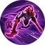

[Главная](https://boostmlbb.ru/) / [Герои](https://boostmlbb.ru/heroes/)

Тир B

# Ханзо

Убийца · Лес

**№ 70 из 133 по доле побед**Все ранги · 30 дней по 23 ноября 2026 года

Победы

49,90%

Выбор

0,36%

Баны

5,82%

Поук · Разрушительный урон · Сложность 50/100

[Сборка](https://boostmlbb.ru/#build)[Контрпики и союзники](https://boostmlbb.ru/#draft)[Навыки](https://boostmlbb.ru/#skills)[Победы по рангам](https://boostmlbb.ru/#ranks)[История](https://boostmlbb.ru/#lore)

## Сборка

Самый частый выбор в рейтинге · Лес

Ключевые предметы

Пронзающий небесаЗолотой посохКоса коррозии

Эмблема и таланты

Эмблема поддержкиПроворностьБлагословение природыБоевой клич

Боевое заклинание

Возмездие

Побед с этой сборкой **55,42%**Выбирают в **2,65%** матчей

Другие сборки (2)

Ключевые предметы

Штормовой поясЗолотой посохКираса грубой силы

Эмблема и таланты

Эмблема поддержкиВдохновениеБлагословение природыУдарная волна

Боевое заклинание

Возмездие

Побед с этой сборкой **53,88%**Выбирают в **5,53%** матчей

Ключевые предметы

Штормовой поясКираса грубой силыОракул

Эмблема и таланты

Эмблема поддержкиВдохновениеБлагословение природыУдарная волна

Боевое заклинание

Возмездие

Побед с этой сборкой **52,79%**Выбирают в **2,80%** матчей

## Контрпики и союзники

### Кто контрит

[Дигги](https://boostmlbb.ru/heroes/diggie.html)[Иксия](https://boostmlbb.ru/heroes/ixia.html)[Франко](https://boostmlbb.ru/heroes/franco.html)[Бальмонд](https://boostmlbb.ru/heroes/balmond.html)[Альфа](https://boostmlbb.ru/heroes/alpha.html)

### Против кого силён

[Обсидия](https://boostmlbb.ru/heroes/obsidia.html)[Кагура](https://boostmlbb.ru/heroes/kagura.html)[Линг](https://boostmlbb.ru/heroes/ling.html)[Хирара](https://boostmlbb.ru/heroes/hirara.html)[Алдос](https://boostmlbb.ru/heroes/aldous.html)[Наталья](https://boostmlbb.ru/heroes/natalia.html)

### Союзники

Прибавка к доле побед в одной команде

[Ангела+2,17 п. п.](https://boostmlbb.ru/heroes/angela.html)[Хильда+1,63 п. п.](https://boostmlbb.ru/heroes/hilda.html)[Дариус+1,60 п. п.](https://boostmlbb.ru/heroes/dyrroth.html)[Алдос+1,55 п. п.](https://boostmlbb.ru/heroes/aldous.html)

## Навыки

Приоритет прокачки · Киндзюцу: высший ниндзя → Ниндзюцу: пир демона → Ниндзюцу: темный туман

Пассивный**Амэ-но Хабакири**

Урон, нанесенный базовыми атаками и навыками Ханзо, накладывает на цель заряд "Темного ниндзюцу", до 5 зарядов. "Ниндзюцу: пир демона" можно применять только к целям с полными зарядами "Темного ниндзюцу".

1-й навык**Ниндзюцу: пир демона**

Навык можно использовать только на целях с макс. количеством зарядов "Темного ниндзюцу". При использовании на монстре Ханзо мгновенно поглощает его и переваривает в течение некоторого времени, восстанавливая 20% ОЗ.
При использовании на Черепахе, Лорде или вражеских героях наносит 600 (+120% дополнительной физической атаки) единиц физического урона, восстанавливает 150 (+80% общей физической атаки) ОЗ и сокращает перезарядку этого навыка на 60%.

2-й навык**Ниндзюцу: темный туман**

**Перезарядка 10 с**

Ханзо бросается в указанном направлении, оставляя впереди темный туман, который наносит 90 (+45% дополнительной физической атаки) единиц физического урона врагам в области кажд. 0.5 сек., до 5 раз (этот урон считается уроном базовой атаки, но не может быть критическим).
Темный туман замедляет врагов в области на 40% и дает Ханзо 20% скорости передвижения.

Ультимейт**Киндзюцу: высший ниндзя**

**Перезарядка 36 с**

Ханзо бросается в бой как Ханекаге, расходуя 170 ед. энергии в секунду. Он получает 20 ед. энергии, когда рядом умирает юнит, не являющийся героем, и 200 ед. энергии, когда рядом умирает герой. Он получает 15 ед. энергии при атаке героя и 45 ед. энергии при атаке Черепахи или Лорда. Когда энергия закончится, тело Ханзо медленно притянется к местоположению Ханекаге.
В форме Ханекаге тело Ханзо неуязвимо, а Ханекаге игнорирует препятствия и получает 50% скорости передвижения и 30% скорости атаки.
Повторное использование или гибель: Ханекаге возвращается к телу Ханзо, восстанавливая 360 (+100% дополнительной физической атаки) ОЗ и обретая неуловимость для прицела во время возвращения. Если Ханекаге будет убит, Ханзо замедлится на 50% и раскроет свое местоположение на 6 сек., а перезарядка навыка удвоится.

## Победы по рангам

-   Эпик**50,77%**
-   Легенда**50,90%**
-   Мифический**50,58%**
-   Мифическая честь**50,23%**
-   Мифическая слава**48,83%**

## История

Гениальный ниндзя из фракции Тени, который находится на распутье.

[Карточка героя](https://www.mobilelegends.com/hero/detail?heroid=69)[MLBB Wiki](https://mobile-legends.fandom.com/wiki/Hanzo)

[Стоимость буста на герое](https://boostmlbb.ru/order.html?type=hero)

## Частые вопросы

Кто контрпик для героя «Ханзо» в MLBB?

За последние 30 дней чаще всего героя обыгрывают Дигги, Иксия, Франко, Бальмонд и Альфа.

Какой процент побед у героя «Ханзо» сейчас?

49,90% за последние 30 дней на всех рангах и 48,83% в Мифической славе, данные на 23 ноября 2026 года.

Какая роль и линия у героя «Ханзо»?

Убийца, играет в лесу.

Силён ли герой «Ханзо» в текущей мете?

Тир B: 70-е место из 133 героев по проценту побед за 30 дней и 10-е среди убийц.

Какая сборка на героя «Ханзо» лучшая?

Самая популярная сборка в рейтинге: ключевые предметы «Пронзающий небеса», «Золотой посох» и «Коса коррозии», эмблема поддержки с талантами «Проворность», «Благословение природы» и «Боевой клич» и заклинание «Возмездие». С ней выигрывают 55,42% матчей.
