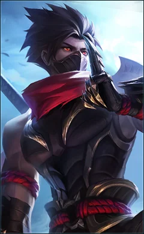
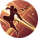

[Тир-лист](https://boostmlbb.ru/heroes/)[Новости и гайды](https://boostmlbb.ru/news/)

# Хаябуса

C

УбийцаЛес

Победы

48,4%

Выбор

0,7%

Баны

0,5%

[Обзор](https://boostmlbb.ru/#overview)[Сборка](https://boostmlbb.ru/#build)[Навыки](https://boostmlbb.ru/#skills)[Контрпики](https://boostmlbb.ru/#draft)[История](https://boostmlbb.ru/#lore)

## Обзор

### Характеристики

-   Живучесть**40**
-   Атака**50**
-   Эффекты**10**
-   Сложность**60**

-   Преследование
-   Разрушительный урон

### Победы по рангам, 30 дней

1.  **47,4%**Эпик
2.  **47,9%**Легенда
3.  **48,3%**Мифик
4.  **48,5%**Честь
5.  **48,1%**Слава

Пунктир: 50% побед

### Другие убийцы этой линии

[Нолан](https://boostmlbb.ru/heroes/nolan.html)[Хирара](https://boostmlbb.ru/heroes/hirara.html)[Сабер](https://boostmlbb.ru/heroes/saber.html)[Харли](https://boostmlbb.ru/heroes/harley.html)[Фанни](https://boostmlbb.ru/heroes/fanny.html)[Линг](https://boostmlbb.ru/heroes/ling.html)[Ли Сун-Син](https://boostmlbb.ru/heroes/yi-sun-shin.html)[Карина](https://boostmlbb.ru/heroes/karina.html)

## Сборка

Сборка 1Сборка 2Сборка 3

Победы

51,4%

Выбор

13,2%

#### Основные предметы

-   

    Удар охотника

-   

    Топор войны

-   

    Злобный рык

#### Заклинание

Возмездие

#### Эмблема и таланты

Эмблема убийцы

-   

    Трепет

-   

    Опытный охотник

-   

    Боевой клич

Победы

55,2%

Выбор

12,6%

#### Основные предметы

-   

    Удар охотника

-   

    Пронзающий небеса

-   

    Топор войны

#### Заклинание

Возмездие

#### Эмблема и таланты

Эмблема убийцы

-   

    Трепет

-   

    Опытный охотник

-   

    Боевой клич

Победы

51,9%

Выбор

7,9%

#### Основные предметы

-   

    Удар охотника

-   

    Пронзающий небеса

-   

    Злобный рык

#### Заклинание

Возмездие

#### Эмблема и таланты

Эмблема убийцы

-   

    Трепет

-   

    Опытный охотник

-   

    Боевой клич

## Навыки

Прокачка**Теневой убийца**_›_**Ниндзюцу: призрачные сюрикены**_›_**Ниндзюцу: четыре тени**

Пассивный**Ниндзюцу: след тени**1-й навык**Ниндзюцу: призрачные сюрикены**2-й навык**Ниндзюцу: четыре тени**Ультимейт**Теневой убийца**

Пассивный

### Ниндзюцу: след тени

Урон Хаябусы накладывает заряд теневой метки при попадании (до 4 зарядов). Каждый заряд длится 6 сек. и увеличивает урон Хаябусы по врагу на 5%.

1-й навык

### Ниндзюцу: призрачные сюрикены

Перезарядка **4 Energy Cost: 30 с**

**Пассивный:** Хаябуса навсегда получает 3% вампиризма от навыков.

**Активный:** Хаябуса бросает три возвращающихся сюрикена в указанном направлении, каждый из которых наносит 220 (+75% дополнительной физической атаки) единиц физического урона пораженным врагам и замедляет их на 35% на 2 сек. Последующие попадания по одному и тому же врагу наносят на 70% меньше урона (лишь на 50% меньше по монстрам). Он также восстанавливает 10 энергии при попадании по врагам, не являющимся миньонами.

2-й навык

### Ниндзюцу: четыре тени

Перезарядка **16 Energy Cost: 25 с**

Хаябуса совершает рывок в указанном направлении и выпускает четыре тени, которые летят в разных направлениях. Тени остаются в конце своего пути или прикрепляются к первому пораженному вражескому герою, нанося 130 (+30% дополнительной физической атаки) единиц физического урона и замедляя его на 40% на 2 сек. Хаябуса немедленно остановится, если ударит вражеского героя во время рывка.

**Повторное использование:** Хаябуса телепортируется в место, где находится тень, и сокращает перезарядку "Ниндзюцу: призрачные сюрикены" на 1 сек. Если тень прикреплена к вражескому герою, он также наносит 130 (+30% дополнительной физической атаки) единиц физического урона врагу.

Ультимейт

### Теневой убийца

Перезарядка **40 с**

Хаябуса скрывается среди теней и совершает 6 одиночных атак по врагам в области, каждая из которых наносит 130 (+30% дополнительной физической атаки) единиц физического урона.

Атаки будут отдавать приоритет врагам с теневой меткой, и каждая из них расходует метку, чтобы нанести 90 (+40% дополнительной физической атаки) единиц дополнительного физического урона. "Теневой убийца" не наносит теневую метку.

## Контрпики

### Контрпики

Побеждают этого героя

[Эймон](https://boostmlbb.ru/heroes/aamon.html)[Ив](https://boostmlbb.ru/heroes/yve.html)[Чжусинь](https://boostmlbb.ru/heroes/zhuxin.html)[Нолан](https://boostmlbb.ru/heroes/nolan.html)[Кэрри](https://boostmlbb.ru/heroes/karrie.html)

### Слабые цели

Этот герой побеждает их

[Баданг](https://boostmlbb.ru/heroes/badang.html)[Заск](https://boostmlbb.ru/heroes/zhask.html)

## История

> Молодой лидер фракции Тени, который орудует своим клинком в безлунные ночи и бесстрашно идет по пути ниндо.

[Читать полную историю ↗](https://play.mobilelegends.com/lore/hero/Hayabusa)Официальный сайт Mobile Legends [Характеристики на сайте игры ↗](https://www.mobilelegends.com/hero/detail?heroid=21)

**Поднимем ранг на герое «Хаябуса»**Цена считается в калькуляторе

[Рассчитать цену](https://boostmlbb.ru/order.html?type=hero)

## Частые вопросы

Кто контрпик для героя «Хаябуса» в MLBB?

За последние 30 дней чаще всего героя обыгрывают Эймон, Ив, Чжусинь, Нолан и Кэрри.

Какой процент побед у героя «Хаябуса» сейчас?

48,36% в Мифической славе за последние 7 дней и 48,15% на всех рангах за 30 дней, данные на 23 ноября 2026 года.

Какая роль и линия у героя «Хаябуса»?

Убийца, играет в лесу.

Силён ли герой «Хаябуса» в текущей мете?

Тир C, 80-е место из 133 героев и 17-е среди убийц. Тир учитывает, как часто героя берут и банят и как он выигрывает в Мифической славе за 7 дней: бан в 0,5% матчей, 48,4% побед. В профессиональных матчах за месяц героя драфтуют в 3,1% катков.

Какая сборка на героя «Хаябуса» лучшая?

Самая популярная сборка в рейтинге: ключевые предметы «Удар охотника», «Топор войны» и «Злобный рык», эмблема убийцы с талантами «Трепет», «Опытный охотник» и «Боевой клич» и заклинание «Возмездие». С ней выигрывают 51,40% матчей.
