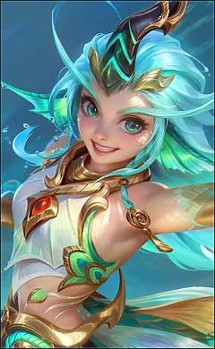

[Тир-лист](https://boostmlbb.ru/heroes/)[Предметы](https://boostmlbb.ru/items/)[Новости и гайды](https://boostmlbb.ru/news/)

# Хелкарт

C

УбийцаЛесРоум

Победы

46,8%

Выбор

0,4%

Баны

2,3%

[Обзор](https://boostmlbb.ru/#overview)[Сборка](https://boostmlbb.ru/#build)[Навыки](https://boostmlbb.ru/#skills)[Контрпики](https://boostmlbb.ru/#draft)[История](https://boostmlbb.ru/#lore)

## Обзор

### Характеристики

-   Живучесть**30**
-   Атака**50**
-   Эффекты**50**
-   Сложность**40**

-   Пуш
-   Разрушительный урон

### Победы по рангам, 30 дней

1.  **48,4%**Эпик
2.  **48,5%**Легенда
3.  **48,4%**Мифик
4.  **47,5%**Честь
5.  **46,4%**Слава

Пунктир: 50% побед

### Другие убийцы этой линии

[Нолан](https://boostmlbb.ru/heroes/nolan.html)[Хирара](https://boostmlbb.ru/heroes/hirara.html)[Сабер](https://boostmlbb.ru/heroes/saber.html)[Харли](https://boostmlbb.ru/heroes/harley.html)[Фанни](https://boostmlbb.ru/heroes/fanny.html)[Линг](https://boostmlbb.ru/heroes/ling.html)[Карина](https://boostmlbb.ru/heroes/karina.html)[Ли Сун-Син](https://boostmlbb.ru/heroes/yi-sun-shin.html)

### Места в рейтингах

-   [Лучшие лесники MLBB**25 из 37**](https://boostmlbb.ru/heroes/best-jungle.html)
-   [Лучшие убийцы MLBB**22 из 29**](https://boostmlbb.ru/heroes/best-assassin.html)
-   [Лучшие роумеры MLBB**21 из 34**](https://boostmlbb.ru/heroes/best-roam.html)

## Сборка

Сборка 1Сборка 2Сборка 3

Победы

51,9%

Выбор

5,0%

#### Основные предметы

-   [

    

    Клинок семи морей

    ](https://boostmlbb.ru/items/blade-of-the-heptaseas.html)
-   [

    

    Удар охотника

    ](https://boostmlbb.ru/items/hunter-strike.html)
-   [

    

    Меч охотника на демонов

    ](https://boostmlbb.ru/items/demon-hunter-sword.html)

#### Заклинание

Возмездие

#### Эмблема и таланты

Эмблема убийцы

-   

    Разрыв

-   

    Мастер-убийца

-   

    Смертельное воспламенение

Победы

54,2%

Выбор

4,8%

#### Основные предметы

-   [

    

    Коса коррозии

    ](https://boostmlbb.ru/items/corrosion-scythe.html)
-   [

    

    Клинок семи морей

    ](https://boostmlbb.ru/items/blade-of-the-heptaseas.html)
-   [

    

    Меч охотника на демонов

    ](https://boostmlbb.ru/items/demon-hunter-sword.html)

#### Заклинание

Возмездие

#### Эмблема и таланты

Эмблема убийцы

-   

    Разрыв

-   

    Опытный охотник

-   

    Смертельное воспламенение

Победы

53,2%

Выбор

3,0%

#### Основные предметы

-   [

    

    Клинок семи морей

    ](https://boostmlbb.ru/items/blade-of-the-heptaseas.html)
-   [

    

    Коса коррозии

    ](https://boostmlbb.ru/items/corrosion-scythe.html)
-   [

    

    Меч охотника на демонов

    ](https://boostmlbb.ru/items/demon-hunter-sword.html)

#### Заклинание

Возмездие

#### Эмблема и таланты

Эмблема убийцы

-   

    Разрыв

-   

    Опытный охотник

-   

    Смертельное воспламенение

## Навыки

Прокачка**Да наступит ночь!**_›_**Смертоносный клинок**_›_**Скрытый ужас**

Пассивный**Тень Стикса**1-й навык**Скрытый ужас**2-й навык**Смертоносный клинок**Ультимейт**Да наступит ночь!**

Пассивный

### Тень Стикса

Хелкарт остается в состоянии скрытности, пока его не заметит вражеская команда, получая 15% дополнительной скорости передвижения и продолжительно восстанавливая (+30% общей физической атаки) ОЗ, если он не наносил урона.

Когда его заметят, он получит 50% дополнительной скорости атаки и 50% дополнительной скорости передвижения (со временем снижается) на 4 сек., а эффект скрытности прекратится через 0.75 сек.

Любой герой, убитый после атаки Хелкарта, оставляет после себя темный туман, который взрывается и распространяется с перезарядкой 10 сек. Хелкарт использует темный туман для маскировки.

1-й навык

### Скрытый ужас

Перезарядка **15 с**

**Пассивный:** когда Хелкарт находится в состоянии скрытности, ужас также поражает вражеских героев и ненадолго раскрывает их. Его перезарядка сокращается в 3 р. быстрее обычного.

**Активный:** Хелкарт перемещается в указанное место и наносит 150 (+70% общей физической атаки) единиц физического урона врагам в области действия, снижая их скорость передвижения на 60% на 0.75 сек.

2-й навык

### Смертоносный клинок

Перезарядка **4 с**

**Пассивный:** за каждые 1.5 сек. нахождения в состоянии скрытности или за каждую базовую атаку Хелкарт получает 1 "Смертоносный клинок". Можно накопить до 5 "Смертоносных клинков".

**Активный:** Хелкарт выпускает вперед все "Смертоносные клинки", каждый из которых наносит врагам 180 (+50% дополнительной физической атаки) единиц физического урона (миньоны и монстры получают только 70% урона).

"Смертоносный клинок" считается базовой атакой, но не может наносить критический урон.

Ультимейт

### Да наступит ночь!

Перезарядка **60 с**

Хелкарт призывает "Темную ночь", которая уменьшает дальность обзора всех врагов и блокирует им обмен обзором с союзниками на 3 сек. Во время "Темной ночи" Хелкарт получает 40% дополнительной скорости передвижения.

"Темная ночь" позволяет Хелкарту легко покинуть зону видимости врагов.

## Контрпики

### Контрпики

Побеждают этого героя

[Икс.Борг](https://boostmlbb.ru/heroes/x-borg.html)[Валир](https://boostmlbb.ru/heroes/valir.html)[Ксавьер](https://boostmlbb.ru/heroes/xavier.html)[Горд](https://boostmlbb.ru/heroes/gord.html)[Дигги](https://boostmlbb.ru/heroes/diggie.html)

### Слабые цели

Этот герой побеждает их

[Обсидия](https://boostmlbb.ru/heroes/obsidia.html)[Эйдора](https://boostmlbb.ru/heroes/eudora.html)[Цзэтянь](https://boostmlbb.ru/heroes/zetian.html)[Пакито](https://boostmlbb.ru/heroes/paquito.html)[Карина](https://boostmlbb.ru/heroes/karina.html)[Лукас](https://boostmlbb.ru/heroes/lukas.html)[Калеа](https://boostmlbb.ru/heroes/kalea.html)[Хильда](https://boostmlbb.ru/heroes/hilda.html)[Аргус](https://boostmlbb.ru/heroes/argus.html)[Алдос](https://boostmlbb.ru/heroes/aldous.html)

## История

> Ночной кошмар Бездны, готовый предать любого, чтобы выжить.

[Читать полную историю ↗](https://play.mobilelegends.com/lore/hero/HelcurtRE)Официальный сайт Mobile Legends [Характеристики на сайте игры ↗](https://www.mobilelegends.com/hero/detail?heroid=51)

**Поднимем ранг на герое «Хелкарт»**Цена считается в калькуляторе

[Рассчитать цену](https://boostmlbb.ru/order.html?type=hero)

## Частые вопросы

Кто контрпик для героя «Хелкарт» в MLBB?

За последние 30 дней чаще всего героя обыгрывают Икс.Борг, Валир, Ксавьер, Горд и Дигги.

Какой процент побед у героя «Хелкарт» сейчас?

46,75% в Мифической славе за последние 7 дней и 47,70% на всех рангах за 30 дней, данные на 25 ноября 2026 года.

Какая роль и линия у героя «Хелкарт»?

Убийца, играет в лесу или в роуме.

Силён ли герой «Хелкарт» в текущей мете?

Тир C, 98-е место из 133 героев и 22-е среди убийц. Тир учитывает, как часто героя берут и банят и как он выигрывает в Мифической славе за 7 дней: бан в 2,3% матчей, 46,8% побед. В профессиональных матчах за месяц героя драфтуют в 0,0% катков.

Какая сборка на героя «Хелкарт» лучшая?

Самая популярная сборка в рейтинге: ключевые предметы «Клинок семи морей», «Удар охотника» и «Меч охотника на демонов», эмблема убийцы с талантами «Разрыв», «Мастер-убийца» и «Смертельное воспламенение» и заклинание «Возмездие». С ней выигрывают 51,89% матчей.
