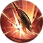

[Главная](https://boostmlbb.ru/) / [Герои](https://boostmlbb.ru/heroes/)

Тир A

# Хильда

Танк и боец · Линия опыта или роум

**№ 43 из 133 по доле побед**Все ранги · 30 дней по 23 ноября 2026 года

Победы

51,07%

Выбор

0,57%

Баны

12,97%

Урон · Регенерация · Сложность 10/100

[Сборка](https://boostmlbb.ru/#build)[Контрпики и союзники](https://boostmlbb.ru/#draft)[Навыки](https://boostmlbb.ru/#skills)[Победы по рангам](https://boostmlbb.ru/#ranks)[История](https://boostmlbb.ru/#lore)

## Сборка

Самый частый выбор в рейтинге · Линия опыта

Ключевые предметы

Штормовой поясГосподство льдаОракул

Эмблема и таланты

Эмблема поддержкиТрепетБлагословение природыУдарная волна

Боевое заклинание

Восстановление

Побед с этой сборкой **58,38%**Выбирают в **2,53%** матчей

Другие сборки (2)

Ключевые предметы

Штормовой поясГосподство льдаНаплечник наказания

Эмблема и таланты

Эмблема танкаТрепетБлагословение природыУдарная волна

Боевое заклинание

Восстановление

Побед с этой сборкой **58,99%**Выбирают в **2,88%** матчей

Ключевые предметы

Штормовой поясГосподство льдаОракул

Эмблема и таланты

Эмблема танкаЛовкостьБлагословение природыУдарная волна

Боевое заклинание

Восстановление

Побед с этой сборкой **58,16%**Выбирают в **6,77%** матчей

## Контрпики и союзники

### Кто контрит

[Грейнджер](https://boostmlbb.ru/heroes/granger.html)[Инь](https://boostmlbb.ru/heroes/yin.html)[Хелкарт](https://boostmlbb.ru/heroes/helcurt.html)[Сабер](https://boostmlbb.ru/heroes/saber.html)[Харли](https://boostmlbb.ru/heroes/harley.html)

### Против кого силён

[Кармилла](https://boostmlbb.ru/heroes/carmilla.html)[Кимми](https://boostmlbb.ru/heroes/kimmy.html)

### Союзники

Прибавка к доле побед в одной команде

[Сильвана+2,65 п. п.](https://boostmlbb.ru/heroes/silvanna.html)[Зилонг+2,26 п. п.](https://boostmlbb.ru/heroes/zilong.html)[Минситтар+2,09 п. п.](https://boostmlbb.ru/heroes/minsitthar.html)[Вэйл+1,92 п. п.](https://boostmlbb.ru/heroes/vale.html)

## Навыки

Приоритет прокачки · Дикая сила → Искусство охоты → Боевой ритуал

Пассивный**Благословение диких земель**

Хильда восстанавливает 2% ОЗ в секунду, находясь в кустах. Вход в кусты усиливает ее следующую базовую атаку, которая наносит цели 110 (+130% общей физической атаки)(+12\*Hero Level) единиц физического урона, снижает ее скорость передвижения на 40% и наносит 40 (+100% общей физической атаки)(+10\*Hero Level) единиц физического урона врагам позади цели. После использования усиленной базовой атаки этот эффект уходит в перезарядку на 6 сек.
Базовая атака и навыки Хильды накладывают "Метку диких земель" при попадании, которая действует до 4 сек. и складывается до 6 раз. Каждый заряд снижает вражеского героя на 3%.

1-й навык**Боевой ритуал**

**Перезарядка 10 с**

Хильда получает 60% скорости передвижения на 3 сек. и щит длительностью 3 сек., поглощающий урон в размере 10% от .

2-й навык**Искусство охоты**

**Перезарядка 7 с**

Хильда фиксируется на вражеской цели, нанося 200 (+90% общей физической атаки) единиц физического урона за попадание. Этот навык можно применить до 3 раз. 2-я атака наносит урон ближайшим врагам. 3-я атака наносит урон цели и ближайшим врагам, ненадолго отбрасывая их.

Ультимейт**Дикая сила**

**Перезарядка 32 с**

Хильда наносит мощный удар по вражеской цели, нанося 600 (+250% дополнительной физической атаки) единиц физического урона и оглушая ее на 0.2 сек. Ближайшие враги получают 60% урона.
Каждый заряд "Метки диких земель" увеличивает урон "Дикой силы" на 2.5% от цели. При максимальном количестве зарядов дополнительный урон увеличивается до 20% от цели.

## Победы по рангам

-   Эпик**54,91%**
-   Легенда**53,40%**
-   Мифический**52,36%**
-   Мифическая честь**49,70%**
-   Мифическая слава**47,74%**

## История

Наследница Силы Мегалита.

[Читать историю](https://play.mobilelegends.com/lore/hero/Hilda)[Карточка героя](https://www.mobilelegends.com/hero/detail?heroid=35)[MLBB Wiki](https://mobile-legends.fandom.com/wiki/Hilda)

[Стоимость буста на герое](https://boostmlbb.ru/order.html?type=hero)

## Частые вопросы

Кто контрпик для героя «Хильда» в MLBB?

За последние 30 дней чаще всего героя обыгрывают Грейнджер, Инь, Хелкарт, Сабер и Харли.

Какой процент побед у героя «Хильда» сейчас?

51,07% за последние 30 дней на всех рангах и 47,74% в Мифической славе, данные на 23 ноября 2026 года.

Какая роль и линия у героя «Хильда»?

Танк и боец, играет на линии опыта или в роуме.

Силён ли герой «Хильда» в текущей мете?

Тир A: 43-е место из 133 героев по проценту побед за 30 дней и 12-е среди танков.

Какая сборка на героя «Хильда» лучшая?

Самая популярная сборка в рейтинге: ключевые предметы «Штормовой пояс», «Господство льда» и «Оракул», эмблема поддержки с талантами «Трепет», «Благословение природы» и «Ударная волна» и заклинание «Восстановление». С ней выигрывают 58,38% матчей.
