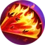

[Тир-лист](https://boostmlbb.ru/heroes/)[Новости и гайды](https://boostmlbb.ru/news/)

# Хирара

S

УбийцаЛес

Победы

49,5%

Выбор

0,8%

Баны

84,7%

[Обзор](https://boostmlbb.ru/#overview)[Сборка](https://boostmlbb.ru/#build)[Навыки](https://boostmlbb.ru/#skills)[Контрпики](https://boostmlbb.ru/#draft)[История](https://boostmlbb.ru/#lore)

## Обзор

### Характеристики

-   Живучесть**40**
-   Атака**70**
-   Эффекты**40**
-   Сложность**60**

-   Преследование
-   Добивание

### Победы по рангам, 30 дней

1.  **50,8%**Эпик
2.  **50,4%**Легенда
3.  **49,9%**Мифик
4.  **50,9%**Честь
5.  **49,5%**Слава

Пунктир: 50% побед

### Другие убийцы этой линии

[Нолан](https://boostmlbb.ru/heroes/nolan.html)[Сабер](https://boostmlbb.ru/heroes/saber.html)[Харли](https://boostmlbb.ru/heroes/harley.html)[Фанни](https://boostmlbb.ru/heroes/fanny.html)[Линг](https://boostmlbb.ru/heroes/ling.html)[Ли Сун-Син](https://boostmlbb.ru/heroes/yi-sun-shin.html)[Карина](https://boostmlbb.ru/heroes/karina.html)[Госсен](https://boostmlbb.ru/heroes/gusion.html)

### Места в рейтингах

-   [Лучшие лесники MLBB**2 из 37**](https://boostmlbb.ru/heroes/best-jungle.html)

## Сборка

Сборка 1Сборка 2Сборка 3

Победы

56,0%

Выбор

17,0%

#### Основные предметы

-   

    Удар охотника

-   

    Пронзающий небеса

-   

    Топор войны

#### Заклинание

Возмездие

#### Эмблема и таланты

Эмблема убийцы

-   

    Трепет

-   

    Опытный охотник

-   

    Нечестивая ярость

Победы

57,2%

Выбор

9,2%

#### Основные предметы

-   

    Удар охотника

-   

    Пронзающий небеса

-   

    Топор войны

#### Заклинание

Возмездие

#### Эмблема и таланты

Эмблема убийцы

-   

    Трепет

-   

    Опытный охотник

-   

    Убийственный пир

Победы

51,4%

Выбор

6,6%

#### Основные предметы

-   

    Удар охотника

-   

    Топор войны

-   

    Злобный рык

#### Заклинание

Возмездие

#### Эмблема и таланты

Эмблема убийцы

-   

    Трепет

-   

    Опытный охотник

-   

    Нечестивая ярость

## Навыки

Прокачка**Каэрадзу**_›_**Мэйсэн‑э**

Пассивный**Парные веера: Укифунэ**1-й навык**Мэйсэн‑э**Ультимейт**Каэрадзу**

Пассивный

### Парные веера: Укифунэ

У Хирары есть только два навыка, представляющие ее два оружия: "Мэйсэн‑э" и "Каэрадзу". Перетащите один навык на другой, чтобы применить комбонавык.

У Хирары есть 2 ед. энергии "Багрянца" / "Смерти". Применение комбонавыка расходует 1 ед. энергии "Багрянца" / "Смерти". Время восстановления энергии равно перезарядке "Мэйсэн‑э". Расход энергии прерывает процесс восстановления.

Хирара наносит только 30 (+4 × ур. героя)% урона миньонам.

1-й навык

### Мэйсэн‑э

Перезарядка **10 с**

Хирара скользит по волнам, используя "Мэйсэн‑э", выполняя до двух рывков с помощью джойстика (первый рывок направлен в ту сторону, куда она смотрит). Она наносит 150 (+50% дополнительной физической атаки) единиц физического урона пораженным врагам.

Ультимейт

### Каэрадзу

Перезарядка **5 с**

Хирара использует "Каэрадзу" и высвобождает "Багровый клен", нанося 165 (+42% дополнительной физической атаки) единиц физического урона врагам в веерообразной области.

После небольшой задержки она снова наносит урон в указанном месте в размере, в 2 р. превышающем первоначальный урон "Багрового клена".

## Контрпики

### Контрпики

Побеждают этого героя

[Ханзо](https://boostmlbb.ru/heroes/hanzo.html)[Карина](https://boostmlbb.ru/heroes/karina.html)[Икс.Борг](https://boostmlbb.ru/heroes/x-borg.html)[Инь](https://boostmlbb.ru/heroes/yin.html)[Лолита](https://boostmlbb.ru/heroes/lolita.html)

## История

> Ниндзя-гейша из Алой тени, вооруженная двумя веерами и облаченная в багряный клен и мейсэн. В ее искаженном сознании смерть — это высшее спасение.

[Читать полную историю ↗](https://kazukiofficial.com/stories/hirara)Kazuki Official, английский [Характеристики на сайте игры ↗](https://www.mobilelegends.com/hero/detail?heroid=133)

**Поднимем ранг на герое «Хирара»**Цена считается в калькуляторе

[Рассчитать цену](https://boostmlbb.ru/order.html?type=hero)

## Частые вопросы

Кто контрпик для героя «Хирара» в MLBB?

За последние 30 дней чаще всего героя обыгрывают Ханзо, Карина, Икс.Борг, Инь и Лолита.

Какой процент побед у героя «Хирара» сейчас?

49,52% в Мифической славе за последние 7 дней и 50,03% на всех рангах за 30 дней, данные на 24 ноября 2026 года.

Какая роль и линия у героя «Хирара»?

Убийца, играет в лесу.

Силён ли герой «Хирара» в текущей мете?

Тир S, 4-е место из 133 героев и 2-е среди убийц. Тир учитывает, как часто героя берут и банят и как он выигрывает в Мифической славе за 7 дней: бан в 84,7% матчей, 49,5% побед. В профессиональных матчах за месяц героя драфтуют в 65,0% катков.

Какая сборка на героя «Хирара» лучшая?

Самая популярная сборка в рейтинге: ключевые предметы «Удар охотника», «Пронзающий небеса» и «Топор войны», эмблема убийцы с талантами «Трепет», «Опытный охотник» и «Нечестивая ярость» и заклинание «Возмездие». С ней выигрывают 55,97% матчей.
