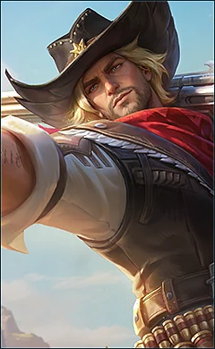
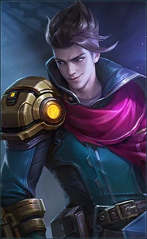

[Тир-лист](https://boostmlbb.ru/heroes/)[Предметы](https://boostmlbb.ru/items/)[Новости и гайды](https://boostmlbb.ru/news/)

# Иритель

C

СтрелокЛиния золота

Победы

53,3%

Выбор

0,5%

Баны

0,1%

[Обзор](https://boostmlbb.ru/#overview)[Сборка](https://boostmlbb.ru/#build)[Навыки](https://boostmlbb.ru/#skills)[Контрпики](https://boostmlbb.ru/#draft)[История](https://boostmlbb.ru/#lore)

## Обзор

### Характеристики

-   Живучесть**10**
-   Атака**80**
-   Эффекты**10**
-   Сложность**30**

-   Добивание
-   Разрушительный урон

### Победы по рангам, 30 дней

1.  **50,3%**Эпик
2.  **52,1%**Легенда
3.  **53,3%**Мифик
4.  **53,5%**Честь
5.  **52,8%**Слава

Пунктир: 50% побед

### Другие стрелки этой линии

[Обсидия](https://boostmlbb.ru/heroes/obsidia.html)[Бруно](https://boostmlbb.ru/heroes/bruno.html)[Клинт](https://boostmlbb.ru/heroes/clint.html)[Броуди](https://boostmlbb.ru/heroes/brody.html)[Ханаби](https://boostmlbb.ru/heroes/hanabi.html)[Москов](https://boostmlbb.ru/heroes/moskov.html)[Клауд](https://boostmlbb.ru/heroes/claude.html)[Мия](https://boostmlbb.ru/heroes/miya.html)

### Места в рейтингах

-   [Лучшие стрелки MLBB**15 из 23**](https://boostmlbb.ru/heroes/best-marksman.html)

## Сборка

Сборка 1Сборка 2Сборка 3

Победы

58,8%

Выбор

20,6%

#### Основные предметы

-   [

    

    Говорящий с ветром

    ](https://boostmlbb.ru/items/windtalker.html)
-   [

    

    Когти Хааса

    ](https://boostmlbb.ru/items/haas-claws.html)
-   [

    

    Ярость берсерка

    ](https://boostmlbb.ru/items/berserkers-fury.html)

#### Заклинание

Спринт

#### Эмблема и таланты

Эмблема убийцы

-   

    Фатальность

-   

    Охотник за скидками

-   

    Квантовый заряд

Победы

58,9%

Выбор

5,8%

#### Основные предметы

-   [

    

    Говорящий с ветром

    ](https://boostmlbb.ru/items/windtalker.html)
-   [

    

    Когти Хааса

    ](https://boostmlbb.ru/items/haas-claws.html)
-   [

    

    Ярость берсерка

    ](https://boostmlbb.ru/items/berserkers-fury.html)

#### Заклинание

Очищение

#### Эмблема и таланты

Эмблема убийцы

-   

    Фатальность

-   

    Охотник за скидками

-   

    Квантовый заряд

Победы

58,1%

Выбор

2,2%

#### Основные предметы

-   [

    

    Говорящий с ветром

    ](https://boostmlbb.ru/items/windtalker.html)
-   [

    

    Ярость берсерка

    ](https://boostmlbb.ru/items/berserkers-fury.html)
-   [

    

    Когти Хааса

    ](https://boostmlbb.ru/items/haas-claws.html)

#### Заклинание

Спринт

#### Эмблема и таланты

Эмблема убийцы

-   

    Фатальность

-   

    Охотник за скидками

-   

    Квантовый заряд

## Навыки

Прокачка**Тяжелый арбалет**_›_**Стрельба на ходу**_›_**Сила королевы**

Пассивный**Сердце джунглей**1-й навык**Стрельба на ходу**2-й навык**Сила королевы**Ультимейт**Тяжелый арбалет**

Пассивный

### Сердце джунглей

Безупречная командная работа Иритель и Лео позволяет ей стрелять во время движения. При каждой базовой атаке выпускает несколько (2) арбалетных стрел (но перезарядка увеличивается), каждая из которых наносит (+55% общей физической атаки) единиц физического урона (наследуется часть эффектов атаки).

Передвижение накапливает "Сердце джунглей" (максимально до 10 единиц расстояния), что позволяет при следующей базовой атаке выпустить 1 дополнительную стрелу.

1-й навык

### Стрельба на ходу

Перезарядка **10 с**

Иритель выпускает град стрел в определенную область, нанося 330 (+60% общей физической атаки) единиц физического урона врагам в области и уменьшая их на 15 на 3 сек.

2-й навык

### Сила королевы

Перезарядка **10 с**

Лео издает громкий рык, нанося 200 (+60% общей физической атаки) единиц физического урона ближайшим врагам и замедляя их на 40% на 2 сек.

Ультимейт

### Тяжелый арбалет

Перезарядка **30 с**

Иритель приказывает Лео прыгнуть в указанном направлении и усиливает свой арбалет на 10 сек.

В это время она получает 30 скорости передвижения, быстрее накапливает "Сердце джунглей", а ее базовые атаки выпускают тяжелые болты, наносящие 100 (+65% общей физической атаки) единиц физического урона цели и ближайшим бойцам.

## Контрпики

### Контрпики

Побеждают этого героя

[Инь](https://boostmlbb.ru/heroes/yin.html)[Ванван](https://boostmlbb.ru/heroes/wanwan.html)[Беатрис](https://boostmlbb.ru/heroes/beatrix.html)[Бенедетта](https://boostmlbb.ru/heroes/benedetta.html)[Марсель](https://boostmlbb.ru/heroes/marcel.html)

### Слабые цели

Этот герой побеждает их

[Мия](https://boostmlbb.ru/heroes/miya.html)[Эйдора](https://boostmlbb.ru/heroes/eudora.html)[Броуди](https://boostmlbb.ru/heroes/brody.html)

## История

> Рыжеволосая эльфийка, которая живет и сражается бок о бок со своим компаньоном Лео.

[Читать полную историю ↗](https://kazukiofficial.com/stories/irithel)Kazuki Official, английский [Характеристики на сайте игры ↗](https://www.mobilelegends.com/hero/detail?heroid=43)

**Поднимем ранг на герое «Иритель»**Цена считается в калькуляторе

[Рассчитать цену](https://boostmlbb.ru/order.html?type=hero)

## Частые вопросы

Кто контрпик для героя «Иритель» в MLBB?

За последние 30 дней чаще всего героя обыгрывают Инь, Ванван, Беатрис, Бенедетта и Марсель.

Какой процент побед у героя «Иритель» сейчас?

53,34% в Мифической славе за последние 7 дней и 52,80% на всех рангах за 30 дней, данные на 25 ноября 2026 года.

Какая роль и линия у героя «Иритель»?

Стрелок, играет на линии золота.

Силён ли герой «Иритель» в текущей мете?

Тир C, 78-е место из 133 героев и 15-е среди стрелков. Тир учитывает, как часто героя берут и банят и как он выигрывает в Мифической славе за 7 дней: бан в 0,1% матчей, 53,3% побед. В профессиональных матчах за месяц героя драфтуют в 0,0% катков.

Какая сборка на героя «Иритель» лучшая?

Самая популярная сборка в рейтинге: ключевые предметы «Говорящий с ветром», «Когти Хааса» и «Ярость берсерка», эмблема убийцы с талантами «Фатальность», «Охотник за скидками» и «Квантовый заряд» и заклинание «Спринт». С ней выигрывают 58,81% матчей.
