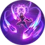
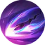

[Тир-лист](https://boostmlbb.ru/heroes/)[Предметы](https://boostmlbb.ru/items/)[Новости и гайды](https://boostmlbb.ru/news/)

# Иксия

C

СтрелокЛиния золота

Победы

50,5%

Выбор

0,8%

Баны

0,5%

[Обзор](https://boostmlbb.ru/#overview)[Сборка](https://boostmlbb.ru/#build)[Как играть](https://boostmlbb.ru/#howto)[Навыки](https://boostmlbb.ru/#skills)[Контрпики](https://boostmlbb.ru/#draft)[История](https://boostmlbb.ru/#lore)

## Обзор

### Характеристики

-   Живучесть**30**
-   Атака**70**
-   Эффекты**50**
-   Сложность**30**

-   Добивание
-   Урон

### Победы по рангам, 30 дней

1.  **49,3%**Эпик
2.  **50,0%**Легенда
3.  **50,2%**Мифик
4.  **49,8%**Честь
5.  **50,5%**Слава

Пунктир: 50% побед

### Другие стрелки этой линии

[Обсидия](https://boostmlbb.ru/heroes/obsidia.html)[Бруно](https://boostmlbb.ru/heroes/bruno.html)[Клинт](https://boostmlbb.ru/heroes/clint.html)[Броуди](https://boostmlbb.ru/heroes/brody.html)[Ханаби](https://boostmlbb.ru/heroes/hanabi.html)[Москов](https://boostmlbb.ru/heroes/moskov.html)[Клауд](https://boostmlbb.ru/heroes/claude.html)[Мия](https://boostmlbb.ru/heroes/miya.html)

### Места в рейтингах

-   [Лучшие стрелки MLBB**14 из 23**](https://boostmlbb.ru/heroes/best-marksman.html)

## Сборка

Сборка 1Сборка 2Сборка 3

Победы

56,1%

Выбор

8,2%

#### Основные предметы

-   [

    

    Трезубец

    ](https://boostmlbb.ru/items/sea-halberd.html)
-   [

    

    Коса коррозии

    ](https://boostmlbb.ru/items/corrosion-scythe.html)
-   [

    

    Пронзающий небеса

    ](https://boostmlbb.ru/items/sky-piercer.html)
-   [

    

    Губительный пулемет

    ](https://boostmlbb.ru/items/malefic-gun.html)

#### Заклинание

Вспышка

#### Эмблема и таланты

Эмблема стрелка

-   

    Трепет

-   

    Мастер оружий

-   

    Боевой клич

Победы

54,5%

Выбор

6,2%

#### Основные предметы

-   [

    

    Трезубец

    ](https://boostmlbb.ru/items/sea-halberd.html)
-   [

    

    Пронзающий небеса

    ](https://boostmlbb.ru/items/sky-piercer.html)
-   [

    

    Коса коррозии

    ](https://boostmlbb.ru/items/corrosion-scythe.html)

#### Заклинание

Вспышка

#### Эмблема и таланты

Эмблема стрелка

-   

    Трепет

-   

    Мастер оружий

-   

    Боевой клич

Победы

54,6%

Выбор

6,1%

#### Основные предметы

-   [

    

    Трезубец

    ](https://boostmlbb.ru/items/sea-halberd.html)
-   [

    

    Коса коррозии

    ](https://boostmlbb.ru/items/corrosion-scythe.html)
-   [

    

    Пронзающий небеса

    ](https://boostmlbb.ru/items/sky-piercer.html)

#### Заклинание

Вспышка

#### Эмблема и таланты

Эмблема стрелка

-   

    Трепет

-   

    Мастер оружий

-   

    Боевой клич

## Как играть за Иксию

### Комбо Иксии

#### В драке

1.  Ульт
2.  Атака
3.  2
4.  1

Выберите безопасное место и накройте ультом как можно больше врагов. Не переставая жмите атаку и контролируйте вторым и первым навыками.

#### На линии

1.  2
2.  1
3.  Атака

Стяните врагов к центру вторым навыком и добавьте первый. Его ускорение помогает догонять.

### Когда сильнее всего

Сильнее в начале: на 10–12 минутах выигрывает 57,7%. Давите на линии, забирайте объекты и заканчивайте, пока преимущество не растаяло.

1.  **57,7**10–12
2.  **52,2**12–14
3.  **49,7**14–16
4.  **47,8**16–18
5.  **47,4**18–20
6.  **47,0**20+

Проценты побед по длине матча в минутах, все ранги. Пунктир: 50%

### Приоритет прокачки

1.  Огневой налет
2.  Двойной луч
3.  Звездная спираль

## Навыки

Пассивный**Старлиумовое поглощение**1-й навык**Двойной луч**2-й навык**Звездная спираль**Ультимейт**Огневой налет**

Пассивный

### Старлиумовое поглощение

Базовые атаки и навыки Иксии при попадании накладывают на врагов старлиумовый заряд. Когда Иксия совершает базовую атаку по врагу с двумя старлиумовыми зарядами, эта атака расходует заряды и становится "Старлиумовым поглощением", нанося цели (+150% общей физической атаки) + (+10 × ур. героя) единиц физического урона. Иксия восстанавливает ОЗ, равные нанесенному урону (только 10 % против юнитов не-героев), и замедляет цель на 25% на 1 сек.

"Старлиумовое поглощение" может поразить всех врагов перед Иксией в пределах дальности ее базовой атаки, но не наносит критический удар.

Базовые атаки Иксии не активируют вампиризм.

1-й навык

### Двойной луч

Перезарядка **4 Mana Cost: 35 с**

Иксия выпускает 2 луча старлиумовой энергии по земле в указанном направлении, нанося 100 (+70% общей физической атаки) единиц физического урона врагам в прямоугольной области. При попадании по вражеским героям Иксия получает 50% скорости передвижения на 2 сек.

Враги, пораженные двумя лучами, получают двойной урон.

2-й навык

### Звездная спираль

Перезарядка **11 Mana Cost: 65 с**

Иксия выпускает контейнер старлиумовой энергии в указанном направлении, отбрасывая ближайших врагов. После небольшой задержки энергия притягивает врагов в радиусе действия к центральной линии и наносит 200 (+60% общей физической атаки) единиц физического урона.

Ультимейт

### Огневой налет

Перезарядка **42 Mana Cost: 120 с**

Иксия разбирает свое оружие на 6 малых орудий и входит в состояние "Огневого налета" на 4 сек. В этом состоянии базовые атаки и навыки Иксии могут поражать врагов в большой веерообразной области перед ней, но не за ее пределами. Базовые атаки Иксии могут поражать до 6 вражеских юнитов (в приоритете герои), а "Старлиумовое поглощение" будет действовать вместе с ее обычными базовыми атаками.

## Контрпики Иксии

### Кто контрит Иксию

[Эстес](https://boostmlbb.ru/heroes/estes.html)[Циклоп](https://boostmlbb.ru/heroes/cyclops.html)[Рафаэль](https://boostmlbb.ru/heroes/rafaela.html)[Лолита](https://boostmlbb.ru/heroes/lolita.html)[Флорин](https://boostmlbb.ru/heroes/floryn.html)

### Кого контрит Иксия

[Селена](https://boostmlbb.ru/heroes/selena.html)[Грейнджер](https://boostmlbb.ru/heroes/granger.html)[Чу](https://boostmlbb.ru/heroes/chou.html)[Клауд](https://boostmlbb.ru/heroes/claude.html)[Кадита](https://boostmlbb.ru/heroes/kadita.html)[Инь](https://boostmlbb.ru/heroes/yin.html)[Бенедетта](https://boostmlbb.ru/heroes/benedetta.html)[Ханзо](https://boostmlbb.ru/heroes/hanzo.html)[Ванван](https://boostmlbb.ru/heroes/wanwan.html)

## История

> Лидер "Злого духа" и самопровозглашенный изобретатель. Она владеет самодельным оружием, работающим от украденного старлиумового реактора.

[Читать полную историю ↗](https://play.mobilelegends.com/lore/hero/Lxia)Официальный сайт Mobile Legends [Характеристики на сайте игры ↗](https://www.mobilelegends.com/hero/detail?heroid=121)

**Поднимем ранг на герое «Иксия»**Цена считается в калькуляторе

[Рассчитать цену](https://boostmlbb.ru/order.html?type=hero)

## Частые вопросы

Кто контрит Иксию в MLBB?

За последние 30 дней Иксию чаще всего обыгрывают Эстес, Циклоп, Рафаэль, Лолита и Флорин.

Как играть за Иксию?

В первую очередь качайте «Двойной луч», ульт берите, как только доступен. Сильнее в начале: на 10–12 минутах выигрывает 57,7%. Давите на линии, забирайте объекты и заканчивайте, пока преимущество не растаяло. Комбо для драки: Выберите безопасное место и накройте ультом как можно больше врагов. Не переставая жмите атаку и контролируйте вторым и первым навыками.

Какой процент побед у Иксии сейчас?

50,55% в Мифической славе за последние 7 дней и 50,11% на всех рангах за 30 дней, данные на 25 ноября 2026 года.

Какая роль и линия у Иксии?

Стрелок, играет на линии золота.

Стоит ли брать Иксию в текущей мете?

Тир C, 74-е место из 133 героев и 14-е среди стрелков. Тир учитывает, как часто героя берут и банят и как он выигрывает в Мифической славе за 7 дней: бан в 0,5% матчей, 50,5% побед. В профессиональных матчах за месяц героя драфтуют в 0,0% катков.

Какая сборка на Иксию лучшая?

Самая популярная сборка в рейтинге: ключевые предметы «Трезубец», «Коса коррозии», «Пронзающий небеса» и «Губительный пулемет», эмблема стрелка с талантами «Трепет», «Мастер оружий» и «Боевой клич» и заклинание «Вспышка». С ней выигрывают 56,12% матчей.
