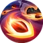

[Главная](https://boostmlbb.ru/) / [Герои](https://boostmlbb.ru/heroes/)

Тир C

# Кусака

Боец · Линия опыта или роум

**№ 110 из 133 по доле побед**Все ранги · 30 дней по 23 ноября 2026 года

Победы

47,87%

Выбор

0,34%

Баны

0,33%

Рывок · Разрушительный урон · Сложность 60/100

[Сборка](https://boostmlbb.ru/#build)[Контрпики и союзники](https://boostmlbb.ru/#draft)[Навыки](https://boostmlbb.ru/#skills)[Победы по рангам](https://boostmlbb.ru/#ranks)[История](https://boostmlbb.ru/#lore)

## Сборка

Самый частый выбор в рейтинге · Линия опыта

Ключевые предметы

Удар охотникаТрезубецГосподство льда

Эмблема и таланты

Эмблема убийцыЛовкостьОпытный охотникУбийственный пир

Боевое заклинание

Вспышка

Побед с этой сборкой **50,55%**Выбирают в **3,03%** матчей

Другие сборки (2)

Ключевые предметы

Клинок семи морейУдар охотникаЗлобный рык

Эмблема и таланты

Эмблема убийцыЛовкостьМастер-убийцаСмертельное воспламенение

Боевое заклинание

Вспышка

Побед с этой сборкой **56,97%**Выбирают в **4,42%** матчей

Ключевые предметы

Клинок семи морейУдар охотникаЗлобный рык

Эмблема и таланты

Эмблема убийцыЛовкостьМастер-убийцаСмертельное воспламенение

Боевое заклинание

Окаменение

Побед с этой сборкой **55,34%**Выбирают в **3,98%** матчей

## Контрпики и союзники

### Кто контрит

[Арлотт](https://boostmlbb.ru/heroes/arlott.html)[Нолан](https://boostmlbb.ru/heroes/nolan.html)[Грейнджер](https://boostmlbb.ru/heroes/granger.html)[Сабер](https://boostmlbb.ru/heroes/saber.html)[Хелкарт](https://boostmlbb.ru/heroes/helcurt.html)

### Против кого силён

[Сан](https://boostmlbb.ru/heroes/sun.html)[Эсмеральда](https://boostmlbb.ru/heroes/esmeralda.html)[Глу](https://boostmlbb.ru/heroes/gloo.html)[Пополь и Купа](https://boostmlbb.ru/heroes/popol-and-kupa.html)

### Союзники

Прибавка к доле побед в одной команде

[Эстес+2,01 п. п.](https://boostmlbb.ru/heroes/estes.html)[Лолита+1,96 п. п.](https://boostmlbb.ru/heroes/lolita.html)[Белерик+1,78 п. п.](https://boostmlbb.ru/heroes/belerick.html)[Рафаэль+1,72 п. п.](https://boostmlbb.ru/heroes/rafaela.html)

## Навыки

Приоритет прокачки · Непрерывная сила → Умные ракеты → Катапульта

Пассивный**Механическое давление**

Каждый раз, когда Кусака наносит урон вражескому герою или монстру, он накладывает на него заряд "Механического давления" на 3 сек. (до 6 зарядов). Каждый заряд "Механического давления" увеличивает весь урон, наносимый цели, на 2% (для монстров не более 50%).

1-й навык**Умные ракеты**

**Перезарядка 5 Mana Cost: 60 с**

Кусака выпускает до 12 ракет в случайных ближайших врагов в течение 5 сек. Каждая ракета наносит 135 (+30% общей физической атаки) единиц физического урона пораженному врагу.

2-й навык**Катапульта**

**Перезарядка 15 Mana Cost: 80 с**

Кусака получает 30% скорости передвижения и 500 (+100% общей физической атаки) ед. щита на 5 сек.
Повторное использование: Кусака бросает ближайшего юнита (приоритет — герои) в указанное место, нанося 300 (+80% общей физической атаки) единиц физического урона врагам в этой области и оглушая их на 0.5 сек. Можно использовать на союзных героев, и они не получат урона.

Ультимейт**Непрерывная сила**

**Перезарядка 35 Mana Cost: 120 с**

Кусака бросается на вражеского героя, нанося 350 (+150% общей физической атаки) единиц физического урона и ненадолго оглушая его. Враги вблизи цели будут отброшены и получат такой же урон. Кусака невосприимчив к эффектам контроля во время рывка.

## Победы по рангам

-   Эпик**47,58%**
-   Легенда**48,28%**
-   Мифический**48,56%**
-   Мифическая честь**47,75%**
-   Мифическая слава**47,11%**

## История

Разумный робот, защищающий маленькую Эйли.

[Карточка героя](https://www.mobilelegends.com/hero/detail?heroid=54)[MLBB Wiki](https://mobile-legends.fandom.com/wiki/Jawhead)

[Стоимость буста на герое](https://boostmlbb.ru/order.html?type=hero)

## Частые вопросы

Кто контрпик для героя «Кусака» в MLBB?

За последние 30 дней чаще всего героя обыгрывают Арлотт, Нолан, Грейнджер, Сабер и Хелкарт.

Какой процент побед у героя «Кусака» сейчас?

47,87% за последние 30 дней на всех рангах и 47,11% в Мифической славе, данные на 23 ноября 2026 года.

Какая роль и линия у героя «Кусака»?

Боец, играет на линии опыта или в роуме.

Силён ли герой «Кусака» в текущей мете?

Тир C: 110-е место из 133 героев по проценту побед за 30 дней и 37-е среди бойцов.

Какая сборка на героя «Кусака» лучшая?

Самая популярная сборка в рейтинге: ключевые предметы «Удар охотника», «Трезубец» и «Господство льда», эмблема убийцы с талантами «Ловкость», «Опытный охотник» и «Убийственный пир» и заклинание «Вспышка». С ней выигрывают 50,55% матчей.
