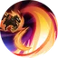

[Тир-лист](https://boostmlbb.ru/heroes/)[Новости и гайды](https://boostmlbb.ru/news/)

# Кусака

C

БоецЛиния опытаРоум

Разумный робот, защищающий маленькую Эйли.

Победы

47,5%

все ранги 47,9%

Выбор

0,2%

все ранги 0,3%

Баны

0,1%

все ранги 0,3%

№113 в тир-листе · №38 среди бойцов · Мифическая слава, 7 дней, по 23 ноября

[Обзор](https://boostmlbb.ru/#overview)[Сборка](https://boostmlbb.ru/#build)[Навыки](https://boostmlbb.ru/#skills)[Контрпики](https://boostmlbb.ru/#draft)[История](https://boostmlbb.ru/#lore)

## Обзор

### Характеристики

-   Живучесть**60**
-   Атака**30**
-   Эффекты**60**
-   Сложность**60**

-   Рывок
-   Разрушительный урон

### Победы по рангам, 30 дней

1.  **47,6%**Эпик
2.  **48,3%**Легенда
3.  **48,6%**Мифик
4.  **47,8%**Честь
5.  **47,1%**Слава

Пунктир: 50% побед

### Другие бойцы этой линии

[Сан](https://boostmlbb.ru/heroes/sun.html)[Аулус](https://boostmlbb.ru/heroes/aulus.html)[Лукас](https://boostmlbb.ru/heroes/lukas.html)[Фрейя](https://boostmlbb.ru/heroes/freya.html)[Калеа](https://boostmlbb.ru/heroes/kalea.html)[Аргус](https://boostmlbb.ru/heroes/argus.html)[Пакито](https://boostmlbb.ru/heroes/paquito.html)[Баданг](https://boostmlbb.ru/heroes/badang.html)

## Сборка

Линия опыта · по данным рейтинговых матчей

Сборка 157,0%Сборка 255,3%Сборка 350,5%

### Предметы

Клинок семи морей

Удар охотника

Злобный рык

### Эмблема

Эмблема убийцы

Ловкость

Мастер-убийца

Смертельное воспламенение

### Заклинание

Вспышка

Победы

57,0%

Выбор

4,4%

### Предметы

Клинок семи морей

Удар охотника

Злобный рык

### Эмблема

Эмблема убийцы

Ловкость

Мастер-убийца

Смертельное воспламенение

### Заклинание

Окаменение

Победы

55,3%

Выбор

4,0%

### Предметы

Удар охотника

Трезубец

Господство льда

### Эмблема

Эмблема убийцы

Ловкость

Опытный охотник

Убийственный пир

### Заклинание

Вспышка

Победы

50,5%

Выбор

3,0%

## Навыки

Прокачка**Непрерывная сила**_›_**Умные ракеты**_›_**Катапульта**

Пассивный1-й навык2-й навыкУльтимейт

Пассивный

### Механическое давление

Каждый раз, когда Кусака наносит урон вражескому герою или монстру, он накладывает на него заряд "Механического давления" на 3 сек. (до 6 зарядов). Каждый заряд "Механического давления" увеличивает весь урон, наносимый цели, на 2% (для монстров не более 50%).

1-й навык

### Умные ракеты

Перезарядка **5 Mana Cost: 60 с**

Кусака выпускает до 12 ракет в случайных ближайших врагов в течение 5 сек. Каждая ракета наносит 135 (+30% общей физической атаки) единиц физического урона пораженному врагу.

2-й навык

### Катапульта

Перезарядка **15 Mana Cost: 80 с**

Кусака получает 30% скорости передвижения и 500 (+100% общей физической атаки) ед. щита на 5 сек.

**Повторное использование:** Кусака бросает ближайшего юнита (приоритет — герои) в указанное место, нанося 300 (+80% общей физической атаки) единиц физического урона врагам в этой области и оглушая их на 0.5 сек. Можно использовать на союзных героев, и они не получат урона.

Ультимейт

### Непрерывная сила

Перезарядка **35 Mana Cost: 120 с**

Кусака бросается на вражеского героя, нанося 350 (+150% общей физической атаки) единиц физического урона и ненадолго оглушая его. Враги вблизи цели будут отброшены и получат такой же урон. Кусака невосприимчив к эффектам контроля во время рывка.

## Контрпики и союзники

### Контрпики

Побеждают этого героя

[Арлотт](https://boostmlbb.ru/heroes/arlott.html)[Нолан](https://boostmlbb.ru/heroes/nolan.html)[Грейнджер](https://boostmlbb.ru/heroes/granger.html)[Сабер](https://boostmlbb.ru/heroes/saber.html)[Хелкарт](https://boostmlbb.ru/heroes/helcurt.html)

### Слабые цели

Этот герой побеждает их

[Сан](https://boostmlbb.ru/heroes/sun.html)[Эсмеральда](https://boostmlbb.ru/heroes/esmeralda.html)[Глу](https://boostmlbb.ru/heroes/gloo.html)[Пополь и Купа](https://boostmlbb.ru/heroes/popol-and-kupa.html)

### Союзники

Рост побед в паре, п. п.

[Эстес**+2,0**](https://boostmlbb.ru/heroes/estes.html)[Лолита**+2,0**](https://boostmlbb.ru/heroes/lolita.html)[Белерик**+1,8**](https://boostmlbb.ru/heroes/belerick.html)[Рафаэль**+1,7**](https://boostmlbb.ru/heroes/rafaela.html)

## История

> Разумный робот, защищающий маленькую Эйли.

[Читать полную историю ↗](https://kazukiofficial.com/stories/jawhead)Kazuki Official, английский

[Характеристики на сайте игры ↗](https://www.mobilelegends.com/hero/detail?heroid=54)

**Поднимем ранг на герое «Кусака»**Цена считается в калькуляторе

[Рассчитать цену](https://boostmlbb.ru/order.html?type=hero)

## Частые вопросы

Кто контрпик для героя «Кусака» в MLBB?

За последние 30 дней чаще всего героя обыгрывают Арлотт, Нолан, Грейнджер, Сабер и Хелкарт.

Какой процент побед у героя «Кусака» сейчас?

47,49% в Мифической славе за последние 7 дней и 47,87% на всех рангах за 30 дней, данные на 23 ноября 2026 года.

Какая роль и линия у героя «Кусака»?

Боец, играет на линии опыта или в роуме.

Силён ли герой «Кусака» в текущей мете?

Тир C, 113-е место из 133 героев и 38-е среди бойцов. Тир учитывает, как часто героя берут и банят и как он выигрывает в Мифической славе за 7 дней: бан в 0,1% матчей, 47,5% побед.

Какая сборка на героя «Кусака» лучшая?

Самая популярная сборка в рейтинге: ключевые предметы «Клинок семи морей», «Удар охотника» и «Злобный рык», эмблема убийцы с талантами «Ловкость», «Мастер-убийца» и «Смертельное воспламенение» и заклинание «Вспышка». С ней выигрывают 56,97% матчей.
