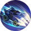

[Тир-лист](https://boostmlbb.ru/heroes/)[Предметы](https://boostmlbb.ru/items/)[Скины](https://boostmlbb.ru/skins/)[Новости и гайды](https://boostmlbb.ru/news/)

[Тир-лист](https://boostmlbb.ru/heroes/)

# Джонсон

C

ТанкПоддержкаРоум

Победы

48,0%

Выбор

0,5%

Баны

0,7%

[Обзор](https://boostmlbb.ru/#overview)[Сборка](https://boostmlbb.ru/#build)[Как играть](https://boostmlbb.ru/#howto)[Навыки](https://boostmlbb.ru/#skills)[Контрпики](https://boostmlbb.ru/#draft)[Скины](https://boostmlbb.ru/#skins)[История](https://boostmlbb.ru/#lore)

## Обзор

### Характеристики

-   Живучесть**80**
-   Атака**30**
-   Эффекты**90**
-   Сложность**60**

-   Поддержка
-   Массовый контроль

### Победы по рангам, 30 дней

1.  **52,7%**Эпик
2.  **51,0%**Легенда
3.  **50,1%**Мифик
4.  **48,3%**Честь
5.  **47,0%**Слава

Пунктир: 50% побед

### Другие танки этой линии

[Кармилла](https://boostmlbb.ru/heroes/carmilla.html)[Белерик](https://boostmlbb.ru/heroes/belerick.html)[Атлас](https://boostmlbb.ru/heroes/atlas.html)[Глу](https://boostmlbb.ru/heroes/gloo.html)[Минотавр](https://boostmlbb.ru/heroes/minotaur.html)[Хуфра](https://boostmlbb.ru/heroes/khufra.html)[Тигрил](https://boostmlbb.ru/heroes/tigreal.html)[Хильда](https://boostmlbb.ru/heroes/hilda.html)

### Места в рейтингах

-   [Лучшие танки MLBB**17 из 25**](https://boostmlbb.ru/heroes/best-tank.html)
-   [Лучшие роумеры MLBB**22 из 34**](https://boostmlbb.ru/heroes/best-roam.html)

## Сборка

Сборка 1Сборка 2Сборка 3

Победы

55,6%

Выбор

4,4%

#### Основные предметы

-   [

    

    Господство льда

    ](https://boostmlbb.ru/items/dominance-ice.html)
-   [

    

    Древняя кираса

    ](https://boostmlbb.ru/items/antique-cuirass.html)
-   [

    

    Шипованная броня

    ](https://boostmlbb.ru/items/blade-armor.html)

#### Заклинание

Спринт

#### Эмблема и таланты

Эмблема танка

-   

    Вдохновение

-   

    Второе дыхание

-   

    Ударная волна

Победы

56,7%

Выбор

1,7%

#### Основные предметы

-   [

    

    Господство льда

    ](https://boostmlbb.ru/items/dominance-ice.html)
-   [

    

    Древняя кираса

    ](https://boostmlbb.ru/items/antique-cuirass.html)
-   [

    

    Шипованная броня

    ](https://boostmlbb.ru/items/blade-armor.html)

#### Заклинание

Спринт

#### Эмблема и таланты

Эмблема танка

-   

    Ловкость

-   

    Благословение природы

-   

    Ударная волна

Победы

52,4%

Выбор

1,5%

#### Основные предметы

-   [

    

    Мимолетное время

    ](https://boostmlbb.ru/items/fleeting-time.html)
-   [

    

    Господство льда

    ](https://boostmlbb.ru/items/dominance-ice.html)
-   [

    

    Щит валькирии

    ](https://boostmlbb.ru/items/athenas-shield.html)

#### Заклинание

Окаменение

#### Эмблема и таланты

Эмблема танка

-   

    Прочность

-   

    Стойкость

-   

    Ударная волна

## Как играть за Джонсона

### Комбо Джонсона

#### В драке

1.  Ульт
2.  2
3.  1

В драке включите ульт, подберите союзника и врывайтесь, затем вторым и первым дайте ещё контроль.

#### На линии

1.  1
2.  2
3.  Атака

На линии оглушите первым навыком, подъедьте и бейте вторым и атаками.

### Когда сильнее всего

Сильнее в долгой игре: на 16–18 минутах выигрывает 51,7%. Не рискуйте в начале, фармите и ввязывайтесь в драки вместе с командой.

1.  **45,8**10–12
2.  **49,0**12–14
3.  **51,4**14–16
4.  **51,7**16–18
5.  **51,4**18–20
6.  **50,5**20+

Проценты побед по длине матча в минутах, все ранги. Пунктир: 50%

### Приоритет прокачки

1.  Газ до упора
2.  Электромагнитные волны
3.  Ударный гаечный ключ

## Навыки

Пассивный**Подушка безопасности**1-й навык**Ударный гаечный ключ**2-й навык**Электромагнитные волны**Ультимейт**Газ до упора**

Пассивный

### Подушка безопасности

Когда ОЗ Джонсона ниже 30%, он получает 300 (+700% общей физической защиты) ед. щита на 10 сек. Перезарядка: 100 сек.

1-й навык

### Ударный гаечный ключ

Перезарядка **8 с**

Джонсон бросает гаечный ключ в указанное место, нанося 120 (+220% общей физической защиты) единиц магического урона врагам на пути. Враги вокруг точки приземления будут оглушены на 0.8 сек.

2-й навык

### Электромагнитные волны

Перезарядка **10 с**

Джонсон поднимает щит, непрерывно нанося 120 (+60% общей магической силы) единиц магического урона врагам в веерообразной области в указанном направлении, снижая их скорость передвижения и на 10% (складывается до 3 раз) на 2 сек.

Пока щит поднят, Джонсон может использовать базовые атаки и применять навыки.

Ультимейт

### Газ до упора

Перезарядка **36 с**

**Пассивный:** Джонсона увеличивается на 10%.

**Активный:** Джонсон превращается в автомобиль. Ближайшие союзные герои могут использовать "Запрыгнуть" и сесть в автомобиль (только 1 за раз). При столкновении с вражеским героем автомобиль взрывается, нанося 300 (+240% общей физической защиты)–450 (+360% общей физической защиты) единиц магического урона ближайшим врагам, оглушая их на 0.5–1 сек. (зависит от времени вождения). Он также создает наэлектризованную зону в этом месте, которая постоянно наносит 60 (+20% общей магической силы) единиц магического урона и замедляет находящихся в ней врагов.

Местоположение Джонсона раскрывается врагам на 3 сек., когда он применяет этот навык.

## Контрпики Джонсона

### Кто контрит Джонсона

[Лейла](https://boostmlbb.ru/heroes/layla.html)[Зилонг](https://boostmlbb.ru/heroes/zilong.html)[Сабер](https://boostmlbb.ru/heroes/saber.html)[Дариус](https://boostmlbb.ru/heroes/dyrroth.html)[Валентина](https://boostmlbb.ru/heroes/valentina.html)

### Кого контрит Джонсон

[Белерик](https://boostmlbb.ru/heroes/belerick.html)[Кармилла](https://boostmlbb.ru/heroes/carmilla.html)[Минотавр](https://boostmlbb.ru/heroes/minotaur.html)[Атлас](https://boostmlbb.ru/heroes/atlas.html)[Клауд](https://boostmlbb.ru/heroes/claude.html)[Кадита](https://boostmlbb.ru/heroes/kadita.html)[Глу](https://boostmlbb.ru/heroes/gloo.html)[Ланселот](https://boostmlbb.ru/heroes/lancelot.html)[Лилия](https://boostmlbb.ru/heroes/lylia.html)[Грок](https://boostmlbb.ru/heroes/grock.html)

## Скины Джонсона

[Повелитель мировВысший · 2025](https://boostmlbb.ru/skins/johnson/sovereign-of-realms.html)[Оптимус ПраймГрандиозный · 2023](https://boostmlbb.ru/skins/johnson/optimus-prime.html)[Звёздный гонщикИсключительный · 2023](https://boostmlbb.ru/skins/johnson/starblazer.html)[Смер­тельная поездкаИсключительный · 2021](https://boostmlbb.ru/skins/johnson/death-ride.html)[Король крушенияИзысканный · 2019](https://boostmlbb.ru/skins/johnson/wreck-king.html)[Гонщик на джипниОбычный · 2018](https://boostmlbb.ru/skins/johnson/jeepney-racer.html)[Автомат S.A.B.E.R.Делюкс · 2018](https://boostmlbb.ru/skins/johnson/s-a-b-e-r-automata.html)[Начальник пожарныхОбычный · 2017](https://boostmlbb.ru/skins/johnson/fire-chief.html)

[Все 8 скинов Джонсона: цены и как получить](https://boostmlbb.ru/skins/johnson.html)

## История

> Суперкиборг, способный превращаться в автомобиль и подвозить своих союзников к месту боя.

[Читать полную историю ↗](https://play.mobilelegends.com/lore/hero/Johnson)Официальный сайт Mobile Legends [Характеристики на сайте игры ↗](https://www.mobilelegends.com/hero/detail?heroid=32)

**Поднимем ранг на герое «Джонсон»**Цена считается в калькуляторе

[Рассчитать цену](https://boostmlbb.ru/order.html?type=hero)

## Частые вопросы

Кто контрит Джонсона в MLBB?

За последние 30 дней Джонсона чаще всего обыгрывают Лейла, Зилонг, Сабер, Дариус и Валентина.

Как играть за Джонсона?

В первую очередь качайте «Электромагнитные волны», ульт берите, как только доступен. Сильнее в долгой игре: на 16–18 минутах выигрывает 51,7%. Не рискуйте в начале, фармите и ввязывайтесь в драки вместе с командой. Комбо для драки: В драке включите ульт, подберите союзника и врывайтесь, затем вторым и первым дайте ещё контроль.

Какой процент побед у Джонсона сейчас?

47,96% в Мифической славе за последние 7 дней и 49,36% на всех рангах за 30 дней, данные на 25 ноября 2026 года.

Какая роль и линия у Джонсона?

Танк и поддержка, играет в роуме.

Стоит ли брать Джонсона в текущей мете?

Тир C, 102-е место из 133 героев и 17-е среди танков. Тир учитывает, как часто героя берут и банят и как он выигрывает в Мифической славе за 7 дней: бан в 0,7% матчей, 48,0% побед. В профессиональных матчах за месяц героя драфтуют в 0,0% катков.

Какая сборка на Джонсона лучшая?

Самая популярная сборка в рейтинге: ключевые предметы «Господство льда», «Древняя кираса» и «Шипованная броня», эмблема танка с талантами «Вдохновение», «Второе дыхание» и «Ударная волна» и заклинание «Спринт». С ней выигрывают 55,57% матчей.
