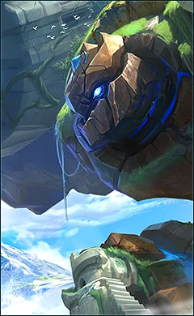

[Тир-лист](https://boostmlbb.ru/heroes/)[Новости и гайды](https://boostmlbb.ru/news/)

# Джонсон

C

ТанкПоддержкаРоум

Победы

47,9%

Выбор

0,5%

Баны

0,7%

[Обзор](https://boostmlbb.ru/#overview)[Сборка](https://boostmlbb.ru/#build)[Навыки](https://boostmlbb.ru/#skills)[Контрпики](https://boostmlbb.ru/#draft)[История](https://boostmlbb.ru/#lore)

## Обзор

### Характеристики

-   Живучесть**80**
-   Атака**30**
-   Эффекты**90**
-   Сложность**60**

-   Поддержка
-   Массовый контроль

### Победы по рангам, 30 дней

1.  **52,7%**Эпик
2.  **51,0%**Легенда
3.  **50,0%**Мифик
4.  **48,2%**Честь
5.  **47,0%**Слава

Пунктир: 50% побед

### Другие танки этой линии

[Кармилла](https://boostmlbb.ru/heroes/carmilla.html)[Белерик](https://boostmlbb.ru/heroes/belerick.html)[Атлас](https://boostmlbb.ru/heroes/atlas.html)[Глу](https://boostmlbb.ru/heroes/gloo.html)[Минотавр](https://boostmlbb.ru/heroes/minotaur.html)[Хуфра](https://boostmlbb.ru/heroes/khufra.html)[Тигрил](https://boostmlbb.ru/heroes/tigreal.html)[Хильда](https://boostmlbb.ru/heroes/hilda.html)

### Места в рейтингах

-   [Лучшие танки MLBB**17 из 25**](https://boostmlbb.ru/heroes/best-tank.html)
-   [Лучшие роумеры MLBB**23 из 34**](https://boostmlbb.ru/heroes/best-roam.html)

## Сборка

Сборка 1Сборка 2Сборка 3

Победы

55,6%

Выбор

4,4%

#### Основные предметы

-   

    Господство льда

-   

    Древняя кираса

-   

    Шипованная броня

#### Заклинание

Спринт

#### Эмблема и таланты

Эмблема танка

-   

    Вдохновение

-   

    Второе дыхание

-   

    Ударная волна

Победы

56,7%

Выбор

1,7%

#### Основные предметы

-   

    Господство льда

-   

    Древняя кираса

-   

    Шипованная броня

#### Заклинание

Спринт

#### Эмблема и таланты

Эмблема танка

-   

    Ловкость

-   

    Благословение природы

-   

    Ударная волна

Победы

52,4%

Выбор

1,5%

#### Основные предметы

-   

    Мимолетное время

-   

    Господство льда

-   

    Щит Афины

#### Заклинание

Окаменение

#### Эмблема и таланты

Эмблема танка

-   

    Прочность

-   

    Стойкость

-   

    Ударная волна

## Навыки

Прокачка**Газ до упора**_›_**Электромагнитные волны**_›_**Ударный гаечный ключ**

Пассивный**Подушка безопасности**1-й навык**Ударный гаечный ключ**2-й навык**Электромагнитные волны**Ультимейт**Газ до упора**

Пассивный

### Подушка безопасности

Когда ОЗ Джонсона ниже 30%, он получает 300 (+700% общей физической защиты) ед. щита на 10 сек. Перезарядка: 100 сек.

1-й навык

### Ударный гаечный ключ

Перезарядка **8 с**

Джонсон бросает гаечный ключ в указанное место, нанося 120 (+220% общей физической защиты) единиц магического урона врагам на пути. Враги вокруг точки приземления будут оглушены на 0.8 сек.

2-й навык

### Электромагнитные волны

Перезарядка **10 с**

Джонсон поднимает щит, непрерывно нанося 120 (+60% общей магической силы) единиц магического урона врагам в веерообразной области в указанном направлении, снижая их скорость передвижения и на 10% (складывается до 3 раз) на 2 сек.

Пока щит поднят, Джонсон может использовать базовые атаки и применять навыки.

Ультимейт

### Газ до упора

Перезарядка **36 с**

**Пассивный:** Джонсона увеличивается на 10%.

**Активный:** Джонсон превращается в автомобиль. Ближайшие союзные герои могут использовать "Запрыгнуть" и сесть в автомобиль (только 1 за раз). При столкновении с вражеским героем автомобиль взрывается, нанося 300 (+240% общей физической защиты)–450 (+360% общей физической защиты) единиц магического урона ближайшим врагам, оглушая их на 0.5–1 сек. (зависит от времени вождения). Он также создает наэлектризованную зону в этом месте, которая постоянно наносит 60 (+20% общей магической силы) единиц магического урона и замедляет находящихся в ней врагов.

Местоположение Джонсона раскрывается врагам на 3 сек., когда он применяет этот навык.

## Контрпики

### Контрпики

Побеждают этого героя

[Лейла](https://boostmlbb.ru/heroes/layla.html)[Зилонг](https://boostmlbb.ru/heroes/zilong.html)[Сабер](https://boostmlbb.ru/heroes/saber.html)[Валентина](https://boostmlbb.ru/heroes/valentina.html)[Дариус](https://boostmlbb.ru/heroes/dyrroth.html)

### Слабые цели

Этот герой побеждает их

[Белерик](https://boostmlbb.ru/heroes/belerick.html)[Кармилла](https://boostmlbb.ru/heroes/carmilla.html)[Минотавр](https://boostmlbb.ru/heroes/minotaur.html)[Атлас](https://boostmlbb.ru/heroes/atlas.html)[Клауд](https://boostmlbb.ru/heroes/claude.html)[Кадита](https://boostmlbb.ru/heroes/kadita.html)[Глу](https://boostmlbb.ru/heroes/gloo.html)[Ланселот](https://boostmlbb.ru/heroes/lancelot.html)[Лилия](https://boostmlbb.ru/heroes/lylia.html)[Грок](https://boostmlbb.ru/heroes/grock.html)

## История

> Суперкиборг, способный превращаться в автомобиль и подвозить своих союзников к месту боя.

[Читать полную историю ↗](https://play.mobilelegends.com/lore/hero/Johnson)Официальный сайт Mobile Legends [Характеристики на сайте игры ↗](https://www.mobilelegends.com/hero/detail?heroid=32)

**Поднимем ранг на герое «Джонсон»**Цена считается в калькуляторе

[Рассчитать цену](https://boostmlbb.ru/order.html?type=hero)

## Частые вопросы

Кто контрпик для героя «Джонсон» в MLBB?

За последние 30 дней чаще всего героя обыгрывают Лейла, Зилонг, Сабер, Валентина и Дариус.

Какой процент побед у героя «Джонсон» сейчас?

47,94% в Мифической славе за последние 7 дней и 49,32% на всех рангах за 30 дней, данные на 25 ноября 2026 года.

Какая роль и линия у героя «Джонсон»?

Танк и поддержка, играет в роуме.

Силён ли герой «Джонсон» в текущей мете?

Тир C, 103-е место из 133 героев и 17-е среди танков. Тир учитывает, как часто героя берут и банят и как он выигрывает в Мифической славе за 7 дней: бан в 0,7% матчей, 47,9% побед. В профессиональных матчах за месяц героя драфтуют в 0,0% катков.

Какая сборка на героя «Джонсон» лучшая?

Самая популярная сборка в рейтинге: ключевые предметы «Господство льда», «Древняя кираса» и «Шипованная броня», эмблема танка с талантами «Вдохновение», «Второе дыхание» и «Ударная волна» и заклинание «Спринт». С ней выигрывают 55,57% матчей.
