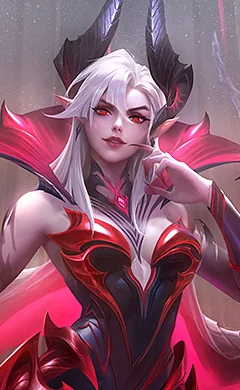

[Тир-лист](https://boostmlbb.ru/heroes/)[Новости и гайды](https://boostmlbb.ru/news/)

# Джулиан

C

БоецУбийцаЛиния опытаЛес

Победы

49,3%

Выбор

0,6%

Баны

0,3%

[Обзор](https://boostmlbb.ru/#overview)[Сборка](https://boostmlbb.ru/#build)[Навыки](https://boostmlbb.ru/#skills)[Контрпики](https://boostmlbb.ru/#draft)[История](https://boostmlbb.ru/#lore)

## Обзор

### Характеристики

-   Живучесть**60**
-   Атака**60**
-   Эффекты**70**
-   Сложность**50**

-   Преследование
-   Магический урон

### Победы по рангам, 30 дней

1.  **51,0%**Эпик
2.  **50,4%**Легенда
3.  **50,1%**Мифик
4.  **50,0%**Честь
5.  **49,2%**Слава

Пунктир: 50% побед

### Другие бойцы этой линии

[Фрейя](https://boostmlbb.ru/heroes/freya.html)[Аулус](https://boostmlbb.ru/heroes/aulus.html)[Пакито](https://boostmlbb.ru/heroes/paquito.html)[Сан](https://boostmlbb.ru/heroes/sun.html)[Лукас](https://boostmlbb.ru/heroes/lukas.html)[Чичи](https://boostmlbb.ru/heroes/cici.html)[Су Ё](https://boostmlbb.ru/heroes/suyou.html)[Сора](https://boostmlbb.ru/heroes/sora.html)

### Места в рейтингах

-   [Лучшие лесники MLBB**24 из 37**](https://boostmlbb.ru/heroes/best-jungle.html)
-   [Лучшие бойцы MLBB**30 из 44**](https://boostmlbb.ru/heroes/best-fighter.html)
-   [Лучшие убийцы MLBB**21 из 29**](https://boostmlbb.ru/heroes/best-assassin.html)

## Сборка

Сборка 1Сборка 2Сборка 3

Победы

52,7%

Выбор

6,5%

#### Основные предметы

-   

    Райское перо

-   

    Концентрированная энергия

-   

    Говорящий с ветром

#### Заклинание

Вдохновение

#### Эмблема и таланты

Эмблема мага

-   

    Проворность

-   

    Опытный охотник

-   

    Смертельное воспламенение

Победы

50,9%

Выбор

4,4%

#### Основные предметы

-   

    Райское перо

-   

    Концентрированная энергия

-   

    Говорящий с ветром

#### Заклинание

Вдохновение

#### Эмблема и таланты

Эмблема мага

-   

    Трепет

-   

    Опытный охотник

-   

    Смертельное воспламенение

Победы

48,5%

Выбор

2,3%

#### Основные предметы

-   

    Райское перо

-   

    Концентрированная энергия

-   

    Говорящий с ветром

#### Заклинание

Вспышка

#### Эмблема и таланты

Эмблема мага

-   

    Трепет

-   

    Опытный охотник

-   

    Смертельное воспламенение

## Навыки

Прокачка**Коса**_›_**Цепь**_›_**Меч**

Пассивный**Наследие мастера**1-й навык**Коса**2-й навык**Меч**Ультимейт**Цепь**

Пассивный

### Наследие мастера

Применив два разных навыка, Джулиан усиливает следующий навык. После его использования все навыки перезаряжаются 9-6 сек. (снижается с уровнем).

После применения любого навыка его базовые атаки в течение следующих 2 сек. наносят 100 (+100% общей физической атаки) (+100% общей магической силы) единиц магического урона и притягивают цель (монстрам наносится 85% урона). Применение другого навыка продлит это действие.

Джулиан получает 15% доп. гибридного вампиризма на 5 сек. каждый раз, когда поражает вражеского героя своими навыками (до 3 зарядов).

1-й навык

### Коса

Перезарядка **9 Mana Cost: 30 с**

Джулиан бросает летящую косу в указанном направлении, нанося 420 (+140% общей магической силы) единиц магического урона врагам на пути и замедляя их на 30% на 1 сек.

Коса исчезает после удара по врагу, не являющемуся миньоном.

2-й навык

### Меч

Перезарядка **9 Mana Cost: 30 с**

Джулиан призывает летающий меч и совершает рывок в указанном направлении, нанося 400 (+80% общей магической силы) единиц магического урона врагам на своем пути.

Ультимейт

### Цепь

Перезарядка **9 Mana Cost: 30 с**

Джулиан бросает цепи в указанное место, нанося 300 (+100% общей магической силы) единиц магического урона пораженным врагам после небольшой задержки и обездвиживая их на 1.2 сек.

## Контрпики

### Контрпики

Побеждают этого героя

[Фарамис](https://boostmlbb.ru/heroes/faramis.html)[Эсмеральда](https://boostmlbb.ru/heroes/esmeralda.html)[Алиса](https://boostmlbb.ru/heroes/alice.html)[Фовиус](https://boostmlbb.ru/heroes/phoveus.html)[Одетта](https://boostmlbb.ru/heroes/odette.html)

### Слабые цели

Этот герой побеждает их

[Гвиневра](https://boostmlbb.ru/heroes/guinevere.html)

## История

> Ворон-убийца из Церкви света, юнец, который ищет свой дом...

[Читать полную историю ↗](https://play.mobilelegends.com/lore/hero/Julian)Официальный сайт Mobile Legends [Характеристики на сайте игры ↗](https://www.mobilelegends.com/hero/detail?heroid=116)

**Поднимем ранг на герое «Джулиан»**Цена считается в калькуляторе

[Рассчитать цену](https://boostmlbb.ru/order.html?type=hero)

## Частые вопросы

Кто контрпик для героя «Джулиан» в MLBB?

За последние 30 дней чаще всего героя обыгрывают Фарамис, Эсмеральда, Алиса, Фовиус и Одетта.

Какой процент побед у героя «Джулиан» сейчас?

49,27% в Мифической славе за последние 7 дней и 49,93% на всех рангах за 30 дней, данные на 24 ноября 2026 года.

Какая роль и линия у героя «Джулиан»?

Боец и убийца, играет на линии опыта или в лесу.

Силён ли герой «Джулиан» в текущей мете?

Тир C, 95-е место из 133 героев и 30-е среди бойцов. Тир учитывает, как часто героя берут и банят и как он выигрывает в Мифической славе за 7 дней: бан в 0,3% матчей, 49,3% побед. В профессиональных матчах за месяц героя драфтуют в 0,0% катков.

Какая сборка на героя «Джулиан» лучшая?

Самая популярная сборка в рейтинге: ключевые предметы «Райское перо», «Концентрированная энергия» и «Говорящий с ветром», эмблема мага с талантами «Проворность», «Опытный охотник» и «Смертельное воспламенение» и заклинание «Вдохновение». С ней выигрывают 52,66% матчей.
