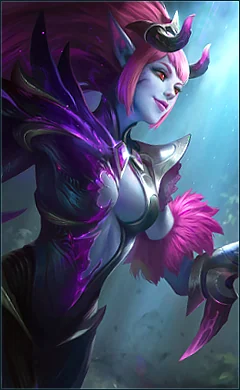
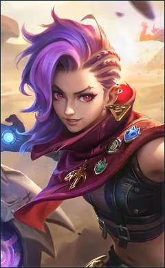

[Тир-лист](https://boostmlbb.ru/heroes/)[Предметы](https://boostmlbb.ru/items/)[Скины](https://boostmlbb.ru/skins/)[Новости и гайды](https://boostmlbb.ru/news/)

[Тир-лист](https://boostmlbb.ru/heroes/)

# Кадита

B

УбийцаМагСредняя линия

Победы

51,2%

Выбор

0,9%

Баны

1,9%

[Обзор](https://boostmlbb.ru/#overview)[Сборка](https://boostmlbb.ru/#build)[Как играть](https://boostmlbb.ru/#howto)[Навыки](https://boostmlbb.ru/#skills)[Контрпики](https://boostmlbb.ru/#draft)[Скины](https://boostmlbb.ru/#skins)[История](https://boostmlbb.ru/#lore)

## Обзор

### Характеристики

-   Живучесть**40**
-   Атака**80**
-   Эффекты**80**
-   Сложность**60**

-   Разрушительный урон
-   Рывок

### Другие убийцы этой линии

[Селена](https://boostmlbb.ru/heroes/selena.html)[Харли](https://boostmlbb.ru/heroes/harley.html)[Госсен](https://boostmlbb.ru/heroes/gusion.html)

### Места в рейтингах

-   [Лучшие маги MLBB**16 из 32**](https://boostmlbb.ru/heroes/best-mage.html)
-   [Лучшие убийцы MLBB**12 из 29**](https://boostmlbb.ru/heroes/best-assassin.html)
-   [Лучшие мидеры MLBB**14 из 29**](https://boostmlbb.ru/heroes/best-mid.html)

## Сборка

Сборка 1Сборка 2

Победы

56,6%

Выбор

9,1%

#### Основные предметы

-   [

    

    Палочка гения

    ](https://boostmlbb.ru/items/genius-wand.html)
-   [

    

    Жезл молний

    ](https://boostmlbb.ru/items/lightning-truncheon.html)
-   [

    

    Священный кристалл

    ](https://boostmlbb.ru/items/holy-crystal.html)

#### Заклинание

Окаменение

#### Эмблема и таланты

Эмблема мага

-   

    Разрыв

-   

    Второе дыхание

-   

    Смертельное воспламенение

Победы

55,5%

Выбор

2,7%

#### Основные предметы

-   [

    

    Палочка гения

    ](https://boostmlbb.ru/items/genius-wand.html)
-   [

    

    Пылающий жезл

    ](https://boostmlbb.ru/items/glowing-wand.html)
-   [

    

    Жезл молний

    ](https://boostmlbb.ru/items/lightning-truncheon.html)

#### Заклинание

Окаменение

#### Эмблема и таланты

Эмблема мага

-   

    Разрыв

-   

    Второе дыхание

-   

    Смертельное воспламенение

## Как играть за Кадиту

### Комбо Кадиты

#### В драке

1.  1
2.  2
3.  Ульт

В драке бейте первым навыком по тылу, вторым на пролёте через врагов подбросьте их. Добавьте ульт с большим уроном: пока вас нельзя выбрать целью, вы не получаете урона.

#### На линии

1.  1
2.  1
3.  2

На линии постоянно тревожьте первым навыком и ловите момент для второго.

### Когда сильнее всего

Сильнее в начале: на 10–12 минутах выигрывает 53,0%. Давите на линии, забирайте объекты и заканчивайте, пока преимущество не растаяло.

1.  **53,0**10–12
2.  **51,9**12–14
3.  **51,3**14–16
4.  **50,7**16–18
5.  **50,1**18–20
6.  **50,4**20+

Проценты побед по длине матча в минутах, все ранги. Пунктир: 50%

### Приоритет прокачки

1.  Бурные волны
2.  Ода океану
3.  Дыхание океана

## Навыки

Пассивный**Талассофобия**1-й навык**Ода океану**2-й навык**Дыхание океана**Ультимейт**Бурные волны**

Пассивный

### Талассофобия

Кадита получает "Благословение океана" каждые 30 сек. Получение урона от вражеского героя активирует "Благословение" на 4 сек.

Когда действие "Благословения" заканчивается, она восстанавливает 65% от ОЗ, потерянных за это время (урон от миньонов и монстров не активирует этот эффект).

Находясь в реке, Кадита получает 10% дополнительной скорости передвижения.

1-й навык

### Ода океану

Перезарядка **9 Mana Cost: 55 с**

Кадита призывает океанскую волну, которая несет ее в указанном направлении и обратно, нанося 250 (+90% общей магической силы) единиц мaгического урона пораженным врагам и замедляя их на 30%. На волне она получает иммунитет к контролю и 50% снижения урона. Этот навык может проходить сквозь препятствия и ландшафт.

**Повторное использование:** Кадита сходит с волны, не прерывая ее движение.

2-й навык

### Дыхание океана

Перезарядка **8 Mana Cost: 75 с**

После короткой задержки Кадита призывает океанскую волну в указанном месте, нанося 350 (+140% общей магической силы) единиц мaгического урона и подбрасывая врагов на 1 сек.

Кадита может использовать этот навык во время навыка "Ода океану", чтобы призвать волну под собой с более быстрой активацией.

Ультимейт

### Бурные волны

Перезарядка **40 Mana Cost: 120 с**

Кадита ныряет и отправляет океанские волны во всех направлениях, каждая из которых наносит 270 (+60% общей магической силы) единиц магического урона пораженным врагам и замедляет их на 30%. Враги, пораженные несколькими волнами, получат увеличенный урон. После задержки волны вернутся к Кадите, и каждая нанесет 180 (+40% общей магической силы) единиц магического урона пораженным врагам.

Под землей Кадита неуловима для прицела и получает 60% скорости передвижения.

Этот навык может быть прерван только подавлением.

## Контрпики Кадиты

### Кто контрит Кадиту

[Лолита](https://boostmlbb.ru/heroes/lolita.html)[Иксия](https://boostmlbb.ru/heroes/ixia.html)[Джонсон](https://boostmlbb.ru/heroes/johnson.html)[Сильвана](https://boostmlbb.ru/heroes/silvanna.html)[Атлас](https://boostmlbb.ru/heroes/atlas.html)

## Скины Кадиты

[Дева приливаИсключительный · 2025](https://boostmlbb.ru/skins/kadita/maiden-of-the-tide.html)[Сердце моряДелюкс · 2024](https://boostmlbb.ru/skins/kadita/heart-of-the-sea.html)[ГидромантИсключительный · 2023](https://boostmlbb.ru/skins/kadita/hydromancer.html)[Белая малиновкаИсключительный · 2019](https://boostmlbb.ru/skins/kadita/white-robin.html)[Принцесса АтлантидыОбычный · 2018](https://boostmlbb.ru/skins/kadita/atlantean-princess.html)[Гимн приливов](https://boostmlbb.ru/skins/kadita/anthem-of-tides.html)

[Все 6 скинов Кадиты: цены и как получить](https://boostmlbb.ru/skins/kadita.html)

## История

> Богиня океана, защищающая водные просторы, орудуя Трезубцем морей.

[Читать полную историю ↗](https://kazukiofficial.com/stories/kadita)Kazuki Official, английский [Характеристики на сайте игры ↗](https://www.mobilelegends.com/hero/detail?heroid=75)

**Поднимем ранг на герое «Кадита»**Цена считается в калькуляторе

[Рассчитать цену](https://boostmlbb.ru/order.html?type=hero)

## Частые вопросы

Кто контрит Кадиту в MLBB?

За последние 30 дней Кадиту чаще всего обыгрывают Лолита, Иксия, Джонсон, Сильвана и Атлас.

Как играть за Кадиту?

В первую очередь качайте «Ода океану», ульт берите, как только доступен. Сильнее в начале: на 10–12 минутах выигрывает 53,0%. Давите на линии, забирайте объекты и заканчивайте, пока преимущество не растаяло. Комбо для драки: В драке бейте первым навыком по тылу, вторым на пролёте через врагов подбросьте их. Добавьте ульт с большим уроном: пока вас нельзя выбрать целью, вы не получаете урона.

Какой процент побед у Кадиты сейчас?

51,17% в Мифической славе за последние 7 дней и 51,18% на всех рангах за 30 дней, данные на 27 ноября 2026 года.

Какая роль и линия у Кадиты?

Убийца и маг, играет на средней линии.

Стоит ли брать Кадиту в текущей мете?

Тир B, 62-е место из 133 героев и 12-е среди убийц. Тир учитывает, как часто героя берут и банят и как он выигрывает в Мифической славе за 7 дней: бан в 1,9% матчей, 51,2% побед. В профессиональных матчах за месяц героя драфтуют в 0,0% катков.

Какая сборка на Кадиту лучшая?

Самая популярная сборка в рейтинге: ключевые предметы «Палочка гения», «Жезл молний» и «Священный кристалл», эмблема мага с талантами «Разрыв», «Второе дыхание» и «Смертельное воспламенение» и заклинание «Окаменение». С ней выигрывают 56,56% матчей.
