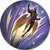

[Тир-лист](https://boostmlbb.ru/heroes/)[Новости и гайды](https://boostmlbb.ru/news/)

# Кайя

B

ПоддержкаРоум

Победы

49,6%

Выбор

0,9%

Баны

31,3%

[Обзор](https://boostmlbb.ru/#overview)[Сборка](https://boostmlbb.ru/#build)[Навыки](https://boostmlbb.ru/#skills)[Контрпики](https://boostmlbb.ru/#draft)[История](https://boostmlbb.ru/#lore)

## Обзор

### Характеристики

-   Живучесть**80**
-   Атака**20**
-   Эффекты**70**
-   Сложность**60**

-   Инициатор
-   Рывок

### Победы по рангам, 30 дней

1.  **48,4%**Эпик
2.  **48,8%**Легенда
3.  **49,7%**Мифик
4.  **50,1%**Честь
5.  **49,8%**Слава

Пунктир: 50% побед

### Другие герои поддержки этой линии

[Марсель](https://boostmlbb.ru/heroes/marcel.html)[Эстес](https://boostmlbb.ru/heroes/estes.html)[Флорин](https://boostmlbb.ru/heroes/floryn.html)[Рафаэль](https://boostmlbb.ru/heroes/rafaela.html)[Ангела](https://boostmlbb.ru/heroes/angela.html)[Дигги](https://boostmlbb.ru/heroes/diggie.html)

## Сборка

Сборка 1Сборка 2Сборка 3

Победы

55,8%

Выбор

14,2%

#### Основные предметы

-   

    Штормовой пояс

-   

    Мимолетное время

-   

    Господство льда

#### Заклинание

Вспышка

#### Эмблема и таланты

Эмблема поддержки

-   

    Ловкость

-   

    Благословение природы

-   

    Квантовый заряд

Победы

53,6%

Выбор

10,1%

#### Основные предметы

-   

    Штормовой пояс

-   

    Мимолетное время

-   

    Господство льда

#### Заклинание

Вспышка

#### Эмблема и таланты

Эмблема поддержки

-   

    Ловкость

-   

    Второе дыхание

-   

    Квантовый заряд

Победы

55,1%

Выбор

2,8%

#### Основные предметы

-   

    Штормовой пояс

-   

    Мимолетное время

-   

    Кираса грубой силы

#### Заклинание

Вспышка

#### Эмблема и таланты

Эмблема поддержки

-   

    Вдохновение

-   

    Благословение природы

-   

    Квантовый заряд

## Навыки

Прокачка**Божественные оковы**_›_**Кольцо порядка**_›_**Парящие крылья**

Пассивный**Крылья молнии**1-й навык**Кольцо порядка**2-й навык**Парящие крылья**Ультимейт**Божественные оковы**

Пассивный

### Крылья молнии

Урон от навыка Кайи накладывает эффект "Паралич" на вражеских юнитов, ненадолго замедляя героев или призванных существ и снижая их урон на 8% на 5 сек.

1-й навык

### Кольцо порядка

Перезарядка **5.5 с**

Кайя призывает кольцо первородной молнии, которое расширяется и возвращается к нему.

Пораженные враги получают 160 (+70% общей магической силы) единиц магического урона и восстанавливают Кайе 78 (+45% общей магической силы) ОЗ. Лечение от последующих попаданий снижается до 33%.

2-й навык

### Парящие крылья

Перезарядка **14 с**

Кайя делает рывок в указанную область, получая иммунитет к контролю во время рывка. По прибытии он наносит 250 (+120% общей магической силы) единиц магического урона, отбрасывая и оглушая ближайших врагов на 0.5 сек., после чего входит в состояние "Парения".

Состояние "Парения" длится 6.6 сек. В течение этого времени он игнорирует препятствия и получает 15% скорости передвижения, но радиус его поворота ограничен. Он может использовать базовые атаки во время движения, нанося 100 (+25% общей магической силы) (+2% от цели) единиц магического урона окружающим врагам. Каждое попадание базовой атакой продлевает состояние "Парения" на 0.2 сек.

При входе в состояние "Парения" перезарядка "Парящих крыльев" сокращается до 4 сек. (не зависит от сокращения перезарядки). Попадание по врагу навыком "Парящие крылья" продлевает состояние "Парения" на 2.6 сек.

Ультимейт

### Божественные оковы

Перезарядка **70 с**

Кайя бросает Аркан первородной молнии в указанную область. После задержки в 0.5 сек. все вражеские герои, оставшиеся в области, получают 360 (+80% общей магической силы) единиц магического урона и оказываются в ловушке на 2.5 сек.

Пока действует навык, Кайя может тянуть аркан, сужая его радиус и притягивая за собой врагов на границе (не прерывает их навыки).

## Контрпики

### Контрпики

Побеждают этого героя

[Валир](https://boostmlbb.ru/heroes/valir.html)[Акай](https://boostmlbb.ru/heroes/akai.html)[Грок](https://boostmlbb.ru/heroes/grock.html)[Баксий](https://boostmlbb.ru/heroes/baxia.html)[Глу](https://boostmlbb.ru/heroes/gloo.html)

### Слабые цели

Этот герой побеждает их

[Одетта](https://boostmlbb.ru/heroes/odette.html)[Люнокс](https://boostmlbb.ru/heroes/lunox.html)[Заск](https://boostmlbb.ru/heroes/zhask.html)

## История

> Лидер назаров, стоящий на страже Небесного дворца.

[Читать полную историю ↗](https://kazukiofficial.com/stories/kaja)Kazuki Official, английский [Характеристики на сайте игры ↗](https://www.mobilelegends.com/hero/detail?heroid=62)

**Поднимем ранг на герое «Кайя»**Цена считается в калькуляторе

[Рассчитать цену](https://boostmlbb.ru/order.html?type=hero)

## Частые вопросы

Кто контрпик для героя «Кайя» в MLBB?

За последние 30 дней чаще всего героя обыгрывают Валир, Акай, Грок, Баксий и Глу.

Какой процент побед у героя «Кайя» сейчас?

49,61% в Мифической славе за последние 7 дней и 49,78% на всех рангах за 30 дней, данные на 24 ноября 2026 года.

Какая роль и линия у героя «Кайя»?

Поддержка, играет в роуме.

Силён ли герой «Кайя» в текущей мете?

Тир B, 30-е место из 133 героев и 6-е среди героев поддержки. Тир учитывает, как часто героя берут и банят и как он выигрывает в Мифической славе за 7 дней: бан в 31,3% матчей, 49,6% побед. В профессиональных матчах за месяц героя драфтуют в 0,7% катков.

Какая сборка на героя «Кайя» лучшая?

Самая популярная сборка в рейтинге: ключевые предметы «Штормовой пояс», «Мимолетное время» и «Господство льда», эмблема поддержки с талантами «Ловкость», «Благословение природы» и «Квантовый заряд» и заклинание «Вспышка». С ней выигрывают 55,84% матчей.
