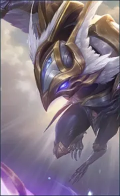

[Тир-лист](https://boostmlbb.ru/heroes/)

# Кайя

B

ПоддержкаРоум

Победы

49,6%

Выбор

0,9%

Баны

30,6%

[Обзор](https://boostmlbb.ru/#overview)[Сборка](https://boostmlbb.ru/#build)[Как играть](https://boostmlbb.ru/#howto)[Навыки](https://boostmlbb.ru/#skills)[Контрпики](https://boostmlbb.ru/#draft)[Скины](https://boostmlbb.ru/#skins)[История](https://boostmlbb.ru/#lore)

## Обзор

### Характеристики

-   Живучесть**80**
-   Атака**20**
-   Эффекты**70**
-   Сложность**60**

-   Инициатор
-   Рывок

### Другие герои поддержки этой линии

[Марсель](https://boostmlbb.ru/heroes/marcel.html)[Эстес](https://boostmlbb.ru/heroes/estes.html)[Флорин](https://boostmlbb.ru/heroes/floryn.html)[Рафаэль](https://boostmlbb.ru/heroes/rafaela.html)[Ангела](https://boostmlbb.ru/heroes/angela.html)[Дигги](https://boostmlbb.ru/heroes/diggie.html)

### Места в рейтингах

-   [Лучшие роумеры MLBB**9 из 34**](https://boostmlbb.ru/heroes/best-roam.html)

## Сборка

Сборка 1Сборка 2Сборка 3

Победы

55,8%

Выбор

13,6%

#### Основные предметы

-   [

    

    Штормовой пояс

    ](https://boostmlbb.ru/items/thunder-belt.html)
-   [

    

    Мимолетное время

    ](https://boostmlbb.ru/items/fleeting-time.html)
-   [

    

    Господство льда

    ](https://boostmlbb.ru/items/dominance-ice.html)

#### Заклинание

Вспышка

#### Эмблема и таланты

Эмблема поддержки

-   

    Ловкость

-   

    Благословение природы

-   

    Квантовый заряд

Победы

54,0%

Выбор

8,7%

#### Основные предметы

-   [

    

    Штормовой пояс

    ](https://boostmlbb.ru/items/thunder-belt.html)
-   [

    

    Мимолетное время

    ](https://boostmlbb.ru/items/fleeting-time.html)
-   [

    

    Господство льда

    ](https://boostmlbb.ru/items/dominance-ice.html)

#### Заклинание

Вспышка

#### Эмблема и таланты

Эмблема поддержки

-   

    Ловкость

-   

    Второе дыхание

-   

    Квантовый заряд

Победы

54,7%

Выбор

3,5%

#### Основные предметы

-   [

    

    Штормовой пояс

    ](https://boostmlbb.ru/items/thunder-belt.html)
-   [

    

    Мимолетное время

    ](https://boostmlbb.ru/items/fleeting-time.html)
-   [

    

    Кираса грубой силы

    ](https://boostmlbb.ru/items/brute-force-breastplate.html)

#### Заклинание

Вспышка

#### Эмблема и таланты

Эмблема поддержки

-   

    Вдохновение

-   

    Благословение природы

-   

    Квантовый заряд

## Как играть за Кайю

### Комбо Кайи

#### В драке

1.  2
2.  1
3.  Ульт

Чтобы начать драку, взлетите вторым навыком и смените позицию за счёт рельефа. Первым замедлите и снизьте урон врагов, сразу ультуйте и дайте команде добить.

#### На линии

1.  1
2.  2
3.  Атака

На линии первым навыком тревожьте и лечитесь. Если враг идёт в драку, взлетайте вторым и кайтите атаками с воздуха.

### Когда сильнее всего

Сильнее в начале: на 10–12 минутах выигрывает 53,2%. Давите на линии, забирайте объекты и заканчивайте, пока преимущество не растаяло.

1.  **53,2**10–12
2.  **51,1**12–14
3.  **48,6**14–16
4.  **47,9**16–18
5.  **48,1**18–20
6.  **48,3**20+

Проценты побед по длине матча в минутах, все ранги. Пунктир: 50%

### Приоритет прокачки

1.  Божественные оковы
2.  Кольцо порядка
3.  Парящие крылья

## Навыки

Пассивный**Крылья молнии**1-й навык**Кольцо порядка**2-й навык**Парящие крылья**Ультимейт**Божественные оковы**

Пассивный

### Крылья молнии

Урон от навыка Кайи накладывает эффект "Паралич" на вражеских юнитов, ненадолго замедляя героев или призванных существ и снижая их урон на 8% на 5 сек.

1-й навык

### Кольцо порядка

Перезарядка **5.5 с**

Кайя призывает кольцо первородной молнии, которое расширяется и возвращается к нему.

Пораженные враги получают 160 (+70% общей магической силы) единиц магического урона и восстанавливают Кайе 78 (+45% общей магической силы) ОЗ. Лечение от последующих попаданий снижается до 33%.

2-й навык

### Парящие крылья

Перезарядка **14 с**

Кайя делает рывок в указанную область, получая иммунитет к контролю во время рывка. По прибытии он наносит 250 (+120% общей магической силы) единиц магического урона, отбрасывая и оглушая ближайших врагов на 0.5 сек., после чего входит в состояние "Парения".

Состояние "Парения" длится 6.6 сек. В течение этого времени он игнорирует препятствия и получает 15% скорости передвижения, но радиус его поворота ограничен. Он может использовать базовые атаки во время движения, нанося 100 (+25% общей магической силы) (+2% от цели) единиц магического урона окружающим врагам. Каждое попадание базовой атакой продлевает состояние "Парения" на 0.2 сек.

При входе в состояние "Парения" перезарядка "Парящих крыльев" сокращается до 4 сек. (не зависит от сокращения перезарядки). Попадание по врагу навыком "Парящие крылья" продлевает состояние "Парения" на 2.6 сек.

Ультимейт

### Божественные оковы

Перезарядка **70 с**

Кайя бросает Аркан первородной молнии в указанную область. После задержки в 0.5 сек. все вражеские герои, оставшиеся в области, получают 360 (+80% общей магической силы) единиц магического урона и оказываются в ловушке на 2.5 сек.

Пока действует навык, Кайя может тянуть аркан, сужая его радиус и притягивая за собой врагов на границе (не прерывает их навыки).

## Контрпики Кайи

### Кто контрит Кайю

[Валир](https://boostmlbb.ru/heroes/valir.html)[Акай](https://boostmlbb.ru/heroes/akai.html)[Грок](https://boostmlbb.ru/heroes/grock.html)[Баксий](https://boostmlbb.ru/heroes/baxia.html)[Глу](https://boostmlbb.ru/heroes/gloo.html)

### Кого контрит Кайя

[Одетта](https://boostmlbb.ru/heroes/odette.html)[Люнокс](https://boostmlbb.ru/heroes/lunox.html)[Заск](https://boostmlbb.ru/heroes/zhask.html)

## Скины Кайи

[Адский надсмотрщикДелюкс · 2023](https://boostmlbb.ru/skins/kaja/inferno-taskmaster.html)[Ворон-магОбычный · 2020](https://boostmlbb.ru/skins/kaja/crow-magician.html)[Небесный заслонИзысканный · 2019](https://boostmlbb.ru/skins/kaja/skyblocker.html)[Хлыст ужасаОбычный · 2019](https://boostmlbb.ru/skins/kaja/horror-whiplash.html)[КаминариИсключительный · 2019](https://boostmlbb.ru/skins/kaja/kaminari.html)[ЗаповедьОбычный · 2018](https://boostmlbb.ru/skins/kaja/commandment.html)

[Все 6 скинов Кайи: цены и как получить](https://boostmlbb.ru/skins/kaja.html)

## История

> Лидер назаров, стоящий на страже Небесного дворца.

[Читать полную историю ↗](https://kazukiofficial.com/stories/kaja)Kazuki Official, английский [Характеристики на сайте игры ↗](https://www.mobilelegends.com/hero/detail?heroid=62)

**Поднимем ранг на герое «Кайя»**Цена считается в калькуляторе

[Рассчитать цену](https://boostmlbb.ru/order.html?type=hero)

## Частые вопросы

Кто контрит Кайю в MLBB?

За последние 30 дней Кайю чаще всего обыгрывают Валир, Акай, Грок, Баксий и Глу.

Как играть за Кайю?

В первую очередь качайте «Кольцо порядка», ульт берите, как только доступен. Сильнее в начале: на 10–12 минутах выигрывает 53,2%. Давите на линии, забирайте объекты и заканчивайте, пока преимущество не растаяло. Комбо для драки: Чтобы начать драку, взлетите вторым навыком и смените позицию за счёт рельефа. Первым замедлите и снизьте урон врагов, сразу ультуйте и дайте команде добить.

Какой процент побед у Кайи сейчас?

49,61% в Мифической славе за последние 7 дней и 49,71% на всех рангах за 30 дней, данные на 27 ноября 2026 года.

Какая роль и линия у Кайи?

Поддержка, играет в роуме.

Стоит ли брать Кайю в текущей мете?

Тир B, 30-е место из 133 героев и 6-е среди героев поддержки. Тир учитывает, как часто героя берут и банят и как он выигрывает в Мифической славе за 7 дней: бан в 30,6% матчей, 49,6% побед. В профессиональных матчах за месяц героя драфтуют в 0,7% катков.

Какая сборка на Кайю лучшая?

Самая популярная сборка в рейтинге: ключевые предметы «Штормовой пояс», «Мимолетное время» и «Господство льда», эмблема поддержки с талантами «Ловкость», «Благословение природы» и «Квантовый заряд» и заклинание «Вспышка». С ней выигрывают 55,79% матчей.
