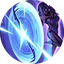
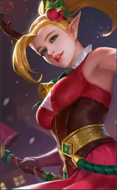

[Тир-лист](https://boostmlbb.ru/heroes/)[Предметы](https://boostmlbb.ru/items/)[Скины](https://boostmlbb.ru/skins/)[Новости и гайды](https://boostmlbb.ru/news/)

# Карина

B

УбийцаЛес

Победы

49,2%

Выбор

0,9%

Баны

4,7%

[Обзор](https://boostmlbb.ru/#overview)[Сборка](https://boostmlbb.ru/#build)[Как играть](https://boostmlbb.ru/#howto)[Навыки](https://boostmlbb.ru/#skills)[Контрпики](https://boostmlbb.ru/#draft)[Скины](https://boostmlbb.ru/#skins)[История](https://boostmlbb.ru/#lore)

## Обзор

### Характеристики

-   Живучесть**50**
-   Атака**70**
-   Эффекты**10**
-   Сложность**50**

-   Добивание
-   Магический урон

### Победы по рангам, 30 дней

1.  **50,0%**Эпик
2.  **49,1%**Легенда
3.  **49,1%**Мифик
4.  **48,4%**Честь
5.  **48,4%**Слава

Пунктир: 50% побед

### Другие убийцы этой линии

[Нолан](https://boostmlbb.ru/heroes/nolan.html)[Хирара](https://boostmlbb.ru/heroes/hirara.html)[Сабер](https://boostmlbb.ru/heroes/saber.html)[Харли](https://boostmlbb.ru/heroes/harley.html)[Фанни](https://boostmlbb.ru/heroes/fanny.html)[Линг](https://boostmlbb.ru/heroes/ling.html)[Ли Сун-Син](https://boostmlbb.ru/heroes/yi-sun-shin.html)[Госсен](https://boostmlbb.ru/heroes/gusion.html)

### Места в рейтингах

-   [Лучшие лесники MLBB**15 из 37**](https://boostmlbb.ru/heroes/best-jungle.html)
-   [Лучшие убийцы MLBB**14 из 29**](https://boostmlbb.ru/heroes/best-assassin.html)

## Сборка

Сборка 1Сборка 2Сборка 3

Победы

57,7%

Выбор

4,4%

#### Основные предметы

-   [

    

    Старлиумовая коса

    ](https://boostmlbb.ru/items/starlium-scythe.html)
-   [

    

    Священный кристалл

    ](https://boostmlbb.ru/items/holy-crystal.html)
-   [

    

    Концентрированная энергия

    ](https://boostmlbb.ru/items/concentrated-energy.html)

#### Заклинание

Возмездие

#### Эмблема и таланты

Эмблема мага

-   

    Трепет

-   

    Мастер оружий

-   

    Убийственный пир

Победы

56,7%

Выбор

3,4%

#### Основные предметы

-   [

    

    Пронзающий небеса

    ](https://boostmlbb.ru/items/sky-piercer.html)
-   [

    

    Старлиумовая коса

    ](https://boostmlbb.ru/items/starlium-scythe.html)
-   [

    

    Священный кристалл

    ](https://boostmlbb.ru/items/holy-crystal.html)

#### Заклинание

Возмездие

#### Эмблема и таланты

Эмблема мага

-   

    Трепет

-   

    Опытный охотник

-   

    Убийственный пир

Победы

57,0%

Выбор

2,8%

#### Основные предметы

-   [

    

    Пронзающий небеса

    ](https://boostmlbb.ru/items/sky-piercer.html)
-   [

    

    Старлиумовая коса

    ](https://boostmlbb.ru/items/starlium-scythe.html)
-   [

    

    Священный кристалл

    ](https://boostmlbb.ru/items/holy-crystal.html)

#### Заклинание

Возмездие

#### Эмблема и таланты

Эмблема мага

-   

    Трепет

-   

    Мастер оружий

-   

    Убийственный пир

## Как играть за Карину

### Комбо Карины

#### В драке

1.  1
2.  Ульт
3.  2
4.  Ульт
5.  Атака

В драке подойдите первым навыком и врежьтесь ультом. Вторым быстро ударьте по площади, ультом вернитесь в теневую форму, затем снова первый и усиленные атаки для погони.

#### На линии

1.  1
2.  Атака
3.  2
4.  Атака

На линии первым войдите в танец клинков и прыгните усиленной атакой. Вторым и атаками включите пассивку.

### Когда сильнее всего

Сильнее в долгой игре: на 18–20 минутах выигрывает 54,1%. Не рискуйте в начале, фармите и ввязывайтесь в драки вместе с командой.

1.  **40,2**10–12
2.  **47,2**12–14
3.  **50,8**14–16
4.  **53,2**16–18
5.  **54,1**18–20
6.  **53,5**20+

Проценты побед по длине матча в минутах, все ранги. Пунктир: 50%

### Приоритет прокачки

1.  Теневая атака
2.  Танец смерти
3.  Танец клинков

## Навыки

Пассивный**Теневое комбо**1-й навык**Танец клинков**2-й навык**Танец смерти**Ультимейт**Теневая атака**

Пассивный

### Теневое комбо

Третья последовательная атака Карины по одному и тому же врагу наносит 100 (+5 (+2.5% общей магической силы)% от потерянных цели) единиц дополнительного чистого урона.

Если целью является вражеский герой, эта атака также сокращает перезарядку ее навыков (кроме ультимейта) на 1.5 сек.

Урон по монстрам ограничен 2000 ед. чистого урона.

1-й навык

### Танец клинков

Перезарядка **6 Mana Cost: 50 с**

Карина переходит в состояние "Танца клинков" на время до 3.5 сек., получая 45% скорости передвижения и блокируя все базовые атаки. Заблокированные атаки вызывают контратаку, которая наносит 100 (+30% общей магической силы) единиц магического урона атакующему (запускает "Теневой клинок" в атакующих дальнего боя или активирует "Танец клинков" против атакующих ближнего боя).

Этот эффект имеет перезарядку 0.4 сек.

Применение базовой атаки или "Теневой атаки" прерывает состояние "Танца клинков", усиливая следующую базовую атаку Карины, которая наносит 160 (+60% общей магической силы) единиц критического магического урона и замедляет цель на 45% на 1 сек.

2-й навык

### Танец смерти

Перезарядка **6 Mana Cost: 60 с**

Карина совершает круговой удар, нанося 375 (+125% общей магической силы) единиц магического урона ближайшим врагам.

Ультимейт

### Теневая атака

Перезарядка **34 Mana Cost: 100 с**

Карина устремляется к вражескому герою, нанося 350 (+160% общей магической силы) единиц магического урона, накладывая на цель "Теневой знак" и оставляя "Теневую форму" позади нее.

"Теневой знак" и "Теневая форма" длятся 5 сек. Если цель умирает в течение этого времени, перезарядка этого навыка немедленно сбрасывается.

**Повторное использование:** Карина быстро перемещается к "Теневой форме", нанося 150 (+50% общей магической силы) единиц магического урона врагам на пути.

## Контрпики Карины

### Кто контрит Карину

[Наталья](https://boostmlbb.ru/heroes/natalia.html)[Кимми](https://boostmlbb.ru/heroes/kimmy.html)[Марсель](https://boostmlbb.ru/heroes/marcel.html)[Линг](https://boostmlbb.ru/heroes/ling.html)[Хелкарт](https://boostmlbb.ru/heroes/helcurt.html)

### Кого контрит Карина

[Грейнджер](https://boostmlbb.ru/heroes/granger.html)[Пакито](https://boostmlbb.ru/heroes/paquito.html)[Броуди](https://boostmlbb.ru/heroes/brody.html)[Клинт](https://boostmlbb.ru/heroes/clint.html)[Сора](https://boostmlbb.ru/heroes/sora.html)[Хирара](https://boostmlbb.ru/heroes/hirara.html)[Люнокс](https://boostmlbb.ru/heroes/lunox.html)[Руби](https://boostmlbb.ru/heroes/ruby.html)[Харит](https://boostmlbb.ru/heroes/harith.html)[Фарамис](https://boostmlbb.ru/heroes/faramis.html)

## Скины Карины

[Чемпионка ключаОбычный · 2025](https://boostmlbb.ru/skins/karina/keyforged-champion.html)[Кровавая лунаОбычный · 2020](https://boostmlbb.ru/skins/karina/blood-moon.html)[Близнецы: СияниеДелюкс · 2019](https://boostmlbb.ru/skins/karina/gemini-halo.html)[ЛеонаГрандиозный · 2019](https://boostmlbb.ru/skins/karina/leona.html)[Роковая дуэлянткаИзысканный · 2018](https://boostmlbb.ru/skins/karina/doom-duelist.html)[Паучья лилияОбычный · 2018](https://boostmlbb.ru/skins/karina/spider-lily.html)[Чёрная жемчужинаИсключительный · 2017](https://boostmlbb.ru/skins/karina/black-pearl.html)[Рож­дественский карнавалИсключительный · 2016](https://boostmlbb.ru/skins/karina/christmas-carnival.html)[Призрачный клинокОбычный · 2016](https://boostmlbb.ru/skins/karina/phantom-blade.html)

[Все 9 скинов Карины: цены и как получить](https://boostmlbb.ru/skins/karina.html)

## История

> Убийца из племени темных эльфов, которая пытается спасти свою сестру Селену.

[Читать полную историю ↗](https://play.mobilelegends.com/lore/hero/Karina)Официальный сайт Mobile Legends [Характеристики на сайте игры ↗](https://www.mobilelegends.com/hero/detail?heroid=8)

**Поднимем ранг на герое «Карина»**Цена считается в калькуляторе

[Рассчитать цену](https://boostmlbb.ru/order.html?type=hero)

## Частые вопросы

Кто контрит Карину в MLBB?

За последние 30 дней Карину чаще всего обыгрывают Наталья, Кимми, Марсель, Линг и Хелкарт.

Как играть за Карину?

В первую очередь качайте «Танец смерти», ульт берите, как только доступен. Сильнее в долгой игре: на 18–20 минутах выигрывает 54,1%. Не рискуйте в начале, фармите и ввязывайтесь в драки вместе с командой. Комбо для драки: В драке подойдите первым навыком и врежьтесь ультом. Вторым быстро ударьте по площади, ультом вернитесь в теневую форму, затем снова первый и усиленные атаки для погони.

Какой процент побед у Карины сейчас?

49,16% в Мифической славе за последние 7 дней и 48,74% на всех рангах за 30 дней, данные на 25 ноября 2026 года.

Какая роль и линия у Карины?

Убийца, играет в лесу.

Стоит ли брать Карину в текущей мете?

Тир B, 64-е место из 133 героев и 14-е среди убийц. Тир учитывает, как часто героя берут и банят и как он выигрывает в Мифической славе за 7 дней: бан в 4,7% матчей, 49,2% побед. В профессиональных матчах за месяц героя драфтуют в 0,0% катков.

Какая сборка на Карину лучшая?

Самая популярная сборка в рейтинге: ключевые предметы «Старлиумовая коса», «Священный кристалл» и «Концентрированная энергия», эмблема мага с талантами «Трепет», «Мастер оружий» и «Убийственный пир» и заклинание «Возмездие». С ней выигрывают 57,71% матчей.
