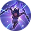

[Главная](https://boostmlbb.ru/) / [Герои](https://boostmlbb.ru/heroes/)

Тир C

# Карина

Убийца · Лес

**№ 100 из 133 по доле побед**Все ранги · 30 дней по 23 ноября 2026 года

Победы

48,60%

Выбор

0,91%

Баны

4,55%

Добивание · Магический урон · Сложность 50/100

[Сборка](https://boostmlbb.ru/#build)[Контрпики и союзники](https://boostmlbb.ru/#draft)[Навыки](https://boostmlbb.ru/#skills)[Победы по рангам](https://boostmlbb.ru/#ranks)[История](https://boostmlbb.ru/#lore)

## Сборка

Самый частый выбор в рейтинге · Лес

Ключевые предметы

Пронзающий небесаСтарлиумовая косаСвященный кристалл

Эмблема и таланты

Эмблема магаТрепетМастер оружийУбийственный пир

Боевое заклинание

Возмездие

Побед с этой сборкой **57,00%**Выбирают в **2,75%** матчей

Другие сборки (2)

Ключевые предметы

Старлиумовая косаСвященный кристаллКонцентрированная энергия

Эмблема и таланты

Эмблема магаТрепетМастер оружийУбийственный пир

Боевое заклинание

Возмездие

Побед с этой сборкой **57,71%**Выбирают в **4,39%** матчей

Ключевые предметы

Пронзающий небесаСтарлиумовая косаСвященный кристалл

Эмблема и таланты

Эмблема магаТрепетОпытный охотникУбийственный пир

Боевое заклинание

Возмездие

Побед с этой сборкой **56,72%**Выбирают в **3,37%** матчей

## Контрпики и союзники

### Кто контрит

[Наталья](https://boostmlbb.ru/heroes/natalia.html)[Кимми](https://boostmlbb.ru/heroes/kimmy.html)[Марсель](https://boostmlbb.ru/heroes/marcel.html)[Линг](https://boostmlbb.ru/heroes/ling.html)[Хелкарт](https://boostmlbb.ru/heroes/helcurt.html)

### Против кого силён

[Грейнджер](https://boostmlbb.ru/heroes/granger.html)[Пакито](https://boostmlbb.ru/heroes/paquito.html)[Броуди](https://boostmlbb.ru/heroes/brody.html)[Клинт](https://boostmlbb.ru/heroes/clint.html)[Сора](https://boostmlbb.ru/heroes/sora.html)[Хирара](https://boostmlbb.ru/heroes/hirara.html)[Люнокс](https://boostmlbb.ru/heroes/lunox.html)[Руби](https://boostmlbb.ru/heroes/ruby.html)[Харит](https://boostmlbb.ru/heroes/harith.html)[Фарамис](https://boostmlbb.ru/heroes/faramis.html)

### Союзники

Прибавка к доле побед в одной команде

[Чип+2,30 п. п.](https://boostmlbb.ru/heroes/chip.html)[Бенедетта+1,46 п. п.](https://boostmlbb.ru/heroes/benedetta.html)[Ванван+1,13 п. п.](https://boostmlbb.ru/heroes/wanwan.html)[Цзэтянь+1,03 п. п.](https://boostmlbb.ru/heroes/zetian.html)

## Навыки

Приоритет прокачки · Теневая атака → Танец смерти → Танец клинков

Пассивный**Теневое комбо**

Третья последовательная атака Карины по одному и тому же врагу наносит 100 (+5 (+2.5% общей магической силы)% от потерянных цели) единиц дополнительного чистого урона.
Если целью является вражеский герой, эта атака также сокращает перезарядку ее навыков (кроме ультимейта) на 1.5 сек.
Урон по монстрам ограничен 2000 ед. чистого урона.

1-й навык**Танец клинков**

**Перезарядка 6 Mana Cost: 50 с**

Карина переходит в состояние "Танца клинков" на время до 3.5 сек., получая 45% скорости передвижения и блокируя все базовые атаки. Заблокированные атаки вызывают контратаку, которая наносит 100 (+30% общей магической силы) единиц магического урона атакующему (запускает "Теневой клинок" в атакующих дальнего боя или активирует "Танец клинков" против атакующих ближнего боя).
Этот эффект имеет перезарядку 0.4 сек.
Применение базовой атаки или "Теневой атаки" прерывает состояние "Танца клинков", усиливая следующую базовую атаку Карины, которая наносит 160 (+60% общей магической силы) единиц критического магического урона и замедляет цель на 45% на 1 сек.

2-й навык**Танец смерти**

**Перезарядка 6 Mana Cost: 60 с**

Карина совершает круговой удар, нанося 375 (+125% общей магической силы) единиц магического урона ближайшим врагам.

Ультимейт**Теневая атака**

**Перезарядка 34 Mana Cost: 100 с**

Карина устремляется к вражескому герою, нанося 350 (+160% общей магической силы) единиц магического урона, накладывая на цель "Теневой знак" и оставляя "Теневую форму" позади нее.
"Теневой знак" и "Теневая форма" длятся 5 сек. Если цель умирает в течение этого времени, перезарядка этого навыка немедленно сбрасывается.
Повторное использование: Карина быстро перемещается к "Теневой форме", нанося 150 (+50% общей магической силы) единиц магического урона врагам на пути.

## Победы по рангам

-   Эпик**49,89%**
-   Легенда**48,95%**
-   Мифический**48,87%**
-   Мифическая честь**48,23%**
-   Мифическая слава**48,29%**

## История

Убийца из племени темных эльфов, которая пытается спасти свою сестру Селену.

[Читать историю](https://play.mobilelegends.com/lore/hero/Karina)[Карточка героя](https://www.mobilelegends.com/hero/detail?heroid=8)[MLBB Wiki](https://mobile-legends.fandom.com/wiki/Karina)

[Стоимость буста на герое](https://boostmlbb.ru/order.html?type=hero)

## Частые вопросы

Кто контрпик для героя «Карина» в MLBB?

За последние 30 дней чаще всего героя обыгрывают Наталья, Кимми, Марсель, Линг и Хелкарт.

Какой процент побед у героя «Карина» сейчас?

48,60% за последние 30 дней на всех рангах и 48,29% в Мифической славе, данные на 23 ноября 2026 года.

Какая роль и линия у героя «Карина»?

Убийца, играет в лесу.

Силён ли герой «Карина» в текущей мете?

Тир C: 100-е место из 133 героев по проценту побед за 30 дней и 19-е среди убийц.

Какая сборка на героя «Карина» лучшая?

Самая популярная сборка в рейтинге: ключевые предметы «Пронзающий небеса», «Старлиумовая коса» и «Священный кристалл», эмблема мага с талантами «Трепет», «Мастер оружий» и «Убийственный пир» и заклинание «Возмездие». С ней выигрывают 57,00% матчей.
